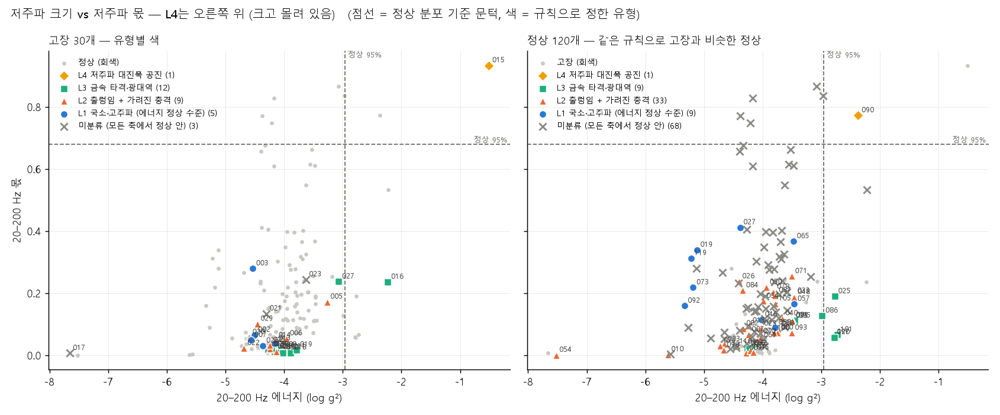
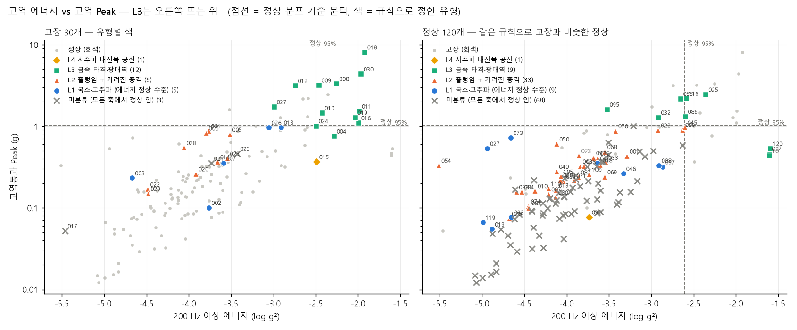
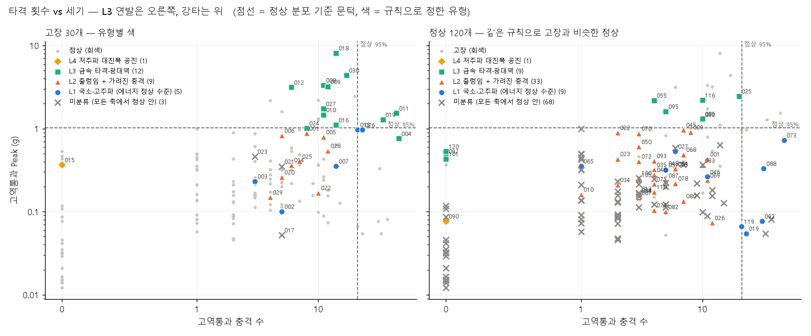
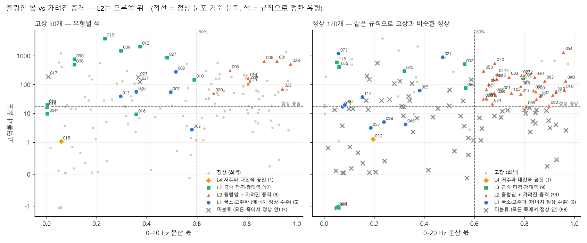
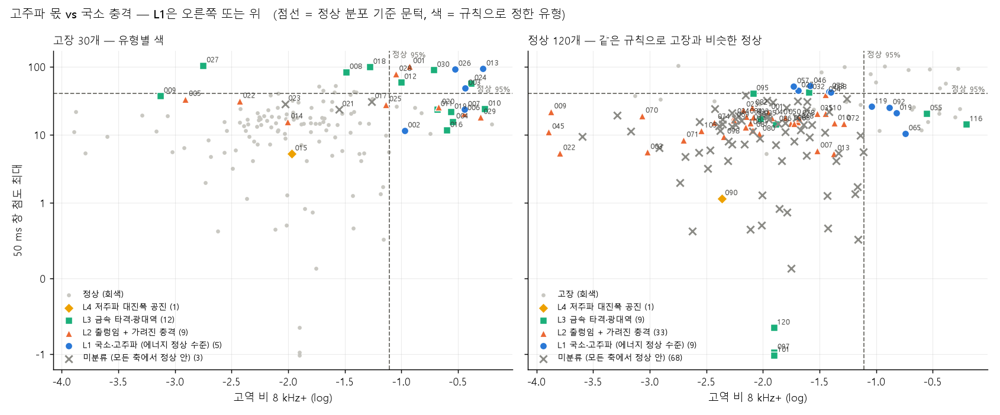

# 2-1 고장 도메인 유형 분류 — 산포도로 고장 30개·정상 120개를 L1–L4에 나누기 (옛 2-0)

상태: 1차 (11-16), 사용자 확인 대기
추가 조각: [2-0-2 EXP-027 유의 피처·스펙트럼 모양 산포도](자료/2-0_2_가족단위피처산포도.md) (11-16)
코드: [2-1_유형산포도.py](자료/2-0_유형산포도.py) → `figs/` (그림 1–5 · [types.csv](자료/figs/types.csv) 파일별 유형·지표 · [summary.txt](자료/figs/summary.txt))
지표 값: [EDA 뷰어](../EDA뷰어/README.md)가 계산한 값 그대로 (`EDA뷰어/figs/features_raw.csv`·`features_hp.csv`, 뷰어 빌드 때 함께 저장)

## 결론
- 1-3의 도메인 유형 4개를 지표 규칙으로 옮기면 **고장 30개 중 27개가 유형에 들어간다**: L3 금속 타격 12 · L2 출렁임+가려진 충격 9 · L1 국소·고주파 5 · L4 저주파 공진 1 · 미분류 3(017 021 023)
- 같은 규칙을 정상에 적용하면 유형마다 "고장과 닮은 정상"이 나온다. **겹침 정도가 유형마다 크게 다르다**
  - **L3 연발**(충격 수 > 정상 95%와 큰 에너지가 함께): 고장 004 011 019만, 정상 0 → 깨끗이 갈림
  - **L3 강타**: 정상 6개(025 032 055 086 095 116)가 같은 자리. 최종 모델 EXP-025의 오경보(025 5/5 · 116 4/5 · 055 3/5)가 **모두 여기서 나온다** = 2-11의 N-A "큰 사건 한 번"
  - **L2**: 고장 9 vs 정상 33. 이 두 축(0–20 Hz 몫 · 고역통과 첨도)은 정상 운전 상태와 거의 구분되지 않는다. EXP-025가 끝까지 놓치는 022(5/5)가 이 유형
  - **L4**: 고장 015 하나, 닮은 정상 090 하나. (11-16 수정: 처음엔 20–200 Hz 에너지 크기만 봐서 평균 −1 g 파일 097·101·120이 걸렸다. 이 셋은 20–200 Hz 몫이 6%뿐이고 에너지가 12.4 kHz에 몰려 있다 → "몫 > 정상 95%" 조건을 더해 뺐고, 지금은 200 Hz 이상 에너지가 커서 L3 광대역으로 간다)
  - **L1**: 고장 5 vs 정상 9. 에너지는 정상 수준이고 고주파 몫·짧은 창 첨도만 높다
- 1-3이 예로 든 파일과 비교: L2(005 022 028) · L3(004 008) · L4(015)는 일치. **L1 예시(014 017 021)는 우리 지표로는 L1이 아니다** — 014는 L2, 017·021은 미분류. 021의 "11 kHz 링잉"은 우리 데이터에서 고주파 에너지가 정상 26% 분위라 보이지 않는다

## 방법
1. 뷰어 지표 중 1-3의 "신호 징후"에 해당하는 8개를 고른다 (아래 표)
2. 문턱은 **정상 분포 분위만** 쓴다(정상 95% · 정상 중앙, 0–20 Hz는 뷰어 태그 "저주파 흔들림 우세"의 60%). 라벨은 색칠과 집계에만
3. 위에서부터 처음 맞는 유형 하나를 준다: L4 → L3 → L2 → L1 → 미분류. 순서는 "더 진행된 열화의 징후가 앞" (강한 타격이 있는 파일은 출렁임이 있어도 L3)
4. 같은 규칙을 정상 120개에도 그대로 적용한다

| 유형 (1-3 열화 단계) | 물리 상태 | 규칙 (뷰어 지표, 신호) | 문턱 값 |
|---|---|---|---|
| **L4** 체결 이완·구조 공진 | 암 전체가 저주파로 크게 떨림, 에너지가 저주파에 몰림, 충격 없음 | `e20_200`(평균 제거) > 정상 95% **이고** 20–200 Hz 몫(`s200 − s20`) > 정상 95% **이고** 충격 수 `n_imp`(고역통과) ≤ 2 | −2.96 log g² · 0.68 |
| **L3** 볼조인트 마모·금속 타격 | 볼스터드–하우징 충돌, 광대역 에너지 | `e200`(평균 제거) > 정상 95% **또는** Peak `maxabs`(고역통과) > 정상 95% | −2.60 log g² · 1.02 g |
| └ 연발 / 강타 / 광대역 | | 충격 수 > 정상 95%(21.1) → 연발, 아니면 Peak > 95% → 강타, 둘 다 아니면 광대역 | |
| **L2** 부싱 유격 확대 | 저주파 출렁임 끝단에서 타격, 원신호 첨도는 묻힘 | 0–20 Hz 몫 `s20`(평균 제거) ≥ 0.6 **이고** 첨도 `kurt`(고역통과) > 정상 중앙 | 0.6 · 17.4 |
| **L1** 초기 미세 열화 | 에너지는 정상 수준, 짧은 틱·고주파 링잉 | 고역 비 `hi_ratio`(고역통과) > 정상 95% **또는** 창 첨도 최대 `win_kurt_max`(고역통과) > 정상 95% | −1.11 · 40.5 |
| 미분류 | 위 어느 축에서도 정상 범위 안 | | |

## 그림

### ① L4 — 저주파 크기 vs 저주파 몫

읽는 법: 왼쪽 = 고장(색 = 유형, 회색 = 정상), 오른쪽 = 정상(색 = 같은 규칙으로 닮은 유형, 회색 = 고장). 점선 = 정상 95%.
- 오른쪽 위 끝 015 = 20–200 Hz 에너지 −0.51(정상 최대 −2.22(nor_030)보다 1.7자리 큼), 몫 0.93(정상 최대 0.865, 고장 2위 003 0.28). 크기와 몫 모두에서 혼자 떨어져 있다
- 정상 090(몫 0.77)만 같은 칸. 097·101·120은 크기는 선 바로 오른쪽이지만 몫이 0.06이라 아래 오른쪽 구석

### ② L3 — 고역 에너지 vs 고역 Peak

- 오른쪽(200 Hz 이상 에너지 > 정상 95%) 또는 위(Peak > 1.02 g)가 L3. 고장 12개 중 10개가 오른쪽 위 모서리 근처에 몰린다
- 정상은 위쪽 선 근처에 6개(025 032 055 086 095 116, 강타)와 오른쪽 끝 097·101·120(Peak 0.4–0.5 g, 평균 −1 g 파일 = 광대역). 097·101·120은 충격 없이 12.4 kHz 에너지만 큰 측정이라 L3라기보다 설치 차이로 읽는다
- 017은 왼쪽 아래 끝 — 가장 조용한 파일. 어느 에너지로도 고장이라 할 수 없다

### ③ L3 세부 — 타격 횟수 vs 세기

- 오른쪽 아래 004·011·019 = 충격 34–46번인데 하나하나는 정상 Peak 범위 = **연발형**(2-12의 "하중은 작은데 타격 반복"과 같은 파일). 정상 중 충격 21번 넘는 파일 6개(019 073 088 092 103 118, 23–47번)는 Peak가 0.05–0.73 g로 작아 L3가 아니다(4개는 L1, 2개는 미분류)
- 위쪽(Peak > 1 g) **강타형**은 고장 8개와 정상 6개가 같은 높이·비슷한 횟수(5–20번)에 섞여 있다. 이 그림의 두 축만으로는 못 가른다 → 2-11의 "두 번째 사건 높이"(정상 N-A는 0.00–0.16)가 갈라야 할 정보

### ④ L2 — 출렁임 몫 vs 가려진 충격

- 오른쪽 위(0–20 Hz ≥ 60%, 고역통과 첨도 > 정상 중앙)에 고장 9개와 정상 33개가 고르게 섞인다. **정상에서 흔한 운전 상태**라 L2 규칙은 "유형 설명"일 뿐 고장 판별 근거가 못 된다
- 022는 가운데(첨도 72, 정상 76% 분위)라 어느 축에서도 튀지 않는다 → 2-13의 주기 잠금(느린 파형 반복 + 충격이 주기에 잠김)이 필요한 이유

### ⑤ L1 — 고주파 몫 vs 국소 충격

- 고장 L1 5개 중 002·007·013·026·003은 고역 비가 오른쪽(> 정상 95%)에 있다. 고장 30개 중 고역 비 > 정상 95%인 파일이 18개로 가장 고장 쪽인 축이지만(뷰어 태그 "고주파 우세" 6/18), 대부분은 이미 L3·L2로 먼저 분류됐다
- 정상 L1 9개는 둘로 나뉜다: 고역 비로 걸린 4개(019 065 092 119)와 창 첨도 최대로 걸린 5개(027 046 057 073 088). 고장 L1은 5개 모두 고역 비로 걸렸다 → 창 첨도 쪽 정상은 고장 L1과 성격이 다를 수 있다

## 유형별 파일 (고장 · 닮은 정상 · 최종 모델 EXP-025 결과)
| 유형 | 고장 | EXP-025 놓침 (5번 중) | 닮은 정상 | EXP-025 오경보 (5번 중) |
|---|---|---|---|---|
| L4 저주파 공진 | 015 | 없음 | 090 | 없음 |
| L3 연발 | 004 011 019 | 없음 | 없음 | — |
| L3 강타 | 008 009 010 012 016 018 027 030 | 없음 | 025 032 055 086 095 116 | **025 5 · 116 4 · 055 3** |
| L3 광대역 | 024 | 없음 | 097 101 120 (평균 −1 g 파일) | 없음 |
| L2 출렁임+충격 | 001 005 006 014 020 022 025 028 029 | **022 5** · 005 1 | 33개 (001 003 007 009 010 013 022 023 026 033 034 035 040 045 048 050 054 068 069 070 071 072 074 078 080 082 084 087 093 098 100 105 110) | 054 1 |
| L1 국소·고주파 | 002 003 007 013 026 | 없음 | 019 027 046 057 065 073 088 092 119 | 027 1 · 065 1 |
| 미분류 | 017 021 023 | 없음 | 68개 | 059 3 · 039 1 · 106 1 |

## 해석
1. **모델의 남은 오류는 유형 두 곳에 몰린다.** 오경보 = L3 강타형 정상(큰 사건 한 번), 놓침 = L2 고장 022. 다음 피처는 이 두 자리를 가르는 정보여야 한다 — 00_NOW 다음 할 일 1번("가장 큰 사건을 가린 Peak·파고율")은 L3 강타 칸을, 2-13 주기 잠금은 L2 칸을 겨냥한다
2. **"레벨이 높을수록 쉽다"는 대체로 맞다.** L3 연발·L4는 정상과 겹치지 않고, L2·L1은 정상과 크게 겹친다(1-3 논의 "L1–L2가 사각지대"와 같은 방향). 단 L3 강타는 정상 큰 사건과 겹쳐 예외
3. 미분류 고장 3개(017 021 023)는 이 8개 축 어디서도 정상 범위 안이다. 017은 2-12 유격 반복 규칙으로 EXP-025에서 잡힌다 — 즉 **이 분류 축에 없는 정보(사건 간 크기 비, 하중 대비 고주파)**로 잡혔다
4. 002·029(2-11의 "8.25 kHz 조용한형")는 각각 L1·L2로 갈렸다. 8 kHz 두 모드 차이는 이 분류의 축이 아니라서 같은 무리로 묶이지 않는다

## 뷰어에서 같은 그림 보기
뷰어 왼쪽 메뉴 → **산점도**, 머리줄 "신호"로 평균 제거/200 Hz 고역통과를 고른다. x·y 지표와 로그 설정:

| 그림 | 신호 | x | y |
|---|---|---|---|
| ① | 평균 제거 | 20–200 Hz 에너지 | 20–200 Hz 몫 — **뷰어에 없음**(0–200 Hz 비율 − 0–20 Hz 비율) | 
| ② | **섞임** — x는 평균 제거의 200 Hz 이상 에너지, y는 고역통과 Peak | | |
| ③ | 200 Hz 고역통과 | 충격 수 (부호 로그) | Peak (로그) |
| ④ | **섞임** — x는 평균 제거의 0–20 Hz 비율, y는 고역통과의 첨도 | | |
| ⑤ | 200 Hz 고역통과 | 고역 비 (8 k+ / 전체) | 창 첨도 최대 (로그) |

- ②·④는 뷰어의 신호 전환이 두 축에 함께 걸려서 그대로는 못 그린다(고역통과 쪽 0–20 Hz 비율은 필터 찌꺼기). 평균 제거 신호에서 x = 0–20 Hz 비율, y = 첨도로 보면 출렁임에 가려 충격이 안 보이는 것 자체를 확인할 수 있다
- 뷰어 산점도의 검은 테두리 = 최종 모델이 틀린 파일. 유형 색은 뷰어에 아직 없다(필요하면 types.csv를 뷰어에 실어 "묶기 = 도메인 유형"을 추가)

## 주의 (틀렸을 수 있는 점)
- **완전한 사전 고정이 아니다.** 문턱은 정상 분위만 썼지만, 어떤 지표를 고를지는 고장 30개의 값을 본 뒤 정했다. 설명용 분류이고 모델 입력·선택에 쓰지 않는다
- 규칙 순서가 결과를 바꾼다. 예: 001·005·006은 강한 고역 충격이 있어도 L3 문턱(Peak 1.02 g)을 조금 밑돌아 L2로 갔다(001 0.88 g, 005 0.79 g, 006 0.83 g). 경계 파일은 두 유형의 성격을 함께 가진 것으로 읽는다
- "열화 단계"는 1-3과 같이 **해석**이다. 진행 시간 정보가 없어 L1→L4 순서는 확인할 수 없다. 발표에서는 "신호 유형"으로 말한다
- 1-3 합의("유형별 라벨링·분류하지 않는다", 11-14)를 사용자 요청(11-16)으로 바꿔 설명용으로만 분류했다 → [결정](../../1_기준·기록/결정.md) "고장 유형 분류"
