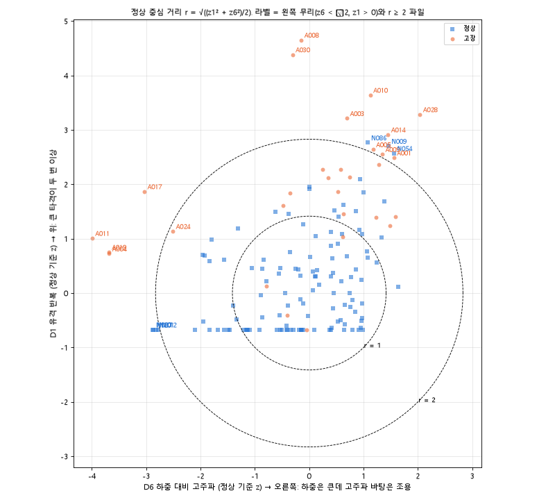
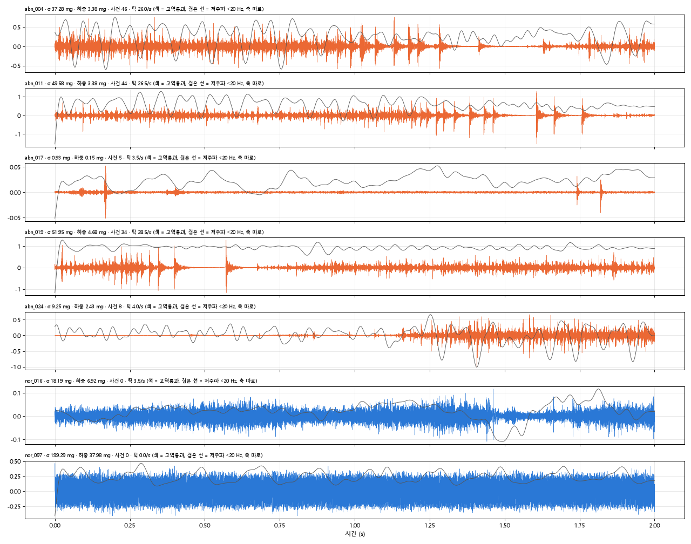
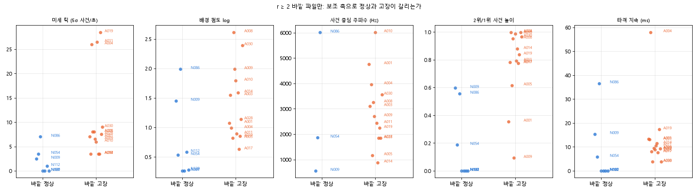

# 2-5 유격 반복 · 하중 대비 고주파 — 정상 중심에서 먼 파일이 고장인가 (옛 2-12)

상태: 5차 (2026-11-14, EXP-025로 검증). 코드 [run.py](자료/run.py), 수치 [figs/numbers.txt](자료/figs/numbers.txt), 파일별 값 [figs/features.csv](자료/figs/features.csv)
출발점: EXP-021이 늘 놓치는 014·017 (신호가 거의 없는 고장). 실험(EXP) 아님 · 이 문서의 규칙은 [EXP-025](../../5_모델실험/2_규칙발견/EXP-025_유격반복규칙/README.md)에서 검증

## 접근 — 어떤 가설로 시작했나 (사용자 11-14)
1. **"신호가 거의 없는 고장(014·017)은 정상과 다른 특징을 도메인 지식에서 뽑아야 한다."** 점수만 보고 피처를 쌓지 않고, 열화 단계 가설(1-3: L1 미세 유격 → L2 부싱 유격 확대 → L3 볼조인트 금속 타격 → L4 체결 이완)에서 "조용한 고장이라면 신호에 무엇이 남는가"를 먼저 적고 그 특징을 계산했다
2. 조용한 파일만 모아(고역통과 바탕 σ 하위 40개 = 고장 11 · 정상 29, 라벨 없이 고정) 아래 가설 특징을 비교했다

| id | 도메인 가설 → 신호 징후 | 정의 | 결과 |
|---|---|---|---|
| **D1 유격 반복** | 미세 유격 → 하중이 걸릴 때마다 큰 타격이 **반복** (H1) | log10(두 번째로 큰 사건 / σ) | **채택** (조용한 무리 AUC 0.92, 150개 0.87) |
| D2 미세 틱 | L1 "틱" → 8σ보다 작은 타격이 잦다 | 5σ 사건 수/초 | 왼쪽 무리(L3)만 강함 |
| D3 배경 첨도 | 큰 사건을 가린 뒤에도 마찰·미세 충돌로 뾰족함이 남는다 | 8σ 사건 ±10 ms 가린 h의 첨도 | 약함 (0.75) |
| D4 사건 중심 주파수 | 조인트를 거친 타격은 암의 저차 모드(1–3 kHz)를 울린다 | 상위 8사건 10 ms 창 스펙트럼 중심 | 014는 맞지만(884 Hz) 일반화 안 됨 (0.36) |
| D5 마찰-속도 동기 | 윤활 소실 → 미끄럼 속도가 클 때 고주파가 커진다 | corr(고주파 포락선, \|저주파 속도\|) | 기각 (0.51) |
| **D6 하중 대비 고주파** | 같은 하중에 고주파 바탕이 덜/더 나온다 (부싱 강성·전달) | log10(저주파 RMS / σ) | **채택** (D1과 함께일 때) |
| D7 배경 모양 | 부싱 강성 변화 → 공진 위치·감쇠 (H2) | 사건 가린 배경 PSD 중심·평탄도 | 약함 |
| D8 타격 지속 | 정상은 덜컹거림 덩어리, 고장은 짧은 타격 | 포락선이 사건 최고점 20% 위에 머무는 시간 | 기각 (014 11.5 ms vs 정상 009 15.4 ms) |
| R 2위/1위 | 유격 타격은 같은 간극·질량이라 크기가 고르다 | 두 번째 / 첫 번째 사건 높이 | **보조 축으로 채택** (r ≥ 2 안에서) |

3. 비교해 보니 **014와 017은 다른 "조용함"** 이었다(014 = 하중은 큰데 고주파 바탕만 조용, 017 = 하중 자체가 없음) → 따로 본다
4. 채택한 D1·D6 두 축 산점도에서 **"바깥쪽에 고장이 많다"** (사용자 관찰) → 정상 중심 거리 r로 정리 → 바깥에서 남는 정상을 가를 보조 축 R → 규칙 "r ≥ 2 이고 R ≥ 0.7이면 고장"

## 두 축 (도메인 가설로 먼저 정의, 라벨 무관)
| 축 | 가설 | 정의 |
|---|---|---|
| **D1 유격 반복** | 유격이 있으면 하중이 걸릴 때마다 큰 타격이 반복된다 (H1) | log10(두 번째로 큰 사건 높이 / σ) |
| **D6 하중 대비 고주파** | 암의 출렁임(하중)이 고주파 바탕의 몇 배인가 | log10(저주파(<20 Hz) RMS / σ) |

- σ = 200 Hz 고역통과 신호의 1.4826·MAD (충격에 둔감한 바탕 수준). 사건 = \|h\| > 8σ, 10 ms 안은 한 사건
- 그림은 두 축을 정상 120개 기준 로버스트 z(중앙값·MAD)로 맞추고, 정상 중심 거리 r = √((z1² + z6²)/2)

| r | 파일 | 고장 (비율) |
|---|---|---|
| 0–1 | 87 | 4 (5%) — 002 015 016 020 |
| 1–1.5 | 33 | 6 (18%) |
| 1.5–2 | 10 | 7 (70%) |
| 2 이상 | 20 | 13 (65%) |

- **정상 중심에서 멀수록 고장이다.** 안쪽 고장 4개 중 002는 8.3 kHz 규칙, 016·020은 기존 모델이 잡는다
- 014(r 2.30)·017(2.52)은 둘 다 r ≥ 2다. 014는 오른쪽 위, 017은 왼쪽

## 질문 1 — 왼쪽 무리는 어떤 데이터인가 (z6 < −2, z1 > 0)

| 파일 | 고주파 바탕 σ | 하중 (저주파 RMS) | 큰 사건 수 | 미세 틱 (5σ/초) | 모양 |
|---|---|---|---|---|---|
| abn_004 | 37.3 mg | 3.4 mg | 46 | 26.0 | 2초 내내 연속 타격 |
| abn_011 | 49.6 mg | 3.4 mg | 44 | 26.5 | 연속 타격 → 후반 굵은 타격 |
| abn_019 | 52.0 mg | 4.7 mg | 34 | 28.5 | 연속 타격 + 굵은 타격 3번 |
| abn_024 | 9.3 mg | 2.4 mg | 8 | 4.0 | 1.25초부터 타격 다발 |
| abn_017 | 0.9 mg | 0.15 mg | 5 | 3.5 | 거의 무신호 + 타격 4번 |
| (정상 중앙) | 7.1 mg | 21.1 mg | 3 | 3.2 | |

- **이 자리에는 고장 5개만 있다.** 같은 왼쪽(z6 < −2)의 정상 5개(016·097·101·112·120)는 D1이 낮아(z ≤ −0.67) 아래쪽에 있다. 이 정상들은 **8σ 사건이 0개**인 고른 잡음이다(그림 아래 두 줄. 097·101·120은 σ 약 199 mg인 평균 −1 g 파일, 112는 아주 조용한 파일)
- 공통점: **하중(암의 출렁임)은 정상의 1/5–1/100로 작은데, 큰 타격이 반복된다**

**도메인 연결 (1-3 열화 단계)**
- 건강한 암에서 큰 타격은 노면 입력이 클 때 난다. 노면 입력이 크면 암도 크게 출렁이므로, "하중이 작은데 타격이 반복"되는 일은 드물다
- 유격이 크면 작은 진동에도 부품이 간극 안에서 부딪친다 → **하중이 작아도 타격이 반복**된다
- **004·011·019 = L3 "볼조인트 마모·금속 타격"** (1-3의 ① 광대역·공진형). 1-3이 예로 든 004(46회)가 실제로 여기 있다. 초당 26–28번의 연속 타격이 고주파 바탕 자체를 올려 σ가 정상의 5–7배다 → D6가 낮다
- **017·024 = 같은 기전의 약한 형태로 볼 수 있다**(가설). 024는 후반 0.75초에만 타격이 몰리고, 017은 하중이 사실상 0인데 0.05 g 타격이 4번 난다
- 따라서 왼쪽 무리의 물리적 뜻은 **"타격이 하중 크기와 무관하게 난다 = 간극(유격)이 타격의 원인"** 이다. D6만이 아니라 **D6 낮음 + D1 높음**이 함께일 때 이 뜻이 된다

## 질문 2 — r ≥ 2 바깥에서 정상과 고장을 가를 보조 축

바깥 정상 7개는 두 종류다
- **아래 왼쪽 097·101·112·120**: 시끄럽지만 큰 타격이 없는 파일(D1 z −0.67). D1 부호로 이미 갈린다 → 문제 아님
- **오른쪽 위 009·054·086**: 014와 같은 자리. 이 셋을 가르는 것이 실제 문제다

보조 축 5개(모두 라벨 무관 정의)를 바깥 파일만 놓고 비교했다

| 보조 축 | 가설 | 바깥 정상 값 | 바깥 고장 13 중 정상 최대 초과 | 판단 |
|---|---|---|---|---|
| **R 2위/1위 사건 높이** | 유격 타격은 매번 비슷한 크기로 반복된다 | 009 0.60 · 086 0.56 · 054 0.19 (나머지 0) | **11 / 13** | **가장 잘 갈림** |
| D2 미세 틱 (5σ/초) | 유격 → 작은 타격도 잦다 | 최대 7.0 (086) | 7 / 13 | 절반 |
| D3 배경 첨도 | 큰 사건을 가린 뒤 남는 뾰족함 | 최대 1.99 (086) | 2 / 13 | 안 갈림 |
| D4 사건 중심 주파수 | 조인트 타격은 저차 모드(1–3 kHz) | 554 · 1864 · 6007 Hz | 1 / 13 | 안 갈림 |
| D8 타격 지속 | 정상은 덩어리, 고장은 짧은 타격 | 5.8–36.6 ms | 1 / 13 | **기각** (014 11.5 ms vs 009 15.4 ms) |

- **R(2위/1위)이 보조 축으로 가장 좋다.** 바깥 고장 13개 중 11개가 R > 0.6(바깥 정상 최대)이다. 014(0.88)·017(0.77)도 여기 들어간다
  - 예외 001(0.35)·009(0.09)는 큰 사건 하나가 지배하는 고장이지만, 지금 모델(EXP-021)이 이미 잡는다
  - 도메인: 유격 타격은 같은 간극·같은 질량이 매번 부딪치므로 크기가 비슷하다(2위 ≈ 1위). 정상의 큰 사건은 노면 사건 하나가 지배한다(054 0.19) 또는 덩어리 하나 안에서 커졌다 작아진다(009·086 0.56–0.60)
- 즉 **"D1·D6로 정상 중심에서 멀고(r ≥ 2) + R이 크면(타격 크기가 고르면) 고장"** 이 이 문서의 결론 모양이다
- D2(미세 틱)는 왼쪽 무리(004·011·019: 26–28/초)를 강하게 가르지만 오른쪽 위에서는 약하다

## 참고 — D만으로 만든 모델 (quick_cv, 탐색 확인)
- ET(D1·D6 + 보조 5개): PR-AUC 0.748 ± 0.026 (EXP-021 0.946보다 훨씬 낮음)
- 그러나 EXP-021이 놓치는 **014(위험 0.01)·017(0.01)·022(0.07)를 잡고**, EXP-021이 잡는 002(0.82)는 놓친다. 오경보 정상도 다르다(D: 009·054·086 / EXP-021: 025·055·116·059)
- → D는 단독 모델이 아니라 **기존 결합에 더하는 보완 정보**다 (위험 = 고장이면 자기보다 점수 높은 정상 비율)

## 검증 — EXP-025
- 규칙 "r ≥ 2 이고 2위/1위 ≥ 0.7이면 무조건 고장"을 EXP-021 위에 더함 (r은 폴드 안 학습 정상으로 계산)
- 중첩 F2 0.892 → **0.942 ± 0.012**, 재현율 0.907 → 0.960, 오경보율 0.043 → 0.033. **014·017 해결**, 남은 놓침 022
- 규칙은 25번 모두 같은 고장 10개(003 004 008 010 011 014 017 019 028 030)만 켰고 정상 0 → [EXP-025](../../5_모델실험/2_규칙발견/EXP-025_유격반복규칙/README.md)

## 이 지식의 의미 — 무엇을 알게 됐고, 무엇을 잘못 판단했을 수 있나

### "하중"이란 (이 문서에서 쓰는 뜻)
- 우리 데이터는 가속도 센서 하나다. 힘(하중)을 직접 잰 값은 없다
- 신호의 **20 Hz 미만 성분은 암이 천천히 출렁이는 움직임**이다. 노면·차체에서 암으로 들어오는 입력이 클수록 크게 출렁인다. 암이 크게 움직이면 부싱·조인트에도 큰 힘이 걸린다고 보고, 이 크기(저주파 RMS)를 **"하중의 대리값"** 으로 불렀다
- 200 Hz 위 바탕(σ)은 그 움직임 중에 연결부·구조에서 나는 잔진동이다. D6 = log10(저주파 RMS / σ) = "들어온 입력에 비해 고주파가 얼마나 조용한가"

### 왜 이것이 고장 진단이 되나 (가설)
- **건강한 연결부**는 간극이 없어 부품이 붙어서 같이 움직인다. 큰 타격은 노면에서 큰 입력이 들어올 때만 나고, 대개 **한 번**(노면 사건 하나)이다 → 두 번째 사건이 작다(2위/1위 낮음)
- **간극(유격)이 생기면** 하중 방향이 바뀔 때마다 부품이 간극을 가로질러 부딪친다. 이 타격은
  - 입력이 작아도 난다 → 하중 대비 타격이 크다 (왼쪽 무리: 하중 1/5–1/100인데 타격 반복)
  - 같은 간극·같은 질량이 부딪치므로 **크기가 고르다** → 2위/1위가 크다
  - 반복된다 → 두 번째 사건도 바탕의 수십 배 (D1)
- 그래서 "정상 중심에서 멀다(D1·D6) + 타격 크기가 고르다(R)"는 **간극 타격의 지문**이라고 해석했다

### 초기 고장과의 관계 (사용자 지적: "원했던 건 초기 고장인데 대부분의 고장이 이 특징을 가진다")
- 맞다. D1(유격 반복)은 **고장 대부분이 가진 공통 성질**이다(정상 중앙보다 낮은 고장은 30개 중 002·015뿐). 규칙에 걸린 10개 중 8개(003 004 008 010 011 019 028 030)는 이미 잡히던 고장이다
- 즉 이 축은 "초기 고장 전용 특징"이 아니라 **"간극 타격"이라는 열화 단계 공통 기전을 재는 특징**이다
- 그런데도 초기 고장 014를 잡은 이유는 **무엇에 대해 재느냐**에 있다
  - 간극 타격은 L1(미세 유격)부터 있다. 광대역 바탕 상승(AE가 보는 것)은 L3(연속 금속 타격)에 가서야 생긴다
  - 기존 모델은 "바탕이 커졌는가(AE)"와 "가장 큰 사건이 큰가(ET의 Peak·파고율)"를 봐서, **타격은 있는데 바탕은 아직 조용한** 초기 고장을 놓쳤다
  - D1은 타격을 **그 파일의 바탕(σ)으로 나눠** 잰다. 그래서 바탕이 조용한 초기 고장에서도 타격이 그대로 드러난다
- 정리: 초기 고장만의 특징을 찾은 것이 아니라, **고장 공통 기전(간극 타격)을 바탕 크기에 무관하게 재는 방법**을 찾았고, 그 결과 초기 단계에서도 보이게 됐다. 발표에서는 이렇게 말하는 것이 정확하다

### 데이터만 보고 정했기 때문에 틀렸을 수 있는 점
1. **"저주파 = 하중"은 가정이다.** 가속도는 힘이 아니다. 차량 속도·노면·센서 장착 방향이 저주파 크기를 바꾼다(평균 −1 g 파일 097·101·120은 저주파가 큰데 σ도 커서 왼쪽에 있다). 하중 차이가 고장이 아니라 **운전 조건 차이**일 수 있다
2. **D6가 낮은 이유가 두 가지다.** 바탕이 아주 시끄러워서(004·011·019) 또는 하중이 없어서(017). 비율 하나에 반대 상태가 섞인다. 왼쪽 무리를 한 기전으로 묶은 것은 해석이다
3. **"고른 반복"은 노면에서도 생긴다.** 요철이 연속된 길이면 정상도 비슷한 크기의 사건이 반복된다. 정상 009·086(2위/1위 0.56–0.60)이 이미 그 예이고, 문턱 0.7과 여유가 0.10뿐이다
4. **선택 편향.** 축(D1·D6)은 014를, 문턱(r = 2, R = 0.7)은 라벨을 보고 정했다. 각 유형이 학습 데이터에 1개(014, 017)뿐이라, 점수 상승(+0.023)은 낙관적이다
5. **열화 단계 대응(L1·L3)과 원인(부싱/볼조인트)은 해석이다.** 라벨은 정상/고장 둘뿐이고 진행 순서 정보도 없다
6. **확인 방법**: val에서 규칙이 켜진 파일을 따로 본다(정상이 켜지면 3번이 원인인지 확인). val을 보고 문턱은 고치지 않는다. 유격 진단 문헌(rattle·knock 반복 지표)과 비교해 해석을 보강한다

## 한계
- 정상 중심·r 구간·"바깥 정상 최대"는 라벨로 잡은 관찰용이다. 규칙 문턱(r = 2, R = 0.7)은 사용자 결정으로 사후 값을 그대로 쓴다(결정.md '사후 문턱 예외'). 0.7은 바깥 정상 최대 0.60보다 여유 0.10을 둔 값
- 그 밖의 한계는 위 "데이터만 보고 정했기 때문에 틀렸을 수 있는 점"
