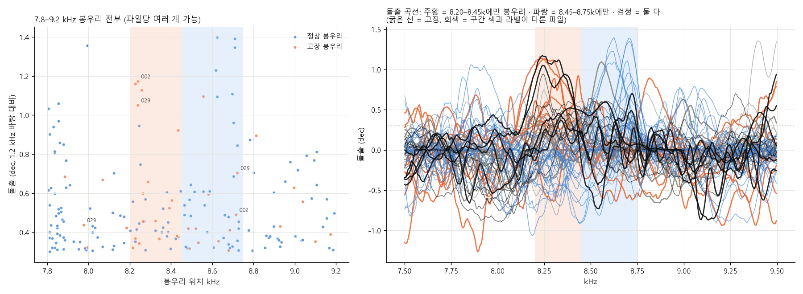
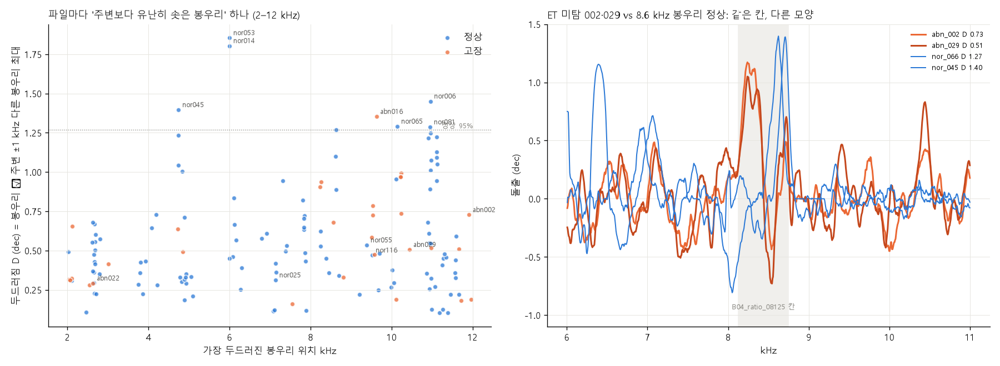

# 2-6 공진 이동 가설 — 정상 8.5–8.7 kHz 봉우리가 고장에서 8.2–8.4 kHz로 옮겨 갔나 (옛 2-9)

상태: 1차 (2026-11-14). 코드 [run.py](자료/run.py), 수치 [figs/hump_numbers.txt](자료/figs/hump_numbers.txt), 봉우리 목록 [figs/humps.csv](자료/figs/humps.csv)

## 가설 (사용자, H2 구체화)
정상의 8.5–8.7 kHz 봉우리와 고장의 8.2–8.4 kHz 봉우리는 같은 공진이다. 고장으로 강성이 줄어 왼쪽으로 이동했다.
- 물리: f ∝ √(k/m). 8.6 → 8.3 kHz = −3.5% → 질량이 같다면 강성 약 −7% (부싱 박리·균열 방향)

## 같은 모드의 이동이라면 보여야 할 것
1. 한 파일에 둘 중 하나만 있다 (둘 다 있으면 이동이 아니라 추가)
2. 봉우리 모양(반높이 폭·Q)이 비슷하다
3. 위치가 정상 8.6 / 고장 8.3으로 갈린다

## 정의 (그림 보기 전에 고정)
log PSD(평균 제거, Welch 4096) 55 Hz 평활 − 1.2 kHz 이동 중앙값 = 돌출. 7.8–9.2 kHz에서 돌출 ≥ 0.3 dec(≈2배) 국소 최대(150 Hz 간격) = 봉우리. 반높이 폭 = 파워 반값 폭

## 결과

| 위치 | 정상 (120) | 고장 (30) | 반높이 폭 · Q (정상 / 고장) |
|---|---|---|---|
| 8.20–8.45 kHz | 22파일 (18%) | **14파일 (47%)** | 186 · 45 / 208 · 40 |
| 8.45–8.75 kHz | 30파일 (25%) | 10파일 (33%) | 134 · 64 / 140 · 60 |
| **둘 다** | 7파일 | **5파일 (002·029·012·013·023)** | |

파일별 **가장 높은** 봉우리 위치: 고장은 8.2–8.3 kHz에 8/22로 몰리고, **8.6–8.8 kHz는 정상 13 · 고장 0**

(7.8–7.9 kHz의 정상 27개는 구간 왼쪽 끝 효과로 보인다 — 7 kHz대 정상 봉우리의 꼬리. 해석에서 제외)

## 해석
- **③ 위치는 가설 방향과 맞다**: 고장은 8.2–8.45 kHz 봉우리가 2.6배 흔하고, 가장 높은 봉우리가 8.6–8.8 kHz인 고장은 없다
- **① 공존은 가설과 어긋난다**: 핵심 파일 abn_002·029가 **두 봉우리를 다 갖는다** (002: 8.25 kHz 1.17 dec + 8.70 kHz 0.49 dec, 029: 8.25 kHz 1.05 + 8.72 kHz 0.72). 정상 7개도 둘 다 있다. 8.6 kHz 봉우리가 사라지고 8.3으로 옮겨 간 것이 아니라 **8.3 kHz 봉우리가 크게 자란 것**에 가깝다
- **② 모양도 위치를 따른다, 라벨을 따르지 않는다**: 8.3 kHz 봉우리는 정상이든 고장이든 넓고(폭 약 190–210 Hz, Q 40–45), 8.6 kHz 봉우리는 정상이든 고장이든 좁다(약 135 Hz, Q 60–64). 한 모드가 이동했다면 고장 쪽만 모양이 바뀌어야 한다
- **8.3 kHz 봉우리는 정상에도 22개 있다** → 고장이 만든 새 공진이 아니라 원래 있는 모드

## 결론
"같은 공진이 왼쪽으로 이동했다"는 **지금 근거로는 세우기 어렵다.** 더 맞는 가설:
- **H2′ (수정 제안)**: 8.3 kHz와 8.6 kHz에 인접한 모드가 원래 둘 있다. 고장 파일에서는 **8.3 kHz 모드가 더 크게 들뜬다** (가진 경로·경계 조건 변화로 에너지가 그 모드로 몰림). 이동량이 아니라 **두 봉우리의 상대 크기(8.3 / 8.6)**가 지표 후보
- 확인 방법: 8.3 / 8.6 kHz 봉우리 높이 비를 정상·고장·오탐 정상(nor_116은 8.3 kHz 봉우리 있음, nor_086은 8.6 kHz)에서 비교. 대역은 이 분석에서 정한 것이므로 피처로 쓸 때는 폴드 안 선택으로 다시 확인 (원칙 3)

## 추가 확인: "주변과 다른 유의미한 극댓값" (사용자 재정의, [distinct.py](자료/distinct.py))
가설: 고장은 주변보다 유난히 솟은 극댓값이 생기고, 정상 봉우리는 주변에도 비슷한 봉우리가 있어 두드러지지 않는다. ET 미탐(002·029)은 이것 때문.

정의(사전 고정, 주파수 손으로 안 고름): 2–12 kHz 봉우리마다 d = 돌출 − (±1 kHz 안·±150 Hz 밖 다른 봉우리 돌출 최대). 파일 값 D = max d

| | 결과 |
|---|---|
| D 정상 vs 고장 | 중앙 0.46 vs 0.51, **AUC 0.53** — 주파수를 가리지 않으면 고장이 더 두드러지지 않는다. 정상 95%를 넘는 고장은 016 하나 |
| abn_002 · 029 | 가장 두드러진 봉우리가 8.24 kHz가 아니라 11.9 · 10.4 kHz. 8.24 kHz 봉우리(1.17 · 1.05 dec)는 옆 8.70 · 8.72 kHz 봉우리(0.49 · 0.72) 때문에 d = 0.68 · 0.33 |
| 8.6 kHz 정상 | nor_066 · 045의 8.6–8.7 kHz 봉우리는 002·029의 8.24 kHz보다 **더 높고 더 좁다** (약 1.4 dec) |
| ET 피처 `B04_ratio_08125` | 002 · 029는 정상 중 **98 · 99%** — ET는 8 kHz대 상승을 이미 보고 있다. 같은 값대에 nor_019(8.25 kHz 봉우리 0.94) · nor_092가 있고, 잡힌 고장들은 더 크다(0.03–0.20) |

해석
- "고장 = 주변보다 뾰족한 극댓값"은 전체에 대해서는 맞지 않는다. 정상 중에도 더 뾰족한 봉우리가 많다 (6 kHz, 10.9 kHz, 8.6–8.7 kHz)
- 002·029와 8.6 kHz 정상을 가르는 것은 뾰족함이 아니라 **위치(8.24 vs 8.6–8.7 kHz)와 8.24 kHz 봉우리의 크기**다. 8.2–8.45 kHz 봉우리 돌출 ≥ 1.0 dec는 고장 4개(002·029·010·006), 정상 0개(최대 nor_019 0.94) — 단, 대역·문턱을 그림을 본 뒤 고른 값
- ET 미탐 원인 수정: ET가 8 kHz대를 못 보는 것이 아니다. 625 Hz 칸 비율로는 002·029가 nor_019 등과 같은 값대이고, 나머지 충격 피처는 모두 "정상"이라 나무들이 이 피처 하나로 고장 쪽에 가르지 않는 것으로 보인다 (추정)

## 한계
- 봉우리 문턱(0.3 dec)·바탕 폭(1.2 kHz)에 따라 개수가 달라진다. 한 가지 설정만 봤다
- 설비·센서 위치·온도가 다른 측정이 섞여 있으면 공진 위치는 고장 없이도 움직인다. 측정 조건 정보가 없다
