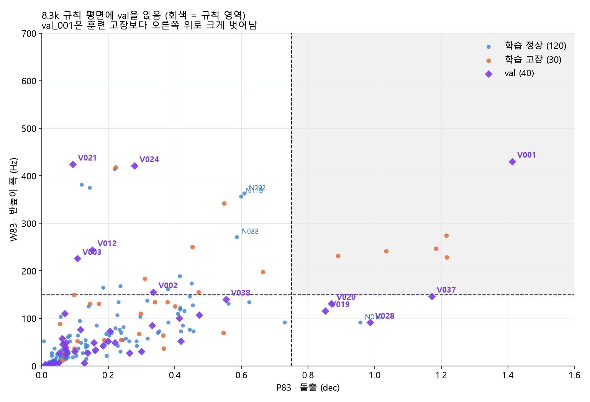
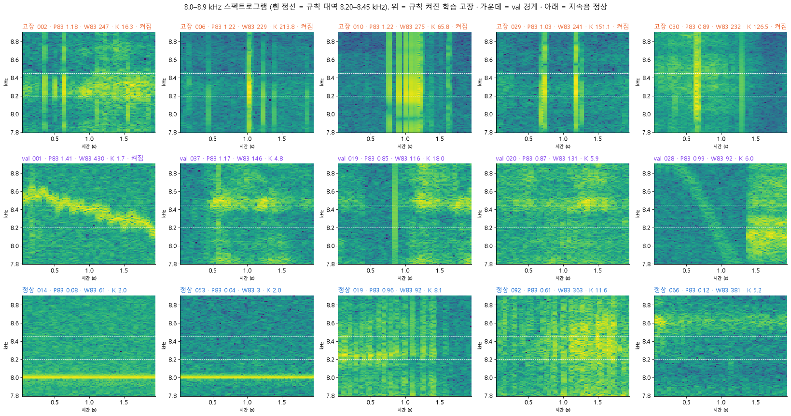
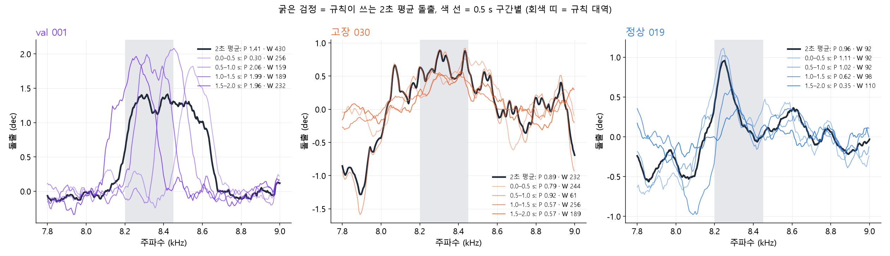
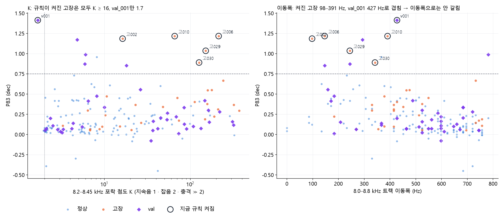

# 2-7 8.3k 규칙 다시 보기 — val을 얹고, 왜 val_001만 켜졌나 (옛 2-16)

상태: 1차 (2026-11-23). 코드 [run.py](자료/run.py), 수치 [figs/표.md](자료/figs/표.md) · [figs/파일표.csv](자료/figs/파일표.csv). 2-2(규칙의 출발) · 2-12(K 지표)를 이어서 val 40개를 같은 도식에 얹었다. **규칙 · 코드는 바꾸지 않았다.**

**결론: val_001만 켜진 이유 = "이동하는 좁은 음"이 규칙 대역을 지나가며 2초 평균에서 넓고 큰 봉우리가 됐기 때문(학습 150개에 이런 파일이 0개). 폭 경계를 만져서는 못 고친다. 구간별 규칙도 못 고친다. 지속음/충격을 가르는 시간 쪽 지표(K)만 val_001을 가른다.**

**그림 읽는 법:** 2-2 · 뷰어와 같은 평면(가로 P83 돌출, 세로 W83 폭). 회색 = 규칙 영역(P83 ≥ 0.75 AND W83 ≥ 150). 학습 고장 5개는 P83 0.89–1.22 · W83 229–275에 모여 있다. val_001(V001)은 P83 1.41 · W83 430으로 이 무리 오른쪽 위에 혼자 멀리 있다. val 경계 근처 V037(1.17 · 146)은 폭이 4 Hz 모자라 안 켜졌다.

## 왜 비슷한 정상은 안 켜졌나 (파일마다 막은 조건이 다르다)

| 파일 | 8 kHz대 음의 모양 | P83 · W83 | 막은 조건 |
|---|---|---|---|
| 정상 014 · 053 | **8.00 kHz에 고정**된 좁은 음 (이동폭 0) | 0.08 · 61 / 0.04 · 3 | 규칙 대역(8.20–8.45k) **밖**이라 돌출이 안 잡힘 |
| 정상 019 | 8.25 kHz 고정 음이 앞 1초 | 0.96 · 92 | **폭 조건**(고정 음은 좁음) |
| 정상 066 · 021 · 007 | 8.6 kHz 약한 음 | 0.12–0.22 · 375–415 | **돌출 조건**(대역 밖, 약함) |
| val 028 | 이동 + 1.4 s 뒤 8.1k 덩어리 | 0.99 · 92 | 폭 조건 |
| val 037 | 8.47 kHz 근처 고정 음 + 충격 | 1.17 · **146** | 폭 조건, **4 Hz 차이** |
| **val 001** | **8.6 → 8.15 kHz로 2초 내내 이동**, 대역을 가로지름 | **1.41 · 430** | 없음 (둘 다 통과) |

- 규칙의 두 조건은 사실상 "**고정된 좁은 음 = 폭에서 걸러짐, 약한 음 = 돌출에서 걸러짐**"이다. 001은 이동하는 음이라 폭이 넓어 보이고, 시간 내내 이어져 돌출도 가장 크다(프레임별 돌출 중앙값 Pf 2.18 = 전체 최대). 두 조건 모두 속은 유일한 파일이다.
- 학습 150개에는 이동하는 지속음이 0개(2-10)라서 규칙을 만들 때 이 경우를 못 봤다.

**그림 읽는 법:** 검정 굵은 선 = 규칙이 보는 2초 평균 돌출, 색 선 = 0.5초 구간별. 001은 구간마다 폭 160–260 Hz의 좁은 봉우리가 8.2 → 8.6 → 8.4로 옮겨 다니고, 평균이 이를 합쳐 폭 430 Hz가 됐다. 030(충격)은 구간별로도 평균과 비슷한 넓은 언덕, 019(고정 음)는 구간마다 같은 좁은 봉우리다.

## 고치는 방법 후보 (결과 보기 전 정의는 run.py 머리말)

**그림 읽는 법:** 세로 = P83, 검은 동그라미 = 지금 규칙이 켜진 파일. 왼쪽(K)은 켜진 고장이 모두 오른쪽 K ≥ 16, val_001만 K 1.7. 오른쪽(이동폭)은 고장 98–391 Hz, 001 427 Hz로 겹친다.

| 후보 | 결과 | 평가 |
|---|---|---|
| A. 폭 경계(150 Hz)를 올림/내림 | 001 W83 430 > 고장 최대 275. 올려서 끄려면 280 이상 → 켜진 고장 5개는 유지되나 **상한을 두는 꼴**(고장 쪽에서 폭이 큰 파일을 잃을 위험, val 037은 내리면 켜짐) | 물리 근거 없음 · 비추 |
| B. 0.5 s 구간별로 P · W를 재서 한 구간이라도 켜지면 켜짐 | **001 그대로 켜짐**(구간 P 2.06 · W 159). 정상 088 · 고장 005 · 007 · 013 · val 017 · 031 · 037이 새로 켜짐 | **기각** (오히려 악화) |
| C. 트랙 이동폭 | 고장 98–391, 001 427. 분리 안 됨 | 기각 |
| D. 8.2–8.45k 포락 첨도 K > 2를 AND (2-12) | 켜진 고장 5개 K 16–214 유지, **001 K 1.7 → 꺼짐**. 정상 켜짐 0 그대로. val 켜짐 1 → 0 | 가장 깔끔. 근거 = 규칙 전제(H2 "충격이 공진을 울린다") |
| E. 지속성 Pf < 1.7 을 AND | 켜진 고장 Pf ≤ 1.36, 001 2.18 | 같은 방향이나 임계값을 데이터에서 고름 |

## 한계 · 확인할 것
- 001의 정답은 모른다. 이 EDA는 "규칙의 전제와 맞지 않는 켜짐"만 보인다. 결합 점수는 001을 정상으로 보고(25/25, 6-7) 신호도 충격이 없다.
- D · E는 켜진 학습 고장이 5개뿐이라 중첩 CV로는 학습 점수가 안 바뀐다(검증 불가). 근거는 물리 전제뿐이다.
- **val 037(P83 1.17 · W83 146 · K 4.8)은 폭 4 Hz 모자라 경계에 있다.** K 조건을 붙여도 이 값은 그대로다. 폭 경계를 만지면 037이 켜지고, 1.1 근처 고정 음이라 같은 문제가 반복될 수 있다.
- 착안은 val_001을 보고 했다(결정.md "val로 모델을 고치지 않는다"와 부딪힘). K 문턱 2는 이론값(잡음)이고 001에 맞춰 바꾸지 않았다.
