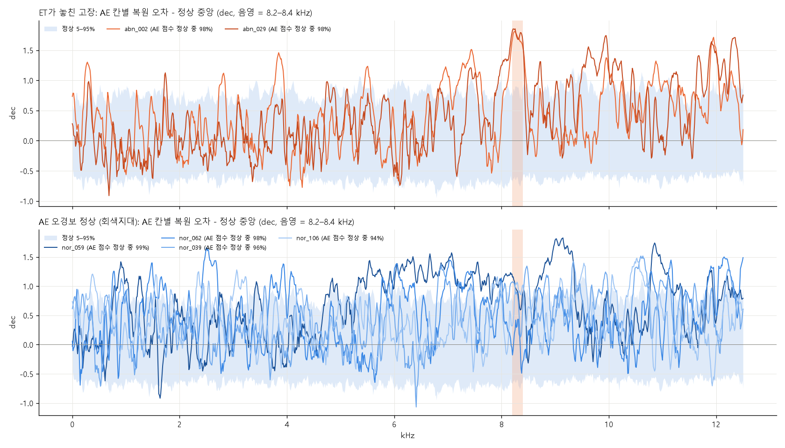
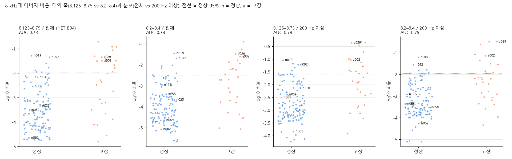

# 2-8 AE 칸별 오차와 8 kHz 대역 — EXP-014 회색지대(abn_002·029 ↔ nor_059·062)를 가를 수 있나 (옛 2-10)

상태: 1차 (2026-11-14). 코드 [run.py](자료/run.py), 수치 [figs/numbers.txt](자료/figs/numbers.txt)

## 질문
1. EXP-014의 AE가 002·029를 높게 보는 이유가 8.2–8.4 kHz 봉우리인가? 같은 AE 점수대의 오경보 정상 059·062는 어디서 오차가 나나?
2. ET 피처 `B04_ratio_08125`(8.125–8.75 kHz)를 8.2–8.4 kHz로 좁히면 002·029가 정상과 더 잘 갈리나? (사용자 제안)

## 방법
- ① EXP-014와 같은 AE·입력·분할(StratifiedGroupKFold 5, seed 0)로 파일별 OOF 칸별 복원 오차 → 칸마다 정상 OOF 중앙값과의 차
- ② ET와 같은 정의(FFT 파워 비율)로 대역 2가지 × 분모 2가지(전체 파워 / 200 Hz 이상 파워). 직접 계산값과 ET 피처 상관 1.0000 확인
- 8.2–8.4 kHz는 라벨을 본 뒤 고른 대역 → 성적은 낙관적. 200 Hz 고정 격자 61칸에서의 순위도 함께

## 결과

**① AE 칸별 오차**

| 파일 | AE 점수 (정상 중) | 초과 오차 중 8.2–8.4 kHz 몫 | 초과가 가장 큰 곳 |
|---|---|---|---|
| abn_002 | 98% | **16%** | **8.25 kHz** (1.81 dec) |
| abn_029 | 98% | **16%** | **8.25 kHz** (1.85 dec) |
| nor_059 | 99% | 1% | 9.14 kHz |
| nor_062 | 98% | 0% | 2.50 kHz |
| nor_039 · 106 | 96 · 94% | 2 · 3% | 10.6 · 10.5 kHz |

8.2–8.4 kHz는 1025칸 중 1.7%인데 002·029 초과 오차의 16%가 여기서 나온다(약 10배 집중). 오경보 정상은 0–3%

**② 대역 비율**

| 비율 | 002 · 029 정상 중 | 002·029보다 큰 정상 | 059 · 062 정상 중 |
|---|---|---|---|
| 8.125–8.75 / 전체 (= ET B04) | 98 · 99% | 2 (nor_019 · 092) | 54 · 7% |
| 8.2–8.4 / 전체 | 99 · 99% | 1 (nor_019) | 28 · 7% |
| 8.125–8.75 / 200 Hz 이상 | **100 · 100%** | **0** | 70 · 5% |
| 8.2–8.4 / 200 Hz 이상 | **100 · 100%** | **0** | 47 · 4% |

- 전체 AUC는 모두 0.78–0.79로 같다 (다른 고장들은 이 대역과 무관)
- 200 Hz 고정 격자 61칸(200 Hz 이상 분모) 단변량 AUC: 8.2–8.4 kHz 칸이 **2위**(0.79, 1위 9.6–9.8 kHz 0.79)

## 해석
1. **AE가 002·029를 높게 보는 이유는 8.25 kHz 봉우리가 맞다.** 059·062는 다른 곳(9.1 · 2.5 kHz 등)에서 오차가 난다 → 같은 AE 점수지만 이유가 다르다. 평균 오차로 합치면 이 차이가 사라진다 (EXP-014 회색지대의 원인)
2. **대역을 좁히는 효과는 작고, 분모를 바꾸는 효과가 크다.** 8.2–8.4로 좁히면 앞선 정상이 2 → 1개. 분모를 200 Hz 이상으로 바꾸면 0개. 전체 파워 분모는 저주파 흔들림이 지배해서, 흔들림이 작은 정상(nor_019 · 092)의 비율이 부풀려진다
3. 다만 여유가 얇다: nor_019 · 092가 정상 중 99 · 98%로 바로 아래에 있다. 둘 다 8.25 kHz 근처 봉우리가 있는 정상이다 (2-9)
4. 정직한 피처 후보: **200 Hz 고정 격자 대역 파워 / 200 Hz 이상 파워**, 폴드 안에서 상위 칸 선택. 8.2–8.4 칸은 격자에서 2위라 손으로 고르지 않아도 뽑힐 가능성이 높다

## 다음 (보류 — EXP-015·016 끝난 뒤 적용, 사용자 11-14)
- **8.25 kHz 축**: 8.25 kHz 중심 대역 파워 / 200 Hz 이상 파워. 중심을 그림 보고 정했으므로 사후 정의로 표시하고, 고정 격자(200 Hz) 폴드 안 선택 구성과 나란히 비교한다
- **결합이 중간으로 수렴하는 문제**: 로지스틱 계수가 1:1(EXP-014)이라 사실상 두 z의 평균 → 한쪽 전문가만 강하게 가리키는 고장(002·029 = AE, 017 = ET)이 희석된다. OR(최댓값)은 오경보 합집합이라 0.889로 하락
  - 원인은 결합기보다 **AE 점수가 비특이적**인 데 있다: 002·029와 059·062가 같은 AE 점수지만 이유가 다르다(①). 특이적인 8.25 kHz 축을 따로 두면 "한쪽만 강해도 고장"을 그 축에만 허용할 수 있다
  - 결합기 후보 (사전 지정 후 같은 중첩 CV로 비교): (a) 지금 로지스틱 (기준) (b) 로지스틱 + max(z) 열 = EXP-016 D 결과 먼저 확인 (c) **엄격한 OR**: 축마다 정상 OOF 상위 q%(안쪽 CV로 q 선택)를 넘으면 고장 — 축이 3개면 오경보 상한 ≈ 3q (d) 로지스틱 + 8.25 축만 OR
  - 피할 것: 2–3개 z 위 트리·부스팅 결합기 (고장 30개로 경계 과적합)
