# Q1 정상 vs 고장 PSD 중앙값 비교 (11-21)

읽는 법은 [가이드](../0_가이드_평균과비교.md) 4절. 코드 [run.py](run.py), 숫자 [result.txt](result.txt). 라벨은 색칠·비교에만 썼고, 모든 비교는 사후 관찰이다.

## 그림
| 그림 | 내용 |
|---|---|
| [q1_fullband](figs/q1_fullband.png) | 전 대역(Welch 2048, 로그 x). 위: 정상 중앙·5–95% 띠, 고장 중앙, val 중앙. 아래: 차이(dec) |
| [q1_high1k](figs/q1_high1k.png) · [히트맵](figs/q1_heat_high1k.png) | 1 kHz 고역통과(4차 Butterworth, 앞뒤 두 번) 후 1–12.5 kHz, 선형 x |
| [q1_zoom_6to11k](figs/q1_zoom_6to11k.png) | 6–11 kHz 확대(선형 x, 250 Hz 눈금). 차이 곡선 봉우리 Hz 표시 |
| [q1_low200](figs/q1_low200.png) | 0–200 Hz(Welch 8192, 선형 x). 같은 구성 |
| [q1_heat_fullband](figs/q1_heat_fullband.png) | 행 = 고장 30 + val 40, 열 = 주파수, 색 = 정상 95%선을 넘은 크기(dec) |
| [q1_heat_low200](figs/q1_heat_low200.png) | 같은 히트맵, 0–200 Hz |

## 핵심 그림
### 전 대역 (Welch 2048, 로그 x)
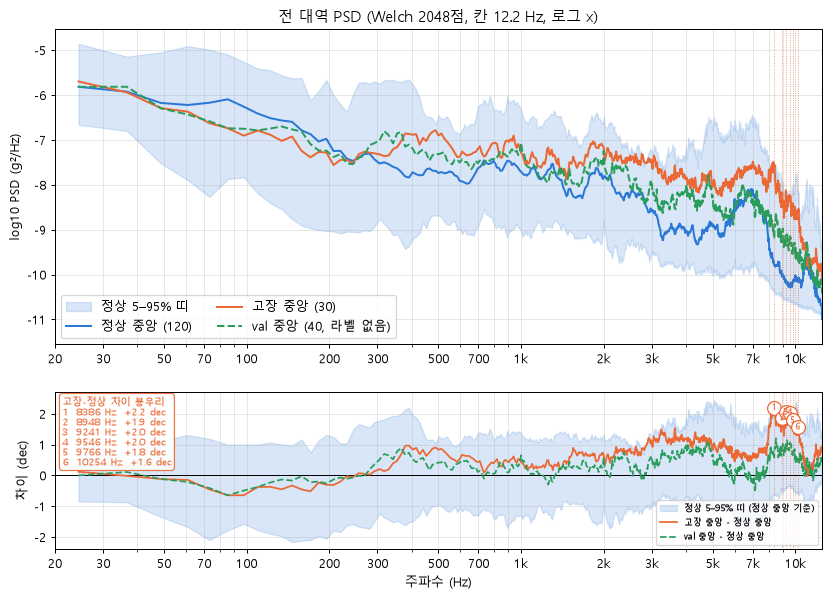

### 고주파 1–12.5 kHz (1 kHz 고역통과 후, 선형 x, 500 Hz 눈금)
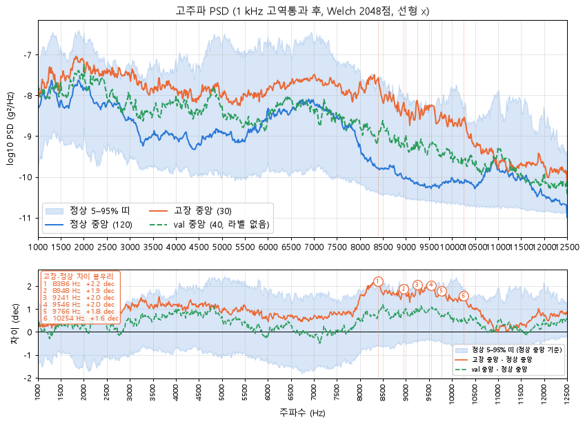

### 6–11 kHz 확대 (선형 x, 250 Hz 눈금)
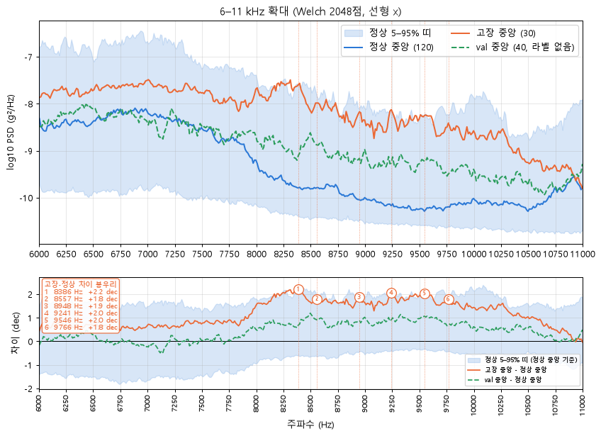

### 0–200 Hz (Welch 8192, 선형 x)
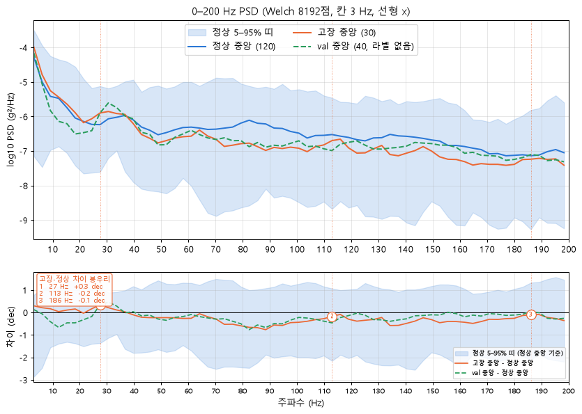

### 정상 95%선 초과 히트맵 — 전 대역
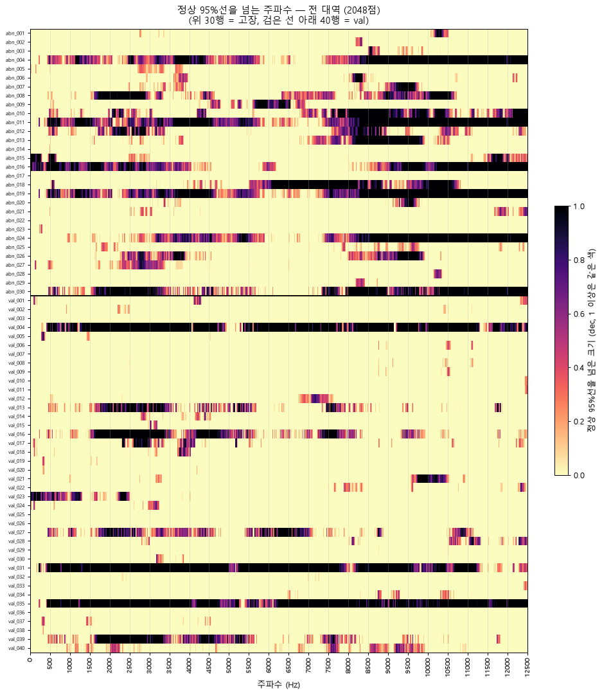

### 정상 95%선 초과 히트맵 — 0–200 Hz
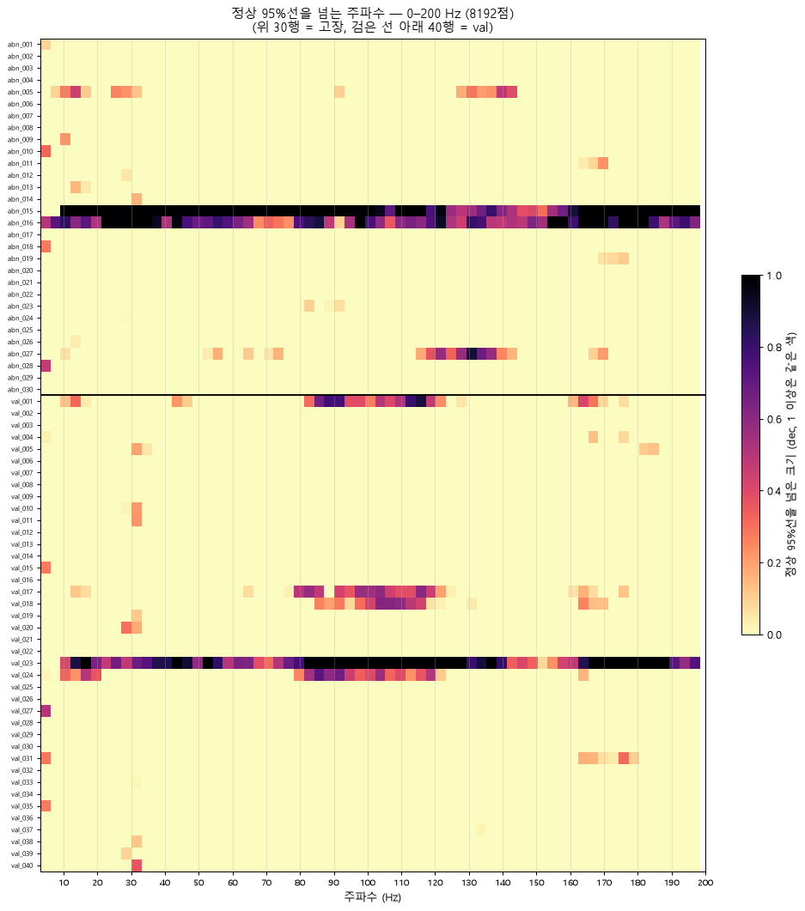

### 중앙값만 + 나이퀴스트(12.5 kHz) 부근 확대 (`medians_only.py`, 숫자 `result_medians.txt`)
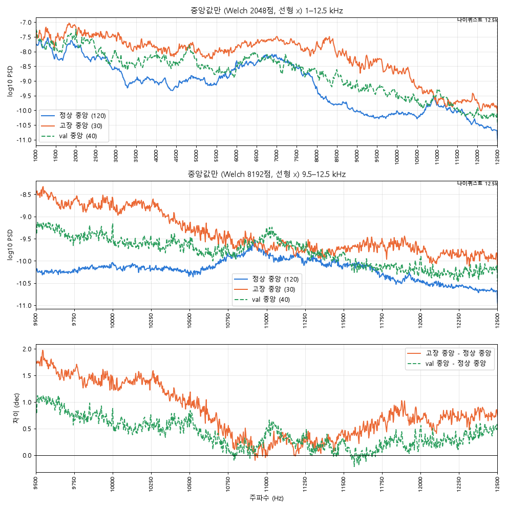

## 관찰 (그림에서 직접 읽은 것)
- 정상 5–95% 띠가 매우 넓다(낮은 주파수에서 위아래 합쳐 약 3–4 dec). 고장·val 중앙선은 대부분 이 띠 안이다.
- 고장 중앙 − 정상 중앙 차이는 **약 7.75 kHz부터 올라가 8.0–10.25 kHz에서 +1.5~+2.2 dec의 넓은 언덕**이다(확대 그림). 가장 높은 곳 8386 Hz(+2.20), 그 외 눈에 띄는 곳 8557 · 8948 · 9241(+2.05) · 9546(+2.04) · 9766 Hz. 언덕 위의 이 높낮이는 서로 비슷한 크기(±0.3 dec)라 "한 개의 좁은 봉우리"가 아니라 8–10 kHz 전체가 들떠 있는 모양이다. 고장 중앙이 정상 95%선 위로 나가는 곳은 8.2–8.4 kHz와 9.2–9.6 kHz 조각이고, 2.76–2.81 kHz(좁음)도 있다. 5% 선 아래는 없다.
- 1–7 kHz에서 고장 중앙은 정상 중앙보다 약 0.5–1.3 dec 높지만 띠 안이다(중앙값 차이만으로는 구분 어려움).
- 0–200 Hz에서 고장·val 중앙은 정상 중앙보다 낮고(최대 약 −0.7 dec) 모두 띠 안. 낮은 음 영역은 중앙값으로 구분되지 않는다.
- val 중앙은 정상 95%선 위로 나가는 곳이 없다. 정상 중앙과의 차이는 약 0.3–0.4 kHz에서 +0.8 dec 안팎으로 고장 중앙과 비슷하고, 8 kHz대에서는 고장 중앙보다 훨씬 작다.
- 히트맵: 가로로 **넓게 이어진 줄무늬**(전 대역이 정상보다 큼)가 협대역 줄무늬보다 훨씬 많다. 고장 중 abn_004·008·010·011·016·019·024·030이 그렇다.
- **val 3개(val_035, 004, 031)는 전 대역에서 95%선 초과 비율이 0.9 이상**이다. 정상 최대(0.80)와 비슷하거나 약간 위다(고장도 3/30). 이 파일들은 고장 쪽 모양인지 단순히 소리가 큰 정상인지 이 그림만으로는 모른다.
- 정상 띠 안에 숨은 고장(95%선 초과 비율 ≈ 0): abn_017, 022, 014, 023, 002. 이 파일들은 중앙값·전 대역 비교로는 보이지 않는다.

- 고주파 선형 그림(1 kHz 고역통과 후): 정상 중앙에 **약 2 kHz와 6.5–7 kHz 두 언덕**이 있다. 고장 중앙도 2 kHz 언덕은 있고(약 +0.5~+1 dec 높음), 7.5 kHz 이후 정상은 급히 떨어지는데 고장은 8–10 kHz까지 높게 남는다. val 중앙은 정상 중앙에 가깝고 8–10 kHz에서만 약간 높다(+0.5~+1 dec).
- 필터는 1.2 kHz 이상 숫자를 바꾸지 않는다(필터 전 전 대역 결과와 95%선 초과 구간이 같음). 1 kHz 부근의 낮은 음 영향만 막아 준다.

## 해석 주의
- 히트맵은 고장·val만 보여 준다. 정상 파일 중에도 95%선 초과 비율이 0.80까지 가는 파일이 있어 정상 120개가 이 기준선을 모두 지키는 것은 아니다(정상 자신으로 기준선을 만들었기 때문에 정상 중앙은 0.000).
- 넓게 이어진 줄무늬는 "전체 소리 크기(게인·길 상태)"가 다른 것인지 "모양"이 다른 것인지 이 그림으로는 가르지 못한다. 다음 후보: 파일 전체 크기로 나눈 모양 PSD로 같은 그림 재작성.
- val 라벨이 없어 val 모양이 정상/고장 어느 쪽인지는 "비슷하다"까지만 말할 수 있다.

## 12.5 kHz 부근 (중앙값만, 사용자 가설: 12.5 kHz 위 성분이 접혀 들어온다?)
- 고장−정상 차이: 10 kHz +1.45 → 10.5k +1.12 → **10.9 kHz에서 최소(−0.10, 거의 0)** → 11.5k +0.39 → **11.88 kHz +1.03 (재상승)** → 12.4k +0.83. 고장이 정상 아래로 내려가는 일은 없고, 가까워졌다가 다시 벌어진다.
- 11.0k→12.4k 로그 파워 변화: 정상 −0.71, **고장 −0.21**, val −0.81. 정상은 계속 떨어지는데 고장은 거의 평평하다.
- 나이퀴스트 직전에 모든 파일이 급절벽으로 떨어지는 모습은 없다(정상도 완만히 하락). 안티에일리어싱 필터가 있었다면 보일 모양이 없다는 뜻이지만, 접힘의 증거는 아니다.
- 한계: 이 샘플링(25 kHz) 데이터만으로는 "실제 12 kHz 성분"과 "13 kHz 성분이 접혀 12 kHz로 보임"을 가를 수 없다.

## 8–10 kHz 들뜸 vs 11.5–12.5 kHz 들뜸: 같은 파일인가 (`band_corr.py`, 숫자 `result_band_corr.txt`, 사후 대역)
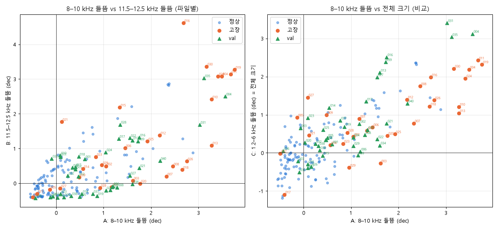
- 값 = 파일별 평균(로그 PSD − 정상 중앙). A 8–10 kHz, B 11.5–12.5 kHz, C 1.2–6 kHz(전체 크기 비교용).
- A–B 순위 상관: 정상 +0.61 · 고장 +0.74 · val +0.60. 그러나 A–C도 +0.60~0.72, B–C +0.39~0.59 → **전 대역이 같이 커지는 "크기" 효과가 크다.** C를 빼면 A–B 상관은 +0.31~0.57로 약해진다.
- 정상 95% 선 초과: A 고장 14/30 · val 4 · 정상 6/120, B 고장 9/30 · val 4 · 정상 6/120. B 초과 고장 9개 중 7개(004 010 011 016 019 024 030)가 A도 초과, B만 초과는 015 · 021.
- A만 초과: 007 008 012 013 018 025 026. 둘 다 아님 14개: 001 002 003 005 006 009 014 017 020 022 023 027 028 029 (8.3 kHz 공진 파일 002 003 006 029 포함).
- val: 004 031 035가 A·B 둘 다 초과, C(전체 크기)도 모든 고장보다 큼(약 +3.0~3.4).

## 크기를 나눈 모양 PSD 재비교 (`shape_psd.py`, 숫자 `result_shape.txt`)
모양 PSD = 파일 PSD ÷ (200 Hz 이상 파워 합) = "각 주파수가 전체 파워의 몇 몫인가". 크기(게인·길 상태)는 사라지고 몫의 분포만 남는다.
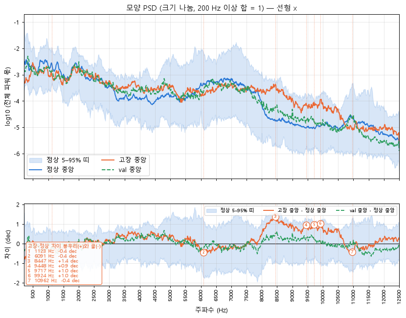
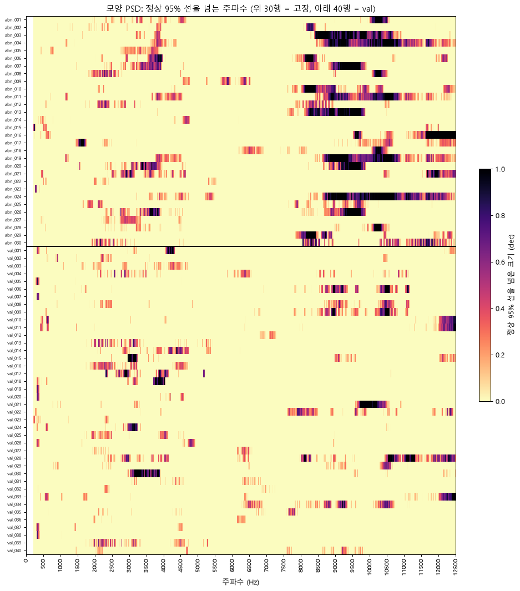
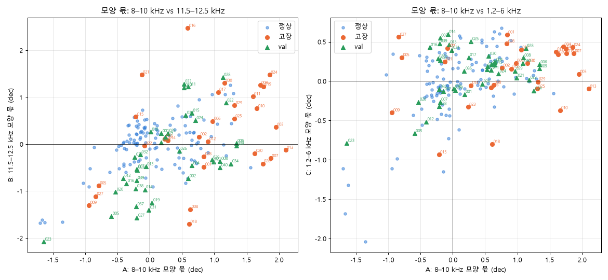
- **8–10 kHz 언덕은 크기를 나눠도 남는다**: 고장−정상 +0.9~+1.4 dec(8447 Hz +1.38, 9448 · 9717 · 9924 Hz 약 +1.0). 정상 95% 선 초과 고장 13/30(A), val 4/40, 정상 6/120.
- **11.5–12.5 kHz의 재상승은 사라진다**: B 대역 중앙 차이 +0.14, 곡선의 차이도 +0.2 안. 크기 효과였다.
- 1.1 · 6.1 · 11.0 kHz 부근은 오히려 정상보다 −0.4 dec(몫이 줄어든 곳, 8–10 kHz 몫이 커진 반대급부).
- A–B 상관: 정상 +0.31 · 고장 +0.29(p 0.125) · val +0.62. B–C는 거의 0(+0.02~0.14). 크기 효과를 빼면 두 대역은 따로 논다.
- A 초과 고장: 003 · 004 · 007 · 010 · 011 · 013 · 019 · 020 · 024 · 025 · 026 · 029 · 030(8.3 kHz 공진 003 · 029 포함). B만 초과: 016 · 017 · 021.
- val_004 · 031 · 035의 모양 값은 A/B/C = +0.65/−0.46/+0.24 · −0.02/−1.40/+0.39 · +0.18/+0.04/+0.13 → 모양은 정상 띠 근처. 크게 측정된 파일일 가능성이 높다. val에서 모양이 튀는 쪽: val_022(A·B 둘 다), 006 · 009 · 034(A만), 010 · 011 · 028 · 033(B만).
- 주의: 파워 합으로 나누므로 한 곳이 커지면 다른 곳은 몫이 줄어든다(−0.4 dec 구간). 사후 대역.
