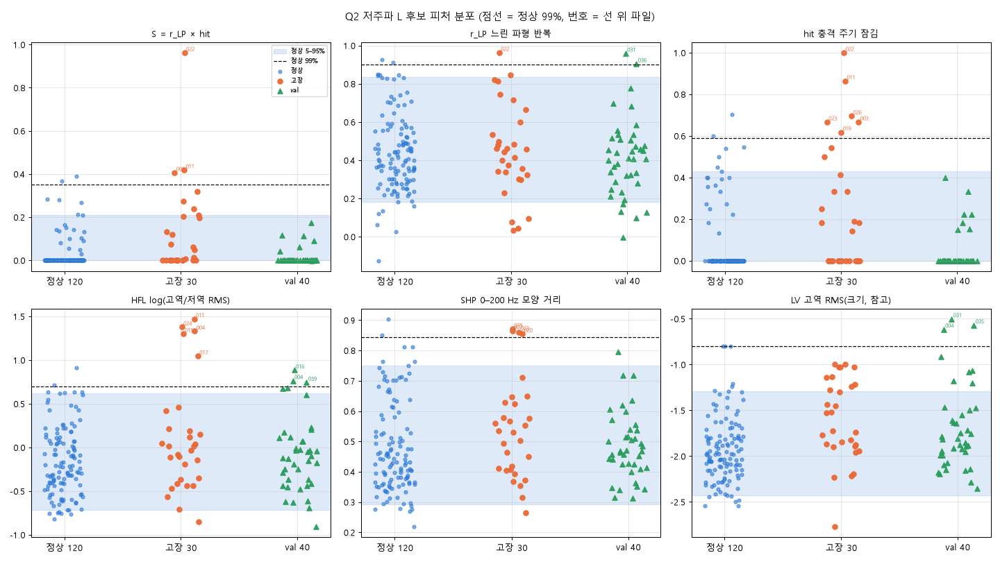
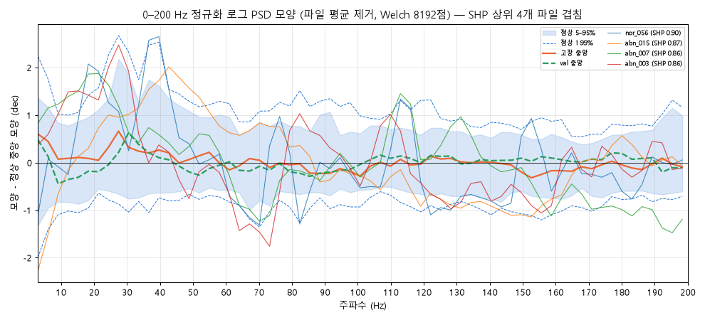

# Q2 저주파 L 블록 후보 피처 분포 (11-21)

코드 [run.py](run.py) · 숫자 [result.txt](result.txt) · 값 표 [features.csv](features.csv). 정의는 run.py 맨 위. 라벨은 색칠·비교에만 썼고 AUC는 사후 관찰이다. 정상 99% 선 = 정상 120개의 99 백분위.

## 피처 (S·r_LP·hit는 2-13 정의 그대로, abn_022 S 0.963 재현)
| 피처 | 뜻 | AUC(사후) | 크기 LV와 상관 | 99% 선 초과: 고장 · val · 정상 |
|---|---|---|---|---|
| S = r_LP × hit | 느린 파형 반복 AND 충격이 그 주기에 잠김 | 0.69 | +0.10 | 3 (001 011 022) · 0 · 2 (073 103) |
| r_LP | 30 Hz 저역 파형이 0.3–1.2 s 뒤에 같은 모양으로 반복되는 정도 | 0.52 | −0.21 | 1 (022) · 2 (031 036) · 2 (042 051) |
| hit | 8σ 충격 중 주기 T ± 3%에 짝이 있는 비율 | 0.69 | +0.09 | 6 (003 011 019 022 023 026) · 0 · 2 (073 091) |
| HFL | log10(200 Hz 이상 RMS / 20 Hz 이하 RMS) | 0.60 | **+0.47** | 5 (004 011 017 019 024) · 3 (004 016 039) · 2 (073 112) |
| SHP | 0–200 Hz 크기 뺀 모양과 정상 중앙 모양의 거리 | 0.62 | −0.24 | 4 (003 007 015 020) · 0 · 2 (051 056) |
| LV (참고) | 200 Hz 이상 RMS 자체 = 전체 크기 | 0.73 | 1.00 | 0 · 3 (004 031 035) · 2 (097 120) |

## 관찰
- **S로 정상 99% 선(0.351)을 확실히 넘는 것은 abn_022(0.963)뿐**이다. 001(0.41) · 011(0.42)은 선 바로 위, 정상 073 · 103도 선 위(최대 0.389). 2-13 결론과 같다.
- **val에는 S가 높은 파일이 없다**(최대 약 0.17, hit는 거의 0). val_031 · 036은 r_LP만 0.9 이상(느린 파형은 반복하지만 충격이 잠기지 않음).
- hit는 고장 6개가 선 위(정상 2개)이나 값이 0.6–1.0에 그치고 정상도 0.70까지 간다. 정상에서 hit가 0이 대부분이라 분포가 한쪽에 몰려 있다.
- **HFL은 크기에 끌려간다**(LV와 +0.47). 선 위 고장 5개(004 011 017 019 024)는 이전 비교에서 "전 대역이 큰" 파일들과 겹친다(017 제외). val 004 · 016 · 039도 같은 방식.
- **SHP는 약하다**(AUC 0.62, 정상도 0.90까지). 모양 곡선에서 정상 띠를 크게 벗어나는 곳은 20–45 Hz와 110 Hz 부근이나 파일마다 달라 공통 모양이 없다. 선 위 고장 003 · 007 · 015 · 020은 서로 다른 모양이다.
- **val_004 · 031 · 035는 고역 크기(LV)가 정상 99% 선(−0.80)과 정상 최대(−0.798)보다 위**다. 학습 정상 120개가 보지 못한 크기 범위의 파일이다(고장 30개도 이 선을 넘지 않는다).

## 해석 주의
- S · hit는 022를 본 뒤 만든 사후 정의다(2-13). 이 그림은 후보 분포를 보는 것이고 규칙 채택 판단이 아니다.
- 정상 99% 선은 정상 120개로 만든 것이라 정상 초과 2개(1%)가 항상 생긴다. SHP는 정상을 자기 제외 중앙과 비교했다.
- 8192점 Welch는 3 Hz 간격이라 낮은 봉우리(2-19: 37 · 81 · 113 …)의 위치 변화는 이 그림만으로 말하기 어렵다.
