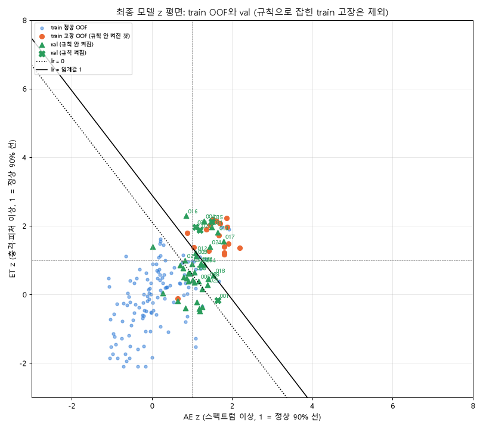
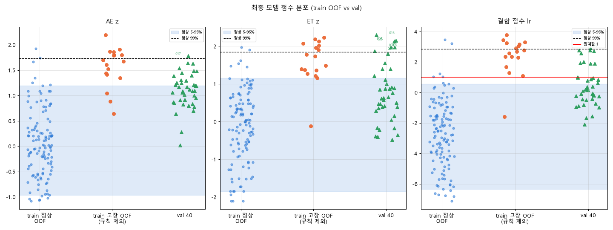
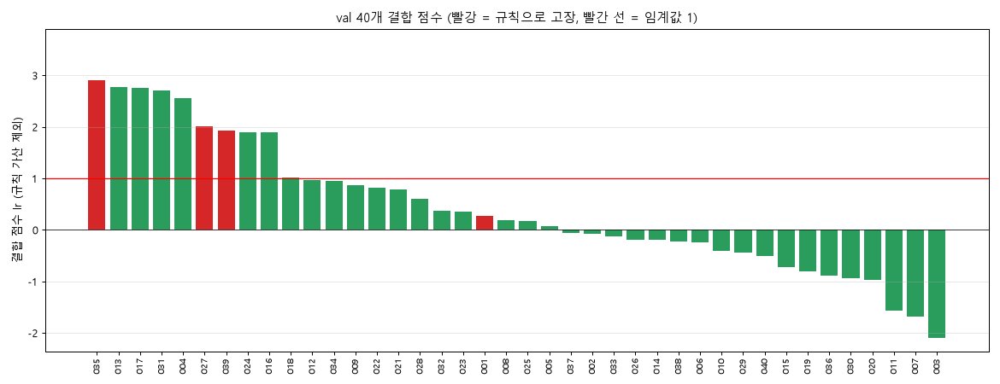

# Q3 최종 모델(EXP-034 c) val 채점 분포 (11-21)

코드 [run.py](run.py) · 숫자 [result.txt](result.txt) · 표 [val_table.csv](val_table.csv)(val 40개 근거표) · [train_oof.csv](train_oof.csv)(학습 150개 OOF). 모델·임계값은 고치지 않았고 제출 파일은 만들지 않았다. val 라벨은 없다.
z = (점수 − 정상 중앙값) / (정상 90% 선 − 정상 중앙값) → 1 = 정상의 90% 선. 로지스틱 lr = 1.944 × AE z + 1.277 × ET z − 2.696, 임계값 1.0(고정).

## 숫자
| | train 정상 OOF | train 고장 OOF(규칙 안 켜진 17개) | val 40 |
|---|---|---|---|
| AE z 중앙 | 0.00 | 1.67 | **1.11** (범위 0.02–1.78) |
| ET z 중앙 | 0.00 | 1.73 | 0.63 |
| lr 중앙 | −2.64 | +2.67 | +0.18 |
| AE z ≥ 0.6 인 비율 | 21% | 100% | **95%** |
| AE z ≥ 1.0 인 비율 | 10% | 88% | **68%** |
| ET z ≥ 1.0 인 비율 | 10% | 94% | 30% |

- **val 판정: 고장 11/40(27.5%)**. 규칙 4개(유격 3: val_035 · 027 · 039, 8.3 kHz 스펙트럼 1: val_001), 결합 점수만으로 7개(013 · 017 · 031 · 004 · 024 · 016 · 018). 본체 내림 2개, 임계값 경계 6개(lr 0.78–1.02 부근: 009 · 012 · 021 · 022 · 028 · 034). 학습 OOF의 오경보 5/120(4%), 규칙 없는 고장의 재현 16/17.
- **val 40개의 AE z가 거의 전부 정상 구름의 오른쪽 가장자리에 있다.** 정상의 21%만 0.6 이상인데 val은 95%. val에 학습과 같은 비율(약 20–35%)로 고장이 섞여 있다고 가정해도 기대값은 약 40–50%이지 95%가 아니다. val의 AE z가 최소 0.02, 최대 1.78로 좁은 범위(학습 정상은 −1.1 ~ +1.9로 넓음)에 몰려 있다 → **val 전체가 AE 눈금에서 한쪽으로 이동**했다는 연결 파일 2절의 우려와 같은 방향(EXP-025 모델은 val AE z 평균 1.77 · 고장 판정 10/40, 이번 모델은 1.10 · 11/40).
- ET z는 이동이 작다(중앙 0.63, ≥ 1.0 이 30%). 결합 점수 상위는 AE와 ET가 같이 높은 파일(035 · 027 · 039 · 013 · 017 · 031 · 004 · 024 · 016).
- 크기가 큰 val(004 · 031 · 035, Q1 · Q2)은 AE z는 1.3–1.5로 평범하고 **ET z가 2.0–2.2로 높다**(ET 입력 피처가 크기에 민감할 가능성). 셋 다 고장 판정(035는 유격 규칙, 004 · 031은 결합 점수). 모양 PSD(Q1)로는 정상 띠 근처였다.
- val_022(이름이 같을 뿐 train abn_022와 무관)는 lr 0.83으로 임계값 바로 아래.

## 해석 주의
- train은 4등분 OOF z(전문가를 75%로 학습), val은 150개 전체로 다시 학습한 전문가의 z라 눈금이 약간 다를 수 있다. 이 차이로 val 95%가 설명되는 크기인지는 확인하지 않았다(OOF 눈금 보정이 필요한지가 사령탑 질문).
- 고장 비율과 val 라벨을 모르므로 "이동"과 "고장이 많음"을 완전히 가르지는 못한다. 팀원 자료의 val 고장 14개(신효섭, 11-19)가 맞다면 기대 비율은 35%.
- 규칙으로 켜진 train 고장은 평면에서 뺐다(CLAUDE.md 규칙). val은 모두 표시하고 규칙 켜짐은 X.
