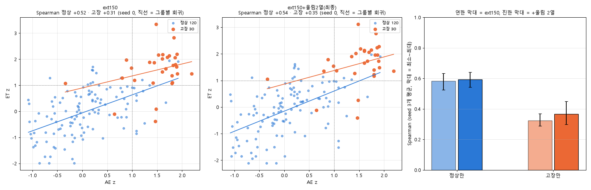

# Q4 AE z × ET(ext150) z 상관 (11-21)

코드 [run.py](run.py) · 숫자 [result.txt](result.txt) · 점수 표 [oof_z.csv](oof_z.csv). train OOF(4등분, 분할 seed 0·1·2). `src/`·모델은 고치지 않았고 `Core`의 내부 함수를 읽어 썼다. 구성 둘: ET 입력 = ext150(요청) / ext150 + 울림 2열(현재 최종).

## 결과 (Spearman, seed 3개 평균. 괄호 = seed 0의 95% 부트스트랩 구간)
| | 전체 | 정상만 | 고장만 |
|---|---|---|---|
| ext150 | +0.72 | **+0.58** (0.37–0.65) | **+0.32** (−0.03–0.58) |
| ext150 + 울림 2열(최종) | +0.73 | +0.59 (0.38–0.67) | +0.37 (−0.02–0.62) |
| 참고: AE × ET(D+), 연결 파일 2절 | 0.81 | 0.67 | 0.49 |

- Pearson도 같은 크기(정상만 +0.52~+0.59, 고장만 +0.30~+0.46).
- 구성(울림 2열 유무)에 따른 차이는 seed 간 차이보다 작다.
- 분할 seed에 따라 정상만 +0.52~+0.64, 고장만 +0.29~+0.45로 움직인다. **고장만의 구간은 0을 걸친다**(30개라 불안정).

## 읽기
- 정상만 +0.58은 "두 전문가가 같은 정상 파일에서 같이 높아지는 정도"다. 보통 수준이고 D+보다 낮다. 전체 상관(+0.72)에는 정상/고장이 갈리는 효과가 들어 있어 중복의 척도로는 정상만 값이 맞다.
- **서로 다른 파일을 잡는다**(seed 0, 두 구성이 같은 고장 분류): z ≥ 1(정상 90% 선) 기준으로 고장 30개 중 둘 다 23 · AE만 2(abn_002, 029) · ET만 4(abn_005, 014, 017, 028) · 둘 다 아님 1(abn_022). AE만 잡는 002 · 029는 8.3 kHz 공진 고장, ET만 잡는 014 · 017은 유격·조용한 고장 쪽이다.
- **오경보는 겹치지 않는다**: 정상 120개 중 둘 다 3~4 · AE만 8~9 · ET만 8~9. 한쪽만 높은 정상이 대부분이라 "둘 다 높아야 고장" 쪽 결합(합·로지스틱)이 오경보를 줄이는 구조다.
- 결론: AE와 ET는 중복이 크지 않고(정상만 0.6) 서로 보완한다 → 핵심을 AE + ET로 두는 근거는 있다. 단독으로 두기에는 AE만 잡는 고장(002 · 029)과 ET만 잡는 고장(005 · 014 · 017 · 028)이 있어 한쪽을 빼면 잃는다.

## 해석 주의
- OOF는 4등분이라 파일 수가 적어 상관 구간이 넓다(특히 고장 30개). 같은 파일이 두 전문가 학습에 쓰인 적이 없는 점수라는 점은 맞다.
- z ≥ 1 분류는 사후 설명용이다(정상 90% 선). 임계값이 아니다.
- 사용한 AE는 최종 모델의 AE(스펙트럼, 정상만 학습)이고 ET는 같은 하이퍼파라미터다. D+ 값(0.81)은 입력 구성이 달라 직접 비교는 어렵다.
