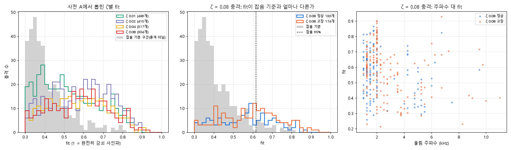
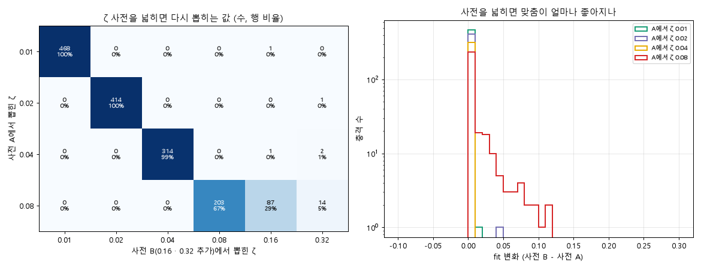
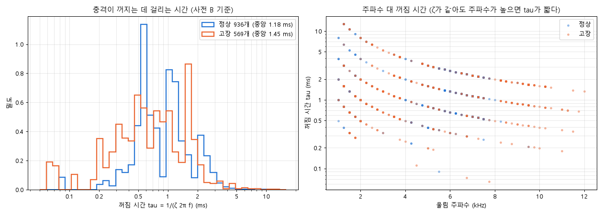

# Q5 ζ = 0.08 충격의 정체 (11-21)

코드 [run.py](run.py)(충격 표 [impacts.csv](impacts.csv), 숫자 [result.txt](result.txt)) · 보충 [extra.py](extra.py)([result_extra.txt](result_extra.txt)). 충격 찾기·맞춤은 `src/final.impact_rings`와 같고 사전만 넓혔다(src는 그대로). 사전 A = ζ {0.01, 0.02, 0.04, 0.08}(현재 최종 모델), 사전 B = A + {0.16, 0.32}. train 충격 1505개(정상 936, 고장 569), val 252개. 라벨은 비교에만, AUC는 사후.

## 결론: ζ = 0.08 칸은 세 종류가 섞인 칸이다
사전 A에서 ζ = 0.08로 뽑힌 충격 304개(전체 충격의 20%, 정상 130 · 고장 174, val은 103개 = 41%)를 보면:

| 하위 집단 | 울림 주파수 | 충격 수 (정상/고장) | fit 중앙 | 설명 |
|---|---|---|---|---|
| ① 사전 가장자리 | 1.0–1.25 kHz | 80 (45/35) | 0.60 | 사전의 맨 아래 주파수 + 1 kHz 고역통과 가장자리. 이 주파수로 맞춘 충격의 72%가 ζ 0.08 |
| ② 2 kHz 부근 울림 | 1.75–2.25 kHz | 71 (18/53) | 0.64 (0.7 이상 28개) | 고장 쪽 비중이 큼. 깨끗하게 맞는 충격이 많음 |
| ③ 그 위 | 2.25 kHz 이상 | 94 (31/63) | 0.46–0.49 | fit이 낮음. 잡음 구간과 비슷 |
| (그 사이 1.25–1.75 kHz) | | 59 (36/23) | 0.62 | |

- **절반 이상이 "깨끗한 울림 아님"**: ζ = 0.08 충격의 59%가 fit이 잡음 기준 구간(충격이 아닌 8 ms를 같은 사전으로 맞춘 값)의 95% 선(0.616)보다 낮다. 잡음 구간도 11%는 ζ = 0.08로 뽑힌다. fit 중앙은 0.58로 ζ 0.02(0.60) · 0.04(0.55)와 비슷한데 잡음 구간은 0.36.
- **사전을 넓히면**(사전 B): ζ = 0.08이던 304개 중 67%는 그대로, 29%는 0.16, 5%는 0.32로 옮겨 가고, 더 낮은 ζ로 가는 것은 0%. 다른 칸(0.01 · 0.02 · 0.04)은 99–100% 그대로. **fit 개선은 거의 없다**(중앙 +0.000, 옮겨 간 것만 +0.020) → 0.16 · 0.32 칸을 넣어도 맞춤이 좋아지지 않는다. "더 빨리 꺼지는 충격"이 0.08 칸에 몰려 있다기보다 **"사전이 잘 설명하지 못하는 충격"**이 모인다.
- 사전 B 기준 ζ 분포(정상/고장): 0.01 30/34%, 0.02 34/18%, 0.04 23/18%, **0.08 9/21%**, 0.16 5/8%, 0.32 1/2%.

## 꺼짐 시간 tau = 1/(ζ 2π f)
- 같은 ζ라도 주파수가 높으면 꺼짐 시간이 짧다. 예: ζ 0.08은 2 kHz에서 약 1 ms, 7 kHz에서 약 0.3 ms. ζ 0.08로 뽑힌 충격의 tau 중앙은 정상 1.14 ms · 고장 0.88 ms.
- 전체 충격의 tau(사전 B): 정상 중앙 1.18 ms, 고장 1.45 ms. **0.5 ms 미만 비율은 정상 4% · 고장 13%, 0.3 ms 미만은 1% · 4%**. 즉 "빨리 꺼지는 충격"은 ζ가 아니라 시간으로 재도 고장 쪽이 많지만 절대 비율은 작다.

## C5 후보 (파일별 "빨리 꺼지는 충격 비율", 충격 있는 파일 128개: 정상 98 · 고장 30)
| 정의 | AUC(사후) | 정상 평균 | 고장 평균 |
|---|---|---|---|
| ζ ≥ 0.08 (현재 사전 끝 칸, 사전 B도 같음) | 0.81 | 14.2% | 43.9% |
| ζ_B ≥ 0.16 | 0.75 | 6.4% | 13.3% |
| tau_B < 0.5 ms | 0.81 | 3.8% | 14.0% |
| tau_B < 0.3 ms | 0.66 | 0.4% | 3.8% |
| tau_A < 0.5 ms | 0.71 | 1.4% | 6.8% |
| ζ ≥ 0.08 & fit ≥ 0.6 | 0.76 | 9.0% | 24.2% |
| ζ ≥ 0.08 & fit ≥ 0.7 | 0.67 | 4.5% | 11.5% |
| tau_B < 0.5 ms & fit ≥ 0.6 | 0.68 | 1.9% | 8.2% |
| fit < 0.6 (깨끗한 울림 아님) | 0.57 | 44.9% | 52.7% |

- ζ ≥ 0.08과 tau_B < 0.5 ms가 AUC 0.81로 같다. 정의를 시간 기준(tau)으로 바꿔도 성능은 그대로이고 값의 의미(ms)가 분명해진다.
- **fit을 높게 제한하면 오히려 약해진다**(0.81 → 0.76 → 0.67). 고장 구별 정보의 일부는 "사전이 잘 설명하지 못하는 모양" 자체에 있다(fit < 0.5인 충격은 정상 34% 대 고장 54%).
- 앞서 2-20의 "빨리 꺼지는 충격 비율 AUC 0.73"(연속 ζ 기준)과 방향이 같고 수치는 이 정의가 조금 높다.

## 해석 주의
- AUC는 사후 관찰이고 파일 128개(고장 30)라 구간이 넓다. 어느 정의가 낫다고 단정하지 않는다.
- ① 1.0–1.25 kHz 집단은 사전의 맨 아래 주파수(1 kHz)와 고역통과 가장자리 때문일 가능성을 추정한 것이다(직접 확인하지 않음).
- 잡음 기준은 충격이 아닌 임의의 8 ms 구간 450개. 포락선이 낮은 구간이 아니라 "충격에서 10 ms 이상 떨어진 곳"이라 작은 울림이 섞여 있을 수 있다.
- tau는 맞춘 ζ · f에서 계산한 값이다. fit이 낮은 충격의 tau는 믿음이 적다(시간 기준 정의도 같은 한계).
