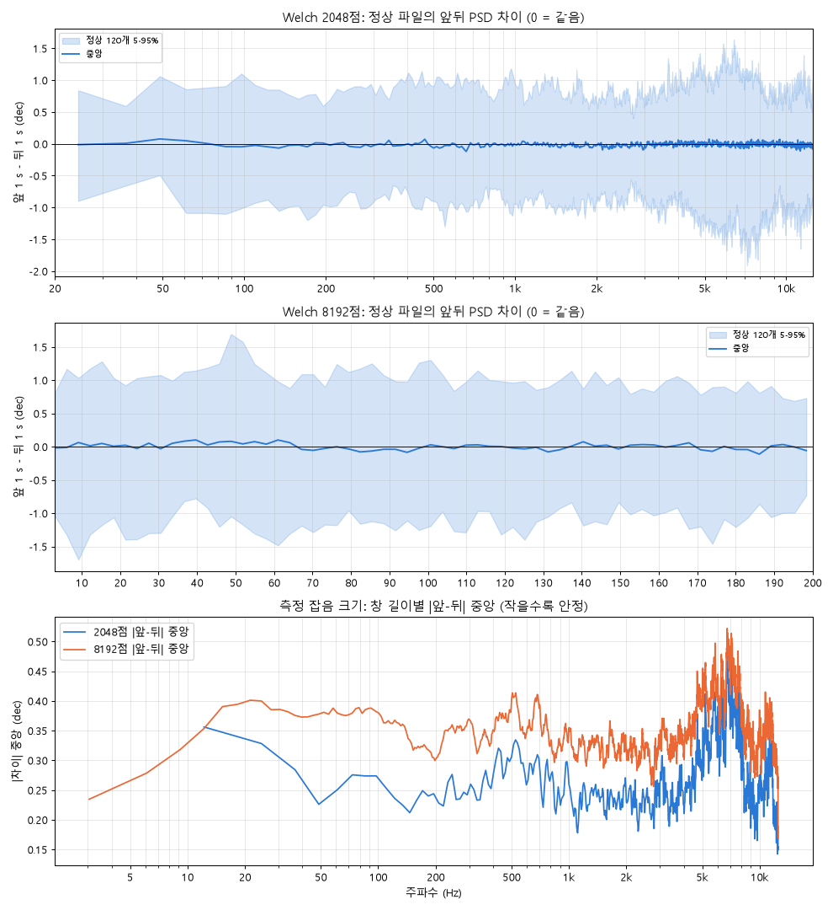

# Q6 Welch 잡음 실측 (11-21)

코드 [run.py](run.py) · 숫자 [result.txt](result.txt). 정상 120개를 앞 1 s / 뒤 1 s로 나눠 각각 Welch(50% 겹침, Hann, 8192점은 detrend 끔)를 구하고 "앞 − 뒤"(dec)를 봤다. 정상은 앞뒤가 같은 신호여야 하므로 이 차이가 그 창 길이에서 생기는 흔들림의 상한이다(실제 앞뒤 신호 차이도 섞여 있다).

## 결과
| 대역 | 2048점 \|차이\| 중앙 (90%) | 8192점 \|차이\| 중앙 (90%) | 8192/2048 | 정상 파일 사이 흩어짐(sd) |
|---|---|---|---|---|
| 3–200 Hz | 0.25 (0.93) | 0.36 (1.12) | 1.45 | 0.84–0.95 dec |
| 200–1 kHz | 0.27 (0.96) | 0.35 (1.03) | 1.30 | 0.83 |
| 1–5 kHz | 0.24 (0.97) | 0.33 (1.03) | 1.37 | 0.76 |
| 5–12.5 kHz | 0.28 (1.17) | 0.37 (1.22) | 1.30 | 0.81 |

- 앞뒤 차이의 **중앙은 모든 주파수에서 0**(체계적인 치우침 없음). 정상 5–95% 띠는 2048점에서 ±1 dec, 높은 주파수(5 kHz 위)에서 ±1.5 dec까지 넓다.
- **8192점의 잡음은 2048점의 약 1.3–1.45배**다. 조각 수만으로 예상하면(약 23개 대 5개) 2배쯤이어야 하는데 더 작다.
- 값이 큰 정상: nor_095 · 094 · 055 · 086 · 060 · 001(2048점 \|차이\| 중앙 1.3–1.8 dec). 충격이 한쪽 절반에만 있을 가능성.

## 읽기
- **측정 잡음만으로는 설명이 안 된다**: 조각 23개짜리 PSD가 정상 신호 위에서 흔들리는 크기는 이론상 0.1 dec 안팎이어야 하는데(|차이| 중앙으로는 0.1 이하), 실제는 0.25 dec이고 90% 선은 0.9–1.2 dec이다. 앞뒤 1 s의 **신호 자체**(충격이 어느 쪽에 몰렸나, 길 상태가 바뀌었나)가 달라서 생긴 비정상성이 더 크다. 그래서 표의 값은 "Welch가 만든 잡음"의 상한이다.
- 5–8 kHz에서 가장 크다(충격 울림 대역). 낮은 주파수 쪽은 비슷하게 0.25–0.4 dec.
- **창 길이 고정에 주는 의미**: 8192점이 2048점보다 약 1.3–1.45배 흔들리지만 배수가 크지 않다. 저주파 8192점(칸 3 Hz) · AE 2048점(칸 12 Hz)은 물리 해상도로 정한 것인데, 잡음이 이를 뒤집을 만큼 차이 나지 않는다. 다만 1 s 반쪽이라는 조건이라, 실제 2 s 전체(조각 수 두 배)는 이보다 안정적이다.
- 정상 파일 사이 흩어짐(sd 0.76–0.95 dec)보다 앞뒤 차이의 표준편차(0.58–0.73 dec)가 작지만 같은 자릿수다. PSD 그림에서 0.3–0.4 dec 정도의 작은 봉우리는 이 흔들림 안에 묻힌다. Q1에서 다룬 8–10 kHz 언덕(+1.5~+2.2 dec)과 모양 몫 차이(약 +1 dec)는 이보다 크다.

## 해석 주의
- 앞 1 s와 뒤 1 s는 같은 파일이라도 다른 순간이다. 이 차이를 순수 추정 잡음으로 읽으면 과대평가다.
- 2 s 전체 Welch의 잡음은 직접 재지 못했다(비교 대상 없음). 파일 사이 흩어짐에도 신호 차이가 섞여 있다.
- 8192점 \|차이\| 곡선의 낮은 주파수 쪽 몇 칸은 칸 수가 적어 거칠다.
