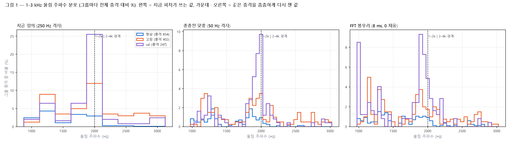
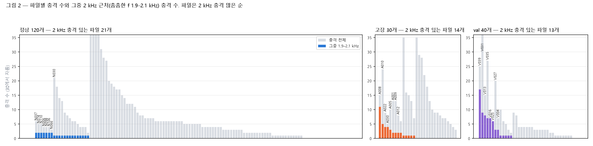
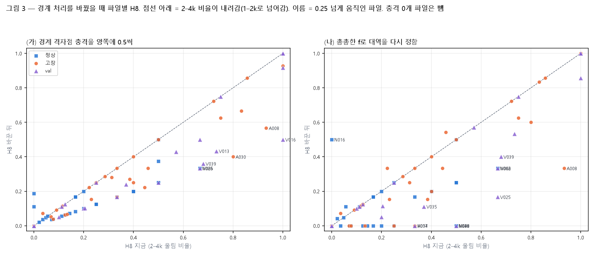

# 2-29 울림 대역 경계 점검 (11-22)

**결론: 2 kHz 몰림은 격자의 산물이 아니라 실제 울림 모드(약 1.9–2.0 kHz)다. 그런데 그 모드가 1–2k | 2–4k 경계(2000 Hz) 위에 걸쳐 있다.** 촘촘하게 다시 재도 val · 고장 충격이 1.85–2.0 kHz에 뾰족하게 몰린다. 고장과 val에서는 이 모드가 몇몇 파일에 여러 번 반복되고(A008 11번, V039 17번), 정상에서는 파일당 1–2번 드문드문 나온다. 경계 처리를 바꾸면(반씩 세기 · 촘촘한 f) 정상보다 **고장의 H8이 더 많이 내려간다**(중앙 0.32 → 0.25 · 0.23). 그래서 경계를 손보면 V025 같은 경계 val은 정상 쪽으로 가지만, 같은 모드로 우는 고장 신호도 함께 약해진다.

**그림 1**은 1–3 kHz의 울림 주파수 분포다(그룹마다 전체 충격 대비 %). 왼쪽은 지금 피처가 쓰는 값(250 Hz 격자)이다. 가운데는 같은 충격을 50 Hz 격자 사전으로, 오른쪽은 FFT 봉우리(8 ms Hann, 8192점 0 채움)로 다시 잰 값이다. 점선이 1–2k | 2–4k 경계다.
- 촘촘하게 재도 val(보라)은 1.85–2.0 kHz에 뾰족한 봉우리가 있고(충격의 26 %), 고장(주황)도 같은 곳에 작은 봉우리가 있다(10 %). 정상(파랑)은 3 %다.
- FFT 봉우리로 보면 중심이 1.9 kHz 근처, 경계 바로 아래다. 지금 2000 Hz로 잡힌 충격 중 FFT로 2000 아래인 것은 정상 20/25 · 고장 27/48 · val 44/63이다.
- 8 ms 창의 실제 분해능은 약 125 Hz다. 따라서 이 모드는 어떤 방법으로 재도 경계 양쪽에 걸친다.

**그림 2**는 파일별 충격 수(회색)와 그중 2 kHz 근처(촘촘한 f 1.9–2.1 kHz, 색) 충격 수다.
- **고장**: 14개 파일에 있고, 상위 3개(A008 11/15 · A010 5/24 · A030 4/5)가 절반을 차지한다.
- **val**: 13개 파일에 있고, 상위 3개(V039 17/25 · V031 9/44 · V013 8/15)가 절반을 차지한다. V039 · V031 · V013 · V016 · V035는 J-축소가 이미 고장으로 판정하는 val이다.
- **정상**: 21개 파일에 있지만 모두 파일당 1–2개다(N006 · N037 · N074 · N110 · N098 2개가 최대).
- → 이 모드가 한 파일에서 "여러 번 반복"되면 고장 쪽 신호다. 한두 번이면 정상에도 있다.

**그림 3**은 경계 처리를 바꿨을 때 파일별 H8(2–4k 울림 비율)이다. 점선 아래는 비율이 내려간 파일이다. 두 방식 모두 라벨 없이 정했다.
- (가) 경계 격자점(2000 · 4000 · 8000 Hz) 충격을 양쪽 대역에 0.5씩
- (나) 촘촘한 f(50 Hz)로 대역을 다시 정함

| 그룹 | 방식 | H8 바뀐 파일 | H8 평균 변화 | 0.2 넘게 내려간 파일 | H8 중앙 (전 → 후) |
|---|---|---|---|---|---|
| 정상 | (가) | 19/103 | −0.021 | 4 | 0.00 → 0.00 |
| 정상 | (나) | 19/103 | −0.028 | 6 | 0.00 → 0.00 |
| 고장 | (가) | 17/30 | −0.072 | 3 | 0.32 → 0.25 |
| 고장 | (나) | 16/30 | −0.075 | 5 | 0.32 → 0.23 |
| val | (가) | 13/36 | −0.073 | 5 | 0.11 → 0.08 |
| val | (나) | 10/36 | −0.077 | 6 | 0.11 → 0.00 |

- 고장에서 크게 내려가는 파일: A008 0.93 → 0.57 · 0.33, A030 0.80 → 0.40 · 0.60, A022 0.44 → 0.22 · 0.33
- V025: 0.67 → 0.33(가) · 0.17(나). 실제 울림은 1.90–1.95 kHz(촘촘한 f 1900 · 2000 · 1900 · 1950 · 1900 · 1900, FFT 1913–2032)이고, 6-6의 "1–2k로 세면 여유 −2.05"와 같은 방향이다
- 표 전체와 고장 파일별 값은 [표.md](표.md), 충격별 값은 `figs/impacts_fine.csv`, 파일별 세 방식 비율은 `figs/ring_ratio_3ways.csv`. 코드 [run.py](run.py)

## 해석과 다음
- **경계를 옮기거나 나눠 세는 것만으로는 개선이 안 될 가능성이 크다.** 경계 근처 val(V025)은 정상 쪽으로 가지만, 같은 모드로 우는 고장 신호(A008 · A030 · A022)도 함께 약해진다. 정상은 거의 안 움직인다.
- 고장과 정상을 가르는 것은 "2 kHz로 울었나"가 아니라 "**2 kHz 울림이 한 파일에서 몇 번 반복되나**"다. 이건 EXP-050 축소(충격이 적으면 비율을 덜 믿기)가 이미 부분적으로 다루는 정보다. V025는 이 모드로 6번 울었다. 고장 A030(4/5)과 정상 최대(2개) 사이라서 정말 애매하다.
- 이 모드를 따로 세는 피처(예: 1.85–2.1 kHz 울림 충격 수)는 라벨을 본 뒤 대역을 고르는 셈이다. 쓰려면 물리 근거(어떤 부품의 모드인지)와 폴드 안 재선택 안정성이 먼저 필요하다(결정.md 설계 원칙).
- 이 EDA는 val 파일(V025)에서 출발했다. 라벨은 그룹 비교(정상 · 고장 분포)에만 썼다.
