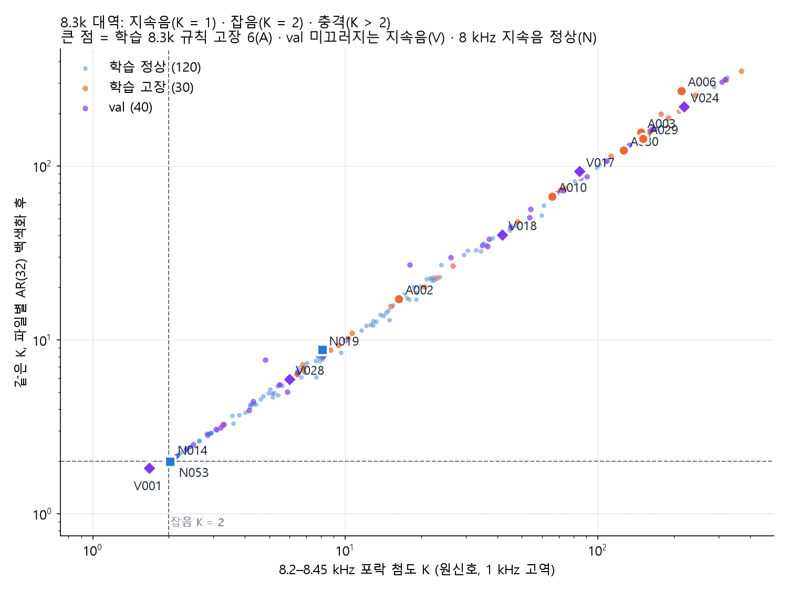
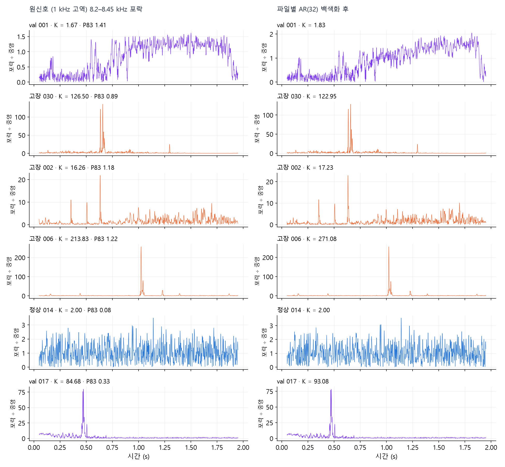
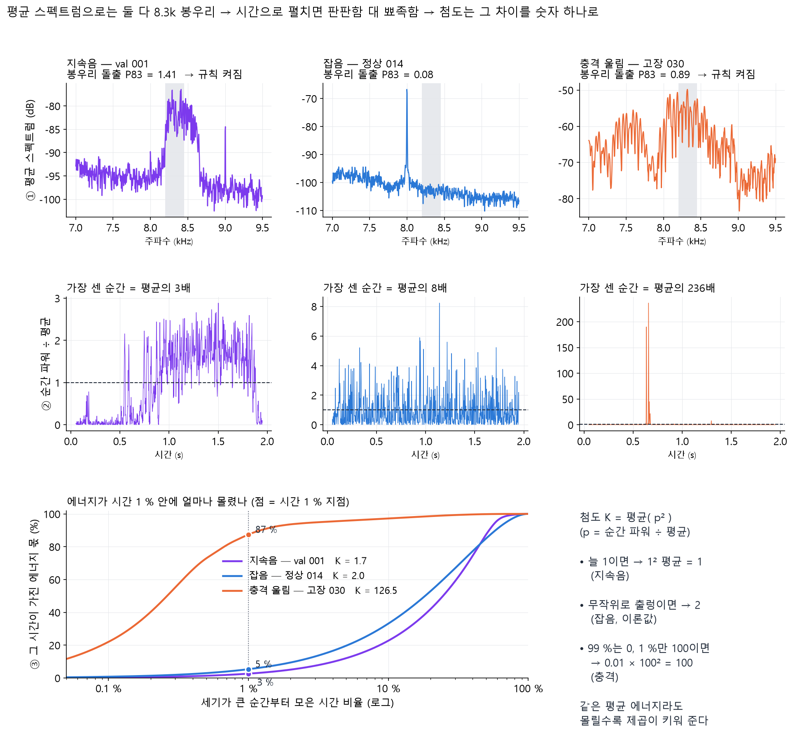

# 2-12 8.3k 대역 에너지는 지속음인가 충격 울림인가

상태: 1차 (2026-11-23). 코드 [run.py](run.py), 수치 [figs/결과.txt](figs/결과.txt), 파일별 값 [figs/파일표.csv](figs/파일표.csv)

**결론: 8.2–8.45 kHz 포락 첨도 K 하나로 갈린다. 학습 8.3k 규칙 고장 6개는 K 16–214(충격), val_001은 K 1.67(지속음, 190개 중 최저)이다. 미리 정한 통과 조건(고장 6개 K > 2 · 001 K ≤ 2)을 만족한다. 파일별 AR 백색화는 K를 거의 바꾸지 않아서 필요 없다.**

## 질문
val_001은 8.3k 규칙의 스펙트럼 갈래(평균 스펙트럼 돌출 P83 · 폭 W83)만으로 고장이다. 규칙의 전제(H2)는 "충격이 8.3 kHz 공진을 울린다"인데, 001에는 충격이 없고 미끄러지는 지속음만 있다(6-7 · 2-10). 평균 스펙트럼은 둘을 구분하지 못한다. 시간 쪽 지표로 지속음과 충격 울림을 가를 수 있는가?

## 방법 (결과 보기 전에 고정)
- 대역 = 규칙 대역 8200–8450 Hz. 1 kHz 고역통과 → 버터워스 4차 대역통과 → 힐베르트 포락 e(t)
- **포락 첨도 K = mean(e⁴) / mean(e²)²** (대역 스펙트럴 첨도). 이론값: 순수 지속음 1 · 가우스 잡음 2 · 충격이 섞이면 2보다 커짐
- 같은 K를 **파일별 AR(32) 백색화** 신호에서도 계산(그 파일 자신으로 예측기를 맞추고 예측 오차만 남김)
- 문턱 = 이론값 2. 001에 맞춰 바꾸지 않음

## 결과

| 파일 | P83 · 폭 | 스펙트럼 갈래 | K (원신호) | K (백색화 후) |
|---|---|---|---|---|
| 학습 고장 002 | 1.18 · 247 Hz | 켜짐 | 16.3 | 17.2 |
| 학습 고장 006 · 010 · 029 · 030 | 0.89–1.22 · 229–275 Hz | 켜짐 | 66–214 | 67–271 |
| 학습 고장 003 (공진 갈래로 켜짐) | 0.19 · 55 Hz | - | 148 | 156 |
| **val 001** | **1.41 · 430 Hz** | **켜짐** | **1.67** | **1.83** |
| val 017 · 024 (미끄러지는 지속음 + 결합으로 고장) | 0.28–0.33 | - | 85 · 220 | 93 · 219 |
| 학습 정상 014 · 053 (8 kHz 고정 지속음) | 0.04–0.08 | - | 2.00 · 2.02 | 2.00 · 1.99 |

- 스펙트럼 갈래가 켜진 파일은 학습 5개 + val 001 하나다. 그중 K ≤ 2는 001뿐이다. 고장의 최솟값(002, 16.3)과 001(1.67) 사이가 10배 가까이 벌어져 있어서, 문턱을 2–16 어디에 두어도 결과가 같다
- 전체 분포(중앙): 정상 6.9 · 고장 68 · val 31. K ≤ 2인 파일은 정상 2 % · 고장 0 % · val 2 %(001)

**그림 읽는 법:** 각 줄이 한 파일의 8.3k 대역 포락이다(중앙값으로 나눔). 고장 030 · 002 · 006은 몇 번의 뾰족한 충격 울림이 대역 에너지를 만든다. val 001은 0.5 s 무렵 지속음이 대역 안으로 미끄러져 들어와 끝까지 머무는 판판한 언덕이다. 정상 014는 잡음 수준(K = 2)이다. val 017도 미끄러지는 지속음이 있지만, 8.3k 대역에서는 0.47 s의 충격 울림이 대부분이다.

### 왜 첨도가 가르나 (설명 그림, 11-23)

- ① 평균 스펙트럼: 001(지속음)과 030(충격)은 둘 다 회색 규칙 대역에 에너지가 있어서 규칙이 켜진다. 평균은 "언제" 생긴 에너지인지 지운다
- ② 같은 대역을 시간으로 펼친 순간 파워(평균 = 1). 001은 1 근처에서 판판하고(최대 3배), 014는 무작위로 출렁이고(최대 8배), 030은 한 순간만 236배로 솟는다
- ③ 세기가 큰 순간부터 시간을 모았을 때 에너지 몫. 시간 1 %가 가진 에너지: 030 87 % · 014 5 % · 001 3 %
- K = 평균(p²). 같은 평균이라도 에너지가 몰리면 제곱 때문에 커진다(99 %는 0, 1 %만 100이면 0.01 × 100² = 100)

## 해석
- **001의 스펙트럼 갈래는 충격 울림이 아니라 지속음이 8.2–8.45 kHz를 지나가며 만든 것이다.** 이 해석이 숫자로 확인됐다. 규칙 전제(H2)와 맞지 않는 켜짐이다
- **백색화는 효과가 없다.** 원신호 K와 백색화 K가 대각선 위에 있다. 파일별 AR(32)은 1–12.4 kHz 전체의 큰 성분에 차수를 쓰기 때문에, 약한 001 지속음을 지우지 못했다(대역 몫 비율 1.11). 좁은 대역 안에서 AR 필터는 거의 일정한 이득이라 K도 그대로다. → 계획의 두 도구 중 **스펙트럴 첨도만 쓴다**
- 017 · 024는 미끄러지는 지속음이 있어도 8.3k 대역에서는 충격이 우세하다(K 85 · 220). **지속음이 있다고 정상인 것은 아니다.** 이 지표는 "8.3k 규칙이 충격 때문에 켜졌나"만 본다

## 한계
- 001의 라벨은 모른다. 이 EDA는 "규칙 전제와 다른 켜짐"을 보일 뿐, 001이 정상이라는 증거는 아니다(결합 점수는 25/25 정상, 6-7)
- 착안은 val_001을 보고 했다(결정.md "val로 모델을 고치지 않는다"와 부딪힘). 문턱은 이론값 2로 미리 정했다
- 학습에서 스펙트럼 갈래가 켜진 파일은 5개뿐이라, 이 조건을 더해도 학습 판정은 바뀌지 않는다 → 중첩 CV로는 검증되지 않고, 근거는 물리 전제(H2)다

## 다음
- EXP-054 후보: 8.3k 스펙트럼 갈래 = 기존 조건 AND K > 2. 기대 결과: 학습 중첩 F2는 J-축소와 같고, val 판정은 001만 고장 → 정상으로 바뀜
- 채택 여부와 제출 파일 변경은 사용자 결정(판단차이 기록 · 승인 사항)
