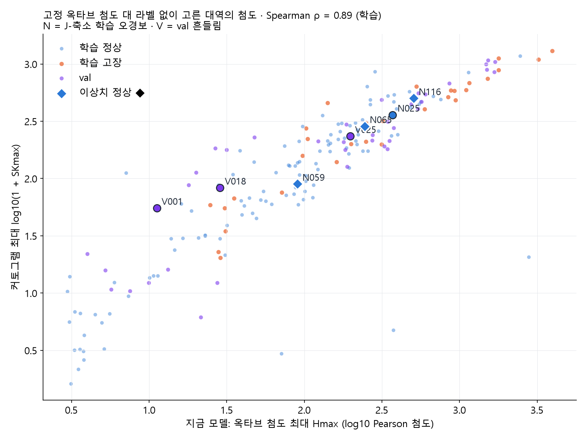
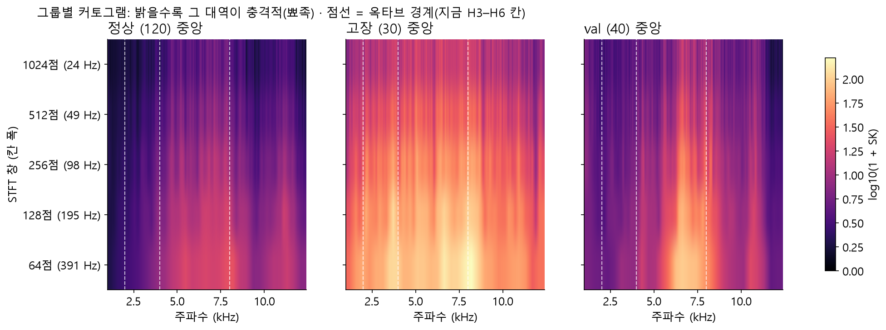
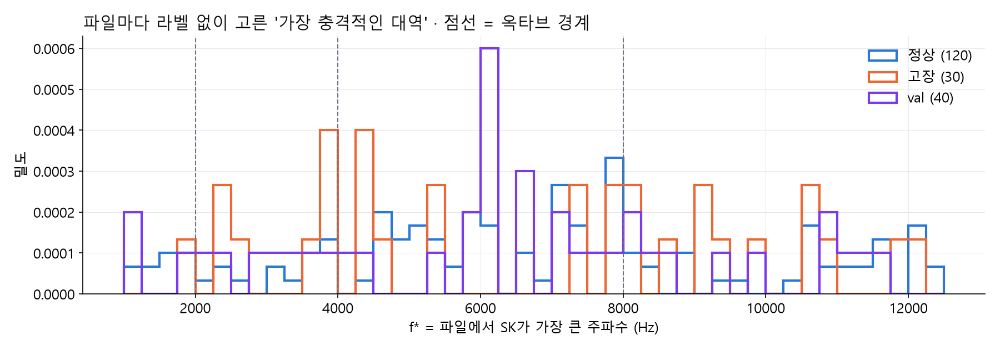

# 2-13 전 대역 스펙트럼 첨도 지도 (STFT 커토그램)

상태: 1차 (2026-11-23). 코드 [run.py](run.py), 수치 [figs/결과.txt](figs/결과.txt), 파일별 값 [figs/파일표.csv](figs/파일표.csv)

**결론: 새 정보가 아니다.** 라벨 없이 파일마다 "가장 충격적인 대역"을 골라도, 그 첨도(SKmax)는 지금 모델의 옥타브 첨도 최대(Hmax)와 거의 같은 순서다(Spearman ρ 0.89, AUC 0.726 대 0.722). J-축소의 학습 오경보 116 · 025 · 065는 정상 안에서 SKmax 79–92 백분위에 있어서, 이 값을 더하면 오경보가 줄지 않고 더 고장 쪽으로 간다. 피처 후보로 올리지 않는다.

**그림 읽는 법:** 점 하나 = 파일 하나. 가로 = 지금 모델의 고정 옥타브 첨도 최대, 세로 = 커토그램 최대. 대각선 띠를 따라 놓이면 같은 정보다. N = J-축소 학습 오경보, V = val 흔들림, ◆ = 이상치 정상(059 · 065 · 116).

## 질문
PHM에서 흔한 "스펙트럼 첨도(SK) → 커토그램으로 충격 대역 고르기"를 전 대역에 적용하면 지금 모델이 못 보는 것이 보이나. 2-12는 8.3k 한 대역만 봤고, 지금 H3–H6은 옥타브 4칸을 고정해서 쓴다.

## 방법 (결과 보기 전에 고정)
- 평균 제거 → 1 kHz 고역 → STFT 창 64 · 128 · 256 · 512 · 1024점(칸 폭 391 – 24 Hz), 홉 = 창/4
- SK(f) = E|X|⁴ / (E|X|²)² − 2 (2-12의 K − 2: 지속음 −1 · 잡음 0 · 충격 > 0). 1–12.4 kHz
- 파일마다 모든 (창, 주파수) 중 최대 = SKmax, 그 자리 = f* (라벨 없이 고른 대역)
- 비교: Hmax(H3–H6 최대), H1(충격 수). ρ ≥ 0.9면 같은 정보로 본다(미리 정함)

## 결과

| | 값 |
|---|---|
| Spearman ρ(SKmax, Hmax) · ρ(SKmax, H1) | **0.89** · 0.35 |
| AUC: SKmax · Hmax · H1 (학습, 기술 통계) | 0.726 · 0.722 · **0.798** |
| SKmax 중앙 [5–95 %] | 정상 112 [2 – 528] · 고장 312 [27 – 1111] · val 211 [10 – 998] |
| f*가 옥타브 경계(2 · 4 · 8 kHz)에 걸친 파일 | 정상 10/120 (8 %) · **고장 7/30 (23 %)** · val 3/40 |
| f* 옥타브 = Hmax 옥타브 | 정상 83/120 · **고장 13/30** · val 26/40 |
| 고른 창 = 64점(넓은 대역 · 짧은 충격) | 정상 49/120 · 고장 21/30 · val 25/40 |

| 어려운 파일 | SKmax (f*) | 정상 중 백분위 |
|---|---|---|
| 정상 116 (오경보 5/5) | 501 (5.9 kHz) | 92 |
| 정상 025 | 359 (3.5 kHz) | 85 |
| 정상 065 | 285 (9.6 kHz) | 79 |
| 정상 059 | 89 (10.6 kHz) | 45 |
| val 001 | 54 (3.3 kHz) | 30 — 충격 없음(2-12와 같음) |
| val 025 · 018 | 233 · 82 | 71 · 42 |

**그림 읽는 법:** 칸 = 그룹 중앙 log10(1 + SK). 세로 = STFT 창(위로 갈수록 좁은 대역), 점선 = 옥타브 경계. 고장은 짧은 창(아래)에서 전 대역이 밝다. 정상은 5–8 kHz만 조금 밝다. val은 정상과 닮았지만 5.5–7.5 kHz가 더 밝다.

## 해석
- **SKmax는 Hmax와 같은 정보다.** 대역을 파일마다 골라도 "얼마나 뾰족한가"의 순서가 거의 바뀌지 않는다. 지금 모델에서 더 잘 가르는 정보는 충격 수(H1, AUC 0.80)이고, SKmax와는 상관이 낮다(0.35)
- **오경보를 줄이는 방향이 아니다.** 116 · 025 · 065는 실제로 뾰족한 충격이 있는 정상이다. 첨도 계열 지표는 이 파일들을 더 고장처럼 보이게 한다. 이들을 가르는 것은 "얼마나 뾰족한가"가 아니라 "어디서 · 몇 번 · 어떤 울림"(H7–H10 · 박자)이다
- **곁가지 관찰:** 고장의 가장 충격적인 대역은 3.5–4.5 kHz와 7.5–8.5 kHz에 몰려 옥타브 경계(4 · 8 kHz)를 걸친다(고장 23 % 대 정상 8 %). 그래서 고장의 f* 옥타브와 Hmax 옥타브가 13/30만 일치한다. 고정 옥타브가 고장 울림 대역을 쪼개고 있다는 2-29(울림 대역 경계)의 문제와 같은 방향이다. 다만 Hmax와 SKmax의 순서가 같으므로 판정에는 영향이 작다
- val은 f*가 6 kHz 부근(본체 모드 5.5–7.75 kHz, 2-7)에 몰린다. 측정 조건 차이(2-8)일 수 있다. 관찰만

## 한계
- STFT 칸 기반 커토그램이다(Antoni의 1/3-이진 필터뱅크 커토그램이 아님). 창 5개 × 균일 칸
- AUC는 순위 기술 통계이고 모델 비교(중첩 CV)가 아니다. 다만 ρ 0.89 · 어려운 파일의 위치로 보아 중첩 CV를 돌릴 이유가 약하다
