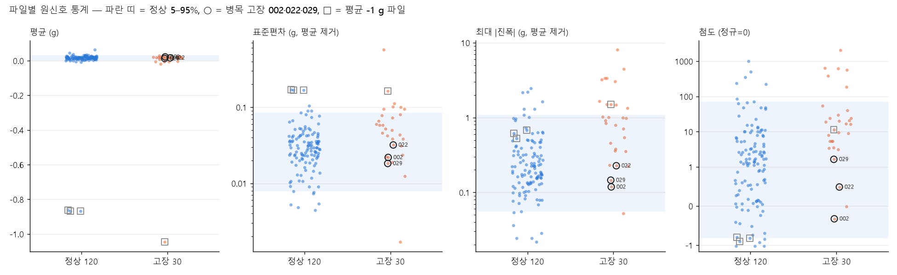
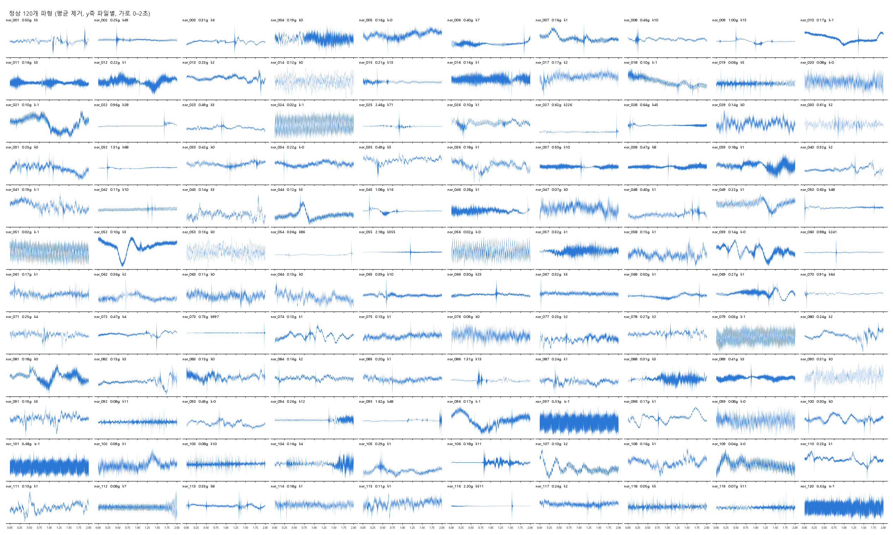
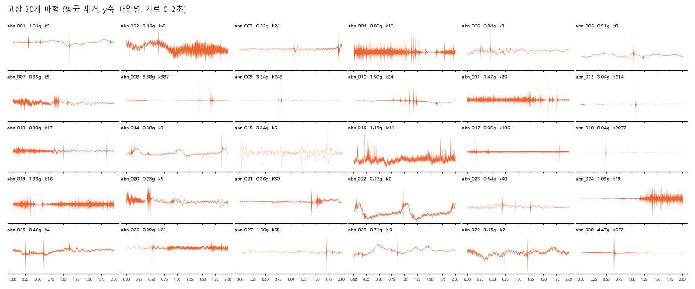

# 2-1 원신호 전체 개관 (조각 ①)

상태: 사용자가 노트북으로 더 확인 중 (2026-11-13)
노트북: [2-1_1113_원신호개관.ipynb](2-1_1113_원신호개관.ipynb) (커널 qe-phm, 셀 단위 실행) · 수치: [figs/2-1_stats.csv](figs/2-1_stats.csv)
파일별 파형 150장: [파형_150/](파형_150) (`nor_001.png` …, 위 = 2초 전체 + 정상 95% 진폭 점선, 아래 = 최대 진폭 지점 ±20 ms, 제목 = 통계와 정상 대비 백분위. 노트북 9절에서 다시 생성)

## 목적
시간영역에서 기본 정보를 먼저 파악한다. 전처리·피처를 만들기 전에 150개 파일이 **파일 단위 기본 통계(describe)와 파형**에서 어떻게 생겼는지 본다.
(a) 정상·고장이 단순 통계로 얼마나 갈리는지, (b) 병목 고장 002·022·029가 어디에 있는지, (c) 평균·표준편차 이상치(평균 -1 g 파일 4개 등)가 무엇인지.

## 방법
- **단위는 파일.** 라벨이 파일마다 붙어 있으므로 파일마다 통계를 하나씩 내고 정상 120개 vs 고장 30개를 describe한다. 샘플 50,000개를 클래스별로 통째로 합치면 진폭 큰 파일 몇 개가 결과를 지배한다
- 통계: 평균(원신호), 평균 제거 후 표준편차(=RMS)·최소·최대·최대 |진폭|·peak-to-peak·첨도(Fisher, 정규=0)·왜도·파고율(최대/표준편차)
- 정상 5–95% 범위를 기준으로 고장을 겹쳐 본다. 단변량 AUC는 설명용(선택에 쓰지 않음)
- 파형: 150개 전체 축소판(25점씩 묶어 최소~최대를 칠함 → 순간 충격 보존), 대표 파일 2초 전체·0.1초 확대, 같은 y축 비교

## 결과
### 데이터 확인
150 × 50,000, 2초 · 25 kHz, 결측·무한대 없음. 전체 범위 -7.25 ~ 8.06 g

### describe 요약 (파일 단위)
| 통계 | 정상 중앙값 [5–95%] | 고장 중앙값 | 고장 중 정상 95% 초과 | AUC |
|---|---|---|---|---|
| 평균 | 0.016 [0.000 ~ 0.031] | 0.017 | – | 0.50 |
| 표준편차 | 0.029 [0.008 ~ 0.085] | 0.051 | | 0.71 |
| 최대 \|진폭\| | 0.22 [0.06 ~ 1.09] | 0.95 | 11 / 30 | **0.80** |
| 첨도 | 1.6 [-0.8 ~ 72] | 16.5 | | 0.77 |
| 왜도 | -0.04 | -0.01 | | 0.51 |
| 파고율 | 7.2 [3.2 ~ 27.6] | 16.7 | | 0.79 |

전체 describe 표(count·mean·std·min·사분위·max)와 빈 칸 값은 노트북 3절 참고.

## 관찰
1. **진폭이 크면 고장일 가능성이 높지만 절반도 안 잡힌다.** 최대 |진폭|이 정상 95%(1.09 g)를 넘는 파일: 고장 11/30, 정상 6/120(nor_025·032·055·086·095·116). 고장 19개는 기준 이하
2. **정상에도 큰 단발 충격이 있다.** nor_055(2.18 g, 첨도 355)·nor_116(2.20 g, 511)·nor_073(첨도 997)은 조용한 바탕에 충격 하나 → 고장 abn_008·009·012·017·018·030과 모양이 비슷하다
3. **150개 파형에서 보이는 차이 후보: 충격이 "한 번"인가 "여러 번 반복"인가.** 고장 abn_004·010·011·019·024는 충격이 열차처럼 여러 번 반복된다. 정상의 큰 충격은 대부분 단발 → 조각 ③(창별 충격 횟수·간격)에서 확인할 1순위 질문 (H1)
4. **정상 파형은 모양이 매우 다양하다.** 느린 흔들림형(nor_021·052·096), 넓은 대역 잡음형(nor_014·030·090), 규칙적 연속 진동형(nor_024·051·056·079: 진폭 0.02–0.03 g로 가장 작은 무리), 강한 연속 진동형(nor_097·101·120) → 정상 안에 여러 운전 상태가 섞여 있을 가능성
5. **평균·표준편차 이상치 = 평균 -1 g 무리.** nor_097·101·120은 평균 -0.87 g, 표준편차 0.17(정상 최대 3개), 첨도 -0.8~-0.9(사인파에 가까움), 약 1 kHz 규칙 진동. 세 파일 값이 거의 같다. abn_016은 평균 -1.04 g로 조금 다르고 충격(첨도 11)이 얹혀 있다
   - 중력 1 g이 평균에 들어감 = 센서 축 방향(설치 자세)이 다른 측정일 가능성. val·test에도 나올 수 있다 → 평균 제거는 필수, 진폭 피처를 그대로 쓰면 이 무리 정상 3개가 오경보 후보
   - 그 밖의 평균은 모두 0.00~0.06 g 사이로 이상치 아님
6. **병목 고장 002·022·029는 모든 통계에서 정상 중앙 부근** (백분위 11–57%)
   - abn_002: 충격 없음, 첨도 -0.3(잡음형). 1.0–1.6초에 넓은 대역 잡음이 커짐 → 조각 ②
   - abn_022: 0.05·0.98·1.95초에 작은 충격(0.1–0.2 g), 간격 약 0.95초. 느린 흔들림과 함께 나타남 → H4 후보. 3번뿐이라 아직 추측
   - abn_029: 0.68·0.73·1.18초에 작은 충격. 정상 충격보다 작다
7. 극단 파일: abn_017 표준편차 0.0017(가장 조용, 충격 하나로 첨도 186), abn_018 최대 8.0 g(첨도 2077), abn_015 표준편차 0.57(가장 큼)
8. 평균·왜도는 정상·고장 차이 없음(AUC 0.50·0.51)

## 해석과 다음
- 파일 전체 통계는 "큰 고장"은 잡지만 겹침이 크고 병목 3개는 전혀 못 잡는다 → 지금까지 RMS·Peak·첨도 계열 피처의 한계와 같은 이야기
- 크기보다 **충격의 횟수·반복성**(관찰 3)과 **정상 안의 운전 상태 차이**(관찰 4·5)가 다음 질문
- 물리가설 연결: 관찰 2–3 → H1, 관찰 6(022) → H4, 관찰 4–5 → 새 질문(운전·설치 조건 차이). 검증 열은 조각 ③ 이후 채운다
