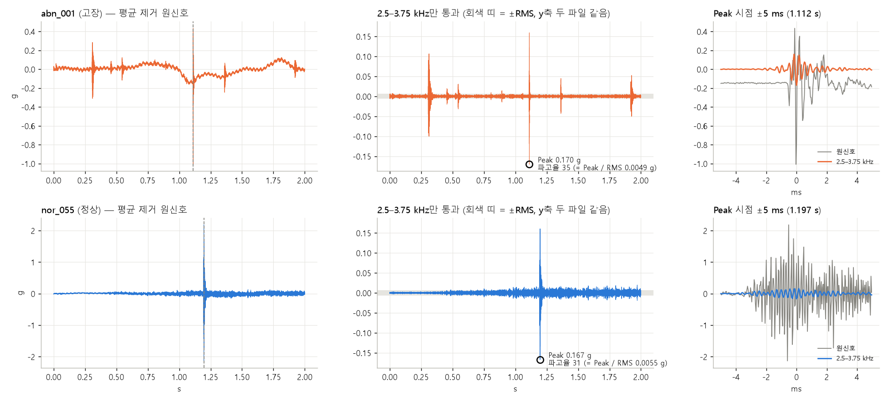

# 2-5 대역 필터 피크 — `P02_peak_025`는 어떤 순간에서 나오나

상태: 그림 1장 (2026-11-14). 코드 [run.py](run.py), 수치 [figs/band_peak_numbers.txt](figs/band_peak_numbers.txt)

## 질문
ET가 가장 기대는 피처 묶음은 대역 필터 후 Peak·파고율이다. "2.5–3.75 kHz만 통과시킨 신호의 최대 |진폭|"이 실제로 무엇을 잡는지, 잘 잡히는 고장(abn_001)과 오경보 정상(nor_055, ET 5/5)에서 비교한다.

## 결과

| | 대역 Peak | 대역 RMS | 파고율 | 정상 중 백분위 (peak · crest · rms) | 원신호 Peak |
|---|---|---|---|---|---|
| abn_001 | 0.170 g (1.112 s) | 0.0049 g | 35 | 97 · 96 · 85 | 1.01 g |
| nor_055 | 0.167 g (1.197 s) | 0.0055 g | 31 | 96 · 92 · 90 | 2.18 g |

## 해석
- 두 파일의 대역 Peak·파고율이 거의 같다 → 이 피처들로는 둘을 가를 수 없고, 그래서 nor_055가 오경보가 된다
- 그림으로 보이는 차이 (확인 필요, 파일 2개):
  1. **충격 횟수**: abn_001은 대역 신호에 떨어진 충격이 5–6번, nor_055는 큰 사건 1번
  2. **충격 모양**: abn_001은 약 1 ms 안에 끝나는 짧은 충격. nor_055는 원신호가 ±2 g로 10 ms 넘게 울리는데 2.5–3.75 kHz 성분은 작다 → 에너지 대부분이 이 대역 밖
  3. **사건 뒤 바탕**: nor_055는 1.2 s 이후 대역 바탕이 높아진 채 유지된다
- 다음: 이 세 가지가 고장/정상 전체에서 갈리는지 확인 (충격 수·지속 시간·주된 주파수·사건 전후 바탕 비)
