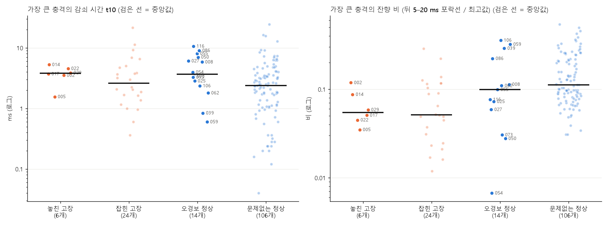
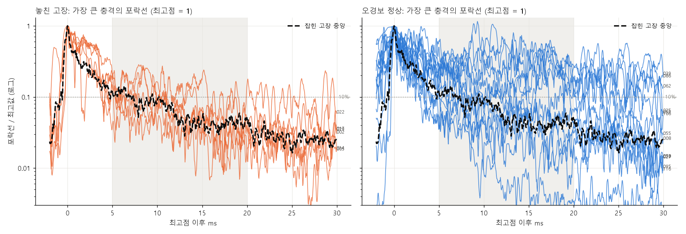

# 2-6 충격 지속 시간 — 틀린 파일(놓친 고장 · 오경보 정상)에서 충격이 얼마나 오래 울리나

상태: 1차 (2026-11-14). 코드 [run.py](run.py), 수치 [figs/duration_numbers.txt](figs/duration_numbers.txt), 파일별 [figs/duration_per_file.csv](figs/duration_per_file.csv)

## 질문
2-5에서 abn_001(짧은 충격)과 nor_055(길게 울림)는 대역 Peak가 같았다. 충격 지속 시간이 모델이 틀린 고장과 정상을 가르는가?

## 정의
- 신호: 평균 제거 → 200 Hz 고역통과. 충격: |h| > 8σ(MAD), 10 ms 안은 한 사건 (뷰어와 같음). 충격 없으면 최대점 1개
- 포락선: Hilbert |h|, 0.2 ms 이동평균
- **t10 (감쇠 시간)**: 최고점 → 포락선이 max(최고 × 10%, 바탕 3σ) 아래로 처음 떨어질 때까지 *(사전 정의)*
- **t50**: 최고점 주변 포락선 ≥ 50% 구간 폭 *(사전 정의)*
- **잔향 비 rv**: 최고점 뒤 5–20 ms 포락선 중앙값 / 최고값 *(그림을 본 뒤 추가. t10이 울림의 출렁임에서 일찍 끊기는 문제 때문. 라벨 보고 만든 정의이므로 피처로 쓰려면 중첩 CV 확인 필요)*
- 묶음: EXP-007 기준 ET · EXP-012 AE에서 5번 중 3번 이상 틀림 (놓친 고장 6, 오경보 정상 14)

## 결과

| 묶음 | 충격 수 | t10 (ms) | t50 (ms) | 잔향 비 | 최대 사건 높이 (σ배) |
|---|---|---|---|---|---|
| 놓친 고장 (6) | 5.5 | 3.8 | 1.00 | **0.055** | 51 |
| 잡힌 고장 (24) | 11 | 2.6 | 0.74 | **0.051** | 103 |
| 오경보 정상 (14) | 6 | 3.7 | 0.88 | **0.099** | 135 |
| 문제없는 정상 (106) | 3 | 2.4 | 1.04 | **0.112** | 19 |

설명용 AUC (고장=1, 0.5보다 작으면 고장 쪽이 작다): 잔향 비 0.25 전체, **최대 사건 40σ 이상만 0.29 (고장 24 / 정상 32)**, 40σ 미만 0.51 (고장 6). t10 0.57 전체. t50 0.38 전체, 40σ 이상 0.32

## 해석
1. **절대 지속 시간(t10)은 가르지 못한다.** 놓친 고장 3.5–5.3 ms(005만 1.6), 오경보 정상 0.6–10.7 ms로 겹친다
2. **최고값 대비 얼마나 빨리 가라앉는가(잔향 비)는 차이가 있다.** 고장은 놓친 것·잡힌 것 모두 5–20 ms 뒤 최고값의 약 5%, 정상은 약 10%. 충격이 큰 파일(40σ 이상)끼리만 비교해도 남는다 → 충격 높이로 생긴 착시만은 아니다
   - 오경보 정상 중 nor_055·116·025·008·086은 큰 충격 뒤 바탕이 높게 남거나 길게 울린다 (2-5의 nor_055 관찰과 같은 방향)
   - 반대로 nor_054·050·073은 고장보다 더 빨리 가라앉는다 → 잔향 비만으로는 이 셋을 가를 수 없다
3. 충격이 작은 파일(40σ 미만, 고장 6)에서는 차이가 없다 → 조용한 고장(abn_002 9σ)에는 이 축이 안 통한다

## 한계
- 잔향 비는 그림을 본 뒤 정의했다. 5–20 ms 구간도 한 번 정한 값이다
- 묶음 크기가 작다 (놓친 고장 6)
- 가장 큰 사건 하나 기준. 같은 파일 안 충격들의 중앙값(med_rv)은 차이가 작다 (AUC 0.44)
