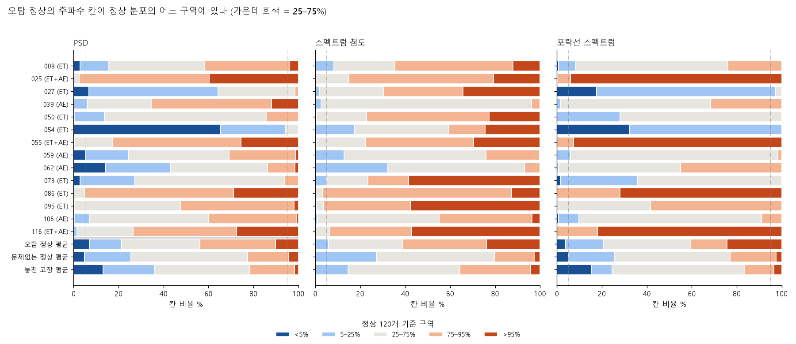
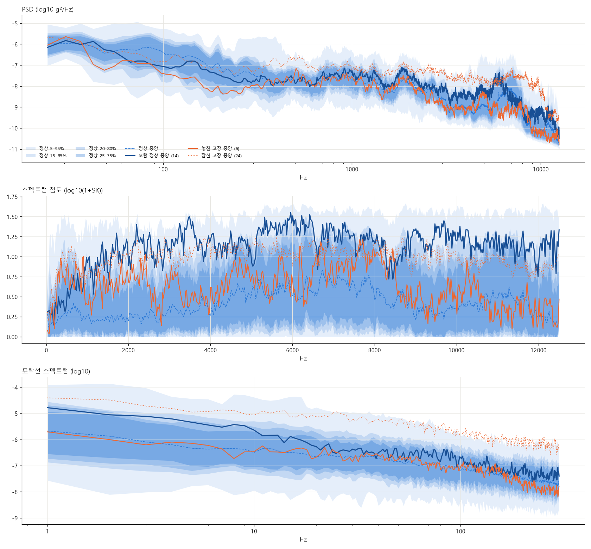

# 2-7 정상 띠 폭 — 오탐 정상은 정상 띠 경계에서 노는가, 띠를 위아래로 좁히면?

상태: 2차 (2026-11-14, 하방 경계 추가해 덮어씀). 코드 [run.py](run.py), 수치 [figs/band_width_numbers.txt](figs/band_width_numbers.txt)

## 가설 (사용자)
PSD·스펙트럼 첨도·포락선 스펙트럼에서 **오탐(오경보) 정상**이 정상 띠의 경계 근처에서 놀며 띠를 넓힌다. 이들을 빼거나 띠를 좁히면(5–95 → 15–85 · 20–80 · 25–75%) 폭이 줄어든다.

## 방법
- 신호·계산은 EDA 뷰어와 같다 (PSD·스펙트럼 첨도 = 평균 제거, 포락선 스펙트럼 = 200 Hz 고역통과 포락)
- 오탐 정상 14개 = ET(EXP-007 기준)·AE(EXP-012) 중 하나라도 5번 중 3번 이상 오경보. 놓친 고장 6개도 같은 기준
- ① 파일마다 주파수 칸이 정상 120개 분포의 어느 구역(<5 · 5–25 · 25–75 · 75–95 · >95%)에 있나. 가장 많은 쪽으로 가운데(25–75) / 경계(5–25 + 75–95) / 밖(<5 + >95) 분류
- ② 띠 폭 = 위 − 아래 경계 (주파수 평균). 정상 120개 vs 오탐 14개를 뺀 106개
- ③ 띠마다 위·아래로 벗어나는 칸 비율

## 결과

**① 오탐 정상의 위치** (칸 비율 평균. 정상 전체면 5 / 20 / 50 / 20 / 5)

| | PSD | 스펙트럼 첨도 | 포락선 |
|---|---|---|---|
| 오탐 정상 | 7 / 14 / 35 / **34** / 10 | 0 / 6 / 33 / **37 / 24** | 4 / 17 / 39 / 16 / **24** |
| 문제없는 정상 | 5 / 21 / 52 / 18 / 4 | 0 / 27 / 53 / 18 / 3 | 5 / 20 / 51 / 20 / 2 |
| 오탐 14개 분류 (가운데 · 경계 · 밖) | 4 · **9** · 1 | 5 · 6 · 3 | **7** · 3 · 4 |

- PSD: 9개가 경계형이고 대부분 위쪽(75–95%). 아래쪽 경계·밖은 027·054뿐
- 포락선: 025·055·086·116(ET+AE 공통 3개 포함)은 칸의 72–94%가 95% 밖. 나머지는 가운데
- AE만 틀린 039·059·062·106은 스펙트럼 첨도·포락선에서 가운데형 → 이 세 그림으로는 설명 안 됨

**② 띠 폭** (5–95% 120개 = 100%)

| 띠 | PSD | 스펙트럼 첨도 | 포락선 |
|---|---|---|---|
| 15–85 / 20–80 / 25–75% (120개) | 62 / 50 / 39% | 74 / 62 / 51% | 60 / 48 / 38% |
| 오탐 14개 빼면 (같은 띠 대비) | 92–96% | 88–90% | 92–96% |
| 그중 아래쪽 반폭 | 94–95% | 87–89% | 96–98% |

**③ 벗어나는 칸 (위 / 아래, 묶음 중앙값)**

| 띠 | 오탐 정상 | 문제없는 정상 | 놓친 고장 | 잡힌 고장 |
|---|---|---|---|---|
| PSD 5–95 → 25–75% | 2/0 → 41/10 | 0/1 → 10/17 | 1/2 → 25/29 | 26/0 → 74/1 |
| 스펙트럼 첨도 | 22/0 → 73/1 | 0/0 → 12/19 | 2/0 → 30/8 | 3/0 → 63/0 |
| 포락선 | 0/0 → 28/4 | 0/0 → 2/8 | 0/0 → 1/11 | 44/0 → 98/0 |

## 해석
1. **"경계에서 논다"는 PSD에서 맞다.** 오탐 정상은 75–95% 구역에 칸의 34%가 있다(보통 18%). 스펙트럼 첨도에서는 경계와 밖에 반반, 포락선에서는 공통 오탐 4개만 확실히 밖이다. 거의 모두 **위쪽**이다
2. **하지만 이들을 빼도 띠는 거의 좁아지지 않는다** (어느 띠에서든 4–12%). 120개 중 14개로는 백분위가 조금밖에 안 움직이고, 띠 폭은 나머지 106개가 퍼진 정도로 정해진다. 아래쪽 반폭은 오탐이 거의 없어서 더 안 줄어든다
3. **띠를 대칭으로 좁히면 폭은 크게 준다** (25–75%에서 38–51%). 하지만 그러면 오탐 정상이 가장 먼저 위로 넘친다(PSD 41%, 스펙트럼 첨도 73%) → 오경보가 더 는다
4. **아래쪽**: 문제없는 정상과 놓친 고장은 띠를 좁히면 위만큼 아래로도 벗어난다(PSD 놓친 고장 25/29). 잡힌 고장과 오탐 정상은 거의 위로만 벗어난다
   → 위쪽에서는 오탐 정상과 잡힌 고장이 같은 편이고, 놓친 고장은 위아래로 흩어져 있다

## 결론
- 오탐 정상이 띠 위쪽 경계에 몰려 있는 것은 맞다 (특히 PSD). 하지만 띠가 넓은 원인은 아니다 → 빼서 띠를 좁히는 방법은 효과가 작다
- 위쪽은 오탐 정상과 잡힌 고장이 함께 있는 곳이라, 위쪽 경계를 어떻게 잡아도 둘을 가르기 어렵다
- 다음 후보: 오탐 정상이 **어느 주파수에서** 위로 올라가는가 vs 잡힌 고장이 어느 주파수에서 올라가는가 (그림 1에서 PSD 오탐 중앙은 3–8 kHz, 잡힌 고장 중앙은 8–11 kHz가 더 높아 보임 — 확인 필요)
- 띠 백분위는 결국 탐지 임계값이다. 정하려면 CV로 (원칙 3)
