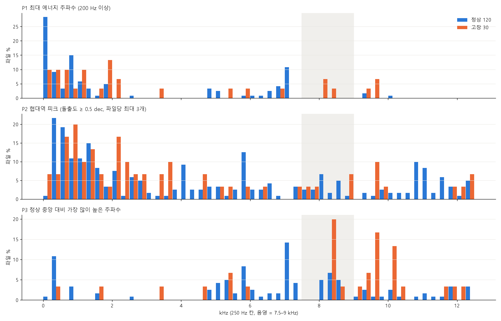
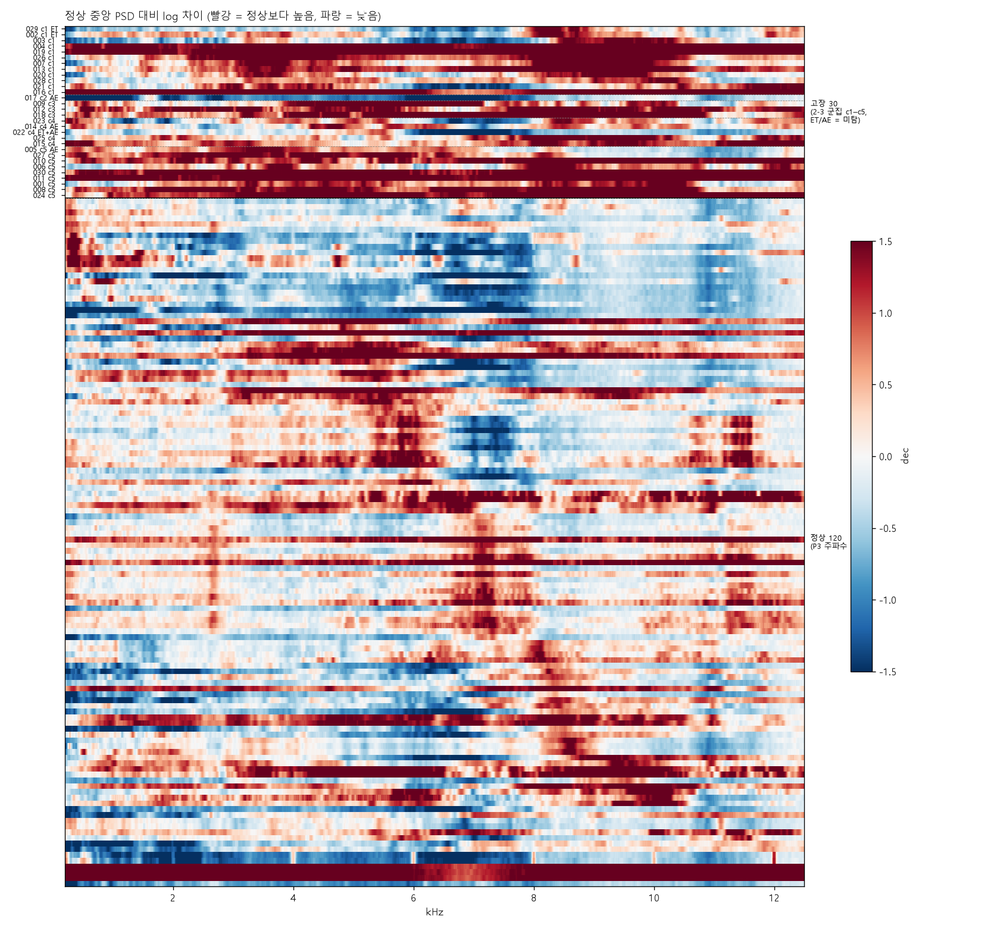

# 2-8 주파수 피크 위치 — 150개 파일의 PSD 피크는 어디에, 고장 유형과는?

상태: 1차 (2026-11-14). 코드 [run.py](run.py) · [check_8k.py](check_8k.py), 수치 [figs/peak_numbers.txt](figs/peak_numbers.txt) · [figs/check_8k.txt](figs/check_8k.txt), 고장별 표 [figs/fault_peaks.csv](figs/fault_peaks.csv)

## 질문
고장들이 8 kHz 부근에 많이 몰려 보인다(사용자 관찰). 전체 데이터의 피크 위치를 보고, 고장 유형과의 관계를 본다.

## 정의 (그림 보기 전에 고정)
PSD = 평균 제거 Welch 4096 (detrend 없음), 200 Hz 이상
- **P1 최대 에너지 주파수**: PSD argmax
- **P2 협대역 피크**: 약 190 Hz 이동 중앙값 바탕보다 튀어나온 정도(dec), 상위 3개 (그림은 0.5 dec 이상만)
- **P3 정상 대비 초과 주파수**: 정상 120개 중앙 PSD와의 log 차이(약 55 Hz 평활)가 가장 큰 곳
- 고장 유형: 라벨 없음(1-3 합의). 참고 축으로 2-3 군집(k=5), 1-3 예시 파일, 모델 미탐(ET·AE 5번 중 3번 이상)을 붙였다

## 결과

1. **"8 kHz"는 P3(정상보다 가장 많이 높은 곳)에서만 보인다.** 고장 P3는 8.25–8.5 kHz 20%(정상 7%), 9.5–9.75 kHz 17%(1%), 10–10.25 kHz 13%(2%). 정상 P3는 7.0–7.25 kHz 14%, 5.75–6 kHz 8%에 몰린다
2. **P1(에너지가 가장 큰 곳)은 고장·정상 모두 2 kHz 아래가 대부분.** 8.25 kHz가 P1인 고장은 3개(029·010·006)
3. **P2 협대역 피크로는 8 kHz가 안 보인다** (8–8.5 kHz 고장 0%, 정상 8%). 고장의 8 kHz대 상승은 190 Hz보다 넓은 혹(hump)이라 협대역 피크 정의에 걸리지 않는다
4. 히트맵: 고장 다수는 4–10.5 kHz 전반이 정상보다 높다(광대역 상승). 정상 안에도 같은 행이 있고, 6.6–8 kHz가 낮은 정상 무리, 7 kHz·11.3 kHz에 섬이 있는 정상 무리가 따로 보인다

**대역별 최대 초과 (check_8k.py — 대역은 그림을 본 뒤 고름, 설명용)**

| 대역 | AUC | 정상 95% 넘는 고장 | abn_002 · 029 (정상 중 백분위) | 상위 정상 |
|---|---|---|---|---|
| 8.0–8.6 kHz | 0.84 | 15/30 | **99 · 98%** | nor_088 · 116 · 057 |
| 9.3–9.8 kHz | 0.82 | 15/30 | 76 · 72% | **nor_116 · 055 (1·2위)** |
| 10–10.5 kHz | 0.80 | 11/30 | 59 · 70% | nor_065 · 116 · 055 |
| 6.8–7.4 kHz | 0.61 | 7/30 | 31 · 19% | nor_025 · 086 |

## 고장 유형과의 관계
| 2-3 군집 | 파일 | P3 위치 | 성격 |
|---|---|---|---|
| c1 (12) | **002·029**·003 | **8.25–8.6 kHz** | 조용함(HP RMS 0.006–0.013), 충격 3–5. ET가 놓침 |
| | 004·019·026·007·013·020 | 9.3–9.6 kHz | 충격 14–46회 |
| | 028·021·016 | 10–12 kHz | |
| c5 (9) 광대역 충격 | 010·006·030·011·001·008·024 (027·005 제외) | 8.25–10.4 kHz | 4–10 kHz 전반 상승, 010·006은 P1도 8.2 kHz |
| c3 (3) 큰 간헐 충격 | 012 8.3k, 018 10.2k, 009 5.8k | 섞임 | |
| c4 (5) | **014·022**·023·025·015 | 0.3–5.5 kHz (025·015만 9.7·11.7k) | 고주파 상승 없음. AE가 014·022 놓침 |
| c2 (1) | **017** | 1.6 kHz | 전 대역이 정상보다 낮음 (AE가 놓침) |

## 해석
- **8–10.5 kHz 상승은 고장 절반의 특징이다.** 그런데 **9.5·10 kHz 상승은 오탐 정상(nor_116·055)도 갖고 있다** → 충격형 고장과 오탐 정상이 이 대역에서 겹치는 이유
- **abn_002·029는 8.0–8.6 kHz만 올라가고 9.5·10 kHz는 그대로다.** 8.0–8.6 kHz 값만 보면 정상 중 98–99% 위치. "8 kHz대만 좁게 높고, 그 위 대역은 평범" 모양은 오탐 정상(9.5 kHz 쪽)과 다르다 → H2(8.2–8.4 kHz 공진, 부싱 강성 변화)를 지지. ET가 놓친 이유는 이 신호가 충격 Peak가 아니라 에너지 분포에 있어서로 보인다(2-5)
- **AE가 놓친 014·017·022(c2·c4)는 고주파 특징이 없다.** 이들은 주파수 피크 위치로는 설명되지 않는다 → 저주파·시간 구조 쪽에서 봐야 한다
- 정상 P3가 몰리는 7.0–7.25 kHz는 고장과 거의 관계없다(AUC 0.61) → 정상 안의 운전 상태 차이 후보

## 한계
- 표의 대역(8.0–8.6 등)은 그림을 본 뒤 골랐다 → AUC는 낙관적. 피처로 쓰려면 고정 격자(예: 250 Hz 또는 1 kHz)에서 폴드 안 선택으로 확인 (원칙 3)
- 군집은 2-3의 데이터 기반 군집이고 실제 고장 원인 라벨이 아니다
