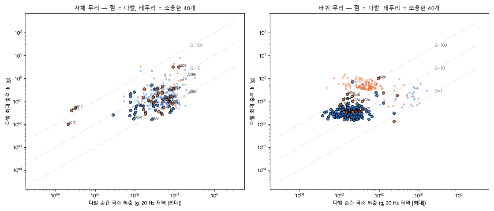

# 2-17 저에너지 고장 017 · 014 — 물리로 다시 보기

상태: 6차까지 분석 (2026-11-17), 문서 재작성. 실험(EXP) 아님
코드 [run.py](run.py) (1차) · [run2.py](run2.py) (2차) · [run3.py](run3.py) (3차) · [run4.py](run4.py) (4차) · [run5.py](run5.py) (5차) · [run6.py](run6.py) (6차)
수치 [figs/summary.txt](figs/summary.txt) · [figs2/summary.txt](figs2/summary.txt) · [figs3/summary.txt](figs3/summary.txt) · [figs4/summary.txt](figs4/summary.txt) · [figs5/summary.txt](figs5/summary.txt) · [figs6/summary.txt](figs6/summary.txt)

## 목적
- 017 · 014는 신호가 거의 없는 고장(저에너지 고장)이다. 지금은 유격 반복 규칙(2-12, EXP-025)이 잡는데, 그 문턱(r ≥ 2 · 2위/1위 ≥ 0.7)은 **라벨을 본 뒤 정한 값**이고 여유가 15%뿐이다 (EXP-030 여유 경고)
- 사용자 요청 (11-16): "이 데이터에만 맞는 과적합이 아니라 물리적으로 맞는 근거로 017을 구하자"
- 그래서 **017 · 014가 왜 고장인지를 물리량으로 설명하고, 그 근거가 문턱을 조금 옮겨도 무너지지 않는지** 본다

## 결론
1. **017 = 암이 거의 움직이지 않는데 연결부가 친다.** 하중(암의 저주파 움직임) 0.15 mg로 150개 중 가장 작다(차체 무리 정상 중앙 22.4 mg의 약 1/150). 그런데 0.05 · 0.04 · 0.01 g 충격이 세 번 난다. **하중 대비 충격 Q2 = 10^2.20 ≈ 160배, 차체 무리 정상 103개의 최대는 10^1.10 ≈ 13배(N028)** → 정상 최대보다 **10배 이상** 떨어져 있다. 현행 규칙의 여유(15%)와 달리 한 자릿수 간격이다
   - 물리: 건강한 연결부는 큰 충격이 나려면 큰 입력이 들어와야 하고, 그때 암도 크게 움직인다. 움직임이 없는데 충격이 나면 원인은 하중이 아니라 **간극**이다 (2-12 H1′ "하중이 작아도 친다"를 가장 직접 잰 값)
2. **014 = 하중은 큰데(35 mg) 바탕이 아주 조용하고, 그 위로 큰 충격이 여러 번 튀어나온다.** 014를 가르는 물리량은 현행 K1(두 번째 충격 / 고역 바탕 σ)이다. 다발 기준으로 다시 재도 정상 무리 z 12.9로 상위 2위(3차). Q(하중 대비)로는 갈리지 않는다(Q2 0.57)
3. **017 · 014는 무딘 충격이다** (5차 날카로움 SE 1.14 · 1.24, 정상 중앙 1.27). 금속끼리 부딪치는 고장(003 004 008 010 011 019 028)은 날카롭다. → 017 · 014는 아직 **고무(부싱)를 거친 부드러운 접촉**, 곧 1-3 열화 단계의 L1 · L2(초기 유격)로 읽힌다 (가설)
4. **그래서 현행 유격 규칙은 그대로 둔다.** 날카로움을 조건으로 더하면 규칙의 여유는 15% → 27%로 넓어지지만 017 · 014를 잃는다(6차). 초기 고장을 지키려면 "날카롭다"를 조건으로 쓰면 안 된다
5. **017의 근거는 둘이 된다**: ① 현행 유격 규칙(라벨로 정한 문턱) ② 하중 대비 충격이 정상 최대의 10배 이상(물리량, 큰 간격). ②만으로 새 규칙을 만들지는 않는다 — 차체 무리에서 Q로 정상 위로 나오는 고장이 017 하나뿐이고, "겨냥한 고장이 하나인 규칙은 채택하지 않는다"(EXP-030, 022 주기 잠금)와 같은 기준을 적용한다

### 아직 확인하지 않은 것
- 017의 Q 간격이 파라미터(충격 기준 8σ, 다발 길이 T0/4, 하중 저역 20 Hz)를 바꿔도 10배 이상 유지되는지
- 017의 하중 0.15 mg는 차가 거의 정지한 상태일 수도 있다. 측정 조건이 특이한 파일일 가능성을 배제하지 못했다

## 017 · 014를 각 축에서 본 값

| 축 (차수) | 무엇을 재나 | 017 | 014 | 정상 기준 | 017 · 014를 가르나 |
|---|---|---|---|---|---|
| 하중 (2차) | 20 Hz 저역 RMS | **0.15 mg** (최소) | 35 mg | 차체 무리 정상 중앙 22.4 mg | 017만 (극단) |
| Q2 하중 대비 충격 (2차) | log10(두 번째 다발 충격 g / 그 순간 하중 g) | **2.20** | 0.57 | 차체 무리 정상 최대 1.10 | **017 (10배 간격)** |
| K1 바탕 대비 충격 (현행) | log10(두 번째 사건 / σ) | 1.64 | 1.94 | 정상 중앙 1.10 | 둘 다 높음 (014가 더) |
| K3 2위/1위 (현행) | 크기 고름 | 0.77 | 0.88 | 문턱 0.7 (사후) | 둘 다 (사후 문턱) |
| 위상 잠금 (1 · 2차) | 하중 반전에 몰리나 | 충격 2–3개라 잴 수 없음 | 같음 | — | 못 잼 |
| 되튐 연쇄 (4차) | 간격·높이가 함께 줄어드는 연쇄 | 0 | 7 (우연 수준) | — | 아니다 |
| 날카로움 SE (5차) | 한 점 봉우리 / 0.5 ms 포락선 | 1.14 (무딤) | 1.24 (무딤) | 정상 중앙 1.27 | 아니다 (정상 쪽) |

- 왼쪽(차체 무리) 맨 왼쪽에 떨어진 주황 점 세 개가 017이다. 충격 순간의 국소 하중(가로)이 0.2–0.3 mg로, 차체 무리의 다른 모든 다발(최소 2.8 mg)보다 약 9배 왼쪽에 있다. 충격 크기(세로)는 정상 충격과 같은 범위다

## 함께 알게 된 것 (전체 고장)
- **운전 조건이 둘로 나뉜다**: 하중 주파수 1–3 Hz(차체 출렁임) · 10–20 Hz(바퀴 튐 = 스프링 아래 질량 공진). 바퀴 튐 무리 정상은 작은 충격(0.02–0.1 g)이 26–56개 연속으로 난다(019 073 092 103 118 119). 바퀴 튐 무리에서 Q2가 정상 최대(1.81)를 넘는 고장은 004 · 011 · 019 · 024 (정상 0)
- **고장 충격은 날카롭다** (5차): 반상승 시간 정상 0.36 ms · 고장 0.28 ms, SE AUC 0.77. K1과 독립(순위상관 0.04), 울림 주파수와 독립(0.12), 파라미터 27가지에서 SE AUC 0.76–0.82로 견고. 금속 접촉은 접촉 시간이 짧다(Hertz)와 맞는다. 다만 오경보 055 · 059 · 116도 날카로워 이 축으로는 못 내린다
- **K1이 재는 것은 "반복"보다 "바탕 위로 크게 튀어나온 충격이 1개보다 많다"** 에 가깝다 (3 · 4차)

## 기각한 가설 (이 센서로 보이지 않음)
| 차수 | 가설 | 결과 |
|---|---|---|
| 1 · 2 | 충격이 하중 반전 순간(위상)에 몰린다 | 파일 단위는 2초에 주기 2–4번이라 검정력 없음. 무리로 모아도 8개 무리 모두 z < 3. 20 Hz 저역 가속도는 연결부 힘이 아니라 센서 위치의 움직임 |
| 2 | 하중 대비 충격 Q가 K1보다 일반적으로 낫다 | 전체 AUC 0.714 vs K1 0.875. 운전 조건이 섞여 흐려짐 (017에 대해서만 가장 강함, 결론 1) |
| 3 | 하중 사건(다발) 단위로 센 반복 + 운전 조건별 정상 문턱 | AUC 0.875 → 0.790, 다발 길이에 따라 0.66–0.90으로 흔들림 |
| 4 | 되튐(반발 연쇄) | 우연을 뺀 연쇄 비율 ≈ 0, 간격 비 · 높이 비 상관 ≈ 0 (반발이면 강한 양) |
| 6 | 날카로움을 유격 규칙 조건으로 | 여유 15% → 27%, 정상 오작동 1.44% → 0.65%지만 **017 · 014를 잃음** |

## 방법 (공통)
- 조용한 40 = 충격 ±10 ms를 가린 200 Hz 고역 바탕 σ 하위 40개 (라벨 무관, 고장 12 · 정상 28)
- 충격 = 200 Hz 고역 |h| > 8σ, 10 ms 안은 한 사건. 하중 = 20 Hz 저역 신호. 하중 무리 = 1–20 Hz 최대 주파수 f0 < 6 Hz(차체) / ≥ 6 Hz(바퀴 튐)
- Q2 = 하중 주기 T0의 1/4 안 충격을 한 다발로 묶고, 다발 최대 |h|(g) / 다발 ±T0/4 안 |20 Hz 저역| 최대(g)의 두 번째 큰 값, log10
- 날카로움 SE = |h(p)| / 0.5 ms 평균 포락선(p), RT = 0.1 ms 포락선이 50% → 봉우리 시간. 큰 순 상위 5개 충격의 중앙값
- 정의는 라벨을 보기 전에 고정. 문턱은 정상만으로(중앙값 · 최대) 또는 귀무 분포로. 라벨은 색칠 · 집계 · 정의 고정 후 AUC에만

## 다음
- (선택) 017 Q 간격의 견고성: 8σ · T0/4 · 20 Hz를 ±50% 바꿔도 정상 최대의 10배 이상인지
- 발표: 017 = "암은 거의 정지했는데 연결부가 친다" (위 그림 왼쪽), 날카로움 = 열화 단계(부드러운 접촉 → 금속 타격)
- 물리가설.md H1 검증 열에 요약 추가 · 2_EDA 분류(유의미/참고) — 사용자 확인 후
