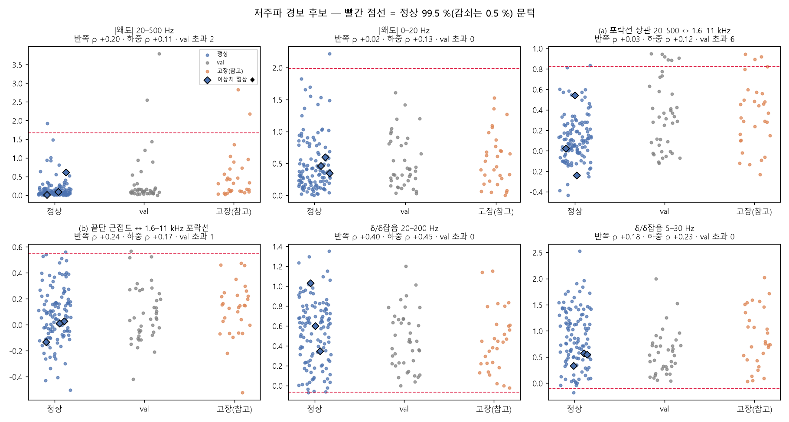
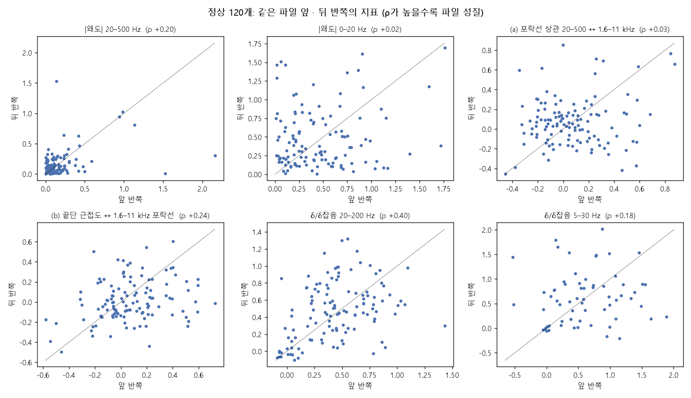

# 2-38 저주파 경보 후보 (11-25)

## 목적
학습 · val에 없을 수 있는 고장(부싱 스토퍼 접촉, 스트로크 반전의 유격 타격, 유체부싱 누유 → 감쇠 상실)을 test에서 잡을 **정상 기준 OR 경보** 후보 3종을 라벨 없이 판정한다. 배경은 [2-37](../../../../3_전처리/3-6_저주파점검/README.md)(하중 = 0–20 Hz RMS, 저주파 크기는 길에 좌우, 3–200 Hz에 공통 모드 없음).
코드 [run.py](run.py) · 수치 [figs/수치.txt](figs/수치.txt) · 요약 [figs/요약.csv](figs/요약.csv) · 파일별 [figs/files.csv](figs/files.csv)

## 정의 (라벨 보기 전에 고정, 모두 무차원)
공통: 평균 제거 → 4차 Butterworth `sosfiltfilt`(전체 2 s) → 양 끝 0.1 s 버림(1.8 s). 경보 방향은 물리로 미리 정함.
| 지표 | 정의 | 경보 방향 |
|---|---|---|
| `skew_b500` | 20–500 Hz 대역 신호의 \|왜도\| | 위 |
| `skew_lo20` | 0–20 Hz 저역 신호(스트로크)의 \|왜도\| | 위 |
| `corr_env_a` | (a) \|Hilbert\| 포락선 20–500 Hz ↔ 1.6–11 kHz의 Pearson 상관. 두 포락선 모두 50 Hz 저역 후 100:1 솎기(250 Hz) | 위 |
| `corr_prox_b` | (b) 끝단 근접도 \|s − 중앙\|/std(s), s = 0–20 Hz 저역 ↔ 1.6–11 kHz 포락선(위와 같은 평활) 상관 | 위 |
| `damp_rel_200` | 랜덤 감소 서명(방아쇠 = +1σ 상향 교차, 구간 0.1 s, 2.5 kHz로 솎음) on 20–200 Hz → 주기당 로그 감소 δ = −(log\|극값\| 기울기)·Td, Td = 영점 교차 간격×2, 극값은 0–4 Td. 지표 = δ ÷ 백색잡음 δ 중앙 | 아래(감쇠 상실) |
| `damp_rel_30` | 같은 절차 on 5–30 Hz(구간 0.5 s, 500 Hz) | 아래 |

백색잡음 기준: 같은 길이 백색잡음 200개에 같은 필터 · 같은 절차 → "필터만의 감쇠". 첫 실행에서 log(δ/δ잡음)이 δ ≤ 0 파일에서 NaN · 발산해 선형 비로 바꿨다(라벨 참고 전, 수치 문제).

## 방법 (라벨 없이)
- **반쪽 안정성**: 1.8 s를 앞 · 뒤 0.9 s로 나눠 각각 계산, 정상 120개에서 Spearman ρ. 비교 기준 L2_hfl +0.67 · 하중 +0.64 · 20–200 Hz RMS +0.80
- **하중 의존**: 정상 안 ρ(지표, 0–20 Hz RMS)
- **CV 오경보**: 정상 5-폴드 × 20번. 4/5(이상치 정상 3개 제외)의 99.5 %(아래 방향은 0.5 %) 문턱 → 남은 1/5 정상 중 초과 수, 120개당 합. 이론상 약 1.2(n≈93의 최댓값 근처 문턱)
- **val**: 정상 117개 전체 문턱 초과 파일, 이동 AUC(경보 방향, 0.5 = 없음) · KS p
- **참고(선택에 안 씀)**: 고장 30 중 문턱 초과 · AUC

## 결과
| 지표 | 반쪽 ρ | 하중 ρ | CV 오경보 /120 | val 초과 | val 이동 AUC · KS p | 참고: 고장 초과 · AUC |
|---|---|---|---|---|---|---|
| skew_b500 | +0.20 | +0.11 | 1.40 | 2 (004 · 016) | 0.60 · 0.21 | 016 · 030 · 0.74 |
| skew_lo20 | **+0.02** | +0.13 | 1.40 | 0 | 0.53 · 0.96 | — · 0.55 |
| corr_env_a (a) | **+0.03** | +0.12 | 2.10 | **6** (004 · 013 · 016 · 031 · 035 · 039) | **0.68 · <0.001** | 008 · 012 · 030 · 0.71 |
| corr_prox_b (b) | +0.24 | +0.17 | 1.20 | 1 (031) | 0.50 · 0.98 | — · 0.58 |
| damp_rel_200 | +0.40 | **+0.45** | 1.50 | 0 | 0.57 · 0.36 | — · 0.59 |
| damp_rel_30 | +0.18 | +0.23 | 1.45 | 0 | **0.66 · 0.003** | — · 0.49 |

빨간 점선 = 정상 문턱. ◆ = 이상치 정상(N059 · N065 · N116, 문턱 계산에서만 제외).

- **정상도 이미 상관한다**: corr_env_a 중앙 +0.10, 정상 73 %가 > 0, 18 %가 > 0.3. corr_prox_b 중앙 +0.06, 15 %가 > 0.3. 길 충격이 두 대역을 함께 흔든다.
- **(a)의 val 초과 6개**는 val 안에서 충격 수와 같이 간다(ρ +0.46, 정상 안 +0.09). 초과 파일의 충격 수 7–44개. 20–500 Hz에도 광대역 충격 에너지가 들어가 "고주파 충격이 많은 파일"을 다시 재는 셈이다.
- **랜덤 감소는 필터 · 스펙트럼 모양이 지배한다**: 20–200 Hz 백색잡음 δ 0.71(Td 8.5 ms) vs 정상 δ 0.42(Td 15.6 ms), 정상 32 %만 잡음 범위 안. 5–30 Hz는 정상 65 %가 잡음 범위 안이고 방아쇠가 파일당 9개(반쪽 3개), NaN 7개. 문턱(δ/δ잡음 ≈ −0.07 · −0.11)은 "서명이 감쇠하지 않음(δ ≤ 0)"을 뜻하는데 정상에서도 나온다.
- **상관(정상)**: 새 지표끼리 |ρ| ≤ 0.22, L2_hfl · L1_lock과 |ρ| ≤ 0.28 → 중복은 없지만 반쪽 ρ가 낮아 대부분 잡음이다.

## 해석
1. 여섯 지표 모두 반쪽 ρ ≤ 0.40(기준 열 0.64–0.80). **파일의 성질보다 0.9–1.8 s 창 안의 우연한 사건**을 잰다. 꼬리 경보는 한 번의 큰 사건으로 정해지므로, 오경보 수(이론값 근처 1.2–2.1/120)는 맞아도 정상 쪽 꼬리가 넓어 새 고장이 그 밖으로 나가기 어렵다.
2. 왜도(20–500 Hz)는 꼬리가 길고(정상 95 % 0.65, 문턱 1.67) 한두 개 사건이 정한다. 0–20 Hz 왜도는 2 s에 스트로크가 몇 번뿐이라 반쪽 ρ 0.02로 사실상 잡음.
3. (a)는 val 배경 이동(KS p < 0.001, 6/40 초과)이 있고 기전이 충격 수로 설명된다 → 저주파 · 고주파 결합의 증거가 아니다. (b)는 이동이 없지만 반쪽 ρ 0.24.
4. 감쇠 지표는 대역통과 필터와 대역 내 스펙트럼 기울기가 서명을 정한다. 2 s 파일로는 방아쇠 수가 모자라(특히 5–30 Hz) 감쇠 추정이 성립하지 않는다. 20–200 Hz판은 하중과 ρ +0.45로 크기에 끌린다.

## 권고
| 지표 | 판단 | 라벨 없는 이유 |
|---|---|---|
| skew_b500 | 재작업 | 반쪽 ρ 0.20, 꼬리가 단발 사건. 사건 단위(스토퍼 접촉 시 한쪽 부호 피크의 반복 비율 등)로 다시 정의해야 함 |
| skew_lo20 | 버림 | 반쪽 ρ 0.02, 2 s에 스트로크 수 부족 |
| corr_env_a (a) | 버림 | 반쪽 ρ 0.03, val 이동(KS p < 0.001), 충격 수를 다시 잼 |
| corr_prox_b (b) | 재작업 | val 이동 없음 · 오경보 정상이지만 반쪽 ρ 0.24. 끝단 구간(예: 근접도 상위 10 %)의 포락선 몫처럼 사건 비율로 바꾸면 안정성 재확인 |
| damp_rel_200 | 버림 | 필터 · 스펙트럼 모양 지배(잡음 대비 판별 불가), 하중 ρ 0.45 |
| damp_rel_30 | 버림 | 방아쇠 9개/파일, NaN 7, val 이동(KS p 0.003) |

지금 경보로 쓸 수 있는 것은 없다. 남길 것은 (b)의 재정의 하나.

## 한계
- 2 s 파일: 5–30 Hz는 수십 주기 · 0–20 Hz 스트로크는 몇 회뿐이라 반쪽(0.9 s) 안정성이 본질적으로 낮다. 반쪽 ρ는 전체 1.8 s 값의 안정성을 과소평가한다(창이 절반).
- 경보 대상 고장이 학습에 없어 **감도(새 고장이 문턱을 넘는가)는 검증할 수 없다**. 판단은 정상 쪽 성질(안정성 · 오경보 · 이동)로만 했다.
- 랜덤 감소의 서명 길이 · 극값 범위(0–4 Td)는 하나로 고정했고 다른 설정은 보지 않았다.
- 참고 AUC(0.71 · 0.74)는 라벨을 본 값이라 선택에 쓰지 않았다. (a)의 0.71은 충격 수와 겹친다.
