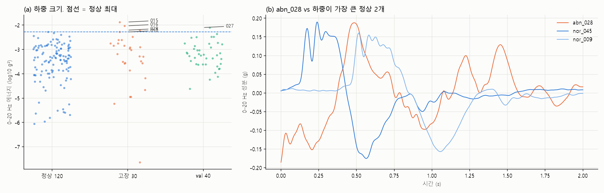

# 2-39 하중 크기(0–20 Hz 에너지) 위 꼬리 경보 — abn_028을 저주파로 잡을 수 있나 (11-25)

뷰어에서 abn_028의 0–20 Hz 에너지가 정상 120개보다 크다(100 백분위)는 것을 보고, "하중 크기 > 학습 정상 분위수 → 고장(OR)" 규칙을 점검했다. 문턱은 정상 분포로만 정했고, 축은 028을 보고 골랐으므로 **[사후 축]**이다.
코드 [run.py](run.py) · 수치 [figs/수치.txt](figs/수치.txt) · 파일별 [figs/files.csv](figs/files.csv)

## 결과
**① 분포**: 정상 최대를 넘는 고장은 010 · 015 · 016 · 028(4개), val은 027(지금 모델도 고장 판정). AUC 0.59로 평균적으로는 못 가른다.
| 정의 | 028 | 정상 최대 | 정상 최대를 넘는 고장 |
|---|---|---|---|
| 0–20 Hz 에너지(뷰어와 같음) | −2.21 | −2.28 (nor_045) | 010 · 015 · 016 · 028 |
| 같은 값, 양 끝 0.1 s 제외 | −2.23 | **−2.24** (nor_045) | 015 · 016 · 028 (사실상 동률) |
| 2–20 Hz(0–2 Hz 뺌) | −2.95 (95 백분위) | −2.58 | 015 · 016 |
- 그림 (b): 028의 0–20 Hz 성분은 **파일 첫 순간 −0.19 g**에서 시작한다(양방향 필터의 가장자리 효과가 섞임). 끝을 빼면 정상 최대와 동률이다.
- 028이 큰 이유는 **0–2 Hz의 느린 움직임**이다(2–20 Hz만 보면 95 백분위). 반쪽으로 나누면 앞 0.9 s −2.04 · 뒤 −2.63으로 앞쪽에 몰린다.
- 모양 차이: 하중이 가장 큰 정상(045 · 009)은 **큰 출렁임 한 번**, 028은 0.5–1 s 간격으로 **여러 번 출렁임**(0.48 · 1.22 · 1.45 s). 하중 파고율은 028이 정상 23 백분위(낮을수록 지속적).

**② 폴드 안 규칙 모의**(최종 모델과 같은 그룹 분할, seed 5 × 5 폴드)
| 문턱(학습 폴드 정상) | 고장 켜짐(/5) | 정상 오경보(/5) |
|---|---|---|
| 99 % | 010 · 015 · 016 · 028 모두 5 | 009 5 · 045 5 · 086 1 (seed당 2.2개) |
| 99.5 % | 같음 | 009 5 · 045 5 (seed당 2.0개) |
| 최대(100 %) | 같음 | 045 5 (seed당 1.0개) |
- 정상 중 하중이 가장 큰 파일은 자기가 시험 폴드에 있을 때 학습 정상 최대보다 크므로 **항상 켜진다**. 문턱을 어떻게 잡아도 최소 1개.
- 여유(C3 ±20 %): 문턱을 RMS ×1.1로 올리면 028 · 010이 빠지고, ×0.9로 내리면 정상 009 · 045가 들어온다 → **여유 없음**.

## 해석
1. 규칙으로 쓰면 **손해다.** 028은 최종 모델(EXP-062 구성 3)에서 5번 중 1번만 놓친다. 규칙이 얻는 것은 평균 0.2건의 미탐(= 오경보 0.8건 값어치)인데, 대가는 seed마다 정상 오경보 1–2건이다. 010 · 015 · 016은 이미 다른 경로로 잡힌다.
2. 축 자체도 약하다: 028의 초과분은 필터 가장자리 + 0–2 Hz 느린 움직임이고, 끝을 빼면 정상 최대와 동률이다. 노면에 따라 절대 크기가 달라지는 위험(test)도 그대로다.
3. 남는 단서는 **모양**(한 번 크게 vs 여러 번 출렁임)이다. 부싱 유격(L2)의 "출렁임마다 반복"과 맞는 그림이지만, 겨냥 고장이 028 하나라 지금 피처로 만들 근거가 부족하다. 박자(L1_lock)가 이미 같은 개념을 재고 있고 028에서 z +1.32다.

**결론: 하중 크기 경보는 쓰지 않는다. abn_028은 결합 점수(박자 · AE · 첨도 · L2 아래 꼬리)로 잡히는 지금 상태를 유지하고, 여유를 지켜본다.**
