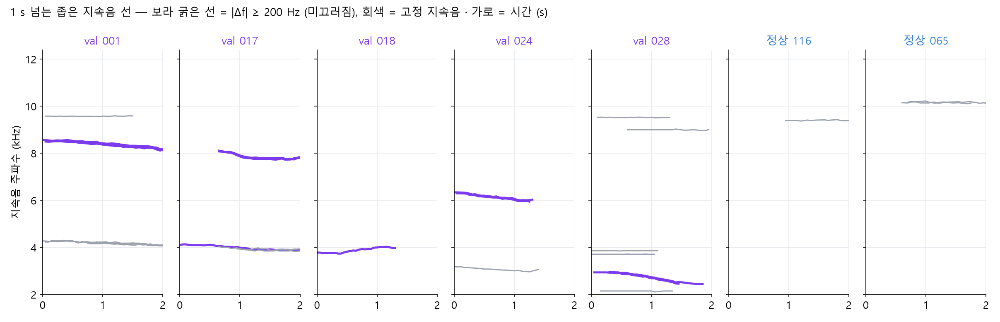
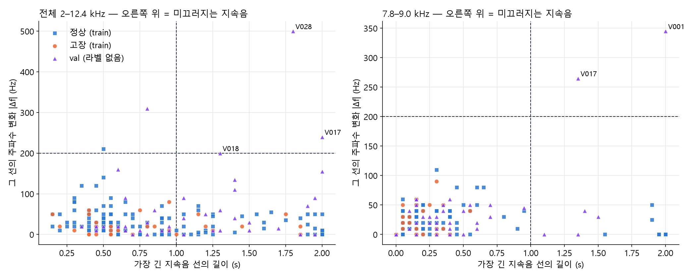

# 2-10 미끄러지는 지속음 — 있으면 정상인가 고장인가

상태: 1차 (2026-11-22). 코드 [run.py](run.py), 수치 [figs/결과.txt](figs/결과.txt), 파일별 값 [figs/파일표.csv](figs/파일표.csv)

## 질문
val_001은 8.3k 스펙트럼 규칙만으로 고장이고(결합 여유 −3.81), 2초 내내 주파수가 미끄러지는 좁은 지속음이 있다(6-7 [V001_지속음](../../../../6_오류분석/6-4_val확실도/자료/V001_지속음.txt)). 학습 데이터에서 이런 지속음은 정상 쪽인가 고장 쪽인가?

## 방법 (결과 보기 전에 고정)
- STFT 0.1 s 창 · 50 % 겹침 → 주변 ±200 Hz 이동 중앙값 대비 돌출 ≥ 10 dB인 좁은 봉우리 (6-7과 같은 정의)
- 이웃 프레임에서 |Δf| ≤ 60 Hz면 같은 선으로 이음(빈 프레임 2개 허용). 선의 Δf = 끝 10 % 중앙 − 처음 10 % 중앙
- 지속음 = 선 ≥ 1.0 s, **미끄러지는 지속음 = 선 ≥ 1.0 s 이고 |Δf| ≥ 200 Hz**. 대역 2–12.4 kHz · 7.8–9.0 kHz
- 점검(첫 결과 뒤 추가): 파일마다 가장 긴 선만 보면 다른 고정 지속음에 가려져서(전체 대역에서 001이 빠짐), 1 s 넘는 선 **모두** 중 |Δf| 최대도 셈

## 결과

| | 정상 120 | 고장 30 | val 40 |
|---|---|---|---|
| 지속음 (2–12.4 kHz, 선 ≥ 1 s) | 41 (34 %) | 8 (27 %) | 21 (53 %) |
| 지속음 (7.8–9.0 kHz) | 9 (8 %) | 0 | 6 |
| **미끄러지는 지속음 (1 s 넘는 선 중 하나라도 \|Δf\| ≥ 200 Hz)** | **0** | **0** | **5 (001 017 018 024 028)** |
| 1 s 넘는 선의 \|Δf\| 최대 | 70 Hz (058) | 120 Hz (016) | 500 Hz (028) |

val 미끄러짐 5개와 지금 제출 판정

| val | 미끄러지는 선 | 짝 지속음 (절반 주파수) | 제출 판정 | 근거 |
|---|---|---|---|---|
| 001 | 8555 → 8210 Hz (2.0 s) | 4265 → 4110 Hz | 고장 | 8.3k 스펙트럼 규칙만 (결합 여유 −3.81) |
| 017 | 8075 → 7810 Hz | 4130 → 3890 Hz | 고장 | 결합 (여유 +1.53) |
| 024 | 6.3 → 6.0 kHz | 3.15 → 3.0 kHz 근처 | 고장 | 결합 (여유 +0.95) |
| 018 | 3780 → 3980 Hz (1.3 s) | — | 정상 | 결합 (여유 −0.72, 흔들림 파일) |
| 028 | 2940 → 2440 Hz (1.8 s) | — | 정상 | 결합 (여유 −4.26) |

## 해석 (관찰만)
- **학습 150개에는 미끄러지는 지속음이 정상에도 고장에도 없다.** 학습의 지속음은 모두 주파수가 고정이다(최대 |Δf| 120 Hz). 그래서 "미끄러지면 정상 / 고장"을 학습 데이터로는 정할 수 없다
- val에서만 5/40개 나온다. val은 배경 3–5 kHz가 학습보다 약 +10.9 dB 높다는 측정 조건 차이도 있다(2-8)
- 001 · 017 · 024는 미끄러지는 선 아래에 **정확히 절반 주파수의 선이 나란히 미끄러진다**(2 : 1). 하나의 소리원이 기본음과 배음을 내면서 속도가 바뀌는 모양과 닮았다 — 출처(회전 부품 · 계측 · 노면)는 확인하지 않음
- 001의 8.3k 규칙 켜짐은 이 미끄러지는 지속음이 8.20–8.45 kHz를 지나가며 만든 봉우리일 수 있다(지속음 프레임의 51 %가 규칙 대역 안, 6-7). 학습 8.3k 규칙 고장 6개는 이런 미끄러지는 지속음이 없다

## 한계
- 선 잇기 문턱(10 dB · 60 Hz · 1 s · 200 Hz)은 한 가지 설정만 봤다. 학습 최대 120 Hz와 val 최소 200 Hz 사이에 빈 구간이 있어 문턱을 그 사이에서 바꿔도 학습 0개는 같다
- 라벨이 없는 val 파일의 정상 · 고장은 모른다
