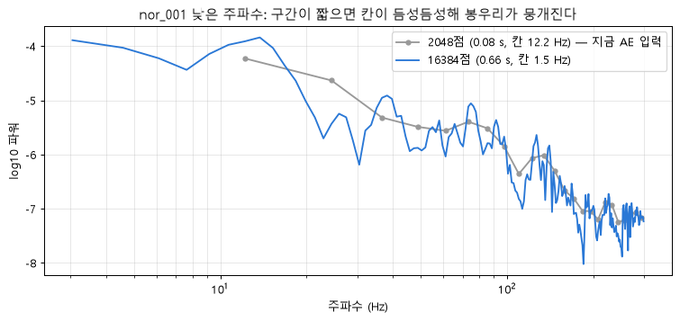
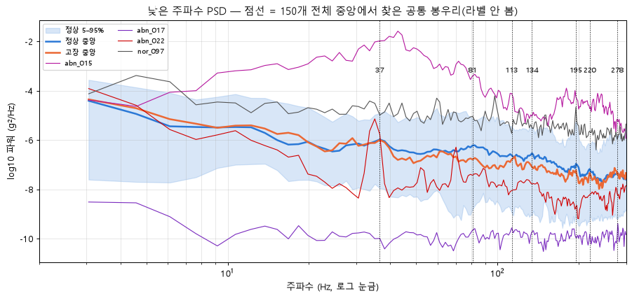
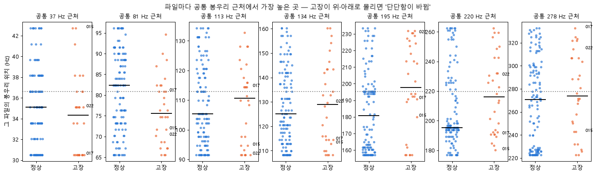
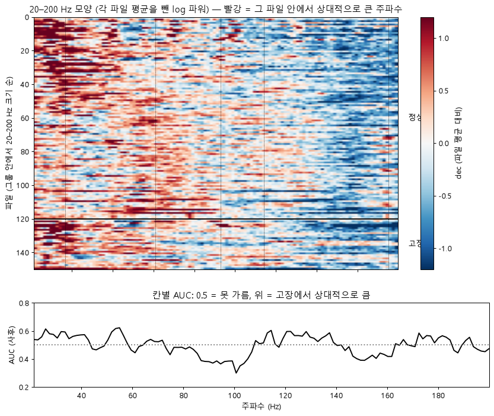

# 2-19 낮은 음 찾기 — 암이 고무 부싱 위에서 출렁이는 낮은 고유진동수

## 결론
- 150개 전체 중앙 PSD에서 낮은 봉우리 7개를 찾았다(**37 · 81 · 113 · 134 · 195 · 220 · 278 Hz**). 가장 뚜렷한 것은 37 Hz다.
- **고장 때 봉우리가 옮겨 가는 모습은 없다.** 정상끼리도 봉우리 위치가 ±10% 넘게 흩어져 있고, 고장은 그 안에 섞여 있다. 위치 AUC는 0.37–0.64다.
- 20–200 Hz의 **크기**(AUC 0.43)도, 크기를 뺀 **모양**(칸별 AUC 0.30–0.62)도 정상과 고장을 거의 가르지 못한다.
- 따라서 피처 후보 C3(20–200 Hz 모양)은 기대를 낮춘다. 부싱이 물러지면 이 영역의 음이 내려갈 것이라는 가설은 우리 데이터에서 보이지 않는다.

## 질문
1. 암 전체가 부싱(스프링 역할)에 얹혀 출렁이는 낮은 고유진동수가 있는가? 있다면 어디인가?
2. 고장 때 그 봉우리가 내려가는가? 내려간다면 부싱이 물러진 것이다.
3. 위치가 아니라 모양(어느 주파수가 상대적으로 큰가)은 다른가?

## 방법 (배운 내용 연결)
| 배운 것 | 여기서 쓴 방식 |
|---|---|
| Stage 2 질량-스프링: 단단할수록 음이 높다 | 부싱이 물러지면 봉우리가 아래로 내려간다고 예상 |
| Stage 3 공진: 그래프의 봉우리가 고유진동수다 | 전체 중앙 PSD에서 봉우리를 찾는다 (라벨은 보지 않음) |
| Stage 4 분해능 ≈ 1 ÷ 구간 길이 | 지금 AE 입력(2048점 = 0.08 s → 칸 12 Hz)으로는 37 Hz 근처 칸이 3개뿐이다. 이번에는 16384점(0.66 s → 칸 1.5 Hz)을 쓰고, 5구간을 평균해 Welch로 안정화했다 |

- 파일별 봉우리 위치 = 공통 봉우리 ±20% 안에서 그 파일의 PSD가 가장 높은 곳
- 모양 = 20–200 Hz log PSD에서 그 파일의 평균을 뺀 값. 크기와 무관하게 상대적인 모습만 남는다
- 코드: [run.py](run.py) · 숫자: [result.txt](result.txt)

## 그림
### 0. 분해능 — 구간이 짧으면 낮은 봉우리가 뭉개진다

회색 점은 지금 AE 입력과 같은 짧은 구간이다. 칸 사이가 12 Hz라서 37 Hz 봉우리 하나를 점 서너 개로만 그린다. 파란 선은 긴 구간이다. Stage 4의 "녹음 길이 = 분해능"을 우리 데이터로 보여 주는 그림이다.

### 1. 정상 띠 위의 낮은 주파수

- 읽는 법: 파란 띠는 정상 120개의 5–95% 범위이고, 진한 선 두 개는 정상 중앙과 고장 중앙이다. 점선은 라벨을 보지 않고 찾은 공통 봉우리다.
- 정상 중앙과 고장 중앙이 띠 한가운데에서 거의 겹친다. 띠의 폭은 3 dec(1000배)다. 낮은 주파수는 파일마다 크기 차이가 아주 크다. 이 차이는 운전 조건(길·하중) 때문이다.
- 띠를 벗어난 파일은 다음과 같다.
  - abn_015: 전 구간이 정상 최대보다 위다. 2-0의 L4 "크게 흔들리는 고장"이다.
  - abn_017: 전 구간이 정상 최소보다 아래다. 하중이 거의 없는 파일이다(2-17).
  - abn_022: 37 Hz 바로 앞(약 34 Hz)과 70 Hz에 뾰족한 봉우리가 있다. 이것이 2-13에서 본 0.94초 주기 반복의 배음인지는 아직 확인하지 않았다.

### 2. 봉우리 위치 — 고장이 옮겨 가나

- 점 하나가 파일 하나다. 고장 점(주황)이 한쪽으로 몰리면 "단단함이 바뀌었다"고 볼 수 있다.
- 몰리지 않는다. 81 Hz 근처만 고장 중앙이 75 Hz로 조금 낮다(정상 82 Hz, AUC 0.37 → 거꾸로 보면 0.63). 하지만 정상 사분위 범위 73–89 Hz 안이다.
- **주의**: 창의 양 끝(예: 30.5 · 42.7 Hz)에 점이 쌓여 있다. 이런 파일은 그 근처에 봉우리가 없어서 창 끝값이 뽑힌 것이다. 파일 하나하나에는 낮은 봉우리가 뚜렷하지 않다는 뜻이기도 하다.

### 3. 모양 열지도와 칸별 AUC

- 위: 한 줄이 파일 하나다. 빨강은 그 파일 안에서 상대적으로 큰 주파수다. 그룹 안에서는 20–200 Hz 크기 순으로 정렬했다.
- 조용한 파일(위쪽)일수록 40 Hz 아래가 빨갛다. 모양이 크기에 따라 바뀐다는 뜻이다. 고장 30개는 이 흐름과 따로 놀지 않는다.
- 아래: 칸별 AUC(사후)는 0.30(101 Hz)–0.62(55 Hz)다. 90–110 Hz에서 고장이 상대적으로 약간 작다. 라벨을 보고 고른 칸이라서 이 칸만 쓰는 규칙은 만들지 않는다.

## 해석
- **출력만 보고는 입력과 구조를 나눌 수 없다**(Stage 3: 출력 = 치는 방식 × 울리는 물건). 낮은 봉우리는 부싱 위 암의 고유진동수일 수도 있지만, 차량·노면이 그 주파수로 흔든 결과일 수도 있다. 위치가 파일마다 ±10%씩 흩어지는 것은 고정된 고유진동수보다 운전 조건 쪽에 가깝다.
- 우리 고장의 신호는 kHz 대역(충격·울림)에 있다. 이 결과는 2-22의 대역별 파워 몫(고장은 1–5 kHz 몫이 3배)과도 맞는다.
- 결정 제안: C3은 "기대 낮음"으로 표시한다. 시험한다면 20–200 Hz 모양 전체(칸을 고르지 않고)를 중첩 CV로 비교한다.

## 남은 질문
- abn_022의 34 · 70 Hz 뾰족한 봉우리가 0.94초 주기 반복과 관계있는가? (2-13과 대조)
- 낮은 주파수 크기가 큰 파일(거친 길)에서 충격 울림 음이 올라가는가? (Q8, 고무는 세게 눌리면 딱딱해짐)
