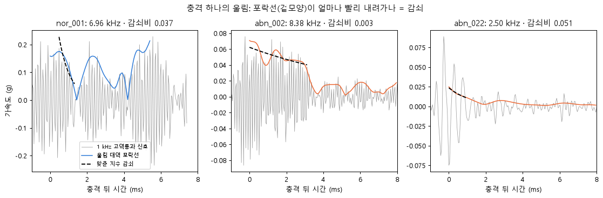
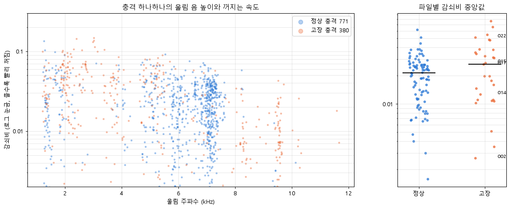
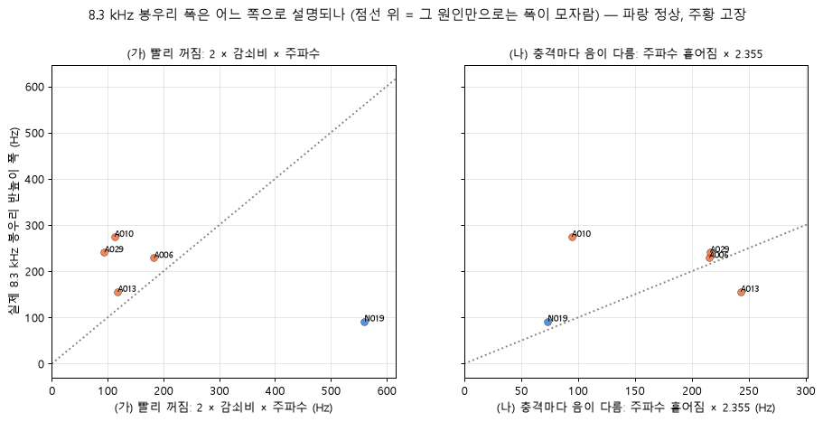

# 2-20 울림이 꺼지는 속도(감쇠) — 고장 충격은 빨리 꺼지나, 8.3 kHz 봉우리는 왜 넓은가

## 결론
- 파일별 감쇠의 **중앙값**은 정상과 고장이 비슷하다. 감쇠비 중앙은 정상 0.022, 고장 0.026이고 AUC는 0.59다.
- 대신 **빨리 꺼지는 충격(감쇠비 0.04 이상)의 비율**은 다르다. 정상 중앙은 0%, 고장 중앙은 29%이고 AUC는 0.73이다. 고장에는 "퍽" 하고 금방 꺼지는 충격이 일부 섞여 있고, 대부분 1.5–3 kHz에 있다.
- 방향이 반대인 고장도 있다.
  - abn_002: 감쇠비 0.003으로 정상 하위 1%다. 8.4 kHz로 **아주 오래** 울린다.
  - abn_022: 0.051로 정상 상위 1%다. 2.5 kHz로 금방 꺼진다.
  - 그래서 "감쇠 하나의 크기"로는 두 고장을 함께 잡을 수 없다.
- Q4(고장 8.3 kHz 봉우리가 넓은 이유): 고장 4개 중 3개는 **"충격마다 음이 조금씩 달라서"** 쪽이 폭을 더 잘 설명한다. 다만 파일이 5개뿐이라 잠정이다.
- 피처 후보 C5를 고친다. 감쇠비 중앙값 대신 **"빨리 꺼지는 충격 비율"** 을 쓴다.

## 질문
1. 고장 충격은 정상보다 빨리 꺼지는가?
2. 고장 8.3 kHz 봉우리의 폭은 200–275 Hz이고 정상은 92 Hz다. 넓은 이유는 (가) 울림이 빨리 꺼져서인가, (나) 충격마다 음이 조금씩 달라서인가?

## 방법 (배운 내용 연결)
| 배운 것 | 여기서 쓴 방식 |
|---|---|
| Stage 2 감쇠 사인파: 겉모양(포락선)이 지수로 줄어든다 | 충격 뒤 울림 대역의 포락선에 log를 씌워 직선을 맞춘다. 기울기에서 감쇠비를 구한다 |
| Stage 3 봉우리 폭 ≈ 2 × 감쇠비 × 주파수 | (가)로 생기는 폭을 계산해 실제 폭과 비교한다 |
| Stage 4 짧은 구간 = 듬성한 칸 | 충격 하나(8 ms)는 칸이 125 Hz다. 0을 채워 길게 FFT하고 꼭대기를 보간해 음 높이를 더 촘촘히 잡았다 |

- 충격 찾기는 `src/final.impact_rings`와 같다. 기존 방식은 감쇠비를 0.01 · 0.02 · 0.04 · 0.08 네 칸에서만 고르지만, 여기서는 연속값으로 잰다
- 직선 맞춤 구간: 포락선 최고점에서 20%로 떨어질 때까지(최대 8 ms, 다음 충격 전까지). 0.5 ms 미만이면 버린다
- 코드: [run.py](run.py) · 숫자: [result.txt](result.txt) · 충격 표: [impacts.csv](impacts.csv) (충격 1151개)

## 그림
### 1. 충격 하나의 울림과 감쇠 맞춤

- 회색은 신호, 색 선은 울림 대역의 포락선(겉모양), 검은 점선은 맞춘 지수 감쇠다.
- abn_002는 3 ms 동안 거의 줄지 않는다(감쇠비 0.003). abn_022는 1 ms 안에 꺼진다(0.051).
- **nor_001은 포락선이 출렁인다.** 가까운 두 음이 같이 울리면 겉모양이 커졌다 작아졌다 한다. 이것이 Stage 5에서 배울 "변조(맥놀이)"다. 이런 충격은 직선 맞춤이 불안정하다. 이 방법의 한계다.

### 2. 주파수 × 감쇠 (충격 하나 = 점)

- 왼쪽: 정상 충격(파랑)은 7 kHz 본체 음에 몰려 있다(2-16과 같음). 고장 충격(주황)은 2–3 kHz, 8.3 kHz, 9.5 kHz에 흩어져 있다. 2–3 kHz 고장 충격은 감쇠비 0.04–0.15로 위쪽(빨리 꺼짐)에 많다.
- 오른쪽: 파일별 중앙값이다. 정상과 고장의 분포가 거의 겹친다. 고장은 위(022)와 아래(002) 양쪽 끝으로 퍼져 있다.

### 3. Q4 — 8.3 kHz 봉우리 폭의 원인

- 대상: 8.0–8.7 kHz로 울린 충격이 3개 이상인 파일(정상 019, 고장 006 · 010 · 013 · 029).
- 점이 점선 근처에 있으면 그 원인 하나로 폭이 설명된다.
- 오른쪽(나, 음이 흩어짐): 006 · 029가 점선 위에 거의 맞고, 013은 흩어짐이 오히려 크다. 왼쪽(가, 빨리 꺼짐)으로는 폭이 절반 정도만 설명된다(고장 중앙: 실제 235 Hz, 감쇠 폭 115 Hz, 흩어짐 폭 216 Hz).
- 010은 두 원인 모두로 설명되지 않는다(275 Hz vs 112 · 94 Hz).
- 정상 019는 충격은 빨리 꺼지는데(감쇠 폭 560 Hz) 봉우리는 좁다(92 Hz). 019의 좁은 8.5 kHz 봉우리는 충격이 아니라 **계속 울리는 순음**에서 온다. 2-11 README2에서 "좁은 순음"이라고 본 것과 맞는다.

## 해석
- 고장의 8.3 kHz 들뜸은 "부품이 물러져 울림이 빨리 꺼짐"(구조 쪽)보다 **"충격마다 조금씩 다른 위치·세기로 맞아 울림 음이 흩어짐"**(입력 쪽)에 더 가깝다. 4-5의 분류에서 8.3 kHz를 "입력 쪽 변화가 구조 공진으로 드러난 것"으로 둔 것과 같은 방향이다.
- 감쇠 측정의 신뢰도는 높지 않다. 기존 네 칸 방식과의 순위상관이 0.41이고, 맞춤 구간 중앙값이 1.3 ms로 짧다. 휴대폰 분석 [14 감쇠비 정밀 구분](../../휴대폰신호해부/2-18_1119_휴대폰_원시신호분석/14_감쇠비_정밀구분/README.md)에서도 "방식마다 값이 3–4배 다르다"고 했다. 같은 방식끼리만 비교한다.
- 결정 제안: C5를 "파일별 감쇠비 0.04 이상 충격 비율"로 바꾼다. 중앙값은 쓰지 않는다. EXP에서 울림 2열과 함께 비교한다.

## 남은 질문
- 010의 넓은 폭은 무엇 때문인가? 두 모드가 겹쳤을 수 있다(봉우리 두 개).
- 포락선이 출렁이는 충격(nor_001)은 Stage 5(변조)를 배운 뒤 두 음으로 나눠 다시 맞춘다.
