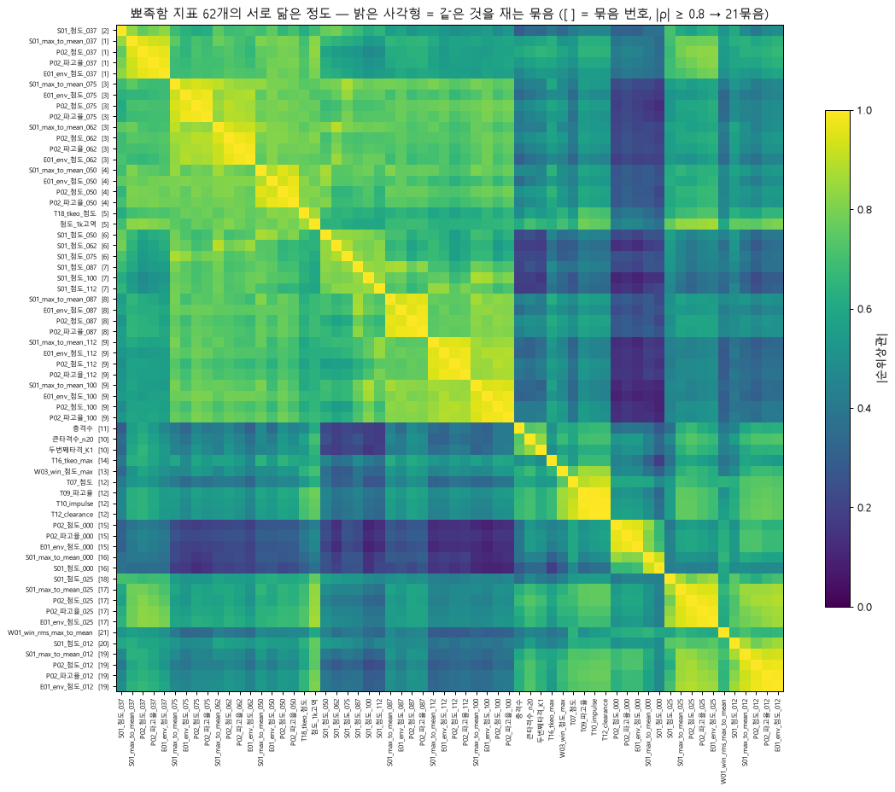
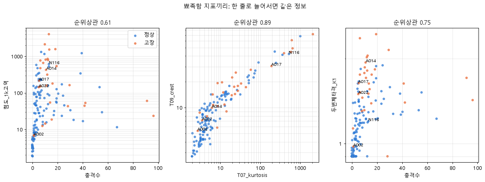
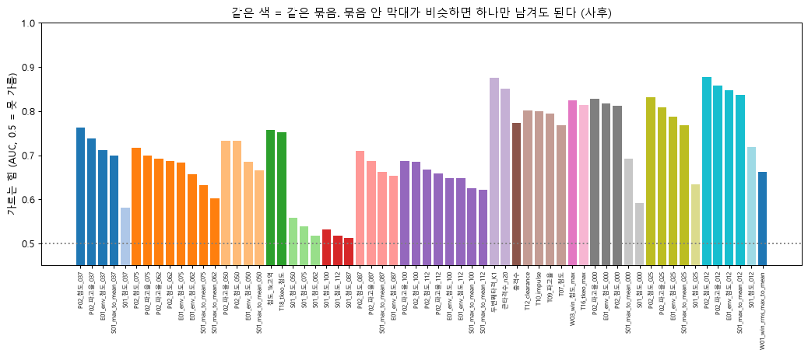

# 2-21 뾰족함 지표 중복 — 첨도·파고율·충격 수는 같은 것을 여러 번 재나

## 결론
- 지금 ET 입력에 있는 뾰족함 계열 58개에 4개(충격 수 · 큰 타격 수 · 두 번째 타격 크기 · 1 kHz 고역통과 첨도)를 더한 **62개는 사실상 21묶음**이다(서로 순위상관 0.8 이상이면 한 묶음).
- 중복의 정체는 **"같은 주파수 대역의 다른 통계량"** 이다. 한 대역에 붙은 첨도 · 파고율 · 포락선 첨도 · 시간별 최대/평균, 이 네 개가 거의 같은 값이다. 10개 대역 × 4개 = 40개가 사실상 10개다.
- 반대로 **대역이 다르면 다른 정보**다. 원신호 첨도와 파고율은 같은 묶음(0.89)이다. 하지만 **충격 수와 첨도는 0.6**으로 따로 논다.
  - 충격이 아주 많으면 오히려 첨도가 내려간다. 충격이 더는 "드물게 튀는 값"이 아니기 때문이다.
- abn_002는 모든 뾰족함 지표에서 정상 하위 11–31%다. 이 계열로는 원리상 못 잡는다(4-5와 같은 결론).
- 교수님 조언(피처 과적합)에 대한 제안은 이렇다. 대역마다 4개 통계량을 1개로 줄이면 뾰족함 계열이 58 → 약 20개가 된다. 새 피처 후보 **C6**으로 추가한다.

## 질문
1. 첨도 · 파고율 · 충격 수는 같은 것(충격이 있었나)을 재는가?
2. 같은 것이라면 몇 개로 줄일 수 있는가?

## 방법
- 대상은 이름으로 골랐다(라벨 무관): ET 150개 중 `kurt|crest|impulse|clearance|max_to_mean|tkeo_max|tkeo_kurt`에 해당하는 58개 + 위 4개
- 묶음은 4-3 중복 지도와 같은 기준이다. 순위상관 |ρ| ≥ 0.8, 완전 연결 군집
- 대역 이름 `000 · 012 · 025 …`는 1.25 kHz 폭의 대역 시작점이다(100 Hz 단위). 예: `012` = 1.25–2.5 kHz. `000`은 200 Hz–1.25 kHz다
- 코드: [run.py](run.py) · 숫자: [result.txt](result.txt) · 묶음 표: [groups.csv](groups.csv)

## 그림
### 1. 상관 열지도 (묶음 순)

- 밝은 사각형 하나가 같은 것을 재는 묶음이다. 4×4 사각형이 대역마다 반복된다. 첨도 · 파고율 · 포락선 첨도 · 시간별 최대/평균의 네 개다.
- 9–12.5 kHz(`100` · `112`)와 6.25–8.75 kHz(`062` · `075`)는 두 대역이 한 묶음(8개)이다. 이웃 대역끼리는 충격이 같이 울리기 때문이다.

### 2. 대표 지표끼리 산점도

- 가운데(원신호 첨도 vs 파고율, 0.89): 한 줄로 늘어선다. 둘 중 하나만 있으면 된다.
- 왼쪽(충격 수 vs 1 kHz 첨도, 0.61): 충격이 0–15개일 때는 같이 오르지만, 30개가 넘으면 첨도가 다시 내려간다. 두 지표는 다른 질문에 답한다. 충격 수는 "몇 번 쳤나", 첨도는 "드물게 세게 쳤나"다.
- 오른쪽(충격 수 vs 두 번째 타격 크기): 고장(주황)은 충격 수가 적어도 두 번째 타격이 크다. 유격 반복 규칙(2-12)이 잡는 축이다.

### 3. 묶음별 가르는 힘 (사후)

- 같은 색 막대는 높이가 비슷하다. 하나만 남겨도 가르는 힘이 거의 그대로다.
- 가장 센 묶음은 1.25–2.5 kHz 대역 뾰족함(AUC 0.88)과 두 번째 타격 · 큰 타격 수(0.87)다. 2-16의 "고장은 2–4 kHz로 운다"와 맞는다. 라벨을 보고 고른 대역이라서 순위만 참고한다.
- 시간별 첨도(`S01_kurtosis_*`) 묶음은 0.53–0.63으로 약하다.

## 해석
- "첨도 · 파고율 · 충격 수가 같다"는 가설은 **절반만 맞다**. 같은 대역 안의 첨도와 파고율은 같다. 충격 수와 첨도는 다르다.
- 피처 줄이기의 단위는 **"대역 하나에 대표 하나"** 다. 대표는 라벨을 보지 않고 미리 정한다. 해석이 쉬운 첨도를 권한다.
- 결정 제안: 4-5 후보 목록에 **C6 "대역별 뾰족함 4종 → 첨도 1종"** 을 추가한다. EXP에서 지금의 ET 150개와 비교한다(교수님 조언 대응).
