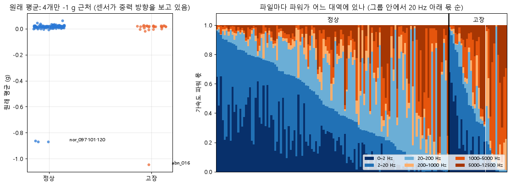
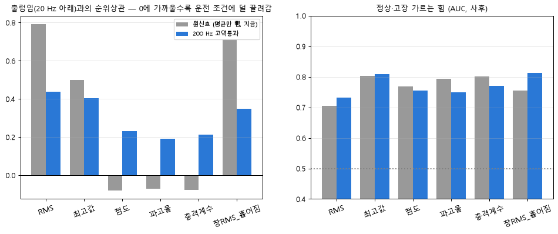
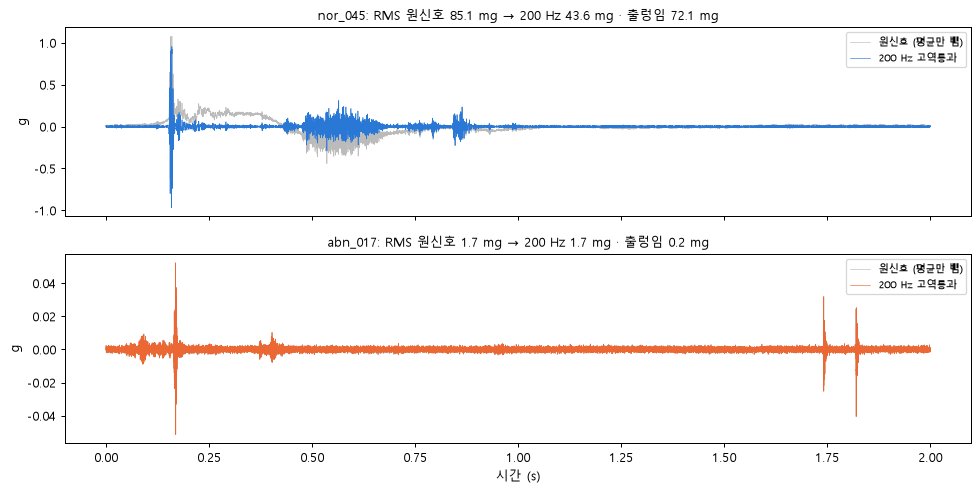

# 2-22 출렁임·센서 방향 영향 — 원래 평균과 느린 출렁임이 지금 모델 입력을 얼마나 흔드나

## 결론
- **원래 평균은 정보가 없다.** AUC는 0.50이다. 평균이 −1 g 근처인 파일 4개(정상 097 · 101 · 120, 고장 016)는 센서 방향이 다른 것이고 고장과 무관하다. 피처 후보 C1(ET에서 원래 평균 빼기)을 지지한다.
- **크기 계열 피처는 출렁임에 끌려간다.** RMS와 창 RMS 흩어짐은 20 Hz 아래 출렁임과 순위상관이 0.79 · 0.71이다. 200 Hz 고역통과로 바꾸면 0.44 · 0.35로 줄고, 가르는 힘은 오히려 오른다(0.71 → 0.73, 0.75 → 0.81).
- **모양 계열 피처(첨도 · 파고율 · 충격계수)는 원래부터 출렁임과 무관하다**(−0.08). 고역통과로 바꾸면 가르는 힘이 약간 내려간다(0.79 → 0.75).
- 따라서 피처 후보 C2를 좁힌다. **크기 계열(RMS · 최고값 · 창 RMS 흩어짐)만** 200 Hz 고역통과로 바꾸고, 모양 계열은 그대로 둔다.

## 질문
1. 원래 평균(센서가 기울어 중력이 얹힌 값)이 모델 입력에 들어가 있는데, 고장 정보가 있는가?
2. 차량이 느리게 출렁이는 성분(20 Hz 아래)이 RMS · 첨도 같은 원신호 피처를 얼마나 흔드는가? 200 Hz 고역통과로 바꾸면 나아지는가?

## 방법 (배운 내용 연결)
| 배운 것 | 여기서 쓴 방식 |
|---|---|
| Stage 1 오프셋 = 중력이 센서 축에 얹힌 값 | 원래 평균의 분포와 AUC |
| Stage 1 가속도 파워의 대역별 몫 | 파일마다 6개 대역 몫을 쌓은 막대 |
| Stage 1 "느린 출렁임도 가속도에 크게 잡힌다"(11-20 정정) | 피처와 출렁임 크기(20 Hz 저역통과 신호의 표준편차)의 순위상관 = "끌려감" |

- 200 Hz는 AE 입력과 같은 값으로 미리 정했다(라벨을 보고 고르지 않음)
- 코드: [run.py](run.py) · 숫자: [result.txt](result.txt) · 비교 표: [raw_vs_hp200.csv](raw_vs_hp200.csv)

## 그림
### 1. 원래 평균과 대역별 파워 몫

- 왼쪽: 146개는 0 근처(−0.02 ~ 0.06 g)에 있고, 4개만 −0.87 ~ −1.04 g다. 정상 3 · 고장 1로 섞여 있다. 고장 신호가 아니라 장착 차이다.
- 오른쪽: 막대 하나가 파일 하나이고, 파랑 계열이 200 Hz 아래, 주황 계열이 위다. 정상은 파랑이 대부분인 파일이 많다. 고장은 주황(1 kHz 위)의 몫이 크다.

| 대역 (Hz) | 0–2 | 2–20 | 20–200 | 200–1k | 1k–5k | 5k–12.5k |
|---|---|---|---|---|---|---|
| 정상 중앙 몫 | 0.16 | 0.21 | 0.18 | 0.04 | 0.06 | 0.05 |
| 고장 중앙 몫 | 0.11 | 0.25 | 0.03 | 0.04 | 0.18 | 0.10 |

- 주의: 고장의 20–200 Hz 몫이 작은 것은 **몫(비율)** 이기 때문이다. 2-19에서 20–200 Hz 크기 자체는 못 가른다(AUC 0.43). 고장은 고주파가 커져서 상대적으로 낮은 쪽의 몫이 줄어든 것이다.

### 2. 같은 피처를 원신호 vs 200 Hz 고역통과로

- 왼쪽(끌려감): 회색이 높은 RMS · 창 RMS 흩어짐은 운전 조건(출렁임)을 재고 있었다. 파랑(200 Hz)에서 절반으로 준다.
- 오른쪽(가르는 힘, 사후): 크기 계열은 파랑이 같거나 높고, 모양 계열은 회색이 약간 높다.
- 모양 계열은 고역통과 뒤 끌려감이 −0.08 → +0.2로 오히려 생긴다. 출렁임이 큰 파일에 노면 충격도 많아서일 수 있지만, 확인하지 않았다.

### 3. 예시 — 출렁임이 가장 큰 정상 vs 가장 조용한 고장

- nor_045: 회색(원신호)이 0.2–0.6초에 느리게 부풀어 있다. 이것이 출렁임이다. 고역통과(파랑)로 걷어 내면 RMS가 85 → 44 mg로 절반이 된다.
- abn_017: 출렁임이 0.2 mg로 거의 없다. 원신호와 고역통과의 RMS가 같다(1.7 mg). 원신호 RMS로 보면 017은 "가장 조용한 파일"일 뿐이다. 고장 신호(0.17 · 1.75 · 1.82초 충격)는 고역통과 신호의 모양에서 보인다.

## 해석
- 원신호 크기 피처가 재는 것의 상당 부분은 **"오늘 길이 얼마나 거칠었나"** 다. val · test의 운전 조건이 학습과 다르면 이 피처들이 흔들린다. 이것이 Stage 1에서 배운 "가속도는 느린 출렁임도 크게 잡는다"의 실제 영향이다.
- 결정 제안
  - C1(원래 평균 빼기)은 그대로 진행한다. 정보는 0이고 위험(장착 차이)만 있다.
  - C2는 "크기 계열 3개(RMS · 최고값 · 창 RMS 흩어짐)만 200 Hz 고역통과"로 좁힌다. 차단 주파수 0 / 20 / 200 비교는 EXP에서 한다.
