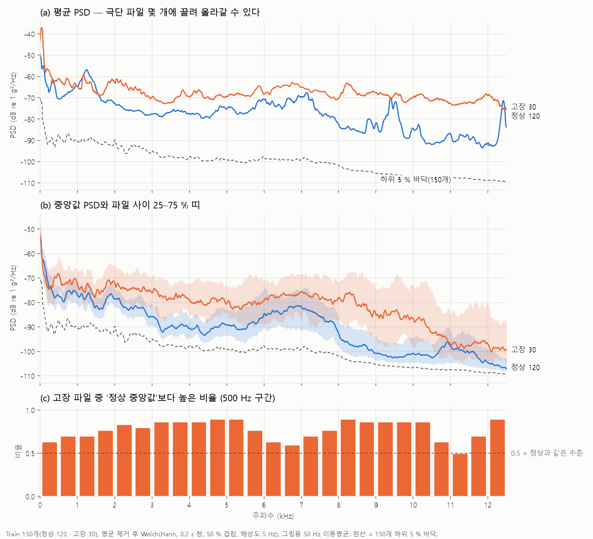

# 3-3 전체 PSD · 유효 대역 (11-24) (옛 new_단계 2-1)

Train 150개(정상 120 · 고장 30)와 val 40개(라벨 없는 진단에만 사용)의 Welch PSD를 보고, 유효 대역 상한과 후보 대역을 정했다. 모델 실험은 하지 않았다.
코드 [run.py](자료/run.py) · 점검 스크립트 [점검/](자료/점검/) · 수치 [figs/](자료/figs/)

## 결정 (사용자 11-24)

1. **유효 대역 상한 = 11 kHz.** 11 kHz 이상은 모델 입력에서 제외하고 "참고 구간"으로만 둔다.
2. **후보 대역 두 개는 가설로만 기록한다**: 3–5 kHz, 8–10.5 kHz. 폴드 안에서 다시 골라도 같은 대역이 나오는지 확인하기 전에는 확정하지 않는다.
3. **협대역 톤이 있는 정상 5개 파일을 "측정 조건 의심 파일"로 표시한다**: 055 · 116(9.4 kHz, **톤이 아니라 충격 후 울림으로 수정**, 아래 "사용자 점검"), 097 · 101 · 120(12.4 kHz 톤, DC −0.865 g). 097 · 101 · 120은 같은 세션 후보로 그룹 누수 점검에 쓴다.

## 근거

### 센서 바닥 (라벨 없이, 190개)
- 파일 사이 하위 5 %와 최솟값은 약 9 kHz 이후 −105 ~ −108 dB에서 평평하다. 양자화 바닥(약 −149 dB)보다 40 dB 높아서 센서 · 아날로그 잡음 쪽이다.
- 정상 중앙값은 8.5 kHz 이후 −100 ~ −102 dB에서 거의 평평하고, 12–12.5 kHz에서는 바닥(−108 dB)에 닿는다.

### 두 대역 (라벨을 본 관찰이므로 가설)
| 구간 | 고장 − 정상 (중앙값) | 고장 중 정상 중앙값 초과 | 구간 AUC |
|---|---|---|---|
| 3–5 kHz | +11 ~ +13 dB | 0.87–0.90 | 0.77–0.81 |
| 6–7.5 kHz | +4 ~ +6 dB | 0.60–0.70 | 0.60–0.62 (정상도 크게 울리는 본체 구간) |
| 8–10.5 kHz | +12 ~ +18 dB | 0.87–0.90 | 0.79–0.83 |
| 10.5–11.5 kHz | +1 ~ +6 dB | 0.50–0.63 | 0.58–0.66 |
| 12–12.5 kHz | +7 dB | 0.90 | 0.75 (아래 톤의 영향 가능) |

- 25–75 % 띠가 겹치지 않는다는 Gemini의 판단은 틀렸다. 고장 25 %와 정상 75 %를 비교하면 대부분 구간에서 겹치고, 안 겹치는 곳(3–4.5 · 8–9 · 9.5–10 kHz 일부)도 간격이 1–2 dB다.
- 고장 파일끼리 모양이 크게 달라서(8–10 kHz 25–75 % 띠 약 20 dB) 일부 고장은 정상 중앙값 아래에 있다.

### 평균을 흔든 정상 파일 (평균 대신 중앙값을 쓰는 이유)
| 평균에서 튄 곳 | 원인 | 내용 |
|---|---|---|
| 9.2–9.6 kHz | nor_116(57 %) · nor_055(41 %) | 9.40 kHz 협대역 톤(이웃보다 11–17 dB) |
| 12.2–12.45 kHz | nor_120(34 %) · nor_097(33 %) · nor_101(32 %) | 12.40–12.43 kHz 협대역 톤(이웃보다 22–24 dB), 세 파일의 DC 평균 −0.863 ~ −0.868 g |

경계 아티팩트가 아니다. 파일 몇 개가 평균의 98–99 %를 차지한다.

### 앨리어싱 가설 (사용자 의문)
- 지지하는 것: 12.4 kHz 톤이 나이퀴스트 바로 아래이고 세 파일에서 같다. 나이퀴스트 위 간섭이 접혔을 수 있다(실제 주파수 25 − 12.42 = 12.58 kHz?).
- 판단이 안 서는 것: 신호가 있는 파일 대부분은 나이퀴스트 쪽으로 완만히 내려간다(10.5–11 kHz 대비 마지막 250 Hz 중앙값 −10 dB). 어떤 저역 필터는 있다는 뜻이지만 앨리어싱을 막는 정도는 알 수 없다.
- **데이터만으로는 단정할 수 없다.** 계측 장비의 안티앨리어싱 필터 사양이 필요하다 → 조교 질문 후보. 앨리어싱이 사실이든 아니든 11 kHz 이상은 AUC가 낮고(0.58–0.66) 물리 모드와 연결도 안 돼서 제외한다.

## Gemini 제안 두 가지를 점검한 결과

### 1. DC 평균 · 협대역 톤으로 숨은 세션(Pseudo-Session) 복원
- DC 평균이 −0.5 g 아래인 파일은 **정상 097 · 101 · 120(−0.863 ~ −0.868 g)과 고장 abn_016(−1.045 g)**뿐이다. 나머지 train 147개와 val 40개는 전부 ±0.1 g 안(중앙값 +0.016 g)이라 DC로는 구별되지 않는다.
- 즉 DC로 복원되는 세션은 **097 · 101 · 120 한 묶음(3개)**이다. abn_016은 값이 달라서 같은 세션이 아니다. 전체 파일의 세션을 복원하는 도구는 못 된다.
- val에는 이런 파일이 하나도 없다. val은 이 세션 유형이 아니다.
- DC 평균은 **그룹 점검용으로만** 쓴다. 피처로 넣으면 안 된다(abn_016의 −1.045 g가 "고장"으로 학습될 수 있다).

### 2. 톤은 첨도 · 윈도우 변동으로 걸러낼 수 있다는 주장 → 055 · 116에는 해당하지 않는다
8–10.5 kHz 대역 통과(4차 Butterworth, 영위상) 신호의 지표:

| 파일 | 초과 첨도 | 파고율 | 0.1초 창 Max/Median RMS | 정상 내 순위(첨도 · 창 비) |
|---|---|---|---|---|
| nor_055 | 292 | 28.8 | 12.4 | 92 · 92 백분위 |
| nor_116 | 484 | 37.3 | 101.6 | 96 · 99 백분위 |
| nor_097 / 101 / 120 | 0.2–0.5 | 5.2–5.7 | 1.1–1.3 | 6–16 백분위 (8–10.5 kHz는 평온) |

- 순수 정현파의 초과 첨도가 −1.5라는 이론은 맞지만, 055 · 116은 **톤 + 충격**이 섞여 있어 첨도 · 창 비가 정상 상위 8 % 이내다. 첨도 · 창 비로는 이 두 파일이 고장처럼 보인다. "완벽히 분리"는 틀렸다.
- 톤처럼 보이는 정상(첨도 < −0.5)은 120개 중 2개, 고장은 0개다. 055 · 116은 그 2개가 아니다.
- 이 대역에서 형태 지표의 분리도는 AUC 0.66–0.73(첨도 0.70 · 파고율 0.66 · 창 비 0.73)으로 대역 에너지(0.79–0.83)보다 낮다. 정상 첨도 중앙값이 37이어서 충격성 자체가 정상에도 흔하다.
- 스펙트럼 평탄도 제안은 아직 계산하지 않았다.

## 사용자 점검 (11-24): nor_055 · nor_116 스펙트로그램

사용자가 두 파일의 스펙트로그램과 충격 검출 표를 직접 보고 정리했다(Gemini 해석 포함). 내가 같은 데이터로 확인한 것을 옆에 적는다. 스크립트 [점검/peak_prevalence_lowband.py](자료/점검/peak_prevalence_lowband.py), 수치 [figs/peak_prevalence_lowband.txt](자료/figs/peak_prevalence_lowband.txt).

| 점검 내용 | 판정 | 내용 |
|---|---|---|
| 055 · 116의 9.4–9.5 kHz는 지속 톤이 아니라 노면 충격 직후의 맑은 울림(ring-down, ζ 0.01–0.02) | **채택** | 앞의 "톤" 표현을 고친다. 첨도 · 창 비율이 높게 나온 이유(충격이 있었음)와도 맞는다 |
| 9.5 kHz는 "정상 텐션암의 고유 울림 주파수" | **근거 부족, 반대 신호 있음** | 9.3–9.6 kHz에 협대역 봉우리(이웃보다 ≥ 10 dB)가 있는 파일: **정상 2/120(1.7 %, 9.39 · 9.41 kHz), 고장 4/30(13 %, 9.48–9.59 kHz), val 3/40**. 고장 쪽이 더 흔하다. 정상 고유 모드라고 단정할 수 없다 |
| (관찰) 정상 봉우리는 약 9.40 kHz, 고장은 9.48–9.59 kHz | **가설, 표본이 작음** | 정상 2개 vs 고장 4개. 같은 모드가 고장에서 위로 이동했을 수 있다(경화 → 공진 이동). 확인하려면 충격 직후 울림 주파수를 따로 재야 한다 |
| 6.0–6.25 kHz도 정상 울림 | **약하게 지지** | 6.0–6.3 kHz 협대역 봉우리: 정상 11/120(9 %), 고장 1/30(3 %), val 2/40. 정상 쪽이 더 흔하지만 배타적이 아니다. 대부분 6.00 kHz(내 검색창 가장자리)라 실제 봉우리는 6.0 kHz 아래일 수 있다 |
| 정상 충격은 2초당 1–2회 단발성 | **일반화 근거 없음** | 055 · 116 두 파일의 검출 표만 본 것이다. 정상 120개와 고장 30개의 충격 횟수 분포는 아직 안 쟀다 |
| 파일마다 저주파(0–700 Hz) 필터 유무가 다르다 | **부분 지지, 원인 미확인** | 0.005–0.7 kHz 평균 − 0.7–1.5 kHz 평균(dB)은 정상 중앙값 +11이고 파일마다 −7 ~ +22로 넓다. 가장 낮은 파일은 **097(−7.1) · 120(−6.8) · 101(−6.3)** = DC −0.865 g 묶음이다. 055는 −3.3(하위 5 %), 116은 +2.4. "완전히 잘렸다"는 아니고 055는 정상 중앙값보다 14 dB 낮다. 고역통과 필터 때문인지 하중 · 노면 때문인지는 구분 못 한다 |

Gemini가 이 점검에서 낸 규칙 세 가지의 상태:
- **① 1 kHz 고역통과 일괄 적용**: 저주파 필터 차이를 없애는 효과는 있다. 대신 저주파 트랙(5–30 Hz)을 포기하게 된다. 결정이 필요하다. 저주파 차이의 원인(필터인지 조건인지)을 먼저 확인하는 쪽이 낫다.
- **② 6–7.5 kHz 제외 · 8–10.5 kHz는 평탄도 · 중앙값**: 6–7.5 kHz 제외는 가설로 이미 기록. 스펙트럼 평탄도는 아직 계산하지 않았다. 055 · 116은 충격 후 울림이라 중앙값으로 톤을 무시하는 논리는 그 두 파일에는 맞지 않는다.
- **③ 윈도우 중 충격 구간 수 또는 P75 · P80**: 구간 수(빈도)는 방향이 맞다. 상위 분위수는 위험하다. 0.1초 창 20개 중 충격이 1–2개면 P75는 바탕 값이라서 **충격이 1–2개뿐인 고장도 같이 가려진다**.

## 남은 것
- Gate 3: 두 대역이 정말 분리된 두 구간인지 500 Hz 스캔 + 폴드 안 재선택 안정성.
- Gate 4: 간헐 충격형인지 연속형인지 시간축 확인, 서브 윈도우 0.1초 vs 0.2초.
- 조교 질문: 계측 장비 안티앨리어싱 필터, 12.4 kHz 톤의 출처.
- 그룹 누수: 097 · 101 · 120이 같은 세션인지, 나머지 파일의 세션 구조는 알 수 없음.
