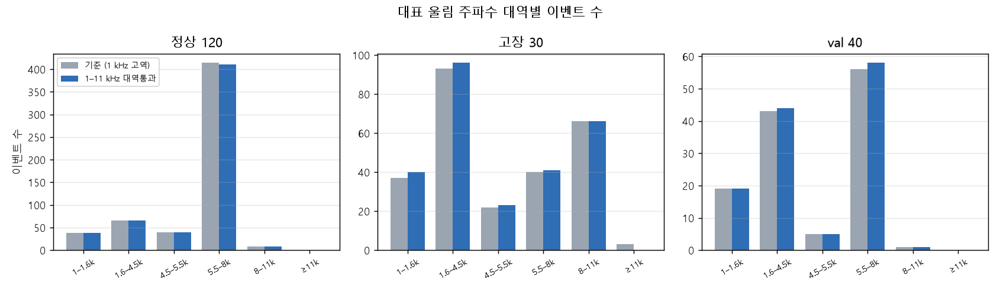
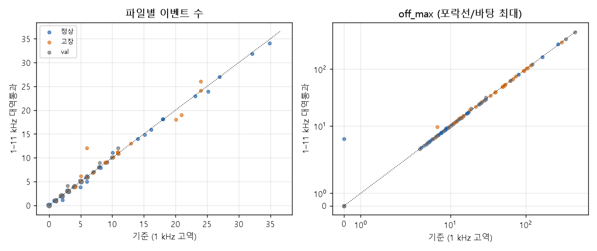

# 3-4 검출기 11 kHz 상한 · 원신호 포화 점검 (11-25) (옛 new_단계 2-7)

코드 [run.py](자료/run.py) · 수치 [figs/수치.txt](자료/figs/수치.txt) · 새 이벤트 표 [figs/events_190_bp11k.csv](자료/figs/events_190_bp11k.csv) · 포화 표 [figs/clip_190.csv](자료/figs/clip_190.csv) · 피처 [기준](자료/figs/feats_old.csv) / [대역통과](자료/figs/feats_bp11k.csv)

## 목적
- 전처리에서 11 kHz 위를 버리기로 했는데([3-3](../3-3_11kHz상한/README.md)), 충격 검출기(`src/impacts.py`)는 1 kHz 고역만 건다. 상한을 검출기에도 걸면 이벤트 · 5피처가 바뀌는지 본다.
- 원신호에 포화(클리핑)된 파일이 있는지 본다.

## 방법
- 입력만 바꿨다: 평균 제거 → 1–11 kHz 대역통과(4차 Butterworth, sosfiltfilt). 이 신호를 `detect_impacts(_hp=)`와 `fine_ring`에 같이 넣었다. 검출기 상수 · 이벤트 정의(25 ms 묶음, 50 Hz 사전)는 [2-6](../../아카이브/new_단계/2_EDA/2-6_바닥보정·이동·기준ET/README.md)과 같다.
- 기준 = 2-6 `events_190.csv`. 같은 코드로 다시 계산해 951개 이벤트가 그대로 나오는 것을 확인했다.
- 190개 파일(정상 120 · 고장 30 · val 40). 라벨은 그룹별 집계에만 썼고 아무것도 고르지 않았다.
- 포화: 원신호의 최댓값 · 최솟값, 그 값이 나온 표본 수, 극값에서 같은 값이 이어진 최대 길이, 서로 다른 값 사이 최소 간격(양자화).

## 결과
**이벤트 수가 바뀐 파일** (25 ms 묶음)

| 그룹 | 바뀐 파일 / 전체 | 이벤트 합 | 바뀐 파일 (기준 → 대역통과) |
|---|---|---|---|
| 정상 | 6 / 120 | 566 → 562 | nor_040 5→4, nor_048 10→11, nor_069 6→5, nor_092 25→24, nor_099 2→1, nor_118 35→34 |
| 고장 | 5 / 30 | 261 → 266 | abn_004 24→26, abn_007 5→6, abn_011 21→19, **abn_016 6→12**, abn_019 20→18 |
| val | 3 / 40 | 124 → 127 | val_011 3→4, val_033 8→9, val_039 11→12 |

**대표 울림 주파수 대역별 이벤트 수** (기준 → 대역통과)

| 그룹 | 1–1.6k | 1.6–4.5k | 4.5–5.5k | 5.5–8k | 8–11k | ≥11k |
|---|---|---|---|---|---|---|
| 정상 | 38 → 38 | 66 → 66 | 40 → 40 | 414 → 410 | 8 → 8 | 0 → 0 |
| 고장 | 37 → 40 | 93 → 96 | 22 → 23 | 40 → 41 | 66 → 66 | 3 → 0 |
| val | 19 → 19 | 43 → 44 | 5 → 5 | 56 → 58 | 1 → 1 | 0 → 0 |

**5피처** (그룹 중앙값 기준 → 대역통과, 괄호 = 값이 바뀐 파일 수)

| 피처 | 정상 | 고장 | val |
|---|---|---|---|
| cnt_low | 0 → 0 (2) | 3 → 3 (3) | 0.5 → 0.5 (1) |
| cnt_high | 0 → 0 (0) | 1 → 1 (4) | 0 → 0 (0) |
| cnt_total | 3 → 3 (6) | 6.5 → 7 (5) | 3 → 3 (3) |
| ratio_off | 0 → 0 (3) | 0.62 → 0.60 (5) | 0.12 → 0.11 (2) |
| off_max | 0 → 0 (5) | 39.6 → 39.6 (7) | 4.7 → 4.6 (2) |

- off 이벤트 수가 바뀐 파일: nor_082 2→1, nor_119 0→1, abn_004 13→14, abn_007 5→6, abn_011 9→7, abn_016 6→9, abn_019 14→12, abn_024 5→7, val_039 6→7.
- off_max가 10 % 넘게 바뀐 파일은 둘: nor_119 0 → 6.0(7.55 kHz로 울던 이벤트가 2.65 kHz로 바뀜), abn_016 6.7 → 9.5.
- 대역통과 후 ≥ 11 kHz 울림은 0개. 기준의 3개(abn_015 12.0k, abn_024 11.1k · 11.05k)는 7.6k · 10.7k · 9.2k로 내려갔다. 사전(1–12 kHz)은 그대로 두어도 된다.

**nor_097 · nor_101 · nor_120** (12.4 kHz 톤, DC ≈ −0.86 g): 이벤트는 기준 · 대역통과 모두 0개. 파일 전체 바탕(100 ms 중앙값)의 중앙은 0.180 → 0.182, 0.183 → 0.184, 0.170 → 0.171 g로 거의 같다. Welch로 보면 이 파일들의 1–11 kHz RMS 0.15 g 중 대부분이 **1–1.6 kHz(0.14 g, 봉우리 1.2 kHz 부근)** 이고, 11–12.5 kHz는 0.016 g뿐이다. 바탕이 높은 원인은 12.4 kHz 톤이 아니다.

바탕 비(대역통과 ÷ 기준) 190개 중앙 1.000. 크게 내려간 것은 abn_016(0.56) 하나뿐이고, 그 다음은 0.96이다.

**포화**: 의심 파일 0개. 190개 모두 최댓값 · 최솟값이 한 표본에만 나온다(val_007 최댓값만 2번, 연속 아님). 극값에서 같은 값이 3번 이상 이어진 파일은 없다. 진폭이 가장 큰 파일은 val_004(13.3 / −14.7 g) · val_031(10.5 / −13.3 g)로, 학습 최대(abn_018 8.1 / −7.3 g)를 넘지만 끝이 평평하지 않다. 양자화 간격은 약 1.4 × 10⁻⁵ g(최소 1.0 × 10⁻⁵ g), 파일당 고유값 중앙 8,915개.

## 해석
- 상한을 걸어도 **이벤트 · 5피처는 거의 그대로**다. 바뀐 파일은 14 / 190이고 대부분 이벤트 ±1–2개다. 그룹 중앙값은 사실상 같다.
- 실제로 의미 있게 바뀐 곳은 abn_016 하나다. 11 kHz 위 성분이 바탕을 끌어올려 묻혀 있던 충격이, 대역통과 뒤 드러났다(이벤트 6 → 12, off 6 → 9, 바탕 0.56배). 고장 쪽 신호가 늘어나는 방향이다.
- 정상에서 off 이벤트가 새로 생긴 파일은 nor_119 하나(0 → 1, off_max 6.0)이고, nor_082는 2 → 1로 줄었다.
- 12.4 kHz 톤 정상 3개는 검출기 입장에서 문제가 아니었다. 이 파일들의 높은 바탕은 1.2 kHz 부근 성분 때문이고, 11 kHz 상한과는 상관없다.
- 포화된 파일은 없다. val_004 · val_031은 학습 범위보다 진폭이 크므로, 진폭 절대값을 쓰는 피처에서는 외삽이 된다(5피처 중 off_max는 바탕 대비 비라서 덜하다).
- **권고**: 1–11 kHz 대역통과를 검출기 입력으로 채택한다. 전처리 결정(11 kHz 상한)과 일치하고, 변화는 작으며, 유일한 큰 변화(abn_016)도 물리적으로 맞는 방향이다. ≥ 11 kHz 울림 라벨이 사라져 대역 정의(8–11 kHz)와도 맞는다. 채택하면 NEXP-01 중첩 CV를 새 이벤트 표로 다시 돌려 확인한다.

## 한계
- 중첩 CV F2는 다시 돌리지 않았다. 피처 값 변화만 봤다.
- 1–1.6 kHz 성분(097 · 101 · 120의 높은 바탕)은 원인을 더 보지 않았다.
- 포화 판정은 "극값의 반복 · 연속"만 봤다. 센서 측정 범위(사양)는 모른다.
