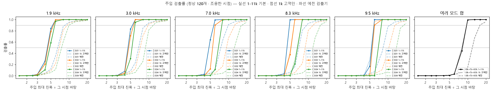
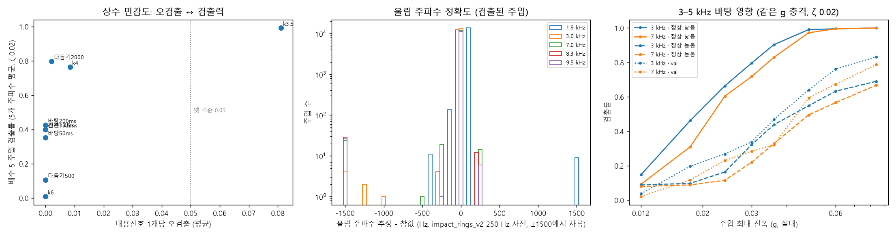
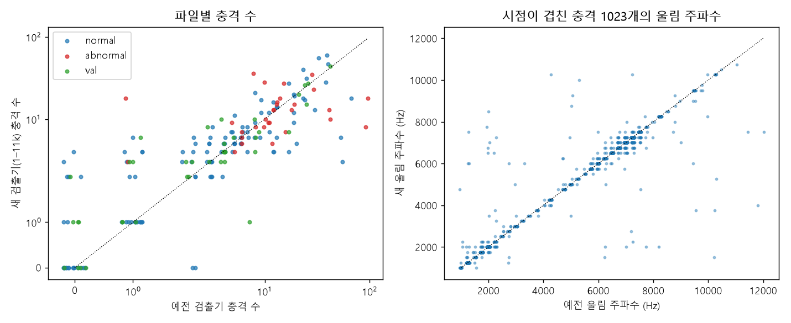

# 3-5 충격 검출기 검증 (11-25) (옛 2-36)

코드 [run.py](자료/run.py) · 수치 [figs/수치.txt](자료/figs/수치.txt) · 파일별 [figs/files_190_검출.csv](자료/figs/files_190_검출.csv) · 충격 [figs/impacts_190.csv](자료/figs/impacts_190.csv) · 주입 원자료 [figs/inject.csv.gz](자료/figs/inject.csv.gz)

## 목적
`src/impacts.py` 검출기(`detect_impacts` · `impact_rings_v2`)를 **1–11 kHz 대역통과 입력**(11-25 결정)으로 쓸 때, 라벨 없이 다음을 잰다.
오검출률, 검출되는 최소 크기(유효 문턱), 울림 주파수 정확도, 상수 민감도, val 바탕(3–5 kHz) 영향, 한 충격의 다중 검출, 예전 검출기(`final.impact_rings`, RES 규칙이 씀)와의 차이.

## 방법
- 입력: 평균 제거 → 1–11 kHz 4차 Butterworth `sosfiltfilt` → `detect_impacts(_hp=)`. 비교: 1 kHz 고역만(지금 코드 기본), 예전 검출기(1 kHz 고역 · 500 Hz 다듬기 · 파일 전체 중앙값 × 6 · 5 ms · 끝단 제외 없음).
- 재현 확인: 스크립트의 검출 함수 = `detect_impacts` 결과, 예전 함수 = `final.impact_rings` 충격 수 · RES 값과 같음(수치.txt 첫 줄 · [4c]).
- **① 오검출**: 190개 파일 각각 위상 무작위 대용신호 10개(진폭 스펙트럼 유지, 위상만 무작위 → PSD 같고 충격성 없음) = 1,900개. 대용신호 1개당 검출 수.
- **② 주입**: 정상 120개(조용한 시점이 없는 nor_073 · nor_118 제외 118개)의 0.2 s 간격 격자 중 세 검출기 모두 ±40 ms 안에 원래 검출이 없는 시점(파일당 최대 6, 평균 5.6)에 감쇠 사인파를 더함. 주파수 1.9 · 3.0 · 7.0 · 8.3 · 9.5 kHz × ζ 0.01 · 0.02 · 0.04, 여러 모드 합(1.9k ζ.01 + 7k ζ.02 + 9.5k ζ.04) 1개. 최대 진폭 = 배수(1.5–20) × 그 시점 바탕(1–11k 포락선 100 ms 이동 중앙값). 검출 = 주입 −3…+10 ms 안 봉우리. 울림 주파수는 검출 시점에서 `impact_rings_v2`(250 Hz 사전)와 50 Hz 사전(`ring_mode_feats` · 2-7) 둘 다.
- **③ 상수 민감도**: 한 번에 하나만 바꿈. 문턱 k 3.5 · 4 · **4.5** · 6, 바탕 창 50 · **100** · 200 ms, 다듬기 500 · **1000** · 2000 Hz, 최소 간격 3.4 · **6.75** · 13.5 ms. ①과 ②를 같은 방식으로.
- **④** (a) 정상을 3–5 kHz 전력(Welch) 3분위로 나눠 낮음 · 높음 40개씩 + val 40개에 같은 g 진폭(× 정상 바탕 중앙 0.0060 g, 2–14배) 3k · 7k ζ 0.02 주입. val에는 주입만 했고 라벨은 쓰지 않음. (b) 실제 검출을 25 ms 묶음으로 묶어 묶음당 검출 수. (c) 예전 vs 새 충격 수 · 시점(±3 ms) 일치 · 울림 주파수 · RES ≥ 0.7 파일.
- 라벨은 그룹별 집계와 맨 아래 '참고' AUC에만 썼다. 상수는 라벨로 고르지 않았다. 실행 약 2분(32코어).

## 결과
**① 오검출 (대용신호 1개당 평균 검출 수)**

| 검출기 | 오검출 | 실제 파일 평균 검출 수 정상 / 고장 / val |
|---|---|---|
| 1–11k 기본 (k 4.5) | **0.000** (1,900개 중 0) | 7.1 / 13.6 / 6.3 |
| 1 kHz 고역만 | 0.000 | 7.1 / 13.4 / 6.2 |
| 예전 검출기 | 0.000 | 7.8 / 19.0 / 6.3 |
| k 4 · k 3.5 | 0.008 · 0.081 | 8.2 / 16.1 / 7.5 · 9.8 / 19.8 / 9.2 |
| 다듬기 2000 Hz | 0.002 | 8.1 / 17.5 / 7.2 |
| 그 밖 변형 | 0.000 | |

**② 50 % · 90 % 검출 배수** (최대 진폭 ÷ 그 시점 바탕)

| 주파수 | ζ 0.01 | ζ 0.02 | ζ 0.04 | 예전 검출기 ζ 0.02 |
|---|---|---|---|---|
| 1.9 kHz | 4.4 / 5.4 | 4.5 / 5.5 | 4.8 / 5.8 | 6.9 / 9.3 |
| 3.0 kHz | 4.5 / 5.4 | 4.7 / 5.6 | 5.3 / 5.9 | 7.2 / 9.8 |
| 7.0 kHz | 4.7 / 5.7 | 5.5 / 6.0 | 6.8 / 7.8 | 9.3 / 12.7 |
| 8.3 kHz | 4.5 / 4.9 | 5.2 / 5.8 | 6.7 / 7.7 | 8.9 / 12.1 |
| 9.5 kHz | 5.4 / 5.9 | 5.5 / 6.0 | 6.9 / 7.8 | 10.3 / 13.0 |
| 여러 모드 합 | 8.2 / 9.6 | | | 11.9 / 15.9 |

1 kHz 고역만 입력은 모든 칸에서 1–11k와 ±0.1 안. 배수 20에서는 모두 100 % 검출.

**울림 주파수 · 시점**: 검출된 주입 62,828개 중 `impact_rings_v2` 오차 > 250 Hz는 111개(0.2 %)뿐이고, 모두 배수 ≤ 5의 약한 주입에서 바탕의 1.25 · 1.5 kHz 성분으로 끌린 경우. 나머지 오차는 250 Hz 격자 간격 그대로(1.9k → 2.0k, 8.3k → 8.25k). 50 Hz 사전은 오차 0. ζ는 250 Hz 사전에서 **1.9 kHz만 거의 다 틀림**(일치 0–19 %, 격자에서 100 Hz 벗어나 짧은 원자가 더 맞음), 50 Hz 사전은 배수 ≥ 6에서 93–100 % 맞음. 검출 시점은 주입보다 0.2–0.6 ms 뒤(10–90 % 범위 0.16–1.8 ms).

**③ 상수 민감도** (ζ 0.02, m50 / m90, 오검출, 주입 1개에 검출 2개 이상 비율)

| 변형 | 오검출 | 1.9k | 3.0k | 7.0k | 8.3k | 9.5k | 다중 검출 |
|---|---|---|---|---|---|---|---|
| 기본 | 0.000 | 4.5/5.5 | 4.7/5.6 | 5.5/6.0 | 5.2/5.8 | 5.5/6.0 | 0.038 |
| k 4 | 0.008 | 3.9/4.9 | 4.3/4.9 | 4.7/5.7 | 4.4/4.9 | 5.4/5.9 | 0.054 |
| k 3.5 | 0.081 | 3.3/4.2 | 3.5/4.4 | 4.3/4.9 | 3.6/4.6 | 4.5/4.9 | 0.075 |
| k 6 | 0.000 | 6.4/7.6 | 6.8/7.7 | 7.0/7.9 | 6.9/7.8 | 7.0/8.1 | |
| 바탕 50 / 200 ms | 0.000 | 4.6/5.8 · 4.4/5.5 | 4.9/5.8 · 4.7/5.7 | 5.5/6.9 · 5.4/6.3 | 5.2/5.8 · 5.1/5.8 | 5.7/7.3 · 5.6/7.1 | |
| 다듬기 500 / 2000 Hz | 0.000 / 0.002 | 5.1/5.9 · 4.4/5.4 | 5.5/6.0 · 4.2/4.9 | 6.9/7.8 · 4.6/5.6 | 6.9/7.8 · 4.4/4.9 | 7.0/8.0 · 5.0/5.8 | |
| 간격 3.4 / 13.5 ms | 0.000 | 기본과 같음 | | | | | 0.120 / 0.001 |

**④-a val 3–5 kHz 바탕**

| 묶음 | 3–5k 전력 중앙 | 바탕 중앙 (g) | 3k ζ.02, 같은 g 진폭 검출률 (×4 · ×6 · ×10, 단위 0.006 g) | 상대 배수 m50 3k · 7k |
|---|---|---|---|---|
| 정상 낮음 | −60.4 dB | 0.0038 | 0.66 · 0.90 · 1.00 | 4.7 · 5.5 |
| 정상 높음 | −46.8 dB | 0.0087 | 0.16 · 0.44 · 0.63 | 4.6 · 5.5 |
| val | −45.8 dB | 0.0081 | 0.27 · 0.47 · 0.76 | 4.7 · 5.5 |

val 3–5k는 정상보다 +10.4 dB(중앙 기준), 검출 바탕은 +2.6 dB. 정상 안에서 3–5k와 바탕의 순위상관 0.67.

**④-b 한 충격의 다중 검출**: 주입에서 2개 이상 나온 것은 길게 우는 저주파뿐(1.9k ζ 0.01: 42 %, 배수 ≥ 10에서 74 % · 3.0k ζ 0.01: 8 % · 나머지 ≤ 3 %). 실제 파일에서 25 ms 안에 이어진 검출 묶음 중 2개 이상인 비율 정상 0.32 · 고장 0.32 · val 0.33(묶음당 평균 1.51 · 1.54 · 1.98). 25 ms 안 이웃 쌍의 77 %가 같은 울림 주파수(±500 Hz).

**④-c 예전 vs 새** (190개)
- 충격 수 중앙(평균): 정상 3(7.8) → 4(7.1), 고장 12(19.0) → 12(13.6), val 4(6.3) → 3(6.3). 파일별 순위상관 0.86.
- 시점 일치(±3 ms): 예전 1,757개 중 58 %, 새 1,509개 중 68 %. 일치한 충격의 울림 주파수 같은 칸 77 %, ±250 Hz 안 90 %.
- 같은 크기 주입에서 예전 검출기는 1.5–2배 더 커야 잡는다(표 ②). 예전은 파일 전체 중앙값 기준이라 시끄러운 구간에서 많이 잡고(고장 평균 19), 조용한 구간의 작은 충격은 놓친다.
- RES(8.0–8.7k · ζ ≤ 0.02 최대 fit ≥ 0.7) 파일: 정상 0 → 0, val 0 → 0, 고장 5 → 7(abn_013 · abn_030이 새로 넘음).

**[참고 · 라벨 사용 · 상수 선택에 쓰지 않음]** 학습 150개 충격 수 AUC: 기본 0.806, 변형들 0.793–0.817, 1 kHz 고역만 0.798, 예전 0.774.

## 해석
- **오검출은 문제가 아니다.** 기본 상수로 대용신호 1,900개에서 0개. 정규 잡음 포락선이 바탕의 4.5배를 넘을 확률은 매우 작아(레일리 분포, 표본당 ~10⁻⁶) 예상과 맞다. 옛 기준(≤ 0.05)만 보면 k를 4까지 내려도 된다(0.008). 단 이 대용신호는 "정규 잡음"만 걸러낸다. 실제 정상 파일의 검출 7개/파일은 실제 과도 현상이지 잡음 오검출이 아니다.
- **유효 문턱은 바탕의 약 5–6배**(ζ ≤ 0.02), 짧게 우는 충격(ζ 0.04 · 고주파)은 6.7–7배. 1000 Hz 다듬기가 1 ms 미만으로 꺼지는 포락선 봉우리를 깎기 때문이다(감쇠 시간 τ = 1/(2πfζ), 9.5k ζ.04 = 0.42 ms). 그래서 고주파 · 빨리 꺼지는 울림은 상대적으로 덜 센다. 고장 쪽 고주파(8–11k) 울림 수를 셀 때 이 편향이 있다.
- **11 kHz 상한은 검출에 영향이 없다**(검출률 ±0.1, 오검출 0). 채택해도 된다.
- **울림 주파수는 정확하다**(격자 오차만). 문제는 250 Hz 사전의 ζ가 격자 사이 주파수(1.9k)에서 틀린다는 점. RES 규칙(8.0–8.7k · ζ ≤ 0.02)은 8.3k에서 ζ가 96–100 % 맞으므로 영향이 작다.
- **val 바탕 효과는 실재한다.** 검출기는 상대 문턱이라 "바탕 대비 배수"로는 val도 정상과 똑같이 잡는다(m50 같음). 그러나 같은 g 충격은 val에서 덜 잡힌다(3k ×6: 정상 낮음 90 % vs val 47 %). val 바탕은 정상 높음 3분위와 같은 수준이라 **학습 범위 밖은 아니다**. 충격 "수"를 피처로 쓰면 바탕이 높은 파일에서 작은 충격이 빠진다는 점은 정상 안에서도 이미 있는 편향이다.
- **다중 검출은 길게 우는 저주파 충격의 꼬리에서 생긴다.** 꼬리가 6.75 ms 넘게 바탕의 4.5배 위에 머물면서 잡음 물결로 두 번째 봉우리가 잡힌다. 실제 묶음의 약 1/3이 2개 이상이다. 묶지 않은 충격 수는 1.9 kHz 모드 충격을 부풀린다.
- **예전 검출기와는 다른 충격 집합이다**(시점 일치 58–68 %). RES 규칙을 새 검출기로 바꾸면 고장 2개가 더 걸리고 정상 · val은 그대로다.

## 권고
1. **상수 유지 (k 4.5 · 바탕 100 ms · 다듬기 1000 Hz · 간격 6.75 ms) + 1–11 kHz 입력 채택.** 오검출 0, 바탕 창(50–200 ms)에 둔감. 라벨 없는 기준으로 바꿀 이유가 약하다.
2. **충격은 25 ms 묶음(이벤트) 단위로 센다**(2-6 · 2-7 방식). 근거: 길게 우는 1.9k 충격이 혼자 2개 이상 검출됨(주입 42 %). 간격을 13.5 ms로 늘리면 다중 검출 0.1 %로 줄지만 가까운 진짜 충격도 합쳐지므로, 검출기는 두고 묶음으로 세는 쪽을 권한다.
3. **울림 주파수 · ζ는 50 Hz 사전**(`_atoms50`)을 쓴다. 250 Hz 사전은 1.9k ζ가 틀린다. 주파수 오차는 0.
4. (선택) 짧은 울림 편향을 줄이려면 다듬기 2000 Hz: 오검출 0.002로 여전히 기준 안이고 7–9.5 kHz m50이 5.5 → 4.6. 다만 실제 검출 수가 늘고(정상 7.1 → 8.1) 기존 피처가 바뀌므로 중첩 CV로 확인한 뒤에만.
5. RES 규칙을 새 검출기로 옮기면 고장 abn_013 · abn_030 판정이 바뀐다. 옮길지는 중첩 CV로 정한다(여기서는 결정하지 않음).
6. val 바탕 효과는 상수로 고칠 수 없다(상대 문턱의 성질). 바탕에 강한 피처를 원하면 "충격 크기 ÷ 바탕" 같은 비 피처를 쓰고, 절대 g 크기 · 작은 충격 수에 기대는 피처는 val에서 낮게 나올 수 있음을 염두에 둔다. 대역별 바탕(울림 대역마다 따로 문턱)은 7 kHz 충격을 3–5k 바탕에서 떼어 낼 수 있지만 시험하지 않았다.

## 한계
- 대용신호는 정규성 잡음만 대표한다. 비정규 비충격 성분(변조된 지속음 등)에 대한 오검출은 재지 않았다.
- 주입은 이상적인 단일 감쇠 사인파(사인 시작) · 조용한 시점만. 실제 충격의 시작 모양 · 겹친 충격 · 시끄러운 구간의 검출률은 다르다.
- 바탕 효과는 3k · 7k ζ 0.02 두 경우만. 대역별 바탕 검출기는 구현 · 시험하지 않았다.
- 피처 · 중첩 CV F2에 대한 영향은 재지 않았다(검출기 수준 통계만).
- 4-6의 원래 상수 결정 기록(≤ 0.05 기준)을 문서에서 찾지 못해, 그때와 대용신호 생성법이 같은지 확인하지 못했다.
