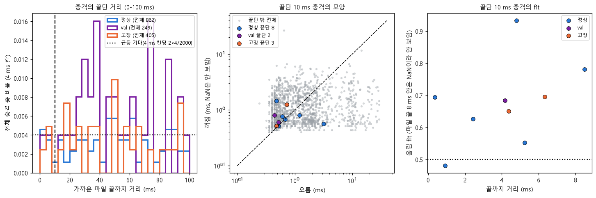
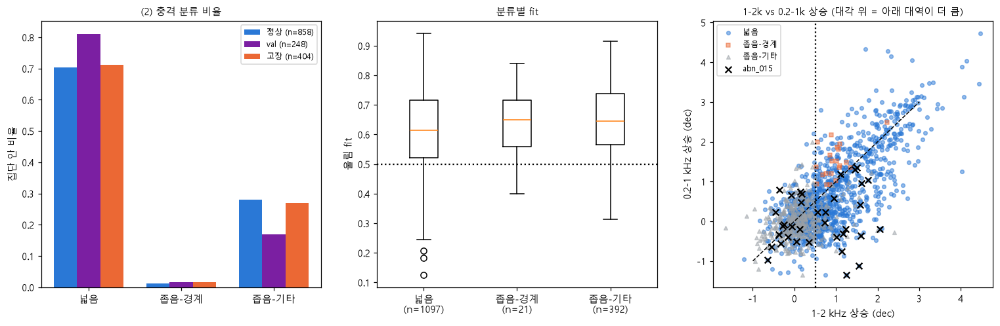
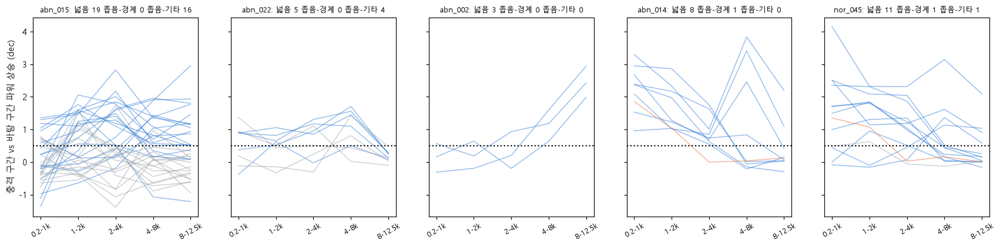
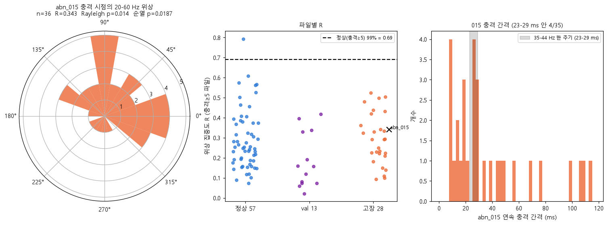
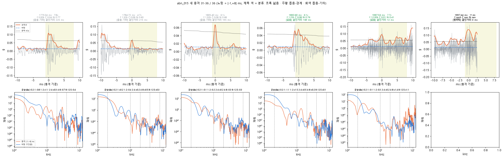

# 4-6 사령탑 015점검 — 새 충격 정의가 진짜 충격을 잡는가 (정의는 고치지 않고 제안만)

수치의 원본은 `result.json`. 표: `충격별_대역분류.csv`(충격 1516개마다 칸별 상승·분류), `끝단충격_10ms.csv`, `015_충격표_분류.csv`, `위상잠금_파일별.csv`. 코드 `run.py`(`detect_impacts`는 사령탑_7b-7e에서 그대로 복사, 실행 시 `충격표_전체.csv`와 모든 열이 같은지 assert 통과: 1516개).

## 목적
새 정의(1 kHz 고역 → |hilbert| → 1000 Hz 다듬기 → 100 ms 이동 중앙값 바탕 → 4.5배 이상 봉우리, 간격 6.75 ms)가 abn_015에서 36개를 잡았다(원래 A는 0개). 이 36개와 전체 충격이 (a) 파일 끝 처리 때문에 생긴 가짜, (b) 울림이 깨끗하지 않은 것, (c) 1 kHz 필터 아래 큰 덩어리가 경계로 새어 나온 것은 아닌지 점검한다.

## 답할 질문
1. 파일 앞뒤 10 ms 안 충격이 얼마나 많고(우연 1 %와 비교), 모양이 이상한가
2. 충격 구간이 바탕에 비해 넓은 대역에서 같이 오르는가, 1–2 kHz만 오르고 아래 대역이 더 오르는 누설형인가 (라벨 없는 기준)
3. 015 충격이 20–60 Hz 출렁임의 특정 위상에 몰려 있는가, 같은 형이 다른 파일에도 있는가
4. 015의 36개를 하나씩 보면 어떤가

## 방법
- 대상: train 150 + val 40, 충격 1516개(정상 862 · val 249 · 고장 405). 라벨은 집단 구분 보고에만 쓰고 분류 규칙·문턱에 쓰지 않았다.
- (1) 충격 시점이 가까운 파일 끝까지 5·10·20 ms 안이면 끝단. 우연 기대 = 2 × 거리 / 2000 ms. 이항검정(단측).
- (2) 충격 구간 [−1, +8] ms(225점, 한 창)와 기준 구간(충격 앞 [−60, −10] ms 안에서 다른 충격의 [−1,+8]ms와 안 겹치는 9 ms 창 중 충격에 가장 가까운 것. 없으면 파일 안 충격 없는 9 ms 창 20개의 칸별 중앙값)의 한(Hann) 창 FFT 파워를 0.2–1 · 1–2 · 2–4 · 4–8 · 8–12.5 kHz 합으로 비교 → 상승 dec = log10(충격/기준). 입력은 평균만 뺀 원신호(고역 필터 안 씀). 분류(실행 전 고정): **넓음** = 1 kHz 위 4칸 중 2개 이상 +0.5 이상 / **좁음-경계** = 1–2 kHz 칸만 +0.5 이상이고 0.2–1 kHz 상승이 더 큼 / **좁음-기타** = 나머지. 충격 구간이 파일 안에 안 들어가는 6개는 "범위밖"(분류 안 함).
- fit = 충격 뒤 8 ms(1 kHz 고역)를 `src/final._ring_atoms` 울림 사전에 투영한 값(7f와 같음). 파일 끝 8 ms 안은 NaN.
- (3) 원신호 20–60 Hz 대역통과(4차) → hilbert 위상을 충격 시점에서 읽음. R = 평균 합성 벡터 길이. Rayleigh p는 Zar 근사. 충격 수가 달라도 공평하도록 같은 파일의 위상 시계열에서 무작위 시점 n개를 4000번 뽑은 순열 p도 계산.
- (4) 015 충격마다 ±10 ms 파형·포락선·바탕·문턱, 아래에 충격 구간 스펙트럼 vs 바탕 구간 스펙트럼.

## 결과

### (1) 끝단 (그림: [1_끝단충격](figs/1_끝단충격.png))

| 끝단 기준 | 정상 (862) | val (249) | 고장 (405) | 우연 기대 |
|---|---|---|---|---|
| 5 ms | 5 (0.58 %) | 2 (0.80 %) | 2 (0.49 %) | 0.5 % |
| 10 ms | 8 (0.93 %) | 2 (0.80 %) | 3 (0.74 %) | 1 % |
| 20 ms | 12 (1.39 %) | 4 (1.61 %) | 7 (1.73 %) | 2 % |

모든 집단·기준에서 우연 기대와 같거나 낮다(이항검정 p 0.35–0.93). 끝단 충격이 특별히 많다는 증거는 없다. 10 ms 안 13개의 모양: 정상 8개 오름 중앙 0.64 ms, 꺼짐 0.72 ms(오름 NaN 2개 = 앞쪽 30 ms 탐색 창이 잘림), fit 0.66, fit < 0.5 1개(nor_118 0.48). val 2개와 고장 3개도 오름 0.5–0.7 ms, 꺼짐 0.5–1.2 ms의 평범한 모양. **모양이 이상한 것은 abn_015 1997.44 ms 하나**(오름 14.08 ms, 꺼짐 NaN, fit NaN)뿐이다. 13개 목록은 `result.json`의 `1_edge10_list`.

### (2) 넓은 대역 (그림: [2_대역분류](figs/2_대역분류.png), [2_추적파일_칸별상승](figs/2_추적파일_칸별상승.png))

| 집단 | 넓음 | 좁음-경계 | 좁음-기타 | 범위밖 |
|---|---|---|---|---|
| 정상 862 | 607 (70.4 %) | 10 (1.2 %) | 241 (28.0 %) | 4 |
| val 249 | 202 (81.1 %) | 4 (1.6 %) | 42 (16.9 %) | 1 |
| 고장 405 | 288 (71.1 %) | 7 (1.7 %) | 109 (26.9 %) | 1 |

- **좁음-경계는 전체 21개(1.4 %)로 드물고, 정상·val에도 같은 비율(1–2 %)로 있다.** 015에는 0개. 누설형은 015 특유가 아니고, 015에서는 관찰되지 않았다.
- 좁음-경계 21개의 칸별 상승 중앙값: 0.2–1k +1.39, 1–2k +0.89, 2k 위 0.04–0.17. 정의대로 "아래 대역이 더 오르는" 모양이다.
- fit < 0.5는 281개(분류된 1510개 중 18.6 %): 넓음 231개(21.1 %) · 좁음-경계 2개(9.5 %) · 좁음-기타 48개(12.2 %). **fit이 낮은 것은 오히려 "넓음"에 많다**(넓은 대역 상승이지만 울림 사전과 안 맞는 경우 = 한 가지 울림이 아닌 넓은 대역 덩어리일 수 있음).
- 칸별 상승 중앙값(분류된 충격 전체): 정상은 4–8k +0.93, val 4–8k +1.63(val이 정상보다 전 칸에서 큼; 기준 구간 선택이나 val 파일 특성 때문인지는 확인 안 함).
- 추적 파일: abn_015 36 = 넓음 19 · 경계 0 · 기타 16 · 범위밖 1 / abn_022 9 = 5·0·4·0 / abn_002 3 = 3·0·0·0 / abn_014 9 = 8·1·0·0 / nor_045 13 = 11·1·1·0.
- 파일 전체 평균 대역 파워(정상 중앙값 대비 dec): 015는 0.2–1k +2.03, 1–2k +0.75, 2–4k +0.97, 4–8k +0.26, 8–12.5k +1.36. nor_045도 0.2–1k +1.29, 1–2k +1.17. 즉 015의 파일 바탕이 낮은 대역에서 크다는 점은 확인되지만, 충격 구간 비교에서 누설형으로 분류된 015 충격은 없다.

### (3) 015 위상 잠금 (그림: [3_015_위상잠금](figs/3_015_위상잠금.png), [3_정상R분포](figs/3_정상R분포.png))

- 015: n = 36, **R = 0.343**, Rayleigh p = 0.0136, 순열 p = 0.019 (순열 99 % = 0.366). 20–60 Hz 대역이 파일 에너지의 83 %, 이 대역 최대 위치 43 Hz. 평균 위상 0.90 rad.
- 정상 충격 ≥ 10개 파일 22개의 R: 중앙 0.181, 95 % 0.324, **최대 0.375(nor_061)**. Rayleigh p < 0.01인 정상은 0개. 015의 R은 정상 분포의 상위(95 % 선 위, 최대 아래)이지만 정상 안에도 같은 크기가 있다.
- 충격 ≥ 5개 전 파일(정상 57 · val 13 · 고장 28)의 R 정상 99 % 선 = 0.690. **선 위 파일 = nor_040 하나**(정상, 충격 6개, R 0.793, 순열 p 0.015). val·고장은 선 위가 없다. 순열 p < 0.01인 파일은 전체에 0개, 정상에서 p < 0.05 2개.
- 015 충격 간격 35개: 23–29 ms 안 4개(11 %), 20–30 ms 8개, 30 ms 미만 19개, 중앙값 29.6 ms. 정상 간격(6.75 ms 이상)의 23–29 ms 비율 6.1 %(759개). 간격은 8–30 ms에 퍼져 있고 한 주기(23–29 ms)에 뚜렷한 봉우리는 없다.

### (4) 015 충격 36개 (그림: [1–6장](figs/4_015_충격_1.png), 6개씩 6장, [표](015_충격표_분류.csv))

| 구분 | 개수 | 시점(ms) |
|---|---|---|
| 넓음 | 19 (fit ≥ 0.5 15 · fit < 0.5 4: 411.3 · 807.4 · 1208.0 · 1987.6) | 16.9 · 411.3 · 428.9 · 463.6 · 545.7 · 794.5 · 807.4 · 882.3 · 1077.2 · 1197.7 · 1208.0 · 1215.6 · 1285.4 · 1323.3 · 1367.0 · 1603.8 · 1731.4 · 1830.6 · 1987.6 |
| 좁음-경계 | 0 | |
| 좁음-기타 | 16 (fit < 0.5 1: 125.2) | 34.4 · 49.2 · 125.2 · 519.1 · 658.6 · 852.7 · 909.2 · 917.7 · 967.7 · 1182.4 · 1396.2 · 1633.7 · 1756.8 · 1775.0 · 1784.7 · 1805.4 |
| 범위밖(끝단 가짜) | 1 | 1997.44 |

20–25 ms 간격으로 반복된다던 1731 → 1756 → 1775 → 1784 → 1805 → 1830 ms 6개 중 가운데 4개(1756.8·1775.0·1784.7·1805.4)가 좁음-기타(대역 상승 약함, 포락선 봉우리가 문턱을 간신히 넘음), 양 끝 1731.4·1830.6은 넓음. 그림 6장의 1775 ms는 높이 7.8배, 1805 ms는 6.1배로 문턱(4.5배) 근처의 작은 봉우리이고 파형도 작다.

## 해석과 결정 (정의는 그대로, 아래는 모두 제안)
- **015의 36개**: 넓은 대역에서 같이 오른 것(넓음) 19개, 이 중 fit ≥ 0.5로 울림 모양이 맞는 것 15개. 좁음-기타 16개는 누설형은 아니지만 대역 상승이 약해 충격이라 하기 어렵다(한 칸만 약하게 오른 것 포함, 해석은 보류). 끝단 가짜 1개(1997.44 ms). 1987.56 ms(끝에서 12 ms, fit 0.41)는 넓음이지만 파형이 고주파 잡음 속에 묻혀 있어 의심스럽다(그림 6).
- **누설 의심(질문 3)은 015에서 지지되지 않았다.** 정의대로 가른 좁음-경계가 015에 0개이고 전체에서도 1.4 %로 정상·val·고장이 같다. 단 "넓음"은 0.2–1 kHz도 같이 오르는 경우를 포함하므로(넓음 중앙 상승 0.2–1k +0.40, 4–8k +1.38) 아래 대역에서 새어 나온 큰 덩어리와 구별되지는 않는다. 이 검사는 1–2 kHz 칸만 오른 경우의 누설을 가려낼 뿐이다.
- **위상 잠금(가설 4)은 약하게만 지지**: 015 R은 정상 상위권(R 0.343 대 정상 최대 0.375)이고 p 0.014–0.019로 파일 190개 중 하나를 골라 본 것이라 유의하다고 하기 어렵다. 간격도 23–29 ms에 몰리지 않는다. 정상 99 % 선 위 파일은 nor_040 하나(n 6)로 "출렁임 한 주기마다 덜컥"형이 다른 파일에 널리 있다는 증거는 없다.
- **끝단 가짜는 전체적으로 드물다**(우연과 같은 수준, 모양 이상은 015의 1개). 제안 1: 끝단 10 ms 제외 → 충격 정상 −8, val −2, 고장 −3(015는 36 → 35). 충격이 0개가 되는 파일은 없음. 20 ms 제외는 정상 −12, val −4, 고장 −7.
- 제안 2: 좁음-경계 제외 → 정상 −10, val −4, 고장 −7(015는 36 그대로). 효과가 작고 판정에 쓴 기준 구간이 임의라 필수는 아님.
- 제안 1+2: 정상 −18, val −6, 고장 −9. (참고) 넓음만 남기면 정상 −257, val −48, 고장 −118이지만 이는 정의를 바꾸는 큰 변경이라 근거가 더 필요하다. 이 경우 충격이 0개가 되는 파일은 정상 1·val 3(충격이 있던 파일만 셈).
- fit < 0.5는 정상 안에서도 흔하다(끝단 밖: 정상 14.9 %, val 17.0 %, 고장 27.9 %). 고장에서 더 높다는 것은 보고만 한다.

## 확인 못 한 것
- 필터 경계 누설의 직접 검증(1 kHz 필터를 800–1200 Hz로 바꿔 충격이 사라지는지)은 하지 않았다. 분류는 대역 파워 비교의 대리 지표일 뿐이다.
- 끝단 제외가 주기 잠금 S에 주는 영향은 계산 안 함.
- 기준 구간이 충격 앞 [−60, −10] ms 안의 가장 가까운 창이라, 바로 앞에 다른 울림이나 출렁임 구간이 있으면 상승이 과소·과대일 수 있다(기준이 파일 전체인 경우는 52개뿐).
- "좁음-기타" 16개가 진짜 작은 충격인지 노이즈 봉우리인지는 그림만으로 판정하지 않았다. 순열 p는 위상 시계열 무작위 시점 기준이며 충격이 서로 모이는 구조(군집)를 반영하지 않는다.
- 위상 분석은 20–60 Hz 한 대역만 봤다(35–44 Hz만 따로는 안 봄).

## 개념
- 위상 집중도 R = 각 충격 시점의 위상을 단위 벡터로 더해 평균한 길이. 0이면 위상이 사방에 흩어짐, 1이면 모두 같은 위상. 충격 수 n이 작으면 우연히도 큰 R이 나오므로 순열(같은 파일에서 무작위 시점) 기준과 함께 본다.
- Rayleigh 검정 = 위상이 균일하다는 귀무가설 아래서 R이 이만큼 클 확률.
- 옥타브 칸 파워 상승(dec) = 10을 밑으로 한 파워 비의 로그. +0.5 dec ≈ 파워 3.2배(진폭 1.8배).
- 필터 경계 누설 = 1 kHz 고역통과가 완전히 끊지 못해, 그 아래(200–1000 Hz)의 큰 에너지가 1–2 kHz 쪽에 약하게 섞여 들어오는 것.
