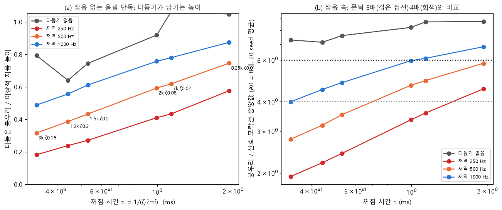
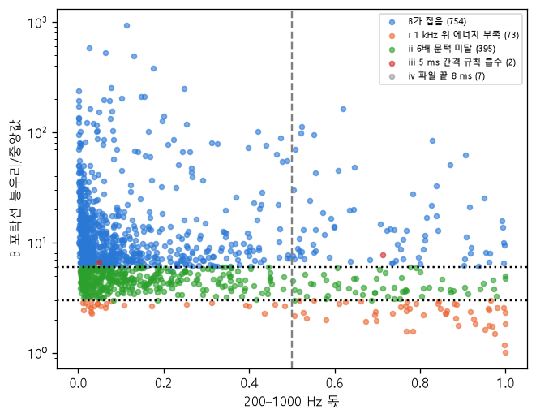
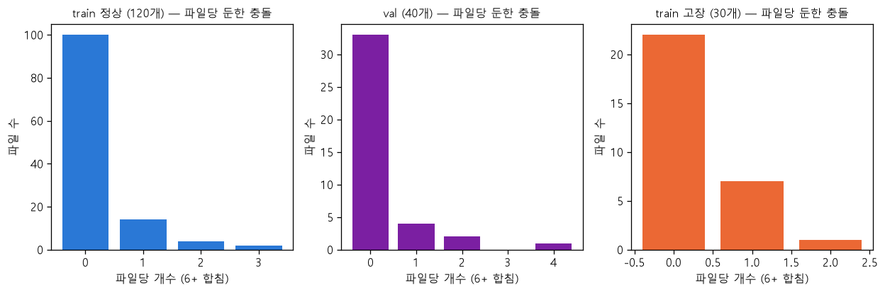

# 4-6 사령탑 7a+ · 7g — 충격 정의 A·B의 허점 확인

수치의 원본은 `result.json`, 표는 `합성_표.csv`·`합성_표.txt`·`022_사건표.csv`·`A사건_전체.csv`·`AB_짝짓기_파일별.csv`. 코드는 `run.py` (라벨 안 씀. 고장 비교는 보고만).

## 목적
충격 정의 두 개(A 사건, B 울림 충격)는 팀원·초기 모델에서 온 것이라 근거가 없다. 새 정의를 만들기 전에 두 의문을 확인한다.
1. B의 포락선 다듬기(500 Hz 저역)가 감쇠 큰 충격(꺼짐 시간이 짧은 충격)을 깎아 놓치는가?
2. A로만 잡히고 B로는 안 잡히는 사건은 무엇인가? 둔한 충돌인가?

## 답할 질문
- 7a+: 합성 울림의 높이가 다듬기 후 얼마나 남고, 문턱(4배·6배)을 넘는가?
- 7g: A만 잡힌 사건의 에너지 대역·오르내림 시간·B가 놓친 이유, 그리고 "둔한 충돌"이 정상·val에 얼마나 흔한가?

## 방법
- 정의 A: 평균 제거 → 200 Hz 고역 → |h| > 8σ(σ = 1.4826·MAD) → 10 ms 안은 한 사건. 사건이 없을 때 원 함수가 argmax를 대신 넣는 부분은 여기서 세지 않는다.
- 정의 B: `src/final.py impact_rings` 로직을 복사해 시점을 얻고, 190개 파일 전체에서 f·ζ·fit이 `impact_rings`와 같은지 assert (통과, 충격 1757개).
- 7a+ 합성: 가우스 백색잡음 → 1 kHz 고역 → RMS를 train 정상 120개의 "1 kHz 고역 RMS" 중앙값(0.00743 g)에 맞춤. 감쇠 사인파 (f, ζ) 6종을 한 신호에 서로 200 ms 이상 떨어뜨려 하나씩 넣음(위상 무작위). 처음 진폭 = A0배 × 바탕 |hilbert| 중앙값, A0 = 4·6·8·12, seed 20개. 포락선 = |hilbert|, 다듬기 = 4차 sosfiltfilt 저역 250/500/1000 Hz 또는 없음. 봉우리 = 울림 시작 −3 ms ~ +6 ms 안의 다듬은 포락선 최댓값, 비율 = 봉우리 / (같은 신호 다듬은 포락선 중앙값). 검출 = 비율 ≥ k (k = 4, 6). 바탕 신호가 이미 1 kHz 고역이라 울림을 넣은 뒤 고역을 한 번 더 걸지 않았다.
  - "남은 비율"은 잡음 없는 울림 하나(A0 = 1)의 다듬은 봉우리 / 이상적 처음 높이.
- 7g: A 사건과 B 충격을 ±5 ms로 짝지음. A만 잡힌 사건마다 −1 ~ +8 ms(225점, 원신호 평균 제거 후 Hann 창, 2048점 rfft)의 200–1000 Hz · 1–12.5 kHz 파워 몫(두 대역 합 = 1)과, 같은 파일의 사건·B 충격에서 10 ms 이상 떨어진 무작위 9 ms 구간 50개 중앙값 대비 배율의 log10(dec). 오르는 시간 = 200 Hz 고역 포락선(|hilbert| 후 1 kHz 저역) 바닥(파일 중앙값)~봉우리의 10→90 %, 꺼지는 시간 = 봉우리 → 바닥 + (봉우리 − 바닥)/e. B가 놓친 이유 = (iv) 사건 + 8 ms가 파일 끝을 넘음 → (i) B 포락선(500 Hz 다듬은 1 kHz 고역) 봉우리/중앙값 < 3 → (ii) 3–6 → (iii) 6 이상(5 ms 간격 규칙 쪽). 봉우리는 사건 −2 ms ~ +4 ms에서 찾음.
- 둔한 충돌 = A만 + 분류 (i) + 200–1000 Hz 몫 ≥ 0.5. 문턱 0.5는 결과를 보기 전에 정했고, 0.3·0.7 민감도도 `result.json`에 있다.

## 결과

### 7a+ 합성 (그림: [합성_남은높이](figs/합성_남은높이.png))

남은 비율 (잡음 없는 울림 단독, 다듬은 봉우리 / 이상적 처음 높이)

| (f, ζ) | 꺼짐 τ ms | 없음 | 250 Hz | 500 Hz | 1000 Hz |
|---|---|---|---|---|---|
| 3 kHz, 0.16 | 0.33 | 0.79 | 0.18 | 0.32 | 0.49 |
| 1.2 kHz, 0.3 | 0.44 | 0.64 | 0.24 | 0.39 | 0.56 |
| 1.5 kHz, 0.2 | 0.53 | 0.74 | 0.27 | 0.43 | 0.61 |
| 2 kHz, 0.08 | 0.99 | 0.92 | 0.41 | 0.59 | 0.76 |
| 7 kHz, 0.02 | 1.14 | 1.06 | 0.43 | 0.62 | 0.78 |
| 8.25 kHz, 0.01 | 1.93 | 1.05 | 0.58 | 0.75 | 0.87 |

검출률 k = 6 (20 seed, 열 = 다듬기 없음 / 250 / 500 / 1000 Hz)

| (f, ζ) | A0 = 4 | A0 = 6 | A0 = 8 | A0 = 12 |
|---|---|---|---|---|
| 2 kHz, 0.08 | .05 / 0 / 0 / 0 | .75 / 0 / 0 / 0 | 1 / 0 / 0 / .45 | 1 / 0 / 1 / 1 |
| 7 kHz, 0.02 | .05 / 0 / 0 / 0 | .95 / 0 / 0 / 0 | 1 / 0 / 0 / .65 | 1 / 0 / 1 / 1 |
| 8.25 kHz, 0.01 | .05 / 0 / 0 / 0 | 1 / 0 / 0 / .05 | 1 / 0 / .10 / 1 | 1 / 1 / 1 / 1 |
| 1.5 kHz, 0.2 | .05 / 0 / 0 / 0 | .60 / 0 / 0 / 0 | .90 / 0 / 0 / 0 | 1 / 0 / 0 / 1 |
| 3 kHz, 0.16 | 0 / 0 / 0 / 0 | .35 / 0 / 0 / 0 | .90 / 0 / 0 / 0 | 1 / 0 / 0 / .45 |
| 1.2 kHz, 0.3 | 0 / 0 / 0 / 0 | .45 / 0 / 0 / 0 | .70 / 0 / 0 / 0 | 1 / 0 / 0 / .60 |

검출률 k = 4는 `합성_표.txt`. 요약: 500 Hz 다듬기는 k = 4에서도 A0 = 8에서 (2k, 7k, 8.25k)만 1.0, (1.5k, 3k, 1.2k)는 0 ~ 0.05. 잡음만 있는 신호의 가짜 봉우리는 k = 6에서 모든 설정이 0개/파일, k = 4에서 "다듬기 없음"만 1.0개/파일(다듬은 설정은 0).

봉우리/중앙값 평균(A0 = 8): 없음 7.1–8.7, 1000 Hz 4.0–6.8, 500 Hz 2.8–5.8, 250 Hz 1.9–4.5.

### 7a+ 실제 abn_022 (다듬기별 봉우리/중앙값; 표 = `022_B충격_다듬기별.csv`, `022_A사건_다듬기별.csv`)
탐색 구간은 시점 −3 ~ +6 ms. "남은" = 다듬은 봉우리 / 다듬기 없는 봉우리.

B 충격 5개 (500 Hz 기준 모두 6 이상): 비율 없음 9.3–44.9, 500 Hz 6.8–27.4, 남은 비율 250 Hz 0.42–0.53, 500 Hz 0.62–0.74, 1000 Hz 0.76–0.92.
A 사건 10개 중 B로 안 잡힌 5개(19.8·210.2·964.3·1163.7·1934.0 ms):

| 시점 ms | 없음 | 250 | 500 | 1000 | 남은 500 Hz |
|---|---|---|---|---|---|
| 19.8 | 4.30 | 2.52 | 3.11 | 3.87 | 0.74 |
| 210.2 | 9.81 | 4.54 | 5.33 | 6.48 | 0.55 |
| 964.3 | 4.83 | 1.97 | 2.31 | 2.88 | 0.48 |
| 1163.7 | 8.70 | 4.74 | 5.15 | 5.83 | 0.60 |
| 1934.0 | 5.34 | 2.59 | 3.01 | 3.49 | 0.57 |

500 Hz 다듬기로는 5개 모두 6 미만. 다듬기를 없애면 2개(210.2, 1163.7), 1000 Hz면 1개(210.2)만 6을 넘는다. 이 5개는 다듬기 없이도 4.3–9.8이라 "다듬기만 문제"가 아니라 애초에 1 kHz 위 포락선이 작은 것이 대부분이다.

### 7g A·B 짝짓기 (±5 ms)
| 집단 | 파일 | A 사건 | B 충격 | A만 | 둘 다(A쪽) | B만 | A만 있는 파일 |
|---|---|---|---|---|---|---|---|
| train 정상 | 120 | 673 | 936 | 216 | 457 | 466 | 61 |
| val | 40 | 183 | 252 | 77 | 106 | 145 | 24 |
| train 고장(보고용) | 30 | 375 | 569 | 184 | 191 | 370 | 22 |

A 사건의 약 1/3(정상 32 %, val 42 %)은 B에 없다. 파일당 A만 개수: 정상 1.80, val 1.92, 고장 6.13. 022는 A 10 = 둘 다 5 + A만 5, B만 0.

### 7g A만 사건의 정체
| 집단 | (i) 1 kHz 위 부족(<3) | (ii) 6배 문턱 미달(3–6) | (iii) 간격 규칙 흡수 | (iv) 파일 끝 |
|---|---|---|---|---|
| train 정상 (216) | 37 | 173 | 2 | 4 |
| val (77) | 13 | 63 | 0 | 1 |
| train 고장 (184) | 23 | 159 | 0 | 2 |

분류별 중앙값(A만 전체): 

| 분류 | 200–1000 Hz 몫 | 1 kHz 위 몫 | dec 200–1k | dec 1k위 | 오름 ms | 꺼짐 ms | A 높이 σ | B 포락선비 |
|---|---|---|---|---|---|---|---|---|
| (i) | 0.70 | 0.30 | 1.05 | 0.46 | 1.48 | 1.12 | 9.0 | 2.5 |
| (ii) | 0.11 | 0.89 | 0.69 | 0.88 | 1.60 | 1.16 | 9.5 | 4.5 |
| (iii) | 0.38 | 0.62 | 1.31 | 1.56 | 5.92 | 1.70 | 15.9 | 7.2 |
| (iv) | - | - | - | - | 1.16 | 0.60 | 9.2 | 4.2 |
| (참고) B도 잡은 A 사건 | 0.07 | 0.93 | 0.46 | 1.31 | 1.28 | 1.12 | 15.9 | 10.2 |

그림: [몫 vs B 포락선비](figs/A사건_몫_vs_B비.png)

### abn_022 사건 10개 (`022_사건표.csv`, 그림 `figs/022_사건NN.png`)
| # | t ms | A σ | B | 200–1k 몫 | 1k위 몫 | dec 200–1k | dec 1k위 | 오름 ms | 꺼짐 ms | B포락선비 | 분류 |
|---|---|---|---|---|---|---|---|---|---|---|---|
| [1](figs/022_사건01.png) | 19.8 | 9.27 | 없음 | 0.74 | 0.26 | 1.13 | 0.19 | 0.56 | 1.00 | 3.11 | ii |
| [2](figs/022_사건02.png) | 49.2 | 21.85 | 매칭 | 0.81 | 0.19 | 2.12 | 1.00 | 0.52 | 3.20 | 16.8 | B가 잡음 |
| [3](figs/022_사건03.png) | 170.2 | 21.17 | 매칭 | 0.04 | 0.96 | -0.02 | 0.89 | 0.44 | 0.76 | 14.4 | B가 잡음 |
| [4](figs/022_사건04.png) | 210.2 | 8.50 | 없음 | 0.08 | 0.92 | 0.52 | 1.08 | 3.56 | 1.52 | 5.33 | ii |
| [5](figs/022_사건05.png) | 964.3 | 10.73 | 없음 | 0.88 | 0.12 | 1.72 | 0.36 | 2.20 | 2.16 | 2.07 | i |
| [6](figs/022_사건06.png) | 983.1 | 42.60 | 매칭 | 0.78 | 0.22 | 2.37 | 1.33 | 0.52 | 2.32 | 27.4 | B가 잡음 |
| [7](figs/022_사건07.png) | 1100.2 | 8.64 | 매칭 | 0.15 | 0.85 | 0.11 | 0.38 | 0.44 | 0.72 | 6.78 | B가 잡음 |
| [8](figs/022_사건08.png) | 1163.7 | 8.32 | 없음 | 0.13 | 0.87 | 0.45 | 0.80 | 1.60 | 0.48 | 4.36 | ii |
| [9](figs/022_사건09.png) | 1934.0 | 9.49 | 없음 | 0.50 | 0.50 | 1.12 | 0.63 | 1.12 | 2.00 | 3.01 | ii |
| [10](figs/022_사건10.png) | 1951.1 | 31.65 | 매칭 | 0.83 | 0.17 | 2.31 | 1.14 | 0.60 | 2.44 | 21.8 | B가 잡음 |

(표의 B포락선비는 −2 ~ +4 ms 구간이라, 위 "실제 abn_022" 표의 −3 ~ +6 ms 값과 약간 다르다.) 오름·꺼짐은 200 Hz 고역 포락선 기준이며 사건 4(오름 3.6 ms)처럼 느린 것은 잡음 속 바닥 대비 정의가 흔들릴 수 있다.

### 둔한 충돌(A만 + (i) + 200–1000 Hz 몫 ≥ 0.5)의 파일당 분포

| 집단 | 0개 | 1개 | 2개 | 3개 | 4+ | 1개 이상 파일 | 평균/파일 | 최대 |
|---|---|---|---|---|---|---|---|---|
| train 정상 (120) | 100 | 14 | 4 | 2 | 0 | 20 (16.7 %) | 0.23 | 3 |
| val (40) | 33 | 4 | 2 | 0 | 1 | 7 (17.5 %) | 0.30 | 4 |
| train 고장 (30, 보고용) | 22 | 7 | 1 | 0 | 0 | 8 (26.7 %) | 0.30 | 2 |

사건 수(몫 문턱 0.3 / 0.5 / 0.7): 정상 30 / 28 / 21, val 13 / 12 / 9, 고장 12 / 9 / 6. val 해당 파일: val_001, 010, 011, 017, 018, 024, 038.

## 해석과 결정
- 결론 1: 500 Hz 다듬기는 감쇠 큰 충격의 높이를 크게 깎는다. 꺼짐 시간 0.3–0.5 ms 울림은 높이가 0.3–0.4로, 1 ms 이상 울림도 0.6–0.75로 줄어, A0 = 8배(깎기 전 8배)짜리 울림도 k = 6에서는 거의 못 잡고(500 Hz: 0–10 %, 없음: 70–100 %), k = 4에서도 τ가 짧은 것(1.2–3 kHz, ζ 0.16–0.3)은 놓친다. 높이가 12배일 때만 τ ≥ 1 ms 울림이 잡힌다. 다듬기 없이도 6배 문턱에 가짜 봉우리가 0개/파일이라, 합성에서는 "문턱 6배 + 다듬기 500 Hz"가 보수적인 쪽이다. 즉 B는 "크고 오래 울리는 충격만" 보는 정의다. 합성의 가정(백색 가우스 바탕)이므로 실제 정상 바탕의 가짜 봉우리 수는 이 실험에서 확인하지 않았다.
- 결론 2: 실제 022에서는 B가 잡은 충격 5개가 다듬기 없이 9–45배로 커서 영향이 작았고, 다듬기 때문에 놓친 것은 일부(없음에서 6 이상이 되는 2개/5개)에 그친다. 나머지 3개는 다듬기를 없애도 4.3–5.3으로 문턱 아래다.
- 결론 3: A만 잡힌 사건 대부분은 (ii) 약한 1 kHz 위 에너지(정상 80 %, val 82 %, 고장 86 %)이고 에너지 몫은 1 kHz 위가 큰 쪽(몫 중앙값 0.89). 높이는 A 기준 약 9σ로 문턱(8σ) 바로 위이며, B 포락선비 중앙값 4.5로 6배 문턱 못 미친다. (i) 둔한 충돌형(200–1000 Hz 몫 중앙값 0.70)은 정상 17 %, val 17 %, 고장 12 %로 소수다. (iii) 간격 규칙 흡수는 정상 2개뿐이라 5 ms 간격 규칙은 문제가 아니다.
- 022의 A만 5개 = (ii) 4개 + (i) 1개(964.3 ms, 몫 0.88). (i) 사건은 1 kHz 위가 거의 없는 둔한 충돌의 전형이다.
- 둔한 충돌이 정상·val에 흔한가: 정상 120개 중 20개 파일(16.7 %), val 40개 중 7개(17.5 %)에 1개 이상으로 두 집단이 거의 같다. 고장 26.7 %는 보고만(30개 파일 8개, 분리력을 주장할 수 없음). "둔한 충돌"만으로는 정상과 구분하기 어렵다.
- 결정(제안, 새 정의는 아직 안 만듦): 새 정의는 (a) 울림(B)과 (b) 둔한 충돌(A − B, 200–1000 Hz 중심)을 따로 세는 쪽으로 하고, B의 다듬기는 500 Hz보다 높이거나 높이 비율 문턱을 4–6배 사이에서 다시 정한다. 문턱은 합성 + 정상 파일의 가짜 봉우리 수로만 정하고 라벨은 쓰지 않는다.
- 확인 못 한 것: 실제 정상 바탕에서 k = 4 가짜 봉우리 수(합성은 백색잡음이라 낙관적), 울림 시작이 순간적이지 않은 충격(오르는 시간 > 0.5 ms)의 합성, 7 kHz 이상 ζ ≥ 0.1 울림, 둔한 충돌의 물리적 원인(유격·충돌 등)과 고장과의 관계, 오름·꺼짐 시간의 잡음 민감도.

## 개념
- 포락선(envelope) = |hilbert| 로 구한 진동의 크기 곡선. 저역 통과로 다듬으면 잡음 요동은 줄지만 짧은 울림의 봉우리도 낮아진다.
- 꺼짐 시간 τ = 1/(ζ·2πf): 울림 진폭이 1/e로 줄어드는 시간. 짧을수록 다듬기에 깎이기 쉽다. 저역 차단 f_c는 대략 1/(2π f_c)(500 Hz → 0.32 ms) 이하의 변화를 뭉갠다.
- 몫(share) = 두 대역 파워 합에서 한 대역의 비율. dec = 사건 없는 구간 중앙값 대비 파워의 log10 배율(1 dec = 10배).
