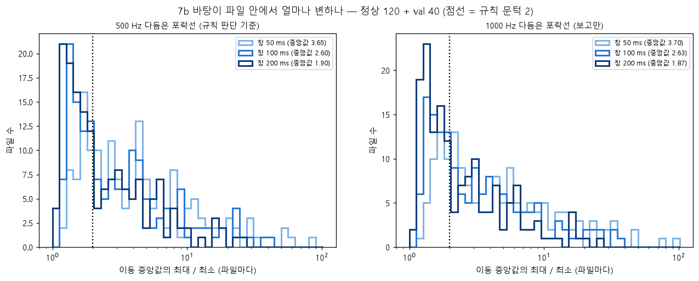
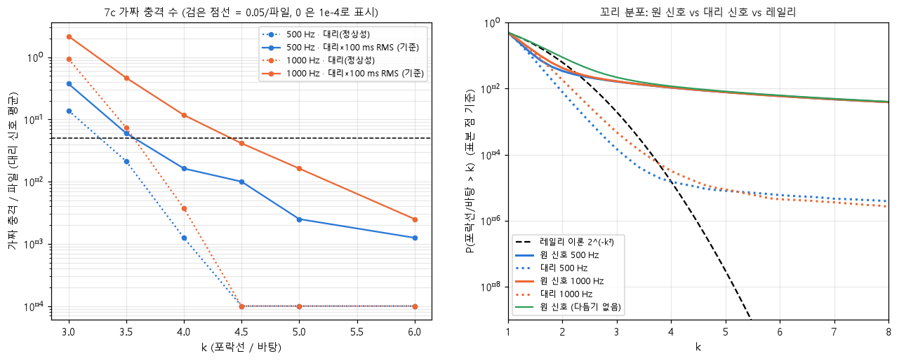
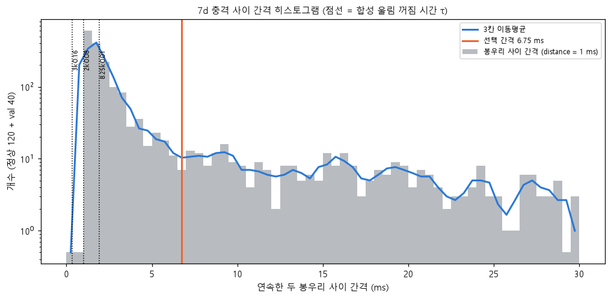
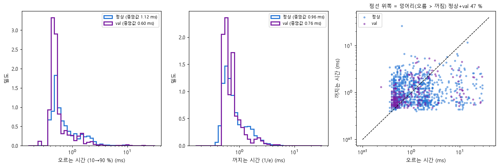
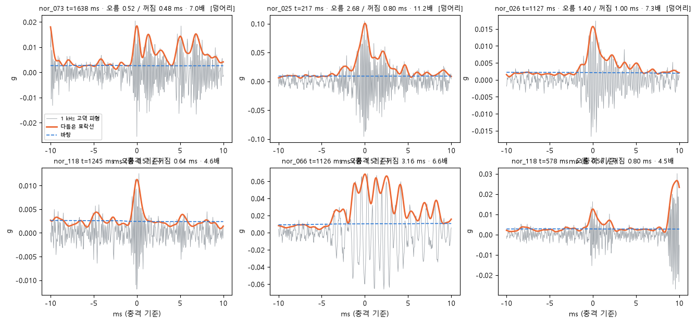
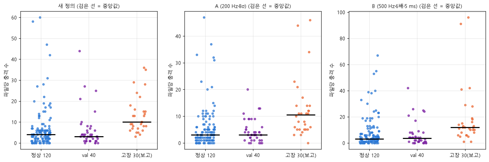
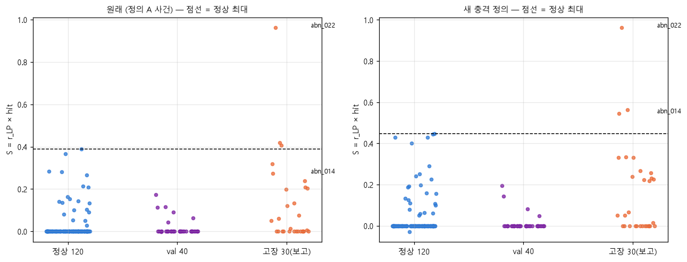

# 4-6 사령탑 7b–7f — 충격 검출 정의를 처음부터 다시 정한다

**확정된 새 충격 정의 (규칙이 고른 값)**: 평균 제거 → 1 kHz 고역(4차 Butterworth sosfiltfilt) → |hilbert| → **1000 Hz 저역 다듬기** → 바탕 = **100 ms 이동 중앙값** → (포락선 / 바탕) ≥ **k = 4.5** 인 봉우리, 봉우리 사이 간격 ≥ **6.75 ms**. 함수는 `run.py`의 `detect_impacts`. 단, 7d 간격은 약한 국소 최솟값이고 합성 울림의 짧은 꺼짐(3 kHz·ζ 0.16 등)은 거의 못 잡는다(아래 해석).

수치의 원본은 `result.json`. 표: `충격표_전체.csv`(충격마다), `충격수_파일별_새_A_B.csv`, `추적파일_충격표.csv`, `S_새충격.csv`, `S_원래A.csv`. 코드 `run.py`.

## 목적
A·B 충격 정의는 근거 없는 팀원 정의라, 직전(7a+)의 결론(6배 문턱은 엄격, 백색잡음 바탕은 낙관적)을 받아 **실제 정상·val 바탕**으로 바탕·문턱·간격을 라벨 없이 정한다. 선택 규칙은 실행 전에 고정했고 결과를 보고 바꾸지 않았다. 규칙이 퇴화한 곳은 없다.

## 답할 질문
- 7b 파일 안에서 평소 크기(바탕)가 변하는가 → 전체 중앙값인가 이동 중앙값인가
- 7c 실제 바탕 위에서 가짜 충격이 거의 없는 문턱 k는 얼마인가, 다듬기 500 / 1000 Hz 중 어느 쪽이 울림을 더 잡는가
- 7d 충격 사이를 갈라 세는 최소 간격은 얼마인가
- 7e 잡힌 봉우리는 "순간 충격(빨리 오르고 서서히 꺼짐)"인가 "덩어리(오름 > 꺼짐)"인가
- 7f 새 정의는 A·B와 어떻게 다르고, 022의 주기 잠금 S가 유지되는가 (라벨은 보고만)

## 방법
- 대상: 7b–7e = train 정상 120 + val 40(라벨 안 씀). 고장 30은 7f에서 보고만. val은 `2_data/TeamProject_val/val/`.
- 7b: 파일마다 100 ms 이동 중앙값(포락선을 1 kHz로 솎아 계산)의 최대/최소(창이 온전한 구간만). 50·200 ms는 민감도. 규칙 판단은 500 Hz 다듬은 포락선 기준(1000 Hz는 보고만).
- 7c 대리 신호: 정상·val 각 파일의 1 kHz 고역 신호를 FFT 진폭 유지 + 위상 무작위로 5개씩(총 800개, seed 2111). 7b가 이동 바탕이라 **대리 × (원 신호 100 ms RMS 포락선 / 전체 RMS)** 를 기준으로 하고 정상성 대리도 보고. 같은 검출(find_peaks, height = k, distance = 1 ms)의 봉우리 수 = 가짜 충격.
- 7c 합성: 정상 파일 대리 신호(5개 × 120 = 600개 바탕)에 (2 kHz, 0.08), (7 kHz, 0.02), (8.25 kHz, 0.01), (3 kHz, 0.16), (1.5 kHz, 0.2) 감쇠 사인파를 서로 50 ms 이상 떨어뜨려 하나씩 넣음(처음 높이 = 다듬지 않은 |hilbert| 바탕의 6배, 위상 무작위, seed 20). 울림 시작 −3 ~ +6 ms 안에 봉우리가 있으면 검출. (대리 5개를 모두 쓴 것은 규칙 문구에 없는 보강이다.)
- 7d: 정상+val 봉우리 사이 간격(distance = 1 ms) 0–30 ms 히스토그램(0.5 ms 칸), 3칸 이동평균 후 1–10 ms 안 첫 국소 최솟값(앞보다 작고 뒤보다 작거나 같음).
- 7e: 오르는 시간 = 바탕 위 높이의 10 → 90 %(봉우리에서 거꾸로 30 ms 안), 꺼지는 시간 = 봉우리 → 높이의 1/e(앞으로 30 ms 안). 덩어리 = 오름 > 꺼짐. 예시 6개는 정상+val에서 seed 7 무작위(덩어리 3 + 아닌 것 3).
- 7f: A = 200 Hz·8σ·10 ms(2-13 정의), B = `impact_rings` 시점(train 150개에서 개수 assert 통과). 울림 f·ζ·fit = `src/final._ring_atoms` 사전에 충격 뒤 8 ms를 투영. S = 2-13 정의(30 Hz 저역 자기상관 T 0.3–1.2 s, r_LP, T ± 3 % hit, S = r_LP × hit), 사건만 새 충격으로 교체. 2-13 원래 값은 같은 코드로 재현해 확인(022 0.963, 정상 최대 0.389).

## 결과

### 7b 바탕 — 이동 중앙값 채택 (그림: [7b_바탕변동비](figs/7b_바탕변동비.png), [예시](figs/7b_바탕예시.png))

100 ms 이동 중앙값의 (최대/최소) 파일 중앙값 = **2.60**(500 Hz, 규칙 문턱 2 이상 → 이동). 10–90 % 구간 1.31–11.7, 최대 41. 민감도: 50 ms 3.65, 200 ms 1.90 (200 ms만 2 미만), 1000 Hz 100 ms 2.63. 즉 정상·val에서도 바탕이 파일 안에서 2배 넘게 변한다.

### 7c 문턱 k · 다듬기 (그림: [7c_가짜충격_꼬리](figs/7c_가짜충격_꼬리.png), [7c_합성검출률](figs/7c_합성검출률.png))

가짜 충격 / 파일 (기준 = 대리 × 100 ms RMS, 800개 평균)

| k | 3 | 3.5 | 4 | 4.5 | 5 | 6 |
|---|---|---|---|---|---|---|
| 500 Hz | 0.374 | 0.060 | **0.016** | 0.010 | 0.0025 | 0.0013 |
| 1000 Hz | 2.17 | 0.466 | 0.118 | **0.041** | 0.016 | 0.0025 |
| (정상성 대리) 500 Hz | 0.139 | 0.021 | 0.001 | 0 | 0 | 0 |
| (정상성 대리) 1000 Hz | 0.939 | 0.074 | 0.004 | 0 | 0 | 0 |

규칙(≤ 0.05/파일 중 가장 작은 k): 500 Hz → k = 4, 1000 Hz → k = 4.5. 비정상성(바탕 변동)을 넣은 대리가 정상성 대리보다 가짜가 훨씬 많다 → 이동 바탕 쪽이 더 엄격한 기준이다.

합성 울림 검출률 (각 600개, 자기 k에서)

| (f, ζ) | 2 kHz 0.08 | 7 kHz 0.02 | 8.25 kHz 0.01 | 3 kHz 0.16 | 1.5 kHz 0.2 | 평균 |
|---|---|---|---|---|---|---|
| 500 Hz (k 4) | 0.195 | 0.260 | 0.860 | 0.000 | 0.008 | 0.265 |
| 1000 Hz (k 4.5) | 0.538 | 0.637 | 0.930 | 0.013 | 0.140 | **0.452** |

평균 차 0.19 ≥ 0.05 → **1000 Hz 채택**, k = 4.5.

### 7d 분리 간격 (그림: [7d_간격히스토그램](figs/7d_간격히스토그램.png))

봉우리 2508개, 간격 2348개. 1–1.5 ms 칸 606, 1.5–2 ms 406, 2–2.5 ms 224 … 로 급감하고 이동평균은 6.5–7 ms 칸(10.3)에서 처음 국소 최솟값 → **6.75 ms**. 간격 < 5 ms가 1498개(64 %), < 10 ms가 1627개(69 %). 비교선인 울림 꺼짐 시간 1/(ζ·2πf)은 0.33–1.9 ms.

### 7e 모양 (그림: [7e_오름꺼짐분포](figs/7e_오름꺼짐분포.png), [7e_예시6개](figs/7e_예시6개.png))

| 집단 | 충격 | 오름 중앙값 ms (10–90 %) | 꺼짐 중앙값 ms (10–90 %) | 덩어리(오름 > 꺼짐) |
|---|---|---|---|---|
| 정상 | 862 | 1.12 (0.48–5.4) | 0.96 (0.52–2.4) | 434 (50.6 %) |
| val | 249 | 0.60 (0.44–7.3) | 0.76 (0.52–2.2) | 85 (34.4 %) |
| 정상+val | 1105 | | | **519 (47.0 %)**, 121개 파일 |
| 고장(보고) | 405 | 0.64 (0.40–8.7) | 1.04 (0.52–2.8) | 139 (34.4 %) |

오름·꺼짐을 못 찾은 것: 오름 4+2+0, 꺼짐 0+0+1 (정상+val 6개). 예시 6개는 덩어리 3개와 아닌 것 3개. **거를지는 정하지 않았다(사용자 결정).** 오름이 꺼짐을 조금(0.52 vs 0.48 ms) 넘는 경우도 덩어리로 세어져 비율이 문턱(오름 > 꺼짐)에 민감하다.

### 7f 라벨 보고 (그림: [7f_파일당충격수](figs/7f_파일당충격수.png), [7f_주기잠금S](figs/7f_주기잠금S.png), [7f_022_충격](figs/7f_022_충격.png))

파일당 충격 수 (새 / A / B)

| 집단 | 새 평균·중앙·최대 (0개 파일) | A 평균·중앙·최대 | B 평균·중앙·최대 |
|---|---|---|---|
| 정상 120 | 7.2 · 4 · 60 (17) | 5.6 · 3 · 47 (19) | 7.8 · 3 · 67 (22) |
| val 40 | 6.2 · 3 · 44 (4) | 4.6 · 3 · 20 (5) | 6.3 · 3.5 · 42 (8) |
| 고장 30 | 13.5 · 10 · 36 (0) | 12.5 · 10.5 · 46 (1) | 19.0 · 12 · 96 (0) |

파일별 새 vs A 순위상관(Spearman): 정상 0.81, val 0.64, 고장 0.46. 새 vs B: 0.85, 0.87, 0.55.

파일 추적 (충격 수 새 / A / B). 새 충격마다 f·ζ·fit은 `추적파일_충격표.csv`.

| 파일 | 새 | A | B | 울림 f 중앙값 Hz · fit 중앙값 |
|---|---|---|---|---|
| abn_015 | 36 | 0 | 28 | 1750 · 0.68 |
| abn_022 | 9 | 10 | 5 | 5000 · 0.81 |
| abn_002 | 3 | 5 | 1 | 8250 · 0.81 |
| abn_014 | 9 | 6 | 11 | 2000 · 0.61 |
| abn_017 | 4 | 5 | 5 | 2000 · 0.61 |
| nor_045 | 13 | 7 | 30 | 1250 · 0.59 |
| nor_116 | 6 | 10 | 13 | 6250 · 0.67 |

022의 새 충격 9개: 49.3, 170.2, 210.2, 983.2, 1100.2, 1152.8, 1160.4, 1180.5, 1951.2 ms. B가 잡은 5개(49, 170, 983, 1100, 1951 ms)는 모두 포함, 추가로 210.2 ms(A 사건 4번)와 1152–1180 ms 3개. A의 964.3·19.8·1934.0 ms 사건은 새 정의에 없음. 8.25 kHz ζ 0.01(본체 모드) 울림이 중앙값인 파일은 abn_002.

2-13 주기 잠금 S 재계산 (그림: [7f_주기잠금S](figs/7f_주기잠금S.png))

| | 022 | 정상 최대 | val 최대 | 014 | 정상 중 S > 0.3 | 정상 최대 초과 고장 |
|---|---|---|---|---|---|---|
| 원래 (정의 A, 재현) | 0.963 | 0.389 (nor_103) | 0.174 (val_031) | 0.273 | 2 | 001·011·022 |
| 새 충격 | **0.963** (T 0.944 s, r_LP 0.963, hit 1.0, 충격 9) | **0.449 (nor_092)** | 0.196 (val_031) | 0.546 | 5 | 001·014·022 |

정상 S 상위: nor_092 0.449, nor_091 0.444. 022 이상인 정상은 0개. 022 − 정상 최대 = 0.514(원래 0.574).

## 해석과 결정
- **정의**: 이동 중앙값 바탕 + 1000 Hz 다듬기 + k 4.5. 정상성 대리 신호로 문턱을 정하면 k 3.5 정도로도 충분해 보이지만, 정상·val의 실제 바탕 변동을 넣은 대리가 가짜를 5–10배 더 만들어 k 4–4.5가 필요했다. 7a+의 "4배면 충분"은 낙관적이었다는 확인이다.
- **다듬기**: 1000 Hz가 합성 검출률 평균 0.45 대 0.27로 더 낫다. 두 다듬기 모두 짧게 꺼지는 울림(3 kHz ζ 0.16: 0–1 %, 1.5 kHz ζ 0.2: 1–14 %)은 6배 높이에서도 거의 못 잡는다. 이 정의는 꺼짐 ≳ 1 ms인 울림(2k·7k·8.25k)을 잡는 정의다. 낮은 대역(2 kHz, ζ 0.08) 검출률도 0.54에 그쳐 "충격 놓침"이 남아 있다.
- **간격 6.75 ms**: 규칙은 성립하지만 이동평균이 6.5–10 ms에서 10–12로 평탄해 국소 최솟값이 뚜렷하지 않다(노이즈 수준의 차이). 거의 모든 간격이 1–5 ms에 몰리는 것은 한 울림 안에서 다듬은 포락선이 여러 봉우리를 만들기 때문으로 보이며(예시 그림의 꼬리 봉우리), 간격 6.75 ms가 이를 하나로 합친다. 확인은 하지 않았다(울림 안 다중 봉우리가 간격 분포를 만든다는 해석은 추정).
- **덩어리**: 정상+val의 47 %가 오름 > 꺼짐이다(정상 51 %, val 34 %). 대부분 오름·꺼짐이 0.5–1.5 ms 범위라 한 칸(0.04 ms) 차이로 갈리는 경우가 많다. 이 비율만으로 거를 근거는 없고, 걸러낼지는 사용자 결정.
- **7f**: 022 S는 0.963으로 그대로 유지(충격 9개 모두 주기 T = 0.944 s에 짝이 있음). 그러나 정상 최대가 0.389 → 0.449(nor_092)로 올라 격차가 0.574 → 0.514, 014는 0.273 → 0.546으로 올라 정상 최대 초과 고장이 001·014·022가 되었다. 새 정의는 충격 수가 정상에서도 평균 7개라 hit이 우연히 높아질 여지가 커졌다. S는 새 정의에서도 022를 정상 밖으로 분리한다. 이 비교는 정의를 고치는 데 쓰지 않았다.
- 고장 집단의 충격 수(중앙 10)는 정상(4)·val(3)보다 많지만 보고만이며 30개라 분리력은 주장하지 않는다.

## 확인 못 한 것
- 7d 6.75 ms 부근이 진짜 경계인지(울림 안 다중 봉우리와 별개 충격의 분리), 간격을 3–10 ms로 바꾼 민감도.
- 짧게 꺼지는(ζ ≥ 0.16) 울림을 놓치는 한계를 해소하는 방법(다듬기 없음 + 대역별 포락선 등)은 이번에 시험하지 않았다.
- 7e의 오름·꺼짐 값이 잡음 바탕에서 얼마나 흔들리는지(합성 확인 안 함), 덩어리의 물리적 의미.
- 7f의 새 충격 중 A·B와 시점이 겹치지 않는 것(예: 022의 1152–1180 ms 3개)이 실제 충격인지 육안 확인은 022 그림만 했고 전체는 안 했다.
- 7c 합성은 대리 바탕 600개 중 5개 울림 종류만이며 울림 시작이 순간적이라고 가정했다.

## 개념
- 위상 무작위 대리 신호(surrogate) = 원 신호와 FFT 진폭(스펙트럼)은 같고 위상만 무작위로 섞은 신호. 순간적인 튐(충격성)은 사라지고 평균 에너지 분포만 남아 "충격 없는 같은 바탕"의 대용이 된다.
- 레일리 이론선 2^(−k²) = 가우스 백색잡음의 포락선(|hilbert|)이 중앙값의 k배를 넘을 확률. 다듬기 후 포락선은 이보다 꼬리가 얇다.
- 이동 중앙값 바탕 = 시간에 따라 변하는 평소 크기. 충격 높이를 "그 순간 평소의 몇 배"로 잰다.
- 오르는 시간(10→90 %)·꺼지는 시간(1/e) = 포락선 봉우리의 모양. 순간 충격은 거의 즉시 오르고 구조의 감쇠 시간(1/(ζ·2πf))에 따라 꺼진다.
