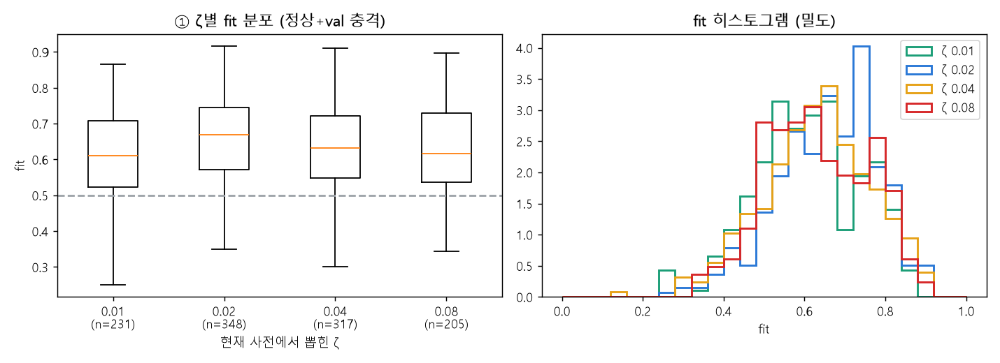
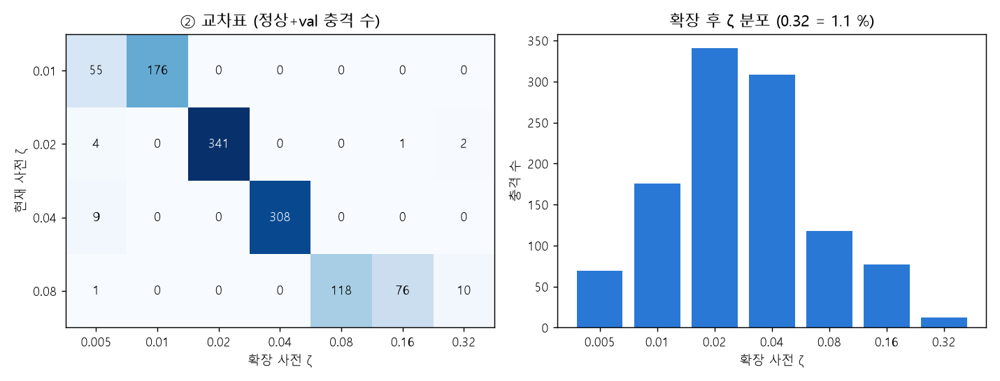
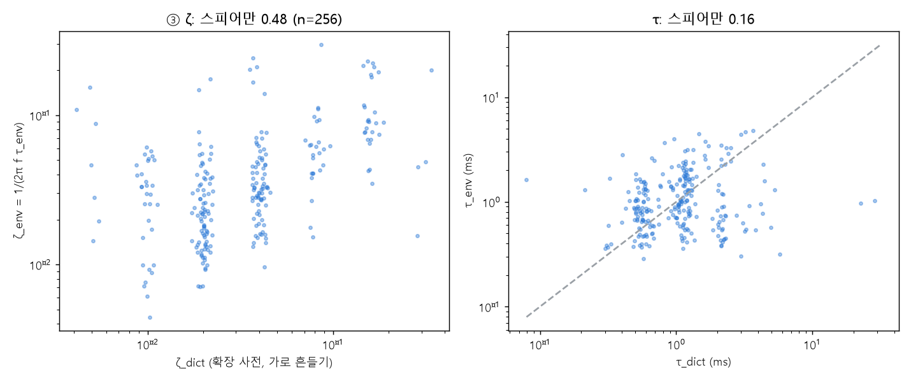
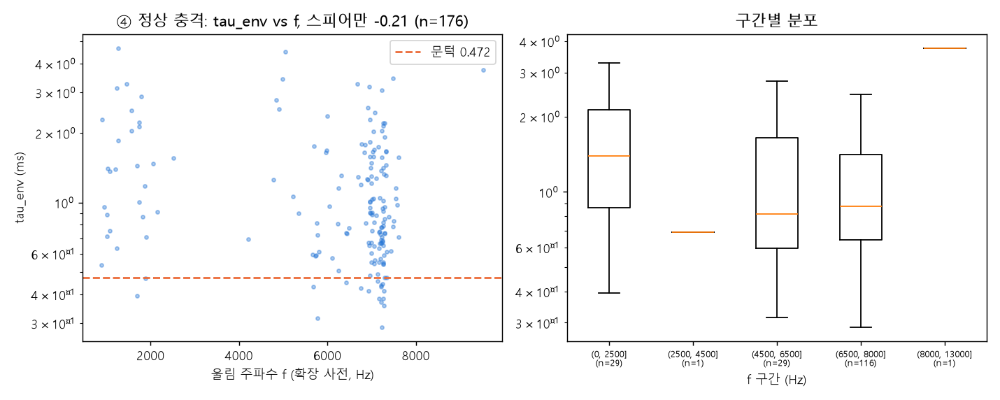
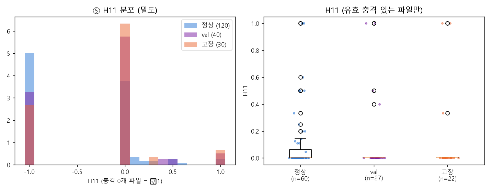
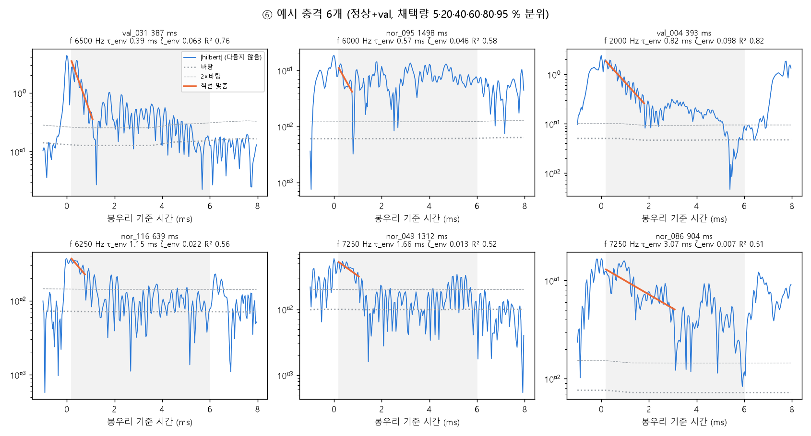

# 4-6 사령탑 Q5 — H11 "빨리 꺼지는 충격 비율"의 정의

**H11 정의 한 줄**: 규칙대로라면 채택할 양이 없다(ζ·τ 모두 두 추정법의 순위상관 0.5 미만 → "둘 다 불안정", H11을 피처에서 빼는 것을 제안). 참고로 계산한 판은 τ_env(다듬지 않은 포락선 로그 직선, R² ≥ 0.5) < 0.472 ms인 충격 비율(train 정상 10 % 분위, 충격 0개 또는 유효 충격 0개면 −1).

수치의 원본은 `result.json`. 표: `충격별_감쇠표.csv`, `H11_파일별.csv`, `교차표_ζ현재_ζ확장.csv`, `추적파일_충격표.csv`. 코드 `run.py`, 로그 `log.txt`.

## 목적
H11(빨리 꺼지는 충격 비율)의 "빨리 꺼짐"을 ζ(몇 번 출렁이고 꺼지나)로 할지 τ(몇 ms 만에 꺼지나)로 할지, 어떤 추정법으로 잴지를 라벨 없이 정한다. 충격 정의는 7b-7e 그대로이고 파일 앞뒤 10 ms 안만 뺐다(끝단 제외 전 결과가 `충격표_전체.csv`와 일치함을 assert, 1516개). 끝단 제외 후 충격 1503개(정상 854 · val 247 · 고장 402).

## 답할 질문
1. ζ = 0.08로 뽑힌 충격은 fit이 낮은가
2. ζ 칸을 늘리면 0.08이던 충격은 어디로 가는가
3. 직접 측정(다듬지 않은 포락선의 로그 기울기)으로 τ를 재면 사전 추정과 같은 순서를 주는가
4. ζ와 τ 중 믿을 만한 쪽은
5. 채택 양이 울림 주파수에 의존하는가
6. 문턱과 H11 분포
7. (라벨, 보고만) 고장 vs 정상 H11

## 방법
- 대상: train 정상 120 + val 40으로 판단, 고장 30은 7번 보고에만. 충격 정의: 평균 제거 → 1 kHz 고역(4차 Butterworth) → |hilbert| → 1000 Hz 다듬기 → 100 ms 이동 중앙값 바탕 → 4.5배 이상 봉우리, 간격 6.75 ms (`detect_impacts`) + 앞뒤 10 ms 제외.
- 사전 추정: 충격 뒤 8 ms(1 kHz 고역)를 감쇠 사인파 사전(1–12 kHz, 250 Hz 간격)에 투영해 fit 최대 칸. 현재 사전 ζ 0.01·0.02·0.04·0.08(`src/final._ring_atoms`와 같음을 assert), 확장 ζ 0.005·0.01·0.02·0.04·0.08·0.16·0.32. τ_dict = 1/(ζ·2πf).
- 직접 측정: 봉우리 = 검출 위치 ±1 ms 안 다듬지 않은 |hilbert| 최댓값. 0.2 ms 뒤부터 6 ms까지, 포락선 > 2 × 바탕(100 ms 이동 중앙값)인 연속 구간만 log(포락선)을 직선 맞춤. 최소 13점(0.5 ms) 미만이거나 기울기 ≥ 0이면 측정 불가. τ_env = −1/기울기, R², ζ_env = 1/(2π f τ_env)(f는 확장 사전의 울림 주파수).
- 선택 규칙(실행 전 고정): 정상+val 유효 충격(R² ≥ 0.5)에서 (ζ_dict, ζ_env), (τ_dict, τ_env) 스피어만을 따로 계산해 높은 쪽을 채택, 둘 다 0.5 미만이면 불안정. 추정법은 직접 측정(R² ≥ 0.5 충격만 H11의 분자·분모에 사용), 문턱은 train 정상 유효 충격 분포의 90 % 분위(ζ 위쪽, τ 아래쪽 10 % 분위). 사용자 문구의 "추정법" 선택이 모호해 위처럼 정했고 사전판 H11은 민감도로만 냈다.

## 결과

### 1. ζ 0.08의 정체 (그림: [1_zeta별_fit](figs/1_zeta별_fit.png))

정상+val 충격, 현재 사전. fit 중앙값 ζ 0.01 0.611(n 231) · 0.02 0.669(348) · 0.04 0.632(317) · **0.08 0.617(205)**. fit < 0.5 비율 20.3 · 10.6 · 17.4 · 14.6 %. 0.08로 뽑힌 충격의 fit은 다른 ζ보다 낮다고 할 수 없다(0.08 대 나머지 맨–휘트니 단측 p 0.20, 중앙값 0.617 대 0.642). 즉 "깨끗한 울림이 아니라 0.08에 몰린 것"이라는 가설은 fit으로는 지지되지 않는다.

### 2. 사전 확장 (그림: [2_사전확장_교차표](figs/2_사전확장_교차표.png))

교차표(행 = 현재 ζ, 열 = 확장 ζ, 정상+val). 0.01 → 0.005 55 · 0.01 176. 0.02 → 0.02 341(0.005 4, 0.16 1, 0.32 2). 0.04 → 0.04 308(0.005 9). **0.08 → 0.08 118 · 0.16 76 · 0.32 10 · 0.005 1** (205개 중 0.16 이상 86개 = 41.9 %). 0.04 이하 칸은 확장 후에도 같은 칸에 남았고 0.08 칸만 쪼개진다. 확장 후 0.32(최댓값)에 걸린 것은 전체 12개(1.1 %), 원래 0.08이던 것 중 4.9 %. 최솟값 0.005는 69개(6.3 %). fit 중앙값은 현재 0.634 → 확장 0.641, 원래 0.08 충격은 0.617 → 0.628(거의 안 오름). 즉 0.08은 "0.08 이상"의 묶음이었고 그 안에 0.16 이상이 약 40 %, 다만 fit이 더 좋아지지는 않는다.

### 3–4. 두 추정법의 순위상관 (그림: [3_사전vs직접_산점도](figs/3_사전vs직접_산점도.png))

직접 측정이 성립한 충격: 1503개 중 R² ≥ 0.5가 311개(20.7 %; 정상 176 · val 80 · 고장 55). 나머지는 0.2–6 ms 구간에서 포락선이 2 × 바탕 아래로 빨리 떨어져 13점 미만 642개, 기울기 ≥ 0 54개, 나머지는 R² < 0.5.

| 비교 (정상+val, R² ≥ 0.5, n = 256) | 스피어만 |
|---|---|
| ζ_dict vs ζ_env | **0.475** |
| τ_dict vs τ_env | **0.157** |
| (민감도) 현재 사전 ζ / τ | 0.483 / 0.189 |
| (민감도) fit ≥ 0.5만 (n 241) ζ / τ | 0.516 / 0.180 |

규칙: 둘 다 0.5 미만 → **"둘 다 불안정"**, H11을 피처에서 빼는 것을 제안. ζ가 상대적으로 낫지만(0.475) 0.5에 못 미치고, 사전 ζ가 7칸 계단이라 동순위가 많아 상관이 낮게 나오는 영향도 있다. τ는 0.16으로 사실상 상관이 없다. 민감도에서 ζ가 0.516으로 넘는 것은 규칙 밖의 사후 조건이므로 채택 근거로 쓰지 않는다.

### 5. 주파수 의존성 (그림: [4_채택량_울림주파수](figs/4_채택량_울림주파수.png))

채택 양이 없어 참고로 τ_env(정상 유효 충격 176개)와 f의 스피어만 −0.21(p 0.005). 대역별 τ_env 중앙값: ≤ 2.5 kHz 1.39 ms(29개) · 4.5–6.5 kHz 0.82 ms(29) · 6.5–8 kHz 0.88 ms(116). 유효 충격의 66 %가 6.5–8 kHz에 몰려 있어(정상) 저주파 울림은 직접 측정이 거의 성립하지 않는다. τ는 주파수가 높을수록 짧은 경향이 약하게 있다.

### 6. 문턱과 H11 (참고 계산, 그림: [5_H11_분포](figs/5_H11_분포.png))

문턱 τ_env < 0.472 ms(train 정상 유효 176개의 10 % 분위. 사전판 문턱 τ_dict < 0.549 ms). 유효 충격 중 빨리 꺼진 비율은 정상 10.2 %(정의상), val 16.3 %. 파일 H11: 정상 평균 −0.44(중앙 −0.5, −1인 파일 60 · 0인 44 · 양수 16), val 평균 −0.25(−1 13 · 0 23 · 양수 4), 고장 평균 −0.19(−1 8 · 0 19 · 양수 3). 정상 120개 중 절반이 −1(유효 충격 0개)이라 피처로 쓰기엔 퇴화에 가깝다.

### 7. 라벨 보고
- AUC(고장 30 vs 정상 120, H11 = 위 참고 정의): **0.597**. 사전판(R²가 아닌 fit ≥ 0.5, 같은 방식의 문턱) 0.780. 예전 정의(ζ ≥ 0.04 비율, 현재 사전, 끝단 제외 후 재계산) **0.742**(기록값 0.73과 비슷). 유효 충격이 있는 파일만(정상 60 · 고장 22) H11 AUC 0.445. 고장 유효 충격의 빠른 비율 9.1 %(정상 10.2 %)로 직접 측정 H11은 분리하지 못한다.
- 추적 파일 (H11 직접판 / 사전판 / 예전 ζ ≥ 0.04 판, 충격 수 · 유효 수): abn_022 0 / 0.14 / 0.56 (9 · 4), abn_015 0 / 0.19 / 0.86 (35 · 5), abn_017 0 / 0.33 / 1.0 (4 · 1), abn_002 −1 / 0 / 0 (3 · 0), abn_014 0 / 0 / 0.67 (9 · 2), nor_045 0 / 0 / 0.69 (13 · 1), nor_116 0 / 0 / 0 (6 · 3). 충격별 (f, ζ_dict, ζ_env, τ_env, R²)는 `추적파일_충격표.csv`. 예전 정의의 AUC가 직접판보다 높은 것은 "ζ ≥ 0.04" 비율이 감쇠 자체보다 울림 주파수·충격 크기의 차이를 반영할 수 있어서이지만 이번에 확인하지 않았다.

### 예시 충격 (그림: [6_예시충격_직선맞춤](figs/6_예시충격_직선맞춤.png))

정상+val 유효 충격을 τ_env 5·20·40·60·80·95 % 분위로 6개 골라, 다듬지 않은 포락선(로그)과 맞춤 직선, 바탕, 2 × 바탕을 보였다.

## 해석과 결정
- **H11을 ζ·τ로 정의해 피처에 넣을 근거가 부족하다.** 두 방법이 같은 순서를 주지 못하고(ζ 0.475, τ 0.157), 직접 측정은 충격의 21 %에서만 성립해 정상 파일 절반이 −1이 된다. 직접 측정이 안 되는 이유는 봉우리 뒤 0.2 ms 만에 포락선이 2 × 바탕 아래로 떨어지는 충격이 대부분이라는 것 자체가 "충격이 빨리 꺼진다 또는 바탕이 높다"는 뜻일 수 있으나, 어느 쪽인지는 구분하지 못했다.
- ζ 0.08의 정체는 "0.08 이상 묶음"이다. 확장하면 약 40 %가 0.16 이상으로 가고 fit은 더 좋아지지 않는다. 그러므로 ζ_dict가 0.08인 충격의 ζ가 정확히 0.08이라고는 말할 수 없다.
- 규칙대로 채택 양 없음 → 제안: H11을 피처 목록에서 뺀다. 예전 정의(ζ ≥ 0.04 비율)의 AUC가 0.74로 가장 높게 나오지만 감쇠 추정이 방식 간 흔들린다는 2-20의 결론과 같은 문제를 안고 있으므로, 쓰려면 "추정이 불안정한 거친 지표"로 표시해야 한다.
- 이 폴더는 정의를 바꾸지 않았다. 규칙(문턱·최소 점수·2 × 바탕)은 실행 전에 정했고 결과를 보고 고치지 않았다.

## 확인 못 한 것 · 규칙 퇴화
- 직접 측정 성립률 20.7 %(규칙 "포락선 > 2 × 바탕", 최소 13점 때문). 구간 조건을 완화하면(1.5 × 바탕, 6점 등) 성립률과 상관이 바뀔 수 있으나 시험하지 않았다.
- 봉우리를 검출 위치 ±1 ms의 다듬지 않은 최댓값으로 다시 정했다(규칙 문구에 없는 보강). 포락선이 다중 모드 맥놀이로 출렁이면 로그 직선이 맞지 않는다(R²가 낮은 이유일 수 있음, 확인 안 함).
- ζ_dict가 7칸 계단이라 스피어만에 동순위가 많다. ζ 0.475가 0.5에 근접해 사전을 더 촘촘히(예: 연속값) 하면 판정이 뒤집힐 가능성은 시험하지 않았다.
- "추정법 우선" 문구를 직접 측정으로 해석했다. H11 사전판(AUC 0.78)이 직접판보다 높은 것은 사전 ζ 구분이 거칠기 때문일 수 있고 의미를 해석하지 않았다.
- 정상 유효 충격 66 %가 6.5–8 kHz(본체 모드 근처)에 몰려 있어 주파수 의존성 결론은 이 대역에 치우친다.

## 개념
- ζ(감쇠비)는 진동이 몇 번 출렁이고 꺼지는지, τ = 1/(ζ·2πf)는 포락선이 1/e로 줄어드는 시간(ms). 같은 ζ여도 주파수가 낮으면 τ가 길다.
- 직접 측정 = 포락선의 로그가 직선이면 지수 감쇠이고 기울기가 −1/τ. 결정계수 R²는 그 직선이 얼마나 맞는지.
- 다듬지 않은 포락선을 쓰는 이유: 1000 Hz로 다듬으면 약 1 ms 번지므로 1 ms 안팎의 τ를 못 믿는다(7e).
- 스피어만 순위상관 = 값 대신 순위로 계산한 상관. 동순위가 많으면 낮게 나온다.
