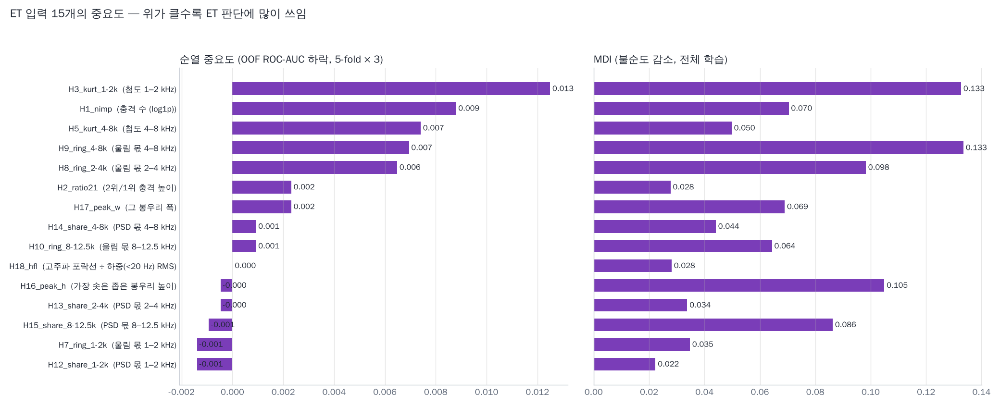
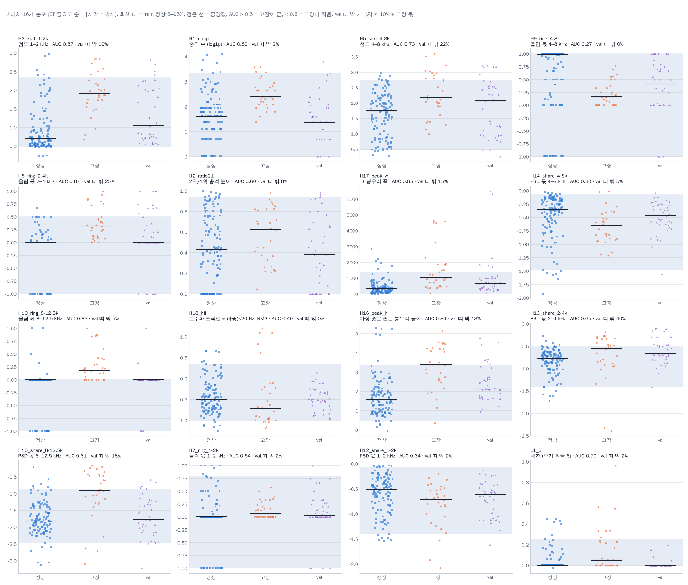

# 4-3 J 피처 해부 (11-22, 휴대폰 세션) (옛 4-11)

> 휴대폰 세션에서 `2_EDA/2-25_1122_J피처해부`로 만든 조각. J가 쓰는 피처를 설명하는 자료라서 4_피처로 옮겼다(11-22). 시각화만 하고 모델은 바꾸지 않았다.

**J(EXP-044)의 ET 입력 15열과 박자 S를 하나씩 본다.** 코드 [run.py](자료/run.py), 수치 [수치.json](자료/수치.json).

- **그림 1 ET 중요도**: MDI(전체 학습)와 5-fold OOF 순열 중요도(열을 섞었을 때 ROC-AUC가 얼마나 떨어지나)
  - MDI 상위: H9 울림 4–8k 0.134 · H3 첨도 1–2k 0.133 · H16 봉우리 높이 0.105 · H8 울림 2–4k 0.098
  - 순열 중요도는 모두 0.013 이하다. 열끼리 정보가 겹쳐서 하나를 섞어도 다른 열이 메운다

- **그림 2 피처 16개 분포**: train 정상 · train 고장 · val과 정상 5–95% 띠. 제목에 단독 AUC와 val 띠 밖 비율을 적었다
  - 단독 AUC가 높은 것: H8 울림 2–4k 0.874 · H3 첨도 1–2k 0.871 · H17 봉우리 폭 0.846 · H1 충격 수 0.798
  - val 띠 밖 비율이 큰 것: H8 0.25 · H5 0.225. 00_NOW의 "val 충격이 2–4 kHz로 더 울린다"와 같은 방향이다
- H16 · H17은 학습 정상 120개 기준(PeakRef)으로 계산했다. J 안에서는 폴드마다 다시 계산된다
