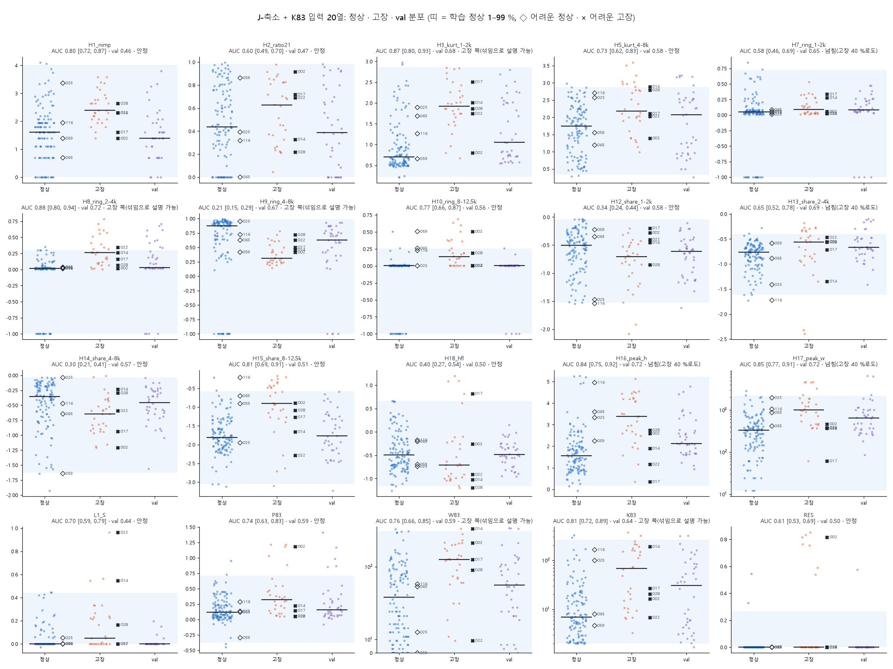
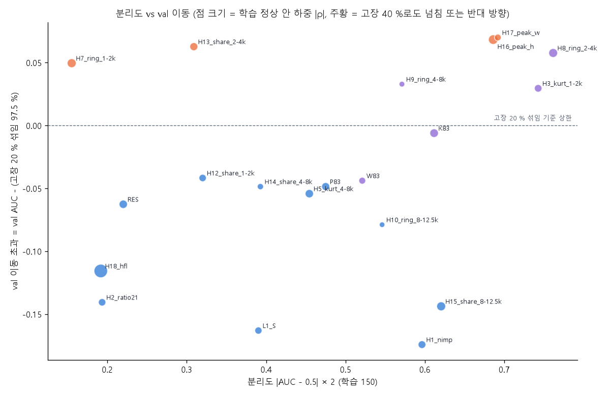

# 4-5 J-축소 + K83 입력 피처 검증 (11-25) (옛 4-18)

상태: 1차 · EDA만(모델 실험 없음). 코드 [run.py](자료/run.py) · 수치 [figs/결과.txt](자료/figs/결과.txt) · 열별 표 [figs/열별_검증.csv](자료/figs/열별_검증.csv) · 어려운 파일 [figs/어려운파일_백분위.csv](자료/figs/어려운파일_백분위.csv) · 파일별 값 `figs/피처값_{train,val}.csv`
점검 목록: [파이프라인점검 3절](../../../파이프라인점검.md)

## 목적
최종 모델 J-축소 + K83(`src/final.py` FinalJ)의 입력 20열(ET 15 · 박자 S · 8.3k 규칙 재료 4)을 열마다 같은 틀로 점검한다. 분리도 · 꼬리 · val 이동 · 하중 의존 · 중복 · 어려운 파일. 판정 열은 **제안**이며 결정은 사용자가 한다. AE는 다음 차례.

## 방법
- 값: `j_tables` 기본값 그대로(11 kHz 변형 안 씀). H7–H10은 `JShrink._shrink`와 같은 축소(α 3, p0 = 학습 정상 전체의 충격 비율 [0.112, 0.040, 0.835, 0.013]). H16 · H17은 학습 정상 120개 중앙 log PSD 기준(FinalJ와 같이 이상치 3개 포함).
- 분리도: AUC(고장 vs 정상, 학습 150) · 층화 부트스트랩 2000번 95 % CI · 분리도 = |AUC − 0.5| × 2. 아래 지표는 **고장 쪽이 커지게 방향을 맞춘 값**.
- 꼬리: 고장꼬리 = 고장 중 정상 95 %선 위 · 정상꼬리 = 정상 중 고장 5 %선 아래(정상 쪽 증거). 양쪽 꼬리 = 원래 방향에서 고장 중 정상 99 % 위 / 1 % 아래.
- val 이동(라벨 없이): val AUC = P(val > 학습 정상). 학습 정상 40개 중 p만큼을 학습 고장으로 바꿔 뽑은 기준(p = 0 · 0.2 · 0.4, 1000번, 4-16 방식)과 비교. **넘침** = p 0.4의 97.5 % 위, **반대** = p 0의 2.5 % 아래(조건 이동의 확실한 증거), **고장 쪽** = p 0 범위 위지만 섞임으로 설명 가능. 범위 밖 비율 = val 중 학습 정상 [1, 99 %] 밖.
- 하중 ρ: 학습 정상 안 Spearman(피처, log 0–20 Hz 저역 RMS). 중복: 학습 150에서 20열 중 최대 |Spearman ρ|.
- 어려운 파일: 학습 정상 안 백분위(방향 맞춤, 높을수록 고장 쪽).

## 결과 표
| 열 | 가설 · 등급 | AUC [95 % CI] | 분리도 | 고장꼬리 / 정상꼬리 | val AUC (p0 범위 · p0.4 상한) | val 범위 밖 | 하중 ρ | 중복 | 판정(제안) |
|---|---|---|---|---|---|---|---|---|---|
| H1 충격 수 | H1 · L5 L6 | 0.80 [0.72, 0.87] | 0.60 | 0.13 / **0.53** | 0.46 (0.41–0.59 · 0.69) 안정 | 0 % | 0.15 | S 0.61 | **유지**: 정상 쪽 증거(충격 0–1개)를 주는 열, val 안정 |
| H2 2위/1위 | H1′ · L9 | 0.60 [0.49, 0.70] | 0.19 | 0.03 / 0.28 | 0.47 안정 | 3 % | 0.12 | H1 0.52 | **교체 후보**: CI가 0.5를 포함. D_K1(4-15)로 바꿔 비교 |
| H3 첨도 1–2k | H1 · L10 | 0.87 [0.80, 0.93] | **0.74** | 0.23 / **0.63** | 0.68 (· 0.72) 고장 쪽 | 0 % | 0.13 | H1 0.56 | **유지**: 가장 강하고 양쪽 증거, 범위 밖 0 |
| H5 첨도 4–8k | H1 | 0.73 [0.62, 0.83] | 0.45 | 0.37 / 0.29 | 0.58 안정 | 18 % (p0 10 %) | 0.19 | K83 0.71 | **유지·확인**: 꼬리 양쪽 있음. 범위 밖이 p0 기준 위(양쪽 끝), K83과 중복 |
| H7 울림 1–2k | H1 · — | 0.58 [0.46, 0.69] | 0.16 | 0.00 / 0.20 | **0.66 넘침** (· 0.62) | 0 % | 0.24 | H8 0.58 | **빼기 후보**: CI가 0.5 포함, val 넘침(4-16과 같음) |
| H8 울림 2–4k | H1 연결부 · L3계 | 0.88 [0.80, 0.94] | **0.76** | 0.47 / 0.47 | 0.72 (· 0.73) 고장 쪽 상한 | 25 % (p0.4 25 %) | 0.24 | H7 0.58 | **유지·확인**: 최강 열이나 val이 고장 40 % 상한 끝. 2–4k가 val 3–5 kHz 배경 상승과 겹침 |
| H9 울림 4–8k | H1 본체=정상 · L4계 | 0.21 [0.15, 0.29] | 0.57 | 0.00 / **0.66** | 0.67 (· 0.69) 고장 쪽 | 0 % | 0.02 | H14 0.72 | **유지**: 정상 쪽 증거가 가장 큰 열 |
| H10 울림 8–12.5k | H2′ · L1계 | 0.77 [0.66, 0.87] | 0.55 | **0.67** / 0.25 | 0.56 안정 | 3 % | −0.01 | H8 0.52 | **유지·확인**: 고장꼬리 최대. 단 오경보 059 · 065 · 116이 98–100 백분위(11 kHz 상한 S1과 함께 볼 것) |
| H12 몫 1–2k | H2 · H3 | 0.34 [0.24, 0.44] | 0.32 | 0.10 / 0.24 | 0.58 안정 | 3 % | 0.12 | H14 0.73 | **확인**: 약하고 H14와 중복 |
| H13 몫 2–4k | H2 · H3 | 0.65 [0.52, 0.78] | 0.31 | 0.43 / **0.00** | **0.69 넘침** (· 0.67) | 20 % | −0.17 | H14 0.47 | **교체 후보**: 정상 쪽 증거 0, val 넘침. ➕2(충격 ÷ 같은 대역 배경)로 대체 검토 |
| H14 몫 4–8k | H2 · H3 · L4 | 0.30 [0.21, 0.41] | 0.39 | 0.00 / 0.13 | 0.57 안정 | 0 % | −0.04 | H12 0.73 · H9 0.72 | **확인**: H9 · H12와 중복, val 안정 |
| H15 몫 8–12.5k | H2 · H3 · L10 | 0.81 [0.69, 0.91] | 0.62 | 0.47 / 0.03 | 0.51 안정 | 3 % | −0.24 | H16 0.43 | **유지·확인**: 강하고 val 안정. 059 · 065 · 116이 93–100 백분위 |
| H18 하중 대비 고주파 | H1′ · L8 | 0.40 [0.27, 0.54] | 0.19 | 양쪽: 정상 99 % 위 13 % · 1 % 아래 3 % | 0.50 안정 | 0 % | **−0.71** | H5 0.43 | **유지(규칙 E2 재료)**: 평균 방향은 무의미(CI 0.5 포함), 위쪽 꼬리 4개(017형)가 쓰임. 정상 안에서는 사실상 1/하중 — val 하중이 같아서(2-8) 지금은 안전 |
| H16 봉우리 높이 | H2 · **X9** | 0.84 [0.75, 0.92] | 0.69 | 0.53 / 0.40 | **0.72 넘침** (· 0.71) | 0 % | 0.29 | H17 0.70 | **교체 후보**: val 넘침의 원인이 배경 이동(아래 발견 2). 025 · 065 · 116이 95–97 백분위 |
| H17 봉우리 폭 | H2 · X9 | 0.85 [0.77, 0.91] | 0.69 | 0.40 / **0.60** | **0.72 넘침** (· 0.71) | 8 % | 0.08 | H16 0.70 | **교체 후보**: H16과 같은 이유 |
| L1_S 박자 | H4 · P4 | 0.70 [0.60, 0.79] | 0.39 | 0.23 / 0.01 | 0.44 (0.44–0.57) 안정(아래 끝) | 3 % | −0.11 | H1 0.61 | **유지**: 022 · 014 보험(100 백분위), 정상 대부분 0 |
| P83 8.3k 돌출 | H2′ · P1 | 0.74 [0.64, 0.83] | 0.48 | 0.20 / 0.33 | 0.59 안정 | 13 % | −0.17 | W83 0.85 | **유지(규칙)**: 문턱은 사후(P1) |
| W83 8.3k 폭 | H2′ · P1 | 0.76 [0.66, 0.85] | 0.52 | 0.30 / 0.28 | 0.59 고장 쪽 | 8 % | −0.09 | P83 0.85 | **유지(규칙)**: P83과 AND로 쓰므로 중복 무관 |
| K83 8.3k 포락 첨도 | H2′ · 문턱 = 잡음 기준 | 0.81 [0.72, 0.89] | 0.61 | 0.43 / 0.47 | 0.64 (· 0.70) 고장 쪽 | 8 % | 0.21 | H5 0.71 | **유지**: 규칙 재료 중 가장 강함 → ➕4(연속 열) 근거 |
| RES 공진 fit | H2′ · L2 | 0.61 [0.53, 0.69] | 0.22 | 0.23 / 0.00 | 0.50 안정 | 3 % | −0.19 | H10 0.37 | **유지(규칙)**: 고장 7개 > 0(5개가 ≥ 0.7), 정상 2개(019 0.55 · 094 0.33). 겨냥형이라 AUC는 낮게 나옴 |

규칙 확인: 학습 8.3k 규칙(OR) = 고장 6(002 003 006 010 029 030) · 정상 0. val은 스펙트럼 조건(P·W) 1개가 K83에서 막혀 **0개**, 공진 0개.

## 그림

- 띠 = 학습 정상 1–99 %, 검은 선 = 중앙값, ◇ 어려운 정상(059 065 116 025) · × 어려운 고장(002 017 022 014 028). 제목 = AUC [CI] · val AUC · val 판정.

- 오른쪽 아래(잘 가르고 val 안정)가 좋은 열. 위쪽 주황은 고장 40 %가 섞여도 설명되지 않는 이동.

## 어려운 파일 (학습 정상 안 백분위, 방향 맞춤)
| 열 | 059 | 065 | 116 | 025 | A002 | A017 | A022 | A014 | A028 |
|---|---|---|---|---|---|---|---|---|---|
| H1 | 38 | 19 | 68 | **95** | 38 | 48 | 81 | 81 | 85 |
| H3 | 45 | 85 | 79 | 88 | 59 | 98 | 86 | 90 | 88 |
| H5 | 43 | 29 | **94** | 89 | 32 | 71 | 68 | 99 | 98 |
| H8 | 57 | 74 | 38 | 80 | 57 | 91 | 99 | 94 | 83 |
| H10 | **100** | **99** | **98** | 18 | 100 | 64 | 32 | 32 | 97 |
| H15 | 93 | **98** | **100** | 35 | 93 | 86 | 7 | 62 | 89 |
| H16 | 78 | **95** | **97** | **95** | 83 | 3 | 34 | 66 | 89 |
| H17 | 89 | 68 | 93 | **97** | 70 | 12 | 62 | 61 | 61 |
| L1_S | 40 | 40 | 40 | 80 | 40 | 40 | 100 | 100 | 90 |
| K83 | 33 | 55 | **97** | 94 | 70 | 82 | 48 | 98 | 76 |
(전체 20열은 csv)

## 해석
1. **강하고 val에 안정한 핵심은 H3 · H1 · H9 · H10 · H15 · K83.** 무차원 충격성 · 울림 비율이 주력이라는 4-16 결론과 같다. H3은 양쪽 증거(고장꼬리 0.23 · 정상꼬리 0.63)를 함께 가진다.
2. **H16 · H17의 val 넘침은 배경 이동 때문이다.** 가장 솟은 봉우리가 3–5 kHz에 있는 파일이 val 16/40개인데, 학습 정상은 6/120개, 학습 고장은 3/30개다. 학습 고장의 봉우리는 주로 8–11 kHz에 있다. 즉 val의 3–5 kHz +6 dB 배경(new 2-8)이 "정상 중앙 대비 최대 돌출"을 고장 쪽으로 밀고 있다. 등급도 X9이므로 교체 후보 1순위로 제안한다. 예를 들어 같은 파일 배경 대비 돌출로 바꾸거나 봉우리 위치를 함께 쓰는 방안이 있다. 단 대역을 라벨로 고르면 안 된다.
3. **약하거나 이동하는 열은 H2 · H7 · H13(+ H12 · H14 중복).** H2와 H7은 AUC CI가 0.5를 포함한다. H7과 H13은 val에서 넘친다. H13은 정상 쪽 증거가 0이다. H12 · H14 · H9는 서로 |ρ| 0.72–0.73로 묶인다.
4. **하중 의존은 H18 하나뿐이다(ρ −0.71).** 나머지 19열은 |ρ| ≤ 0.29다. H18은 평균 방향으로는 가르지 못하고(AUC 0.40), 위쪽 꼬리(정상 99 % 위 고장 4개)만 규칙 E2로 쓰인다. 정상 안에서는 사실상 하중의 역수다. val 하중이 학습과 같아서(중앙 −1.61 vs −1.68 log g) 지금은 안전하지만, test 하중이 다르면 E2가 먼저 흔들린다.
5. **오경보 정상의 원인이 열로 보인다.**
   - 059 · 065 · 116은 H10 · H15(고주파 울림 · 몫)에서 98–100 백분위다. 116은 H5 · K83 · H16도 높다.
   - 025는 H1 · H16 · H17 · K83에서 94–97 백분위다.
   - 어려운 고장 017은 거의 모든 열에서 정상 안에 있고 H18 위쪽 꼬리(E2)로만 잡힌다. 022 · 014는 박자 S가 100 백분위다.

## 한계
- val AUC 기준 범위는 학습 정상에서 다시 뽑은 것이라 정상끼리의 비교가 약간 낙관적이다. val의 고장 비율은 모르므로 "넘침"은 조건 이동일 수도, 새 고장일 수도 있다. "반대" 판정은 0개다.
- 단변량 지표다. ET는 열 조합으로 쓰므로 약한 열(H2 · H12)도 조합에서 기여할 수 있다. 빼기 · 교체는 같은 중첩 CV로 비교해야 한다(이번에는 모델 실험을 하지 않음).
- 부트스트랩 CI는 고장이 30개뿐이라 넓다(폭 0.15–0.25).
- p0 · 봉우리 기준은 FinalJ처럼 이상치 3개를 포함했다(CLAUDE.md 원칙 5와 다름, 파이프라인점검 V4). 이상치 3개를 빼도 AUC는 ±0.01 이내(결과.txt).
- H18 · S의 val 하중 ρ는 학습과 부호 · 크기가 조금 다르다(S −0.11 → 0.33). val n = 40이라 판단은 보류한다.
