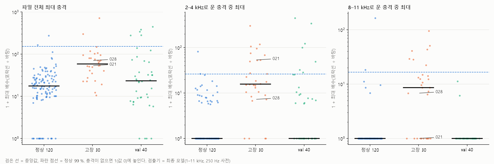

# 4-19 대역별 최대 충격 배수 EDA (피처 후보 P0, 11-25)

동기: 지금 피처는 충격 수 · 비율 · 첨도뿐이라 "한 번이라도 얼마나 세게 쳤나"를 직접 재는 열이 없다. abn_021(3 kHz 충격 3개, 최대 52배)은 비율이 축소로 묽어지고, abn_028(최대 70배)은 센 충격이 본체 모드라 정상 증거로 읽힌다([파이프라인점검 3-2](../../../../파이프라인점검.md)).
- 열 = 그 대역으로 운 충격 중 최대 "포락선 ÷ 바탕" 배수, log10(1 + x), 충격 없으면 0. 무차원. 대역은 옥타브 2–4 kHz와 8–11 kHz(실행 전 고정), 비교용으로 전체 · 1.6–4.5 kHz · 본체 5.5–8 kHz.
- 검출기 = 최종 모델(EXP-062 구성 3)과 같음: `all_impacts(fmax=11000)`, 검출 하나씩, 250 Hz 사전. 중복은 같은 설정의 `j_tables(fmax=11000)` 열과 비교.
- 코드 [run.py](자료/run.py) · 수치 [figs/수치.txt](자료/figs/수치.txt) · 파일별 [figs/files.csv](자료/figs/files.csv)

## 결과
| 열 | AUC [95 %] | 정상 99 %를 넘는 고장 | 고장 하위 10 % 선을 넘는 정상 | val 이동 AUC (고장 0 · 20 · 40 % 섞은 기준) | ρ(하중) | 가장 겹치는 J 열 |
|---|---|---|---|---|---|---|
| **max_2_4k** | **0.88** [0.80, 0.95] | **11개**(005 006 007 008 012 017 021 022 026 027 030) | 26/120 | 0.65 (0.45–0.55 · 0.52–0.63 · 0.60–0.71) | +0.19 | **H8 울림 2–4k +0.90** |
| **max_8_11k** | 0.79 [0.71, 0.88] | 7개(001 003 006 010 026 029 030) | 6/120 | 0.50 (이동 없음) | −0.13 | H10 울림 8–11k +0.82 |
| max_all | 0.86 [0.78, 0.93] | 2개(012 018) | 47/120 | 0.57 (0–20 % 범위 안) | +0.16 | H5 첨도 4–8k +0.71 |
| (참고) 1.6–4.5k | 0.89 | 14개 | 33/120 | 0.64 | +0.07 | H8 +0.81 |
| (참고) 본체 5.5–8k | 0.49 | — | 87/120 | 0.46 | +0.16 | 정보 없음 |

- 후보끼리는 겹치지 않는다(|ρ| 0.31–0.45). 2–4 kHz 칸에 충격이 없는 파일: 정상 78 % · 고장 13 % · val 52 %, 8–11 kHz: 정상 95 % · 고장 37 % · val 95 %.

**파일별 (배수, 정상 내 백분위)**
| 파일 | max_all | max_2_4k | max_8_11k |
|---|---|---|---|
| abn_021 | 52.4 (95) | **52.4 (99)** | 0 |
| abn_028 | 69.6 (96) | 6.3 (86) | 5.8 (95) |
| abn_014 · 022 · 017 | 79.9 (97) · 26.5 (73) · 34.0 (83) | 15.0 (97) · 26.5 (99) · 25.5 (98) | 0 |
| abn_002 | 11.4 (34) | 0 | 11.4 (98) |
| nor_059 · 065 · 116 (오경보 정상) | 10.1 · 17.3 · 164.1 | 0 | **10.1 · 17.3 · 164.1 (98–99)** |
| nor_054 · 060 · 032 (강타형 정상) | 275.5 · 111.2 · 76.3 (96–99) | 0 | 0 |
| nor_046 | 81.1 (97) | 81.1 (99) | 0 |
| nor_025 · 095 · 110 | 47.0 · 36.1 · 23.9 | 4.9 · 17.3 · 13.3 | 0 |

- val에서 정상 99 %를 넘는 파일: max_2_4k → val_004 · 013 · 016 · 027 · 031 · 035 · 039(지금 모델이 고장으로 판정한 9개 안에 모두 들어 있다), max_all → 004 · 016 · 027 · 031 · 035, max_8_11k → 없음.

## 해석
1. **max_2_4k가 가장 유망하다.** 꼬리 증거가 가장 강하다(정상 99 %를 넘는 고장 11개, 그중 021 · 022 · 017 포함). 021을 99 백분위로 잡는다. 다만 **H8(2–4 kHz 울림 비율)과 ρ 0.90**이라 관문(|ρ| < 0.8)에 걸린다. 같은 대역을 "비율"과 "세기"로 다르게 재는 것이라, ET 안에서 더해 비교해 볼 가치는 있다(H8은 충격이 적으면 축소로 묽어지고, max는 묽어지지 않음).
   - val 이동(0.65)은 고장 40 %를 섞은 범위 안이다. val 배경이 높으면 배수는 오히려 낮아지는 쪽이라, 위로 이동한 것은 배경 탓이 아니다.
2. **max_8_11k는 오경보 정상을 같이 올린다.** 059 · 065 · 116이 98–99 백분위로, H10이 이미 가진 문제와 같다(ρ 0.82). 028은 95 백분위로 조금 올라가지만 이 열만으로는 약하다.
3. **max_all은 강타형 정상을 같이 올린다.** 054 · 060 · 032 · 046 · 116이 028보다 세다. 꼬리 증거가 약하고(정상 99 %를 넘는 고장 2개), 고장 하위 10 % 선을 넘는 정상이 47개다. 028을 위한 열로는 부족하다.
4. **abn_028은 "최대 충격"으로도 따로 서지 못한다.** 센 충격이 본체 모드이고(본체 최대 AUC 0.49), 강타형 정상과 같은 모양이다. 지금처럼 저주파 · 결합 점수에 기대는 것이 현실적이다.

## 다음
- 실험 후보: 최종 모델(EXP-062 구성 3)에 **+ max_2_4k**, **+ max_2_4k + max_8_11k**를 ET 열로 더해 같은 분할로 비교(max_all은 제외 권장).
- 한계: 단변량 · 라벨을 본 설명용 AUC다. 대역은 옥타브로 미리 정했다.
