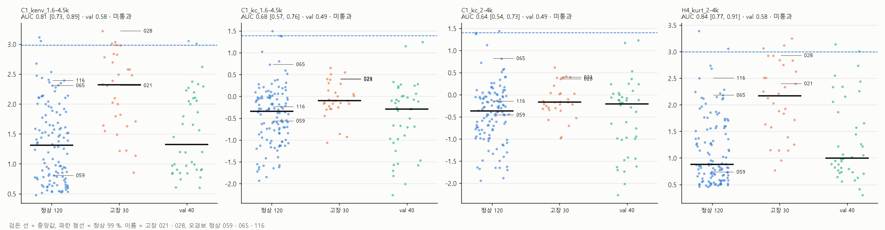

# C1 대역 포락선 첨도 대비 (피처후보 P1 + H4, 11-25)

목적: 고장 충격은 연결부(1.6–4.5 kHz)로, 정상 충격은 본체(5.5–8 kHz)로 운다(H1). 두 대역 포락선 첨도를 같이 재면 "연결부만 뾰족한" 파일이 고장 쪽으로 서는지 본다.

## 정의 (라벨 보기 전 고정, `src/features2.py band15_table`)
- `C1_kenv_1.6-4.5k` = log10 Pearson 첨도(|Hilbert| 포락선, 1.6–4.5 kHz 4차 대역통과, 끝 10 ms 제외)
- `C1_kc_1.6-4.5k` = 위 값 − 본체(5.5–8 kHz) 같은 값 = log10(연결부 ÷ 본체)
- `C1_kc_2-4k` = 옥타브 2–4 kHz 판 대비
- `H4_kurt_2-4k` = 옥타브 2–4 kHz 대역 신호 log10 Pearson 첨도(feat2_table H4와 같은 식, J 미사용)
- 공통 방법 · 관문은 [상위 README](../../README.md). 수치 [figs/수치.txt](figs/수치.txt) · 파일별 [figs/files.csv](figs/files.csv) · 코드 [../run.py](../run.py)

## 결과
| 열 | AUC [95 %] | 고장 > 정상 99 % | 정상 > 고장 10 % | val AUC (0 · 20 · 40 % 범위) | ρ(하중) | 겹치는 J 열 | 반쪽 ρ | 통과 |
|---|---|---|---|---|---|---|---|---|
| C1_kenv_1.6-4.5k | 0.81 [0.73, 0.89] | 006 012 027 028 | 64/120 | 0.58 (0.42–0.57 · 0.49–0.64 · 0.56–0.69) | +0.13 | H3 +0.83 | 0.11 | ✗ (중복 · 반쪽) |
| C1_kc_1.6-4.5k | 0.68 [0.57, 0.76] | — | 67/120 | 0.49 | −0.13 | H3 +0.53 | 0.32 | ✗ (CI · 반쪽) |
| C1_kc_2-4k | 0.64 [0.54, 0.73] | — | 75/120 | 0.49 | −0.13 | H9 −0.52 | 0.32 | ✗ (CI · 반쪽) |
| H4_kurt_2-4k | 0.84 [0.77, 0.91] | 006 012 027 | 48/120 | 0.58 (0.43–0.69) | +0.12 | H3 +0.88 | 0.17 | ✗ (중복 · 반쪽) |

헷갈리는 파일(정상 내 백분위, kenv · kc · H4): 021 90 · 93 · 96 / 028 **100** · 93 · 98 / 014 82 · 25 · 88 / 022 97 · 95 · 93 / 002 32 · 24 · 38 / 017 97 · 55 · 95 / 정상 065 90 · 95 · 92 · 116 93 · 58 · 96 · 095 82 · 78 · 94.

## 해석
- 대비(연결부 ÷ 본체)는 기대보다 약하다. 본체 첨도도 강타형 정상에서 높아 둘을 나누면 고장 신호까지 줄어든다.
- 연결부 첨도 자체(kenv · H4)는 분리력이 있지만 H3(1–2k 첨도)와 0.83–0.88로 같은 축이다. 028을 맨 위로 올리는 것은 눈에 띄지만 065 · 116도 90 백분위 위로 같이 올린다.
- val 이동은 없다(0 · 20 % 범위 안). 배경 +6 dB가 첨도를 낮출 거라는 걱정은 나타나지 않았다.

**통과 여부: 4열 모두 미통과.**
