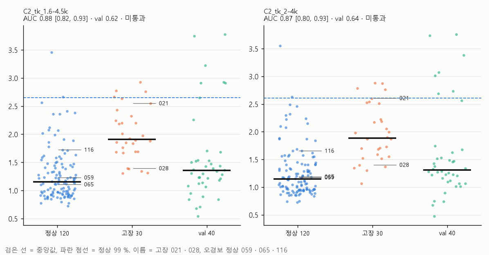

# C2 TKEO 파고율 (피처후보 P2, 11-25)

목적: TKEO Ψ = x(n)² − x(n−1)x(n+1)는 순간 울림 에너지(≈ A²ω²)라, 검출 문턱(4.5배)에 못 미치는 약한 충격도 연속값으로 잡을 수 있는지 본다.

## 정의 (라벨 보기 전 고정, `src/features2.py band15_table`)
- `C2_tk_1.6-4.5k` = 1.6–4.5 kHz 4차 대역통과 신호(끝 10 ms 제외)의 Ψ → log10(P99 ÷ P50)
- `C2_tk_2-4k` = 옥타브 2–4 kHz 판
- 먼저 C1과의 중복: C2 ~ C1_kenv ρ 0.63 · ~ H4 0.76 · ~ C4 0.53–0.57 (학습 150). 같은 계열이지만 같은 열은 아니다.
- 공통 방법 · 관문은 [상위 README](../../README.md). 수치 [figs/수치.txt](figs/수치.txt) · 파일별 [figs/files.csv](figs/files.csv)

## 결과
| 열 | AUC [95 %] | 고장 > 정상 99 % | 정상 > 고장 10 % | val AUC (0 · 20 · 40 % 범위) | ρ(하중) | 겹치는 J 열 | 오경보 정상 > 99 % | 반쪽 ρ | 통과 |
|---|---|---|---|---|---|---|---|---|---|
| C2_tk_1.6-4.5k | **0.88 [0.82, 0.93]** | 007 008 010 020 | 38/120 | 0.62 (0.43–0.57 · 0.51–0.65 · 0.59–0.71) | +0.07 | H3 +0.79 | **095** | 0.38 | ✗ (오경보 정상 · 반쪽) |
| C2_tk_2-4k | 0.87 [0.80, 0.93] | 007 008 010 020 | 35/120 | 0.64 (0.43–0.71) | +0.08 | H3 +0.77 | **095** | 0.33 | ✗ (오경보 정상 · 반쪽) |

헷갈리는 파일(정상 내 백분위, 1.6–4.5k): 021 98 · 028 69 · 014 88 · 022 65 · 002 68 · 017 68 / 정상 059 57 · 065 42 · 116 86 · 025 93 · **095 99** · 110 59 · 046 78.

## 해석
- 후보 중 분리력(CI 하한 0.82)이 가장 높다. 중복은 H3과 0.79로 관문(0.8) 바로 아래.
- 오경보 정상 095를 정상 맨 위(99)로, 025를 93으로 올린다. 이상치 059 · 065 · 116은 올리지 않는다(065는 오히려 낮음).
- val 이동 0.62는 20–40 % 범위 안. val 7개(004 013 016 027 031 035 039)가 정상 99 % 위 — 지금 모델이 고장으로 판정한 파일들이다.
- 028(69) · 022(65)는 못 올린다. 021은 98.

**통과 여부: 미통과(관문 4 · 5). CI 하한이 가장 높아 EXP-067에서 "참고"로 실험.**
