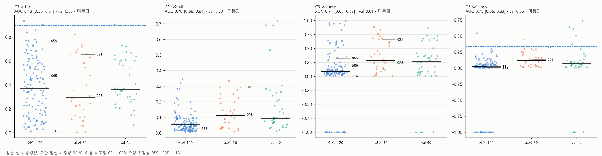

# C3 WPD 3단계 상대 에너지 (피처후보 P3, 11-25)

목적: 0–12.5 kHz를 1.5625 kHz 폭 8칸으로 나눈 수학적 경계(라벨 무관)에서, 연결부 칸의 에너지 몫이 고장에서 커지는지 본다. 파일 전체 몫은 val 3–5 kHz 배경 이동을 받으므로 충격 구간만의 몫을 같이 본다.

## 정의 (라벨 보기 전 고정, `src/features2.py band15_table`)
- **PyWavelets가 없어서 같은 경계의 FFT 대역 분할로 계산**(조각별 4096점 rfft, |X|² 칸별 합). WPD의 Paley 순서 · 필터 누설 문제는 없다.
- 칸1 = 1.56–3.12 kHz, 칸2 = 3.12–4.69 kHz. 분모 = 칸1–6(1.56–10.94 kHz). 칸0 · 칸7은 1 kHz 하한 · 11 kHz 상한과 맞지 않아 뺐다.
- `C3_w1_all` · `C3_w2_all` = 파일 전체 / `C3_w1_imp` · `C3_w2_imp` = 충격 [−2, +12] ms 합집합 조각만. 충격 없으면 −1(정상 17 · val 4).
- 공통 방법 · 관문은 [상위 README](../../README.md). 수치 [figs/수치.txt](figs/수치.txt) · 파일별 [figs/files.csv](figs/files.csv)

## 결과
| 열 | AUC [95 %] | 고장 > 정상 99 % | val AUC (0 · 20 · 40 % 범위) | ρ(하중) | 겹치는 J 열 | 반쪽 ρ | 통과 |
|---|---|---|---|---|---|---|---|
| C3_w1_all | 0.48 [0.36, 0.61] | — | 0.55 | +0.06 | H12 몫 1–2k +0.84 | 0.62 | ✗ (CI · 중복) |
| C3_w2_all | 0.70 [0.58, 0.81] | 020 | **0.73** (0.43–0.57 · 0.46–0.61 · 0.50–0.65 → 밖) | −0.18 | H9 −0.34 | 0.78 | ✗ (CI · val 이동) |
| C3_w1_imp | 0.72 [0.61, 0.82] | — | 0.61 (0.42–0.66) | +0.10 | H8 +0.70 | 0.14 | ✗ (반쪽) |
| C3_w2_imp | 0.75 [0.65, 0.84] | 011 | 0.66 (0.43–0.67) | +0.04 | H8 +0.53 | 0.21 | ✗ (반쪽) |

헷갈리는 파일(정상 내 백분위, w2_all · w2_imp): 021 98 · 98 / 028 88 · 87 / 014 92 · 92 / 022 67 · 72 / 정상 095 92 · 95 / 046 91 · 83.

## 해석
- 예고대로 **파일 전체 몫 w2(3.12–4.69 kHz)는 val에서 넘친다**(0.73, 고장 40 % 섞음 범위 위). new 2-8의 3–5 kHz 배경 +6 dB가 그대로 들어온다. w1_all은 분리력이 없다.
- 충격 구간 몫으로 바꾸면 val 이동은 범위 안으로 돌아오지만(0.61 · 0.66), 정상은 충격이 드물어 반쪽 ρ가 0.14–0.21로 떨어진다. 분리력도 H8(울림 2–4k)보다 약하다.
- 꼬리 증거가 거의 없다(정상 99 %를 넘는 고장 0–1개).

**통과 여부: 4열 모두 미통과.**
