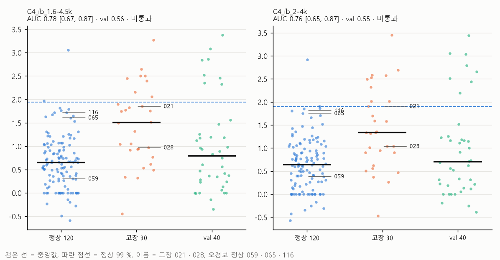

# C4 충격 대 배경 에너지 비 (배경 이동 상쇄 설계, 11-25)

목적: val은 3–5 kHz 배경이 +6 dB 높다(new 2-8). 같은 대역 안에서 "충격 구간 에너지 ÷ 구간 밖 에너지"로 재면 배경 이동이 분모 · 분자에 같이 들어가 상쇄되는지, 그리고 연결부 충격의 세기를 잡는지 본다.

## 정의 (라벨 보기 전 고정, `src/features2.py band15_table`)
- `C4_ib_1.6-4.5k` = log10(충격 [−2, +12] ms 합집합 안 평균 x_band² ÷ 밖 평균 x_band²), x_band = 1.6–4.5 kHz 4차 대역통과
- `C4_ib_2-4k` = 옥타브 2–4 kHz 판. 충격 없으면 0(대비 없음, 정상 17 · val 4)
- 공통 방법 · 관문은 [상위 README](../../README.md). 수치 [figs/수치.txt](figs/수치.txt) · 파일별 [figs/files.csv](figs/files.csv)

## 결과
| 열 | AUC [95 %] | 고장 > 정상 99 % | 정상 > 고장 10 % | val AUC (0 · 20 · 40 % 범위) | ρ(하중) | 겹치는 J 열 | 반쪽 ρ | 통과 |
|---|---|---|---|---|---|---|---|---|
| C4_ib_1.6-4.5k | 0.78 [0.67, 0.87] | 003 005 006 008 012 023 027 030 (8) | 75/120 | 0.56 (0.42–0.58 · 0.48–0.63 · 0.54–0.69) | +0.13 | H3 +0.73 | −0.06 | ✗ (반쪽) |
| C4_ib_2-4k | 0.76 [0.65, 0.87] | 위 + 010 021 (10) | 75/120 | 0.55 | +0.14 | H3 +0.69 | −0.05 | ✗ (반쪽) |

헷갈리는 파일(정상 내 백분위, 1.6–4.5k): 021 98 · 028 72 · 014 90 · 022 90 · **002 2** · 017 96 / 정상 059 28 · 065 91 · 116 95 · 025 84 · 095 83 · 110 80 · 046 45.

## 해석
- **설계대로 val 이동이 없다**(0.55–0.56, 고장 0 % 범위 안). 배경 비라 3–5 kHz 배경 상승이 상쇄된다.
- 꼬리 증거는 후보 중 가장 넓다(고장 8–10개가 정상 99 % 위, 2–4k 판은 021 포함). 반면 몸통은 겹친다(정상 75/120이 고장 하위 10 % 선 위) → 일부 고장에만 강한 열.
- 반쪽 ρ ≈ 0: 정상은 충격이 적고, 1초 안에 충격이 있느냐에 따라 값이 0 ↔ 양수로 바뀐다. 파일 단위로는 측정이 불안정하다.
- 오경보 정상 065 · 116을 91–95 백분위로 올린다(99 % 아래라 관문 4는 통과).

**통과 여부: 미통과(관문 5만).** 반쪽 관문을 충격 기반 열에 맞게 바꾸면 다시 볼 1순위 후보.
