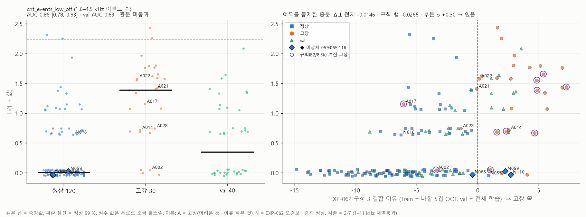

# F1 cnt_events_low_off (1.6–4.5 kHz로 운 이벤트 수)

- **목적**: 연결부 대역(1.6–4.5 kHz)으로 우는 충격이 고장에 많다는 가설이 EXP-062에 새 정보를 주는지.
- **방법**: 2-7 이벤트 표(1–11 kHz 대역통과, 25 ms 묶음, 50 Hz 사전)에서 셈. 공통 계산은 [../run.py](../run.py), 수치 [../figs/수치.txt](../figs/수치.txt).
- **결과**: AUC 0.86 [0.78, 0.93] · 최대 ρ H8_ring_2-4k +0.70 (4-19 max_2_4k와 0.76) · val AUC 0.63 (기준 0.44–0.70 안) · 이상치 · 경계 정상 99 % 초과 없음 · 반쪽 AUC 0.75/0.76, 정상 ρ 0.32(미통과) · 증분 ΔLL −0.015(전체) / −0.027(규칙 뺌), 부분 ρ 0.30.
- **해석**: 오른쪽 그림에서 여유 0 근처의 고장 A021 · A022(3–4개)는 위에, 오경보 ◆ 059 · 065 · 116 · N055는 0에 있다. 모델이 헷갈리는 두 무리를 반대로 미는 유일한 피처다. 위험 파일은 N037(3개, 정상 96 %)과 N016. 정상 75 %가 0이다.
- **판정**: 관문 1–4 통과, 5 미통과, 증분 있음 → **EXP-062에 넣어 볼 후보**.
