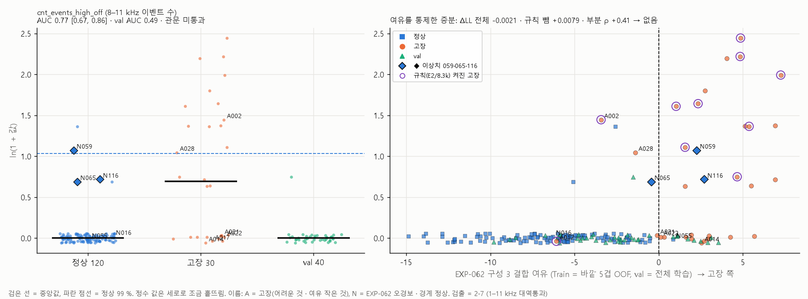

# F2 cnt_events_high_off (8–11 kHz로 운 이벤트 수)

- **목적**: 8–11 kHz로 우는 충격 수가 EXP-062에 새 정보를 주는지.
- **방법**: 2-7 이벤트 표에서 셈. 공통 계산 [../run.py](../run.py), 수치 [../figs/수치.txt](../figs/수치.txt).
- **결과**: AUC 0.77 [0.67, 0.86] · 최대 ρ H10_ring_8-12.5k +0.77, 4-19 max_8_11k와 **0.93** · val AUC 0.49 (범위 안) · **nor_059(2개)가 정상 99 % 위**, 065 · 116도 97 % · 반쪽 정상 ρ 0.31(미통과) · 증분 ΔLL −0.002 / +0.008, 부분 ρ 0.41.
- **해석**: 고장 13개가 정상 99 % 위에 있지만 그중 8개(002 · 003 · 004 · 006 · 010 · 011 · 019 · 029)는 규칙(E2 · 8.3k)이 이미 켜진 파일이다. 놓치는 고장 중에는 abn_028(2개)만 위에 있고, 그 대가로 이상치 정상 059 · 065 · 116도 같이 올라간다. 여유를 통제하면 로그손실이 줄지 않는다.
- **판정**: 관문 4 · 5 미통과, 증분 없음, 4-19 max_8_11k와 중복 → **기각**.
