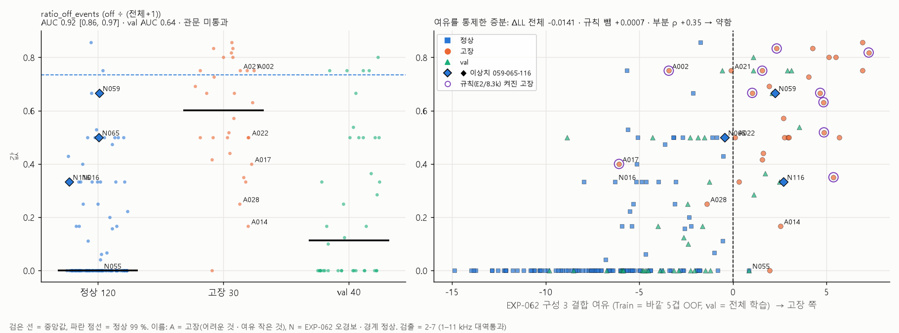

# F3 ratio_off_events ((low + high) ÷ (전체 + 1))

- **목적**: 정상 몸체 대역(5.5–8 kHz) 밖으로 우는 이벤트의 비율이 EXP-062에 새 정보를 주는지.
- **방법**: 2-7 이벤트 표에서 계산. 공통 계산 [../run.py](../run.py), 수치 [../figs/수치.txt](../figs/수치.txt).
- **결과**: AUC 0.92 [0.86, 0.97] · 최대 ρ H8_ring_2-4k +0.68 · val AUC 0.64 (범위 안, 다만 val 5개 013 · 016 · 018 · 024 · 025가 정상 99 % 위) · 이상치 99 % 초과 없음(059 98 %, 065 93 %) · 반쪽 정상 ρ 0.29(미통과) · 증분 ΔLL −0.014 / +0.001, 부분 ρ 0.35.
- **해석**: 놓친 abn_021이 정상 99 %로 가장 잘 올라가지만, 오경보 ◆ 059 · 065도 93–98 %로 같이 올라간다. 규칙 켜진 파일을 빼면 증분이 사라진다. 전체 150의 증분은 규칙으로 이미 잡히는 고장(예: abn_002, 여유 −3.43 · ratio 0.75)에서 주로 나온 것으로 보인다.
- **판정**: 관문 1–4 통과, 5 미통과, 증분 약함 → **보류** (F1 다음 차선).
