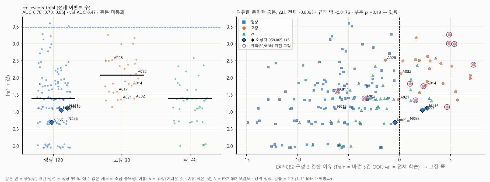

# F4 cnt_events_total (전체 이벤트 수)

- **목적**: 25 ms로 묶은 충격 이벤트 수가 EXP-062에 새 정보를 주는지.
- **방법**: 2-7 이벤트 표에서 셈. 공통 계산 [../run.py](../run.py), 수치 [../figs/수치.txt](../figs/수치.txt).
- **결과**: AUC 0.78 [0.70, 0.85] · 최대 ρ **H1_nimp +0.96** · val AUC 0.47 (범위 안) · 이상치 99 % 초과 없음 · 반쪽 정상 ρ 0.26(미통과) · 증분 ΔLL −0.010 / −0.018, 부분 ρ 0.19.
- **해석**: J의 H1_nimp(충격 수)와 같은 양을 검출 방식만 바꿔 센 열이다. 증분 수치가 기준을 넘은 것은 묶음 방식 차이로 생긴 작은 차이이거나 우연일 수 있고, 새 물리 정보는 아니다. 고장 중 정상 99 % 위는 없다. 2-6에서 val이 낮게 나오던 열이다(val AUC 0.47).
- **판정**: 관문 2(중복) · 5 미통과 → **중복**.
