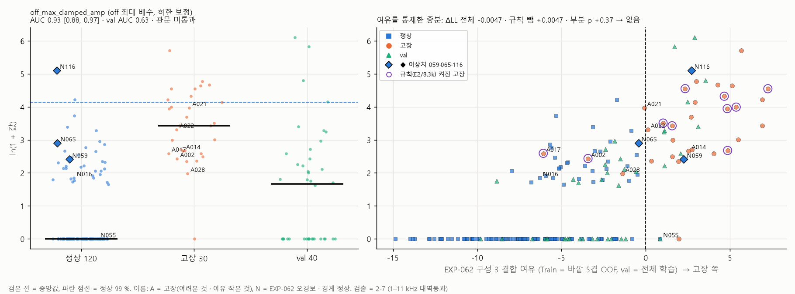

# F5 off_max_clamped_amp (off 이벤트 중 최대 배수, 바탕 하한 보정)

- **목적**: off 대역(1.6–4.5 · 8–11 kHz)으로 운 가장 센 충격의 크기가 EXP-062에 새 정보를 주는지.
- **방법**: 2-7 이벤트 표에서 포락선 ÷ max(바탕, 0.0044 g)의 최댓값(b_floor = Train 150 바탕 중앙 하위 20 %, 라벨 없이). 보정 없는 값의 AUC는 0.925로 거의 같다. 공통 계산 [../run.py](../run.py), 수치 [../figs/수치.txt](../figs/수치.txt).
- **결과**: AUC 0.93 [0.88, 0.98] · 최대 ρ H8_ring_2-4k +0.69 (ratio_off와 0.97) · val AUC 0.63 (범위 안, val 004 · 016 · 035 · 039가 정상 99 % 위) · **nor_116 = 164배로 정상 최대**, 059 89 % · 065 95 % · 반쪽 정상 ρ 0.28(미통과) · 증분 ΔLL −0.005 / +0.005, 부분 ρ 0.37.
- **해석**: 단독 분리력은 다섯 중 가장 좋지만 EXP-062 결합 여유와 ρ 0.73으로 겹치고, 여유를 통제하면 로그손실이 줄지 않는다. 오경보 이상치 116을 정상 최대로 밀어 올려 지금 모델의 약점을 키우는 방향이다.
- **판정**: 관문 4 · 5 미통과, 증분 없음 → **기각**.
