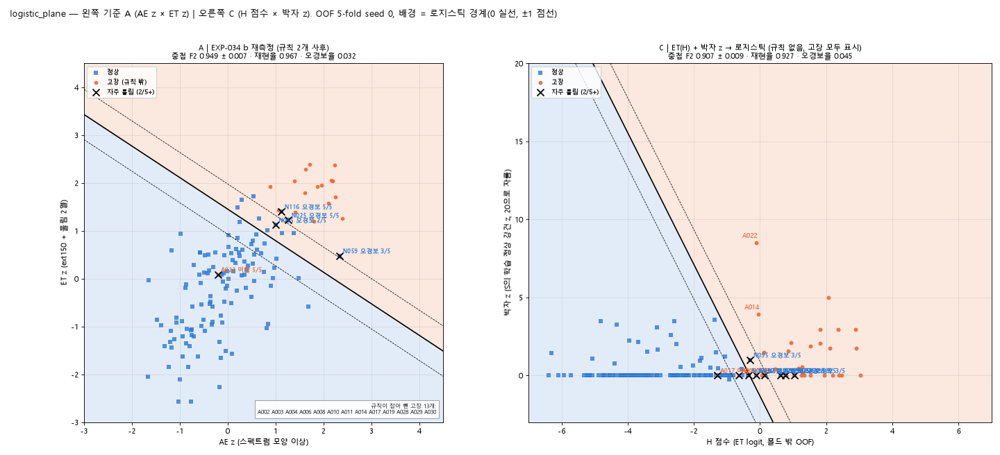
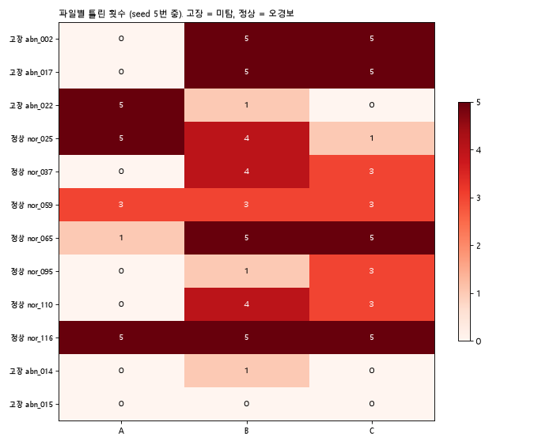
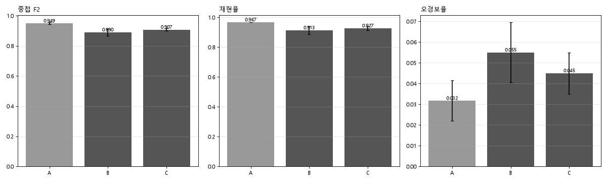
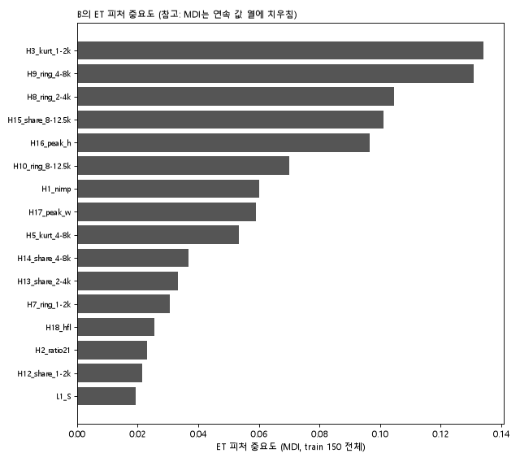
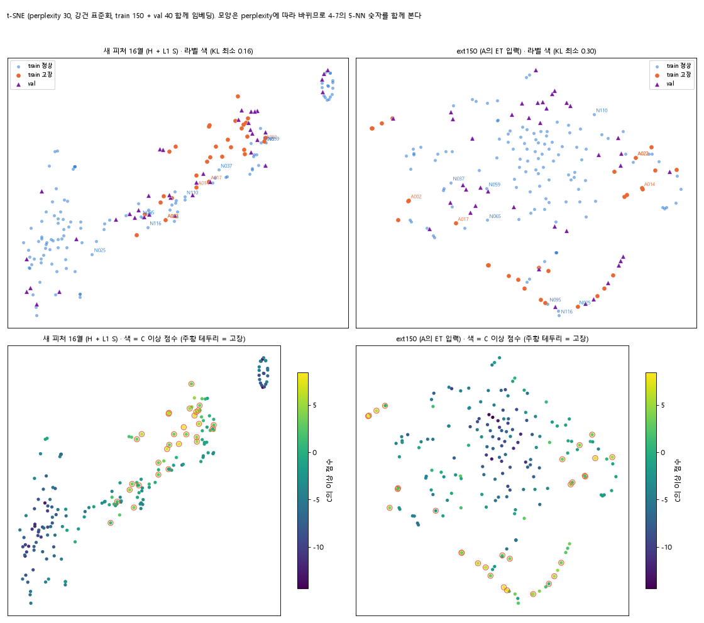
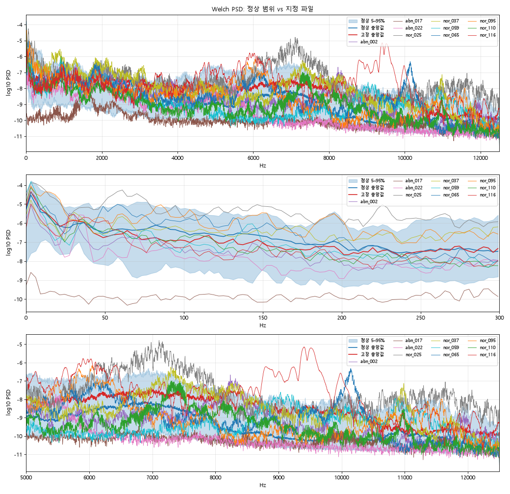

# EXP-040 2차 설계 1단계 — A 기준 · B ET 하나 · C 저/고 분리 + 로지스틱

노션 카드 (실험 DB에 그대로 옮긴다)

| 팀원 | 모델 | F2 점수 | 변경 사항 | 메모 |
|---|---|---|---|---|
| 이동훈 | A: EXP-034 b / B: ET(H 15열 + 박자 S) / C: ET(H) + 박자 z → 로지스틱 | 0.907 ± 0.009 | 2차 설계: 새 충격 정의(11-21) · 1 kHz 고역 H 블록(옥타브 4칸·울림 몫·PSD 몫·봉우리·HFL) + 박자 S. AE·규칙 없음 (B·C) (H1, H2, H3, H4) |  |

- 가설: H1, H2, H3, H4 ([물리가설](../../../1_기준·기록/물리가설.md))
- 실행: 2026-11-21 · git `bfc87b8+수정중` · 코드 [run.py](자료/run.py)
- 평가: 중첩 CV (바깥 5 × 안쪽 4, seed 5개). 자주 놓침 = seed 5번 중 3번 이상

## 결과

| 구성 | F2 | 재현율 | 오경보율 | 정밀도 | F2 (고장 10%·40%) | 자주 놓침 | 오경보 3회+ |
|---|---|---|---|---|---|---|---|
| 중첩: A \| EXP-034 b 재측정 | 0.949 ± 0.007 | 0.967 | 0.032 | 0.885 | 0.920 · 0.964 | 022 | 3 |
| 중첩: B \| ET 하나 (H + 박자 S) | 0.890 ± 0.024 | 0.913 | 0.055 | 0.808 | 0.844 · 0.914 | 002 017 | 6 |
| 중첩: C \| ET(H) + 박자 z → 로지스틱 | 0.907 ± 0.009 | 0.927 | 0.045 | 0.839 | 0.869 · 0.928 | 002 017 | 6 |
| 중첩: Ac \| EXP-034 c 재측정 (참고, A + 본체 모드 내림) | 0.955 ± 0.007 | 0.967 | 0.023 | 0.913 | 0.934 · 0.966 | 022 | 2 |

## 해석

새 H 피처(15열) + 박자 S로는 기준 A(EXP-034 b, 0.949 ± 0.007)를 못 따라간다: B 0.890 ± 0.024(A보다 −0.059, sd의 8배), C 0.907 ± 0.009(−0.042). B와 C의 차 +0.017은 B의 sd(0.024) 안이라 선택 규칙(차 < sd면 단순한 쪽)으로는 B가 뽑히지만, C ≥ B(점수·sd 모두)이므로 2단계 진행 조건은 충족한다. 규칙 없는 새 구조는 002·017 두 고장을 5/5 놓치고(A는 규칙 3개로 해결), 오경보 정상이 늘었다(065 5/5, 116 5/5, 037·095·110 3–4/5). 반대로 A가 5/5 놓치는 022는 박자 S 덕에 B(1/5)·C(0/5)가 잡고, 014도 C가 잡는다.

<!-- key-figs: 자동 (save_fig key=True) -->

*logistic_plane* — A는 AE z × ET z 평면에서 규칙이 고장 일부를 빼고, C는 H 점수 × 박자 z 평면에서 022·014가 위쪽에 따로 서는가

<!-- /key-figs -->

### 그림 읽는 법과 상세

**logistic_plane.** 왼쪽은 기준 A의 평면(AE z × ET z). 고장 13개가 규칙으로 평면에서 빠졌고 남은 고장은 오른쪽 위에 모여 있다. 오경보 025 · 116 · 059가 경계 위에 있다(025는 본체 내림이 없는 b라 5/5, c에서는 해소). 오른쪽 C 평면은 가로축 H 점수(ET logit, 폴드 밖 OOF), 세로축 박자 z. 정상 대부분이 z ≈ 0(S가 0인 파일이 79%)에 줄 서 있어 로지스틱은 사실상 H 점수 하나로 가르고, 022(z ≈ 8.5) · 014(z ≈ 4)만 H 점수가 낮은데도 위로 떠서 경계를 넘는다. 002 · 017은 H 점수가 정상 쪽이다.

**설정 메모.** (1) 박자 z는 정상의 79%가 S = 0이라 MAD가 0 → 계획의 (S − 중앙값)/(1.4826·MAD)를 못 쓴다. `robust_z`가 대체로 정상 90% 분위수 규모((P90 − 중앙값)/1.2816)를 쓴다 → **판단 필요**(계획과 다른 부분). (2) A는 사용자 결정(11-21)으로 EXP-034 c에서 본체 모드 내림을 뺀 b. c는 같은 틀에서 한 단계만 더한 참고값(0.955 ± 0.007, 기록과 같음). (3) 임계값은 nested_cv 안쪽 OOF F2 최대(기존 방식). (4) H16–H17과 박자 z와 C의 로지스틱은 fit 안에서 학습 행으로 계산(C의 안쪽 OOF ET 4겹은 fit 행의 정상 중앙 PSD를 공유).

**val (라벨 없음, 구성 선택에 안 씀).** B·C는 train 150 전체로 학습, 임계값은 train 4등분 OOF F2 최대의 seed(0·1·2) 중앙값(FinalModel 방식): B −0.335 → 12/40, C 0.850 → 10/40. A(b) = 최종 모델(`4_outputs/final/final_model.joblib`, 임계값 1.0)의 내림 전 판정 11/40: 001 004 013 016 017 018 024 027 031 035 039. 최종 모델은 c 설정이라 `predict_table`의 `lr`·`rule83`·`knock` 열로 내림 전 점수(lr + 100·rule83 + 100·knock)를 다시 만들어 같은 임계값으로 잘랐고, 내림이 걸리지 않은 파일은 점수가 최종 점수와 같음을 assert로 확인했다(val에서 내림이 바꾼 파일 없음 → b와 c의 val 판정은 같다).

| | 판정 수 | 파일 |
|---|---|---|
| A (b) | 11 | 001 004 013 016 017 018 024 027 031 035 039 |
| B | 12 | 004 013 016 017 021 024 025 027 031 035 036 039 (A와 9개 겹침, A에 없는 것 021 025 036, A에만 001 018) |
| C | 10 | 004 013 016 017 024 025 027 031 035 039 (A와 9개 겹침, A에 없는 것 025, A에만 001 018) |
| 셋 다 | 9 | 004 013 016 017 024 027 031 035 039 |

val의 박자 z 상위는 031(1.56) · 027(1.21) · 022(0.65) · 039(0.39). val S 최대 0.196으로 C의 박자 축은 val에서 거의 안 켜진다(예상된 일, 계획 9절). 참사 신호(판정 수 급변)는 없다.

t-SNE(perplexity 30)는 새 피처 공간에서 val이 train 분포 위에 놓이는지, C 점수 색이 고장 쪽 가장자리에서 높은지를 본다. 숫자 근거는 4-7의 5-NN 표.

## 그림

### hard_files
어느 파일이 A · B · C에서 맞고 틀리는가

### scores
A · B · C 중첩 F2 · 재현율 · 오경보율 (막대 = 평균, 선 = sd)

### importance_B
B의 ET가 어떤 H 피처·박자 S를 쓰는가

### tsne
새 피처 공간과 ext150 공간에서 고장이 따로 모이는가 · val이 train 분포 안인가 · C 점수와 배치

### psd_missed
자주 틀린 파일의 PSD가 정상 5–95% 범위 밖으로 나가는 주파수

