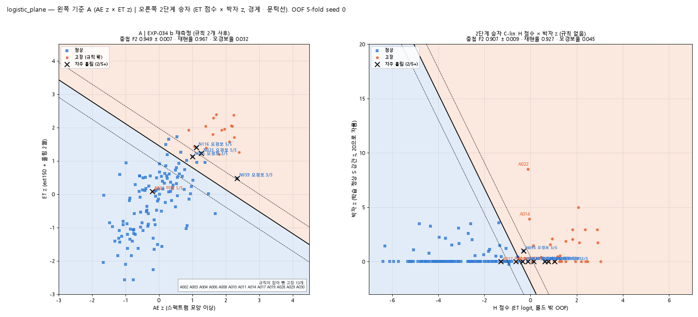
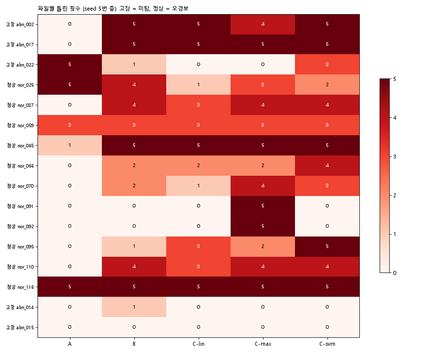
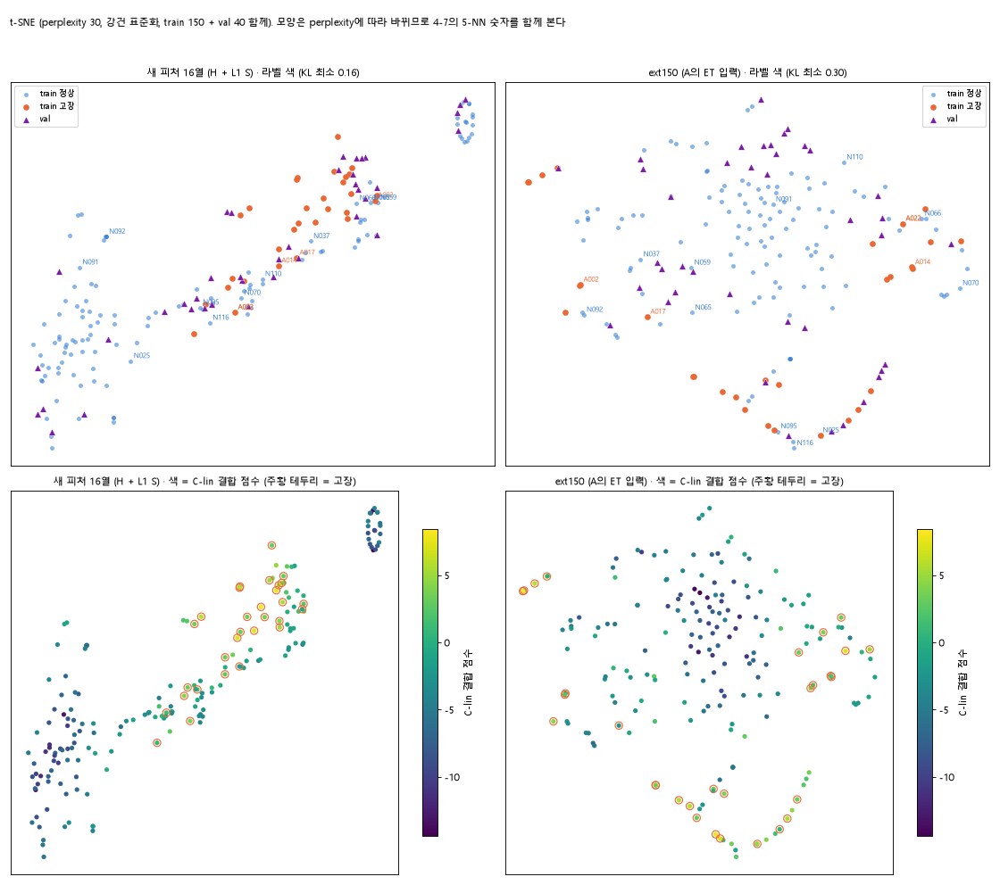
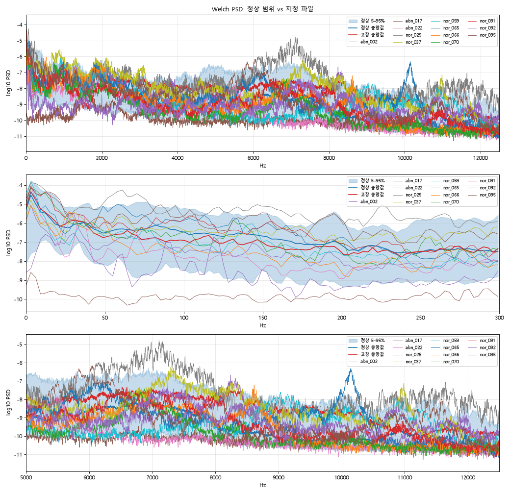

# EXP-041 2차 설계 2단계 — C 위에서 결합 방식 비교 (max · lin · svm)

노션 카드 (실험 DB에 그대로 옮긴다)

| 팀원 | 모델 | F2 점수 | 변경 사항 | 메모 |
|---|---|---|---|---|
| 이동훈 | ET(H 15열) OOF logit + 박자 z → C-max(OR) / C-lin(로지스틱) / C-svm(RBF) | 0.907 ± 0.009 | 결합만 바꿈. 박자 문턱 q99 · t_H는 fit 안에서 고정 규칙(튜닝 없음) (H1, H2, H4) |  |

- 가설: H1, H2, H4 ([물리가설](../../../1_기준·기록/물리가설.md))
- 실행: 2026-11-21 · git `bfc87b8+수정중` · 코드 [run.py](자료/run.py)
- 평가: 중첩 CV (바깥 5 × 안쪽 4, seed 5개). 자주 놓침 = seed 5번 중 3번 이상

## 결과

| 구성 | F2 | 재현율 | 오경보율 | 정밀도 | F2 (고장 10%·40%) | 자주 놓침 | 오경보 3회+ |
|---|---|---|---|---|---|---|---|
| 중첩: A \| EXP-034 b (EXP-040 값) | 0.949 ± 0.007 | 0.967 | 0.032 | 0.885 | 0.920 · 0.964 | 022 | 3 |
| 중첩: B \| ET 하나 (EXP-040 값) | 0.890 ± 0.024 | 0.913 | 0.055 | 0.808 | 0.844 · 0.914 | 002 017 | 6 |
| 중첩: C-lin \| EXP-040 C 그대로 | 0.907 ± 0.009 | 0.927 | 0.045 | 0.839 | 0.869 · 0.928 | 002 017 | 6 |
| 중첩: C-max \| (ET ≥ t_H) OR (박자 z ≥ q99) | 0.887 ± 0.013 | 0.940 | 0.090 | 0.726 | 0.817 · 0.926 | 002 017 | 9 |
| 중첩: C-svm \| RBF SVM [ET OOF logit, 박자 z] | 0.883 ± 0.008 | 0.913 | 0.065 | 0.779 | 0.831 · 0.911 | 002 017 022 | 8 |

## 해석

결합 방식은 EXP-040의 C-lin(로지스틱, 0.907 ± 0.009)이 가장 낫고, 선택 규칙(차 < sd면 max → lin → svm)도 lin을 고른다. C-max 0.887 ± 0.013(−0.020, sd 안이 아니라 lin이 최고라 max가 sd 안에 못 들어옴), C-svm 0.883 ± 0.008(−0.024). 어느 쪽도 A(EXP-034 b 0.949 ± 0.007)에 못 미친다(승자 − A = −0.042, sd의 6배). 승자 − B = +0.017(B sd 0.024 안).

<!-- key-figs: 자동 (save_fig key=True) -->

*logistic_plane* — A는 규칙이 고장 일부를 빼고, 승자는 ET 점수 × 박자 z 평면에서 022 · 014가 박자 축으로 따로 서는가

<!-- /key-figs -->

### 읽는 법과 상세 (손으로 씀)
- **C-max.** 재현율 0.940로 C-lin(0.927)보다 높지만 오경보율이 0.090으로 두 배다. 박자 문턱 q99(학습 정상 박자 z의 99%)가 정상의 79%가 S = 0인 분포의 꼬리라, 폴드 밖 정상 중 S가 조금 높은 파일(091 · 092 · 103 등)이 박자 축으로 켜진다(정상 092는 S 0.445로 정상 최대). t_H도 ET 단독 문턱이라 정상이 늘어난다. 022 · 014는 박자로 잡혀 미탐에서 빠진다(미탐 002 4/5 · 017 5/5만).
- **C-svm.** 022를 3/5 놓친다(RBF가 박자 z의 큰 값 구간을 학습 고장 1–2개로 만든 작은 섬으로 다뤄 폴드마다 흔들림). 오경보율 0.065.
- **구현 메모 (C-max 문턱이 안쪽 F2로 다시 골라지지 않게).** `src/models2.py`의 `Two('max')`가 fit 안에서 t_H(ET OOF logit의 F2 최대)와 q99(학습 정상 박자 z 99% 분위)를 정하고, 점수를 이진(규칙이 켜지면 1, 아니면 0)으로 돌려준다. nested_cv의 문턱 후보가 {0, 1}뿐이라 판정은 항상 규칙 그대로다. C-lin은 EXP-040 C 결과를 가져왔다(같은 split·seed 고정이라 재계산하면 같은 값, W 재계산 0.9073 ± 0.0088 확인). C-svm은 class_weight = balanced.
- **오류 분석 (승자 C-lin 기준, OOF seed 0).** 아래 표. 백분위 = 학습 정상 120개 중 그 파일 값 이하의 비율(H16 · H17은 정상 전체 기준 참고 ref). 한 열만 튀는 경우는 드물고, 새 오경보 037 · 110 · 095는 정상 95%를 넘은 피처가 없다 → 여러 피처가 조금씩 고장 쪽에 놓여 ET 점수가 오른 경우(개별 피처로 설명 안 됨). 065 · 116은 H10(8–12.5 kHz 울림 몫) · H15(8–12.5 kHz PSD 몫) · H16(가장 솟은 봉우리)이 정상 95% 위이고 ET 중요도 상위(H9 H3 H16 H8 H15 H1)와 H15 · H16이 겹친다. 059는 H10만. 놓친 002는 H10만 높고 나머지는 정상 안(ET logit −0.65), 017은 H3 · H18이 95% 위지만 H16이 5% 아래라 ET가 정상 쪽으로 읽는다(logit −1.29). 박자 z는 이 파일들에서 0 (095만 1.0).

| 파일 | 구분 | ET logit | 박자 z | 정상 95% 위 피처 | 5% 아래 피처 | ET 중요도 상위와 겹침 |
|---|---|---|---|---|---|---|
| nor_065 | 정상 | 0.63 | 0.0 | H10 H15 H16 | — | H16 H15 |
| nor_037 | 정상 | -0.12 | 0.0 | — | — | — |
| nor_110 | 정상 | 0.13 | 0.0 | — | — | — |
| nor_095 | 정상 | -0.3 | 1.0 | — | — | — |
| nor_116 | 정상 | 0.76 | 0.0 | H10 H15 H16 | H12 H13 | H16 H15 |
| nor_059 | 정상 | 1.04 | 0.0 | H10 | H14 | — |
| abn_002 | 고장 | -0.65 | 0.0 | H10 | — | — |
| abn_017 | 고장 | -1.29 | 0.0 | H3 H18 | H16 | H3 H16 |

ET 중요도 상위 6: H9, H3, H16, H8, H15, H1

## 그림

### hard_files
어느 파일이 A · B · C-lin · C-max · C-svm에서 맞고 틀리는가

### tsne
새 피처 공간과 ext150 공간에서 고장이 따로 모이는가 · 색 = 승자 결합 점수 (train OOF, val은 train 전체 학습)

### psd_missed
자주 틀린 파일의 PSD가 정상 5–95% 범위 밖으로 나가는 주파수

