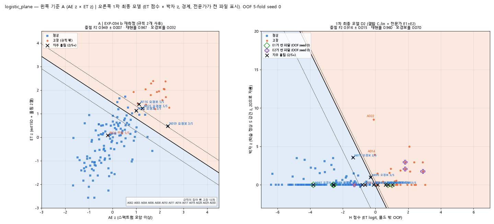
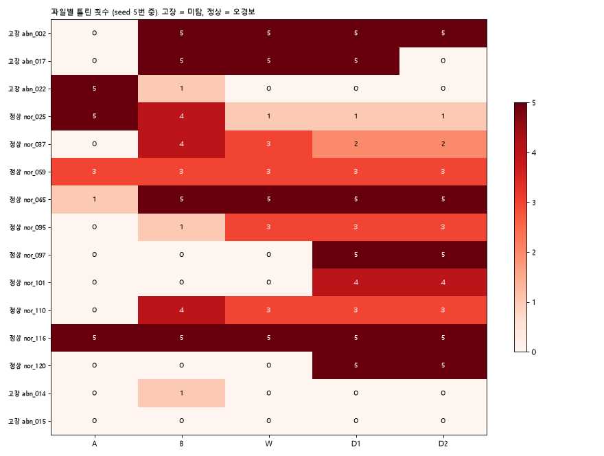
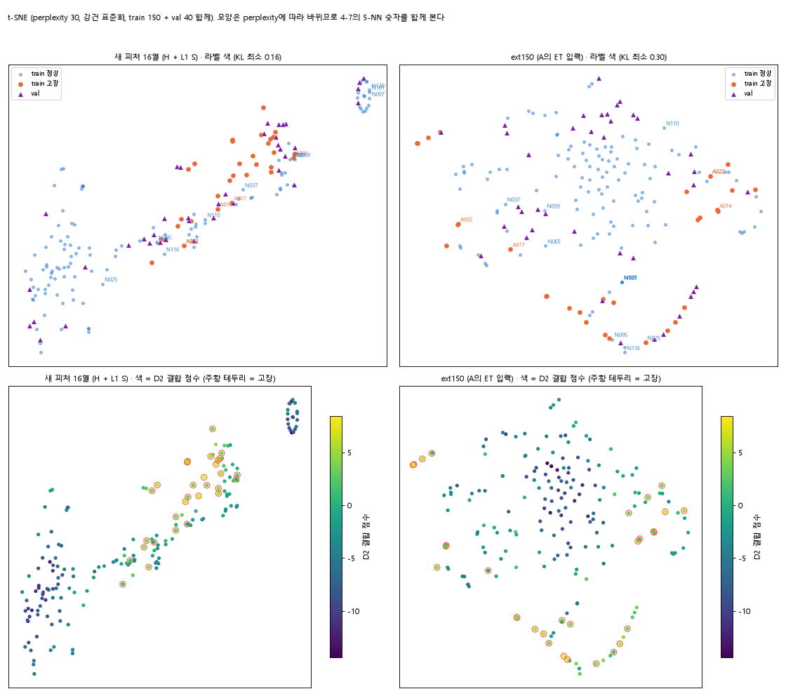
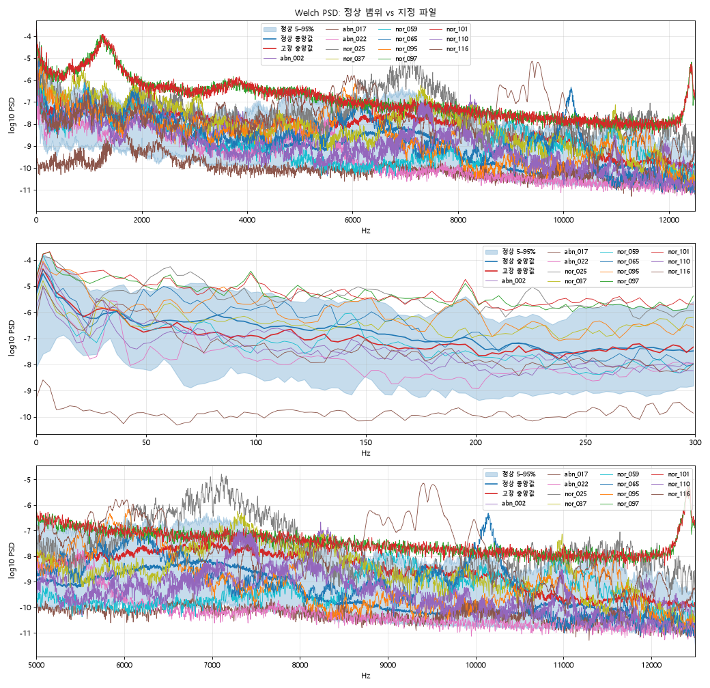

# EXP-042 2차 설계 3단계 — 2단계 승자 + 정상 기준 전문가 E1 · E2 (OR)

**1차 최종 모델 = D2 = ET(H 15열, 폴드 안 H16–H17) OOF logit + 박자 z → 로지스틱(C-lin) OR E1 OR E2** — 중첩 F2 0.916 ± 0.015 · 재현율 0.960 · 오경보율 0.070 (A(b) 0.949 ± 0.007보다 −0.033). 제출 파일 아님.

노션 카드 (실험 DB에 그대로 옮긴다)

| 팀원 | 모델 | F2 점수 | 변경 사항 | 메모 |
|---|---|---|---|---|
| 이동훈 | 2단계 승자(C-lin) OR E1(솟은 봉우리 H16) OR E2(하중 대비 덜컥 H18 & 충격 ≥ 1) | 0.916 ± 0.015 | 전문가 문턱 = 학습 폴드 정상 99 % 분위(고정, 라벨로 안 고름). D1 = W + E1, D2 = D1 + E2 (H2, H3, H1) |  |

- 가설: H2, H3, H1 ([물리가설](../../../1_기준·기록/물리가설.md))
- 실행: 2026-11-21 · git `bfc87b8+수정중` · 코드 [run.py](자료/run.py)
- 평가: 중첩 CV (바깥 5 × 안쪽 4, seed 5개). 자주 놓침 = seed 5번 중 3번 이상

## 결과

| 구성 | F2 | 재현율 | 오경보율 | 정밀도 | F2 (고장 10%·40%) | 자주 놓침 | 오경보 3회+ |
|---|---|---|---|---|---|---|---|
| 중첩: A \| EXP-034 b (EXP-040 값) | 0.949 ± 0.007 | 0.967 | 0.032 | 0.885 | 0.920 · 0.964 | 022 | 3 |
| 중첩: B \| ET 하나 (EXP-040 값) | 0.890 ± 0.024 | 0.913 | 0.055 | 0.808 | 0.844 · 0.914 | 002 017 | 6 |
| 중첩: W \| 2단계 승자 C-lin (EXP-041 값) | 0.907 ± 0.009 | 0.927 | 0.045 | 0.839 | 0.869 · 0.928 | 002 017 | 6 |
| 중첩: D1 \| W + E1 (솟은 봉우리) | 0.890 ± 0.015 | 0.927 | 0.070 | 0.769 | 0.834 · 0.921 | 002 017 | 8 |
| 중첩: D2 \| D1 + E2 (하중 대비 덜컥) | 0.916 ± 0.015 | 0.960 | 0.070 | 0.776 | 0.859 · 0.948 | 002 | 8 |

## 해석

선택 규칙이 고른 것은 D2(W OR E1 OR E2): 중첩 F2 0.916 ± 0.015로 2단계 승자 W(C-lin 0.907 ± 0.009)보다 +0.009(W sd 0.0088 — 반올림 전 값 비교에서 간신히 넘음, 사실상 동률)이고 D1(W + E1)은 −0.017로 오히려 나쁘다. 이득은 전부 E2(017형 4개를 5/5 잡고 정상은 0)에서 오고, E1은 겨냥한 002를 못 잡으면서 정상 097 · 101 · 116 · 120을 4–5/5 켠다(C2 · C3 실패). A(EXP-034 b 0.949 ± 0.007)에는 −0.033으로 아직 못 미친다. **판단 필요**: 선택 규칙(실행 전 고정)은 D2지만 E1을 뺀 "W + E2"가 더 합리적일 수 있다 — 구성을 결과 보고 바꾸지 않는다는 지시라 돌리지 않았다.

<!-- key-figs: 자동 (save_fig key=True) -->

*logistic_plane* — A와 1차 최종 모델의 평면. 전문가 E1(초록 마름모)·E2(보라 +)가 켠 파일과 자주 틀린 파일(×)

<!-- /key-figs -->

### 읽는 법과 상세 (손으로 씀)
**전문가별 C1–C4** (중첩 CV와 같은 분할 seed 5 × 바깥 5겹에서 학습 폴드 정상 99% 문턱을 테스트 폴드에 적용. C3 = 문턱 거리(분위수 − 정상 중앙값)를 ×0.8 / ×1.2로 바꿈)
| | E1 솟은 봉우리 (H16 > 정상 99%, 겨냥 002형) | E2 하중 대비 덜컥 (H18 > 정상 99% & 충격 ≥ 1, 겨냥 017형) |
|---|---|---|
| 켜진 고장 (5회 중) | 016 (2/5) — 002는 0 | 004 011 017 019 (모두 5/5) |
| 켜진 정상 (5회 중) | 097 (5) · 101 (4) · 116 (4) · 120 (5) | 없음 |
| C2 겨냥 학습 고장 ≥ 3개 (≥ 3/5 켜짐) | 0개 → **미달** (겨냥한 002는 안 켜짐) | 4개 → 충족 |
| C3 문턱 ×0.8 / ×1.0 / ×1.2에서 켜진 정상 (합집합) | 5 / 4 / 0 (시드당 평균 5.0 / 3.6 / 0.0) → 문턱 20% 안에서 크게 바뀜 | 2 / 0 / 0 (시드당 평균 0.4 / 0 / 0) |
| C4 오류 방향 | 올리는 규칙이 틀려 오경보만 생김 (정상 097 · 101 · 120은 평균 −1 g 파일) | 틀리면 오경보인데 이번엔 0 |

E1의 정상 097 · 101 · 120은 물리가설.md의 "평균 −1 g 파일 4개(nor_097 · 101 · 120, abn_016)"와 같은 파일이다 → 센서 방향 이상 파일에서 가장 솟은 봉우리 높이가 구조적으로 높다(고장 016도 켜짐). 정상 기준으로 쓰기엔 이 파일들이 정상 분포를 두 무리로 만든다. E1은 002를 겨냥했지만 002는 H16 정상 범위 안이다.

**결과.** D1 0.890 ± 0.015 (재현율 0.927 · 오경보율 0.070 · 10%/40% 환산 0.834/0.921 · 미탐 002 5/5, 017 5/5, 009 1/5), D2 0.916 ± 0.015 (재현율 0.960 · 오경보율 0.070 · 0.859/0.948 · 미탐 002 5/5, 009 1/5). 새 오경보: 097 5/5 · 101 4/5 · 120 5/5가 E1 때문에 추가, 065 · 116 5/5, 095 · 110 3/5는 승자와 같다. A(b)와 B 대비: D2 − A = −0.033 (A sd 0.007), D2 − B = +0.026 (B sd 0.024).

**오류 분석** (승자 W 기준 피처 백분위, 표의 E1 · E2 켜짐 = 위 분할의 5회 중 횟수. 백분위·95% 초과 목록은 EXP-041 README와 같은 값):

| 파일 | 구분 | ET logit | 박자 z | E1 켜짐 | E2 켜짐 | 정상 95% 위 피처 | 5% 아래 피처 | ET 중요도 상위와 겹침 |
|---|---|---|---|---|---|---|---|---|
| nor_065 | 정상 | 0.63 | 0.00 | 0/5 | 0/5 | H10 H15 H16 | — | H16 H15 |
| nor_037 | 정상 | -0.12 | 0.00 | 0/5 | 0/5 | — | — | — |
| nor_110 | 정상 | 0.13 | 0.00 | 0/5 | 0/5 | — | — | — |
| nor_095 | 정상 | -0.30 | 1.00 | 0/5 | 0/5 | — | — | — |
| nor_116 | 정상 | 0.76 | 0.00 | 4/5 | 0/5 | H10 H15 H16 | H12 H13 | H16 H15 |
| nor_059 | 정상 | 1.04 | 0.00 | 0/5 | 0/5 | H10 | H14 | — |
| abn_002 | 고장 | -0.65 | 0.00 | 0/5 | 0/5 | H10 | — | — |
| abn_017 | 고장 | -1.29 | 0.00 | 0/5 | 5/5 | H3 H18 | H16 | H3 H16 |

ET 중요도 상위 6: H9, H3, H16, H8, H15, H1

**1차 최종 모델 val 채점 (제출 파일 없음).** train 150 전체로 학습한 D2 → val 40: **10개** 판정 (004 013 016 017 024 025 027 031 035 039). 전부 결합 블록(W = ET + 박자 로지스틱)이 켠 것이고 E1 · E2는 val에서 켜진 파일이 없다(val H18은 정상 99% 문턱 아래, H16도 아래; val 박자 z 상위 031 1.56 · 027 1.21 · 022 0.65 · 039 0.39). A(EXP-034 b 내림 전 판정 11개: 001 004 013 016 017 018 024 027 031 035 039)와 9개 겹침, 최종에만 025, A에만 001 · 018. 파일별 표 [val_판정.csv](자료/val_판정.csv). 판정 문턱: 전문가가 붙은 구성이라 이진 점수 0.5 (결합 문턱은 fit 안에서 안쪽 OOF F2 최대).

**구현 메모.** `src/models2.py` `Two(comb, experts)`: E1 · E2 문턱은 fit 행 정상의 99% 분위(H16은 fit 행 정상으로 ref 재계산), W의 결합 문턱은 fit 행의 안쪽 OOF 점수에서 F2 최대(`tc_`), 점수는 이진(OR). 선택 규칙은 반올림 전 중첩 F2로 판정.

## 그림

### hard_files
어느 파일이 A · B · W · D1 · D2에서 맞고 틀리는가

### tsne
새 피처 공간과 ext150 공간에서 고장이 따로 모이는가 · 색 = 1차 최종 모델의 결합 점수

### psd_missed
자주 틀린 파일의 PSD가 정상 5–95% 범위 밖으로 나가는 주파수

