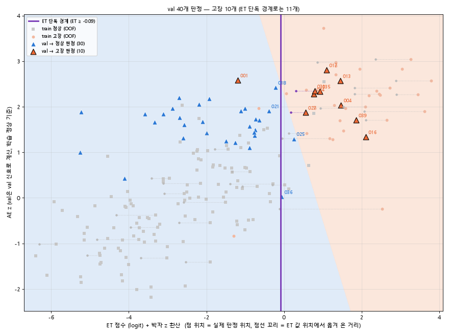
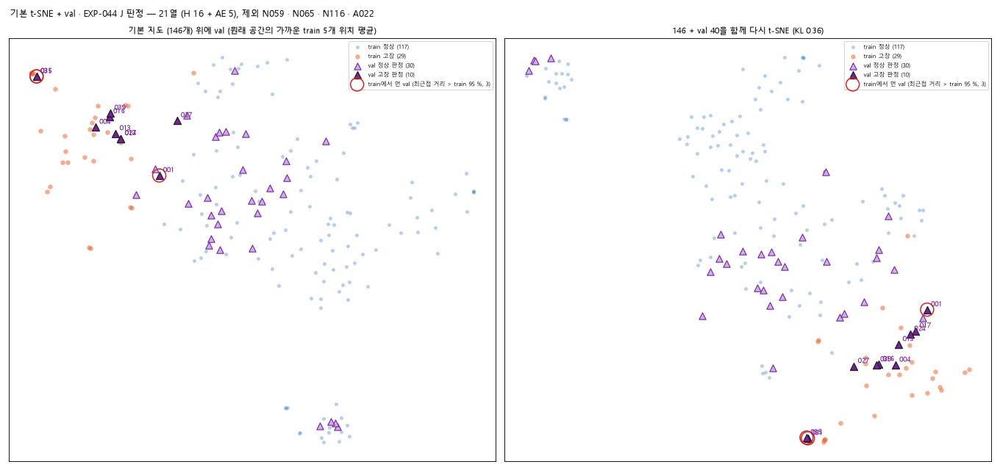

# EXP-044 val 결과 (README2)

모델 = J (ET + 박자 z + AE z → 로지스틱 OR E2 OR 8.3k), train 150 전체로 학습. val 라벨은 없어 맞고 틀림은 채점하지 않는다. 제출 파일 아님.

## 결과

**val 40개 중 10개를 고장으로 판정 (25 %).** train 고장 비율은 20 %.

| 파일 | 001 | 004 | 013 | 016 | 017 | 024 | 027 | 031 | 035 | 039 |
|---|---|---|---|---|---|---|---|---|---|---|
| 켠 부품 | 8.3k | 결합 | 결합 | 결합 | 결합 | 결합 | 결합 | 결합 | 결합 | 결합 |

- 전체 40개 표: [val_판정.md](val_판정.md)
- 8.3k 규칙으로 잡은 것은 001 하나, 나머지 9개는 결합 점수. E2만 켠 파일은 없다.

*배경 = 결합 판단(파랑 정상 · 주황 고장), 보라 세로선 = ET 단독 경계, ▲ = val, 회색 · 연주황 = train OOF.*

## 경계 근처 (정상 판정이지만 가까운 파일)

| 파일 | ET | AE z | ET 단독 | 결과 |
|---|---|---|---|---|
| 025 | 0.25 | 1.30 | 고장 | 정상 (AE가 낮아 결합이 막음) |
| 036 | -0.06 | 0.02 | 고장 | 정상 (AE가 매우 낮음) |
| 018 | -0.22 | 2.42 | 정상 | 정상 (ET가 +0.2만 올라도 고장) |
| 021 | -0.39 | 1.91 | 정상 | 정상 |

ET 단독 경계로는 11개가 고장이다. 결합이 025 · 036을 정상으로 돌리고, 8.3k 규칙이 001을 더해 10개가 된다.

## t-SNE에 val 얹기 (값 이상 확인)

**기본 t-SNE(4-10 방식, 11-22 다시 그림)**: H 16열 + AE 5열 = 21열, `map_scale` 눈금. 지도는 146개(059 · 065 · 116 · 022 제외, 002 · 029 포함)이고, 그 위에 val 40개를 보라 ▲로 찍었다.
- 왼쪽 = 기본 지도 위에 val을 원래 공간(t-SNE 전)의 가까운 train 5개 위치 평균으로 올림
- 오른쪽 = 146 + val 40을 함께 다시 t-SNE
- 코드는 run.py 마지막 칸(`src.exp2util.tsne_val_default`). 파일별 수치는 [val_판정.md](val_판정.md)의 이웃고장(5) · 최근접거리_백분위 · 최대z 열이다.
- 예전 그림(16열, 예전 눈금, 144개)은 이 그림으로 바뀌었다.

**결론: 판정과 지도가 맞는다.** val이 새 덩어리를 만들지 않고, 고장 판정은 train 고장 무리로, 정상 판정은 정상 무리로 간다.

- **고장 판정 10개**: 가까운 train 5개 중 고장이 평균 4.2개다. 정상 판정 30개는 0.23개다. 왼쪽 그림에서 고장 판정은 대부분 왼쪽 위 고장 무리에 있다.
- **train에서 먼 val (최근접 거리 > train 95 %)**: 031 · 035 · 001.
  - 031 · 035: 둘 다 고장 판정이고 백분위 100이다. **H17_peak_w(봉우리 폭) z가 21**로, 새 눈금에서도 그대로 극단값이다. 두 파일은 지도에서 서로 겹친다.
  - 001: 8.3k 규칙으로 고장 판정. 백분위 97, H8_ring_2-4k z 5.0. 이웃 고장 2개.
- **정상 판정인데 이웃에 고장이 많은 val**: 021(5개 중 3개), 018 · 036(2개). 경계 목록의 파일들과 같다.
- 위쪽 작은 무리(충격 0개 정상)에도 val 3개가 들어간다.

해석: val은 측정 조건이 약간 다르지만(H3 · H17 · H9) 큰 이상 덩어리는 없다. 031 · 035는 H17 한 열이 극단값이라, 이 열이 맞게 계산됐는지 확인할 가치가 있다.

## 주의

- **val은 AE z가 전체적으로 높다.** 중앙 1.75, 95 %가 1.0 이상(train 정상 중앙 0). AE 계수 0.553 때문에 결합 점수가 약 +0.9 올라간다. 처리 방침(그대로 / 눈금 다시 맞춤)은 팀 회의에서 정한다.
- ET 점수도 val에서 +2.7 이동했다(충격이 2–4 kHz로 더 울림). AE를 −1.75까지 내려도 판정은 10 → 9개(027만 바뀜)라서 판정은 AE 보정에 둔감하다.
- 8.3k 문턱은 train으로 사후에 정한 값이다.

## 비교: EXP-039 (규칙 없는 AE + ET(D+))

EXP-039 모델은 val 16개를 고장으로 판정한다. 044가 판정한 10개는 모두 포함하고, 추가로 009 · 012 · 018 · 021 · 022 · 034 여섯 개를 더 잡는다. 이 여섯 개가 오경보인지는 val 라벨이 없어 알 수 없다.

브라우저: EDA 뷰어 → 모델 → 경계 화면에서 모델을 고르면 val이 보라색 ▲로 겹쳐 보인다([EDA뷰어](../../../../2_EDA/EDA뷰어/README.md)).
